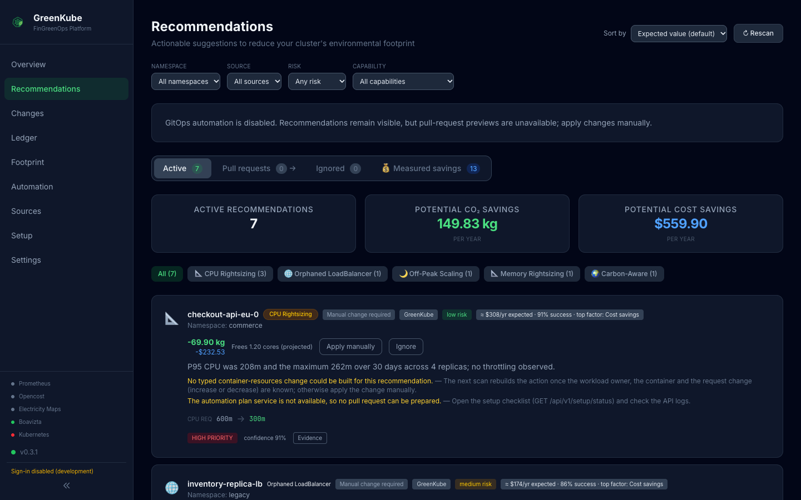
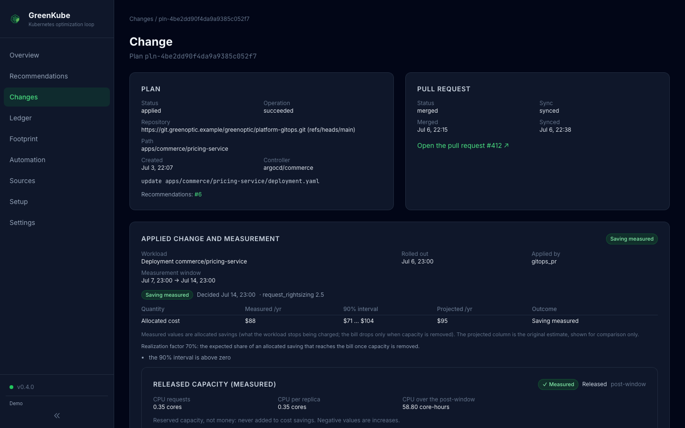

# GreenKube

**Rightsizing you can review. Savings you can measure.**

[](https://opensource.org/licenses/Apache-2.0) [](https://hub.docker.com/r/greenkube/greenkube) [](CHANGELOG.md)

Most pods request far more CPU and memory than they use. Resizing them by hand is tedious, GitOps reverts anything changed outside Git, and almost no tool tells you what a change really saved once it shipped.

GreenKube sizes container requests from your cluster's own measurements, delivers each change as a reviewed pull request in your GitOps repository, then measures the merged change against its projection: in money, in CO₂e, and in CPU and memory released.

> **Live demo:** [demo.greenkube.cloud](https://demo.greenkube.cloud), the full dashboard with sample data, no install.

## How it works

1. **Measure.** GreenKube collects CPU and memory usage from Prometheus and prices it with OpenCost, a bundled cloud price catalog or your own rates, with its energy and CO₂e.
2. **Recommend.** It sizes CPU and memory requests from that history, raises memory after an out-of-memory kill, and flags orphaned LoadBalancers and PersistentVolumes. Each recommendation gets evidence, a projected impact, a risk level, a confidence score and a ranking. When present, [VPA](docs/sources/vpa.md) (including [Goldilocks](docs/sources/goldilocks.md)) and [Robusta KRR](docs/sources/krr.md) reports sent through the [push API](docs/sources/push.md) only raise or lower the confidence: GreenKube's measured value always decides the size.
3. **Deliver.** GreenKube finds the workload's source in Git through Argo CD or Flux (plain YAML, Kustomize, Helm), shows the exact diff, and opens a pull request on GitHub, GitLab or Gitea once you approve the plan.
4. **Prove.** It follows the merge through the sync and the rollout, then measures the change against a counterfactual baseline, with confounders and health gates, and records the outcome in an append-only, hash-chained ledger.

### Released capacity: savings for clusters that do not shrink

On an on-premises cluster or a fixed node pool without an autoscaler, a smaller request does not lower the bill until nodes are removed. GreenKube says so, and reports what you do get: **released capacity**, the CPU cores and memory GiB a change frees. It is projected on each request change and in its pull request, measured from the workload specs after the rollout (verdict `released`, `partially released` or `not released`), and never converted to money or added to cost savings.

## Screenshots

| Overview: measured, pending and projected savings | Recommendations, ranked, with the capacity they free |
|---|---|
|  |  |

| Changes: plan, pull request, sync, rollout, outcome | A measured change: cost interval and released capacity |
|---|---|
|  |  |

## Quick start

**1. Try the demo (one minute, no cluster).** Sample data, the full UI, nothing to configure:

```bash
docker run --rm -p 9000:9000 greenkube/greenkube demo --no-browser --port 9000   # open http://localhost:9000
```

**2. Install in your cluster.** One Helm release, no profile, no feature flag. Prometheus and OpenCost are discovered when present:

```bash
helm repo add greenkube https://GreenKubeCloud.github.io/GreenKube && helm repo update
helm install greenkube greenkube/greenkube --namespace greenkube --create-namespace

kubectl -n greenkube get secret greenkube-initial-admin -o jsonpath='{.data.password}' | base64 -d; echo
kubectl -n greenkube port-forward svc/greenkube-api 8000:8000   # sign in as admin at http://localhost:8000
```

**3. Let it open pull requests (optional).** One Secret; delivery activates within a minute, no upgrade, no restart:

```bash
kubectl -n greenkube create secret generic greenkube-git-credentials \
  --from-literal=token=<git token> --from-literal=host=github.com
```

The **Setup** page lists what is active and the fix for anything missing. Recommendations need evidence first: most appear after about 3 hours of samples, request decreases after 7 days. To see the whole loop in about 20 minutes on Minikube, with a sample app, Argo CD, Flux and Gitea, follow [Your first pull request](docs/get-started/first-pr.md) (`make e2e`, accelerated values in [`docs/examples/quickstart/values.yaml`](docs/examples/quickstart/values.yaml)).

## Principles

- **Git is the only write path.** No admission webhook, no in-place mutation, no drift for Argo CD or Flux to revert. No pull request is opened without your approval of a plan digest.
- **Projected is never shown as realized.** Projected, measured and billed savings are labeled and never added together; released capacity is never turned into money.
- **On-premises and in the cloud.** Bundled price catalogs for AWS, Azure, OVHcloud and Scaleway, OpenCost or your own rates anywhere, and released capacity where the bill does not move.
- **Fail closed, explain why.** When a change cannot be automated or measured safely, GreenKube stops and tells you what is missing and how to fix it.
- **Light.** One Helm release (API, controller, renderer, PostgreSQL); an optimization tool should not cost much to run.

## Learn more

- [Concepts](docs/concepts.md): the loop and its vocabulary.
- [Installation](docs/installation.md) and [Upgrading](docs/upgrading.md): external PostgreSQL, Ingress/TLS, high availability, upgrades from 0.3.x.
- [GitOps automation](docs/automation.md), [Recommendation lifecycle](docs/recommendation.md), [Recommendation sources](docs/sources.md).
- [Impact model](docs/methodology/impact-model.md) and [Savings measurement](docs/methodology/savings-measurement.md): how cost, CO₂e and released capacity are projected and measured.
- [Configuration](docs/configuration.md), [API](docs/api.md), [CLI](docs/cli.md), [Architecture](docs/architecture.md), [Prometheus & Grafana](docs/prometheus-grafana.md) (operations dashboard and alerts).
- [Roadmap](docs/roadmap.md) and [Changelog](CHANGELOG.md): new features land in the *Unreleased* section before each release.

## Contributing

Contributions are welcome, especially support for more GitOps layouts and Git providers. See [CONTRIBUTING.md](CONTRIBUTING.md).

```bash
git clone https://github.com/GreenKubeCloud/GreenKube.git && cd GreenKube
uv sync && uv run pytest
```

## License

[Apache 2.0](LICENSE).
