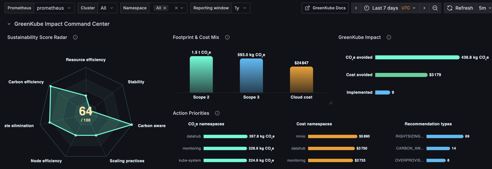
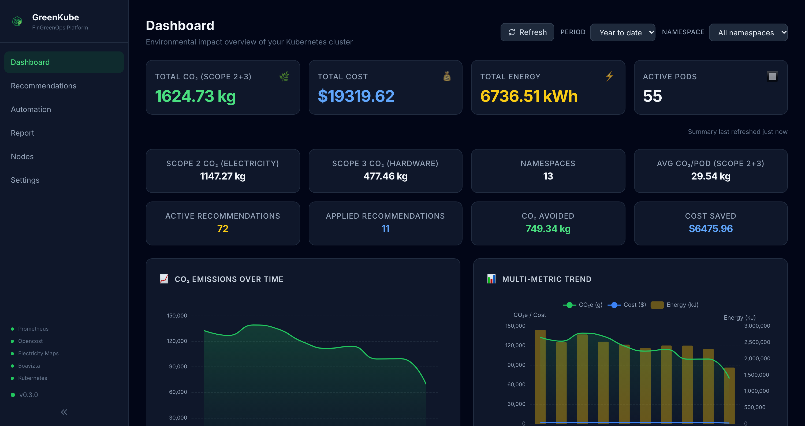
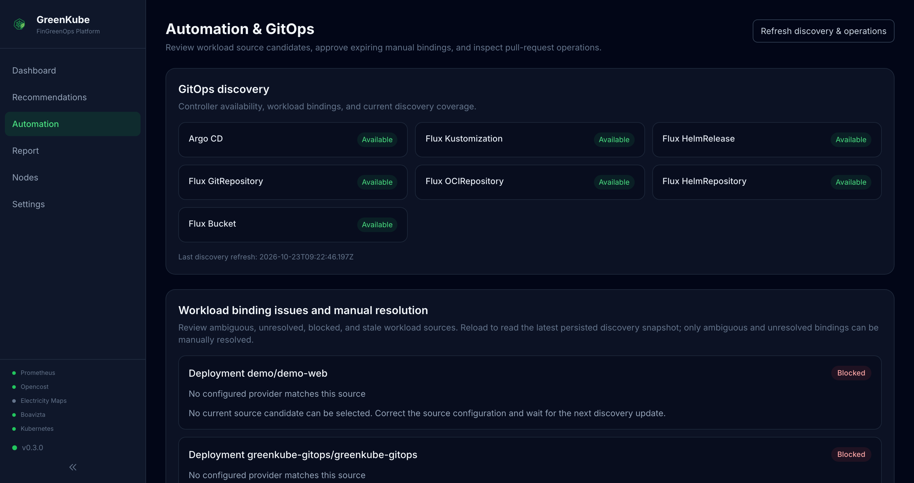
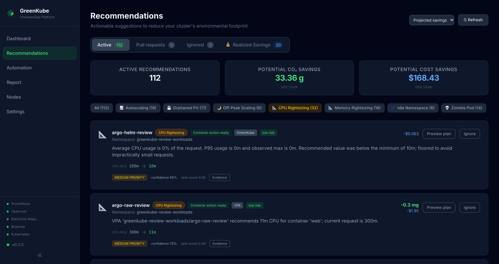
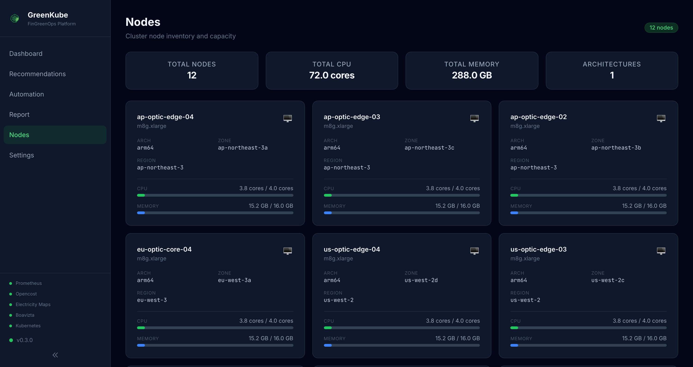
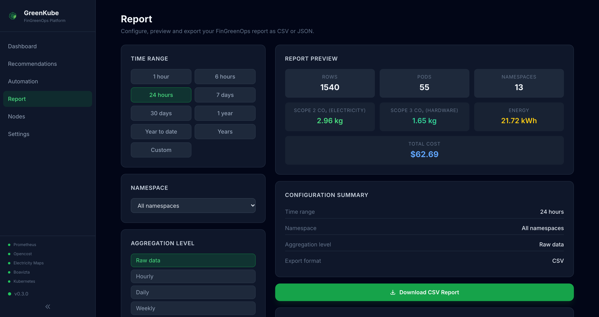
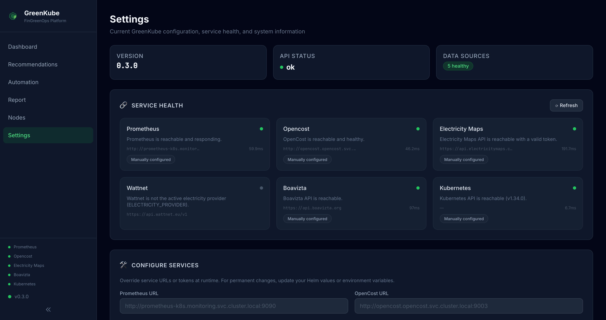

# GreenKube

**Measure, understand, and reduce the carbon footprint of your Kubernetes infrastructure.**

GreenKube is an open-source FinGreenOps platform for Kubernetes. It gives DevOps, SRE, and FinOps teams workload-level carbon visibility and cost control — without complex setup or expensive SaaS tooling.

[](https://opensource.org/licenses/Apache-2.0) [](https://hub.docker.com/r/greenkube/greenkube) [](CHANGELOG.md)

>**Live demo:** [demo.greenkube.cloud](https://demo.greenkube.cloud) — explore the full dashboard with realistic sample data, no install required.

---

## What it does

- **Estimates** the energy consumption and CO₂e emissions of each Kubernetes workload, using CPU metrics from Prometheus and cloud instance power profiles.
- **Visualises** those metrics in a web dashboard with per-pod data, node inventory, namespace breakdowns, and historical reports.
- **Recommends** concrete optimizations to reduce cloud spend and carbon footprint — rightsizing, zombie pod cleanup, autoscaling candidates, orphaned PVs/LoadBalancers, and more.
- **Verifies** recommendations after they land with post-apply health and savings checks, measured against the projected impact.
- **Automates** eligible rightsizing changes through GitOps: GreenKube discovers Argo CD/Flux sources, renders and validates raw, Kustomize, or supported Helm changes, opens one atomic pull request, and tracks the merge through controller sync and apply detection.
- **Integrates** with Prometheus and Grafana to expose GreenKube metrics alongside the rest of your cluster observability stack.

---

## Screenshots

| Grafana dashboard |
|------------------|
|  |

### Frontend screenshots

| Dashboard | Automation & GitOps |
|----------|---------------------|
|  |  |

| Recommendations | Nodes |
|----------|-------|
|  |  |

| Report | Settings |
|----------|----------|
|  |  |

---

## Documentation

| Document | Description |
|----------|-------------|
| [Installation guide](docs/installation.md) | Step-by-step Helm installation, values, development vs production, API keys, and frontend access |
| [Architecture](docs/architecture.md) | Technical architecture, data flow, and component breakdown |
| [Power estimation methodology](docs/power_estimation_methodology.md) | How energy and CO₂e are calculated |
| [Configuration](docs/configuration.md) | All Helm values and environment variables |
| [API Reference](docs/api.md) | REST API endpoints, parameters, and examples |
| [CLI Reference](docs/cli.md) | `greenkube start`, `demo`, and other CLI commands |
| [Recommendation lifecycle](docs/recommendation.md) | How recommendations are generated, persisted, actioned, and measured |
| [GitOps automation](docs/automation.md) | Git discovery, plan lifecycle, pull requests, rollback, and security model |
| [Local Minikube deployments](docs/local-deployment.md) | Development and production-like local deployments |
| [Prometheus & Grafana](docs/prometheus-grafana.md) | ServiceMonitor setup and Grafana dashboard import |
| [Observability and SLOs](docs/observability-slos.md) | Control-loop metrics, objectives, and alert examples |
| [Sustainability score](docs/sustainability-score.md) | How the 0–100 composite score is computed |
| [Changelog](CHANGELOG.md) | Version history |

---

Published dashboard on Grafana.com: https://grafana.com/grafana/dashboards/25377-greenkube-fingreenops-dashboard/

## Installation

The recommended deployment method is the official Helm chart. See the [Installation guide](docs/installation.md) for the full walkthrough, including production secrets, external databases, GitOps automation, and ingress setup.

```bash
helm repo add greenkube https://GreenKubeCloud.github.io/GreenKube
helm repo update
helm install greenkube greenkube/greenkube \
  -n greenkube \
  --create-namespace
```

The chart defaults to the `standalone` profile, production authentication, a generated API key, and disabled GitOps automation. Retrieve the key from the release Secret:

```bash
kubectl -n greenkube get secret greenkube \
  -o jsonpath='{.data.GREENKUBE_API_KEY}' | base64 -d
```

Once deployed, access the dashboard and API from the same origin:

```bash
kubectl -n greenkube port-forward svc/greenkube-api 8000:8000
# Open http://localhost:8000 and paste the API key when prompted
```

The browser keeps the key in memory only and asks for it again after a reload.

### Deployment profiles

| Profile | Components | Recommended for |
|---------|------------|-----------------|
| `standalone` | Collector and API in one Deployment; inline automation when enabled | Evaluations, small clusters, local installations |
| `production` | Separate API, controller, and optional automation worker Deployments; migration Job; leader election | Production clusters and horizontally scaled API deployments |

For production, create the API key and database credentials in a Kubernetes Secret and reference it with `secrets.existingSecret` instead of storing them in a values file. Start from [`helm-chart/values-production.yaml`](helm-chart/values-production.yaml). See [Production mode](docs/installation.md#production-mode).

### Key configuration variables

Create a `my-values.yaml` to customise your deployment:

```yaml
config:
  clusterName: prod-eu-west
  cloudProvider: aws
  defaultZone: FR          # Fallback Electricity Maps zone
  prometheus:
    url: ""                # Leave empty for automatic in-cluster discovery
    queryRangeStep: 5m
  opencost:
    url: ""

secrets:
  # Electricity Maps API token for real-time grid carbon intensity.
  # Free token: https://www.electricitymaps.com/
  electricityMapsToken: ""
```

Apply it:

```bash
helm upgrade --install greenkube greenkube/greenkube \
  -n greenkube \
  -f my-values.yaml
```

For the full list of variables, see the [Configuration reference](docs/configuration.md).

### Dependencies

GreenKube auto-discovers the following services. No manual configuration is required in most cases.

| Service | Purpose | Required? |
|---------|---------|-----------|
| Prometheus | CPU, memory, network, disk metrics, and restart counts | Strongly recommended |
| Metrics Server | Per-container CPU/memory evidence and verification | Recommended |
| OpenCost | Cost allocation data | Optional |
| Electricity Maps or Wattnet | Grid carbon intensity | Optional |
| Argo CD / Flux | GitOps automation | Optional |

### On-premises clusters

Cloud providers expose zone labels on nodes automatically. On bare-metal clusters, label your nodes manually:

```bash
kubectl label nodes --all topology.kubernetes.io/zone=FR
```

Then set `config.cloudProvider: on-prem` and `config.defaultZone: FR` in your values. See the [Configuration reference](docs/configuration.md#on-premises-and-bare-metal-clusters) for details.

### GitOps automation

Automation is opt-in and fails closed when it cannot prove a safe target. It requires a supported GitOps source, a Git provider token stored in a Kubernetes Secret, a repository allowlist, and a renderer boundary enforced by your CNI.

See [GitOps automation](docs/automation.md) for setup, provider configuration, supported source layouts, webhooks, policy gates, rollback, and limitations.

---

## Try the demo locally

```bash
docker run --rm -p 9000:9000 greenkube/greenkube demo --no-browser --port 9000
# Open http://localhost:9000
```

The demo includes a two-year sample history, with hourly workload metrics in the recent window selected by `--days` (30 days by default) and daily metric and carbon-intensity points further back. It includes estimated emissions, costs, node history, and optimization recommendations.

---

## Contributing

Contributions are welcome. See [CONTRIBUTING.md](CONTRIBUTING.md) to get started.

```bash
git clone https://github.com/GreenKubeCloud/GreenKube.git
cd GreenKube
uv sync
pytest
```

---

## Licence

Licensed under the [Apache 2.0 License](LICENSE).
