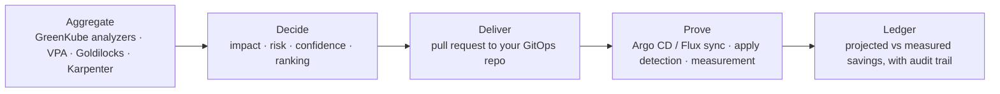
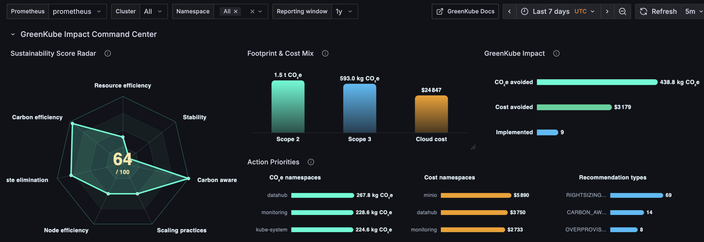
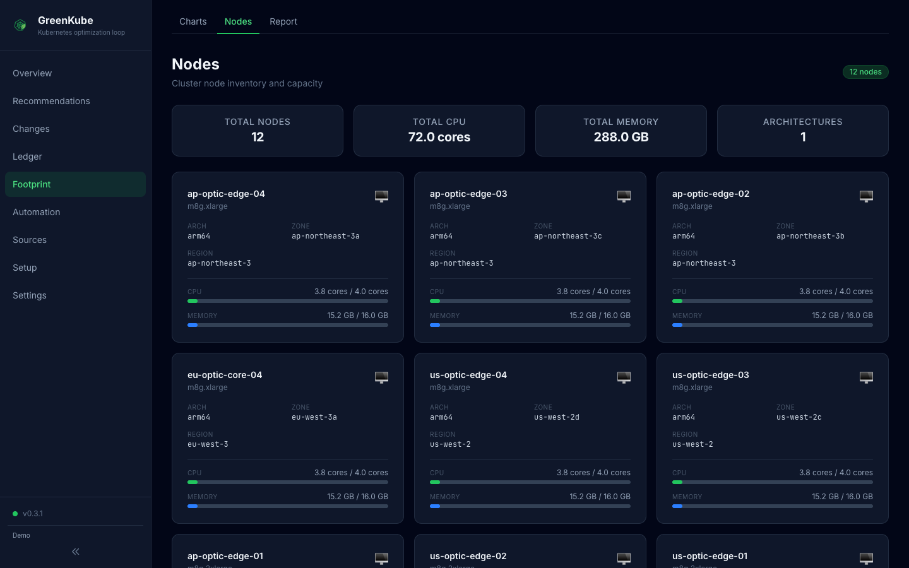
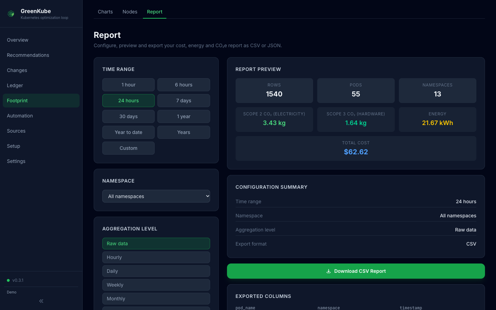

# GreenKube

**Every recommendation. One pull request. Proven savings.**

GreenKube collects Kubernetes optimization recommendations from the tools you already run, ranks them by value and risk, delivers the best ones as reviewable pull requests to your GitOps repository, and then measures what each merged change actually saved — in money and CO₂e.

[](https://opensource.org/licenses/Apache-2.0) [](https://hub.docker.com/r/greenkube/greenkube) [](CHANGELOG.md)

> **Live demo:** [demo.greenkube.cloud](https://demo.greenkube.cloud) — the full dashboard with realistic sample data, no install required.

---

## Why GreenKube

Teams running Kubernetes do not lack optimization advice. VPA, Goldilocks, KRR, Kubecost, cloud consoles and in-house scripts all produce lists. The hard part comes next:

- **Which advice should you trust?** Sources use different algorithms and observation windows, and they often disagree.
- **How do you apply it safely?** In a GitOps setup, the cluster mirrors Git. Tools that resize pods inside the cluster create drift, and Argo CD or Flux either reverts it or has to be told to ignore it.
- **What did the change actually save?** Most tools report *potential* savings. Few measure what happened after the change, and fewer tie that result to the commit that caused it.

GreenKube closes that loop. It takes the advice, opens a pull request in your GitOps repository, confirms that the merge reached the cluster, and keeps a ledger of measured outcomes.

## How it works



1. **Aggregate.** GreenKube gathers recommendations from its own analyzers and from the sources installed in your cluster. All of them are converted into one model, with the provenance of each source kept.
2. **Decide.** Each recommendation carries evidence (usage distribution, coverage, restarts), a projected cost and CO₂e impact, a risk level, a confidence score and an explainable ranking.
3. **Deliver.** GreenKube finds the Git source of a workload through Argo CD or Flux. It renders the change, shows you the exact diff, and opens a pull request only after you approve it. GreenKube never modifies workloads directly: every change goes through Git.
4. **Prove.** After the merge, GreenKube waits for Argo CD or Flux to sync. It detects that the new configuration is live, then compares the workload before and after the change, with health gates (restarts, usage headroom).
5. **Ledger.** Every recommendation's history — created, pull request, merged, synced, applied, verified or flagged for review — is recorded with its events. Measured savings and projected savings are always reported separately.

## Principles

- **Git is the only write path.** No admission webhooks, no in-place mutation, no `ignoreDifferences` drift.
- **Neutral by design.** GreenKube's own analyzers are one source among others. Each source is a plugin.
- **Projected is not measured.** Projected and measured savings are labeled and never added together.
- **Evidence travels with the change.** The pull request carries the data a reviewer needs to decide.
- **Cost and carbon, side by side.** Every recommendation has a cost dimension and a CO₂e dimension.
- **Fail closed, explain why.** When a change cannot be automated safely, GreenKube says why.

---

## What works today

| Area | Status | Details |
|---|---|---|
| Recommendation sources | ✅ Available | GreenKube analyzers (rightsizing, zombie pods, autoscaling and off-peak candidates, idle namespaces, carbon-aware scheduling, node utilization, orphaned PersistentVolumes and LoadBalancers), VPA in recommendation mode (including VPAs created by Goldilocks), and Karpenter NodePool consolidation. VPA and Karpenter are detected automatically. |
| Ranking | ✅ Available | Evidence, risk, confidence and effort on every recommendation; ranking profiles `balanced`, `cost_first`, `carbon_first`, `quick_wins` and `low_risk`. |
| GitOps pull requests | ✅ Available (opt-in) | Lowering CPU and memory requests for Deployments, StatefulSets and DaemonSets managed by Argo CD or Flux. Supported sources: plain YAML, Kustomize overlays, and Helm charts stored in the same repository. Git providers: GitHub, GitLab and Gitea. Changes are approved by digest, rendered in an isolated sandbox, and the pipeline fails closed. |
| Sync and apply tracking | ✅ Available | Argo CD and Flux revision and health checks; apply detection against per-container baselines; validated rollback pull requests. |
| Savings verification and ledger | 🧪 Beta | Health and savings checks after apply; measured and projected savings kept separate. The measurement method is being hardened. See [Recommendation lifecycle](docs/recommendation.md). |
| Cost and carbon footprint | ✅ Available | Per-workload cost (from OpenCost), energy and CO₂e estimates (Electricity Maps or Wattnet, Boavizta, PUE), node and namespace views, reports, Prometheus metrics and a Grafana dashboard. |

### On the roadmap

- **More sources:** Robusta KRR, Kubecost request sizing, Polaris findings, cloud recommenders, and a public API for pushing recommendations from any tool. Recommendations from several sources for the same workload will be merged by consensus rather than by fixed priority.
- **More kinds of change:** raising requests that are too low, limits, replica counts and HPAs, off-peak scale-down with KEDA cron triggers, deletion of orphaned resources, Helm charts pulled from remote repositories, and Karpenter NodePool settings.
- **One install, sign in once:**
  - A single production-grade installation, with no profiles to choose.
  - GitOps automation turns itself on as soon as Argo CD or Flux and Git credentials are detected.
  - A sign-in that your browser or password manager can save, so you no longer paste the API key after every reload.
- **Faster first pull request:** guided setup, GitHub App authentication, and alternatives to letting GreenKube open the pull request (download a patch file, or let your CI open it).
- **Ledger v2:** append-only entries linked to pull request, merge commit and synced revision; counterfactual baselines with confidence intervals; CSV export and export aligned with the FinOps FOCUS format.

See the full [roadmap](docs/roadmap.md) for priorities, milestones and specifications.

---

## Screenshots

| Recommendations | Automation & GitOps |
|----------|---------------------|
|  |  |

| Dashboard | Grafana |
|----------|---------|
|  |  |

| Nodes | Report |
|----------|----------|
|  |  |

---

## Quick start

### Try the demo locally

```bash
docker run --rm -p 9000:9000 greenkube/greenkube:0.3.1 demo --no-browser --port 9000
# Open http://localhost:9000
```

The demo includes a two-year sample history with recommendations, costs, emissions and node history.

### Install in your cluster

```bash
helm repo add greenkube https://GreenKubeCloud.github.io/GreenKube
helm repo update
helm install greenkube greenkube/greenkube \
  -n greenkube \
  --create-namespace
```

By default the chart uses the `standalone` profile, enables production authentication, and leaves GitOps automation disabled. You sign in as `admin`; read the initial password (you choose a new one at the first sign-in):

```bash
kubectl -n greenkube get secret greenkube-initial-admin \
  -o jsonpath='{.data.password}' | base64 -d; echo
```

Then open the dashboard:

```bash
kubectl -n greenkube port-forward svc/greenkube-api 8000:8000
# Open http://localhost:8000 and sign in as admin
```

GreenKube discovers Prometheus, OpenCost, VPA, Karpenter, Argo CD and Flux automatically. The [Installation guide](docs/installation.md) covers production secrets, external databases, ingress and on-premises clusters.

### Turn on pull requests

GitOps automation is opt-in. It needs:

- a workload managed by Argo CD or Flux;
- a Git provider token stored in a Kubernetes Secret;
- a repository allowlist;
- for Kustomize and Helm sources, a renderer boundary enforced by your CNI.

See [GitOps automation](docs/automation.md) for the step-by-step setup, supported layouts, webhooks, policy gates and rollback.

### What GreenKube uses

| Service | Used for | Required? |
|---|---|---|
| Prometheus | Usage, restarts, evidence and verification | Strongly recommended |
| Metrics Server | Per-container usage evidence | Recommended |
| OpenCost | Cost allocation, used for cost savings | Recommended |
| VPA, Goldilocks, Karpenter | Additional recommendation sources | Optional (detected automatically) |
| Argo CD or Flux | Pull request delivery and sync verification | Required for pull requests |
| Electricity Maps or Wattnet | Real-time grid carbon intensity | Optional (regional defaults otherwise) |

---

## Documentation

| Document | Description |
|----------|-------------|
| [Concepts](docs/concepts.md) | The GreenKube loop and its vocabulary: sources, recommendations, plans, sync, verification and the ledger |
| [Installation guide](docs/installation.md) | Helm installation, values, development and production profiles, API keys, frontend access |
| [Your first pull request](docs/get-started/first-pr.md) | The whole loop on a local cluster with a sample app, Argo CD, Flux and Gitea (`make e2e`) |
| [GitOps automation](docs/automation.md) | Discovery, plans, pull requests, sync, rollback and the security model |
| [Recommendation lifecycle](docs/recommendation.md) | How recommendations are generated, ranked, applied, verified and recorded |
| [Configuration](docs/configuration.md) | All Helm values and environment variables |
| [API reference](docs/api.md) | REST API endpoints, parameters and examples |
| [Architecture](docs/architecture.md) | Components, data flow and process topology |
| [Power estimation methodology](docs/power_estimation_methodology.md) | How energy and CO₂e are estimated |
| [Prometheus & Grafana](docs/prometheus-grafana.md) | ServiceMonitor setup and dashboard import |
| [Observability and SLOs](docs/observability-slos.md) | Control-loop metrics, objectives and alerts |
| [CLI reference](docs/cli.md) | `greenkube start`, `demo` and `version` |
| [Roadmap](docs/roadmap.md) | Positioning, prioritized work, milestones and implementation specifications |
| [Changelog](CHANGELOG.md) | Version history |

The Grafana dashboard is also published on [Grafana.com](https://grafana.com/grafana/dashboards/25377-greenkube-fingreenops-dashboard/).

---

## Contributing

Contributions are welcome, especially new recommendation sources and support for more GitOps layouts. See [CONTRIBUTING.md](CONTRIBUTING.md) to get started.

```bash
git clone https://github.com/GreenKubeCloud/GreenKube.git
cd GreenKube
uv sync
pytest
```

---

## License

Licensed under the [Apache 2.0 License](LICENSE).
