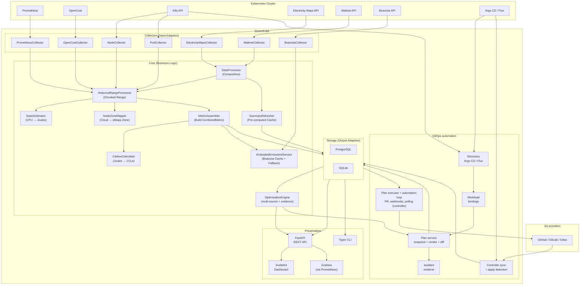
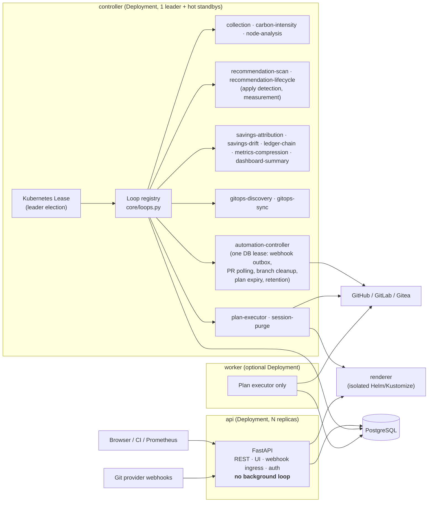

# GreenKube Architecture

This document describes the current technical architecture of GreenKube. GreenKube is an optimization loop for Kubernetes: it aggregates recommendations from several sources, ranks them, delivers them as GitOps pull requests, verifies that Argo CD or Flux synced them, and measures the cost and CO₂e savings they realize.

The architecture has four parts:

- **Measurement layer:** collectors, the processor and storage. It produces per-workload usage, cost, energy and CO₂e, which feed both the recommendation evidence and the before/after comparison used for verification.
- **Optimization engine:** sources, analyzers, consensus, evidence and ranking.
- **GitOps automation:** discovery, bindings, plans, the renderer sandbox, the worker, and sync.
- **Verification and savings ledger.**

See [Concepts](concepts.md) for the vocabulary used here.

## Architecture Diagram



## Overview

GreenKube runs scheduled collection and recommendation lifecycles in a controller process alongside a stateless API and dashboard for querying stored data (see [Process topology](#process-topology)). An optional GitOps automation path discovers workload sources, renders and validates plans, executes approved pull requests, and observes controller sync and apply state. The CLI starts the collector or a local demo; it does not provide ad-hoc report or recommendation commands.

The system is designed around the principles of **Clean Architecture** and **Hexagonal Architecture**:
- **Core Business Logic** (domain layer) is independent of infrastructure
- **Adapters** (collectors, repositories) interface with external systems
- **Use Cases** (processor, calculator, recommender) orchestrate business logic
- **Presentation Layer** (API, CLI, Dashboard) provides multiple interfaces

All I/O operations use Python's `asyncio` for high-performance, non-blocking concurrent execution.

## Process topology

GreenKube runs as a small set of processes with one rule (roadmap M8, F8): **the API handles requests, the controller runs every loop.**



| Process | Runs | Scaling |
|---|---|---|
| `api` | Stateless request handling: REST, UI, webhook ingress (writes the durable outbox), authentication, plan previews and approvals. It starts **no periodic job**: no scans, no plan expiry sweep, no worker, no session purge. | Any number of replicas. |
| `controller` | Every periodic loop, declared once in the loop registry. Leader-only loops run on the Lease holder; standbys keep their loops registered, skip their ticks, and take over within the Lease duration. | One leader plus optional hot standbys. |
| `worker` (optional) | Claims and executes queued plan operations, nothing else. | Any number of replicas: operation leases make concurrent executors safe. |
| `renderer` | Isolated Helm/Kustomize rendering. | Independent. |
| PostgreSQL | All state; SQLite remains for `greenkube demo` and local development. | — |

**Controller loops.** `greenkube start` registers these loops in `LoopRegistry` (`src/greenkube/core/loops.py`). Each loop declares a name, an interval, jitter, a leader-only flag, an optional timeout, and its backoff:

| Loop | Interval | Leader-only | Timeout |
|---|---|---|---|
| `collection` | `PROMETHEUS_QUERY_RANGE_STEP`, aligned on window boundaries + `COLLECTION_SAFETY_LAG` | yes | — (watermarked) |
| `carbon-intensity` | 1 h | yes | 30 min |
| `node-analysis` | `NODE_ANALYSIS_INTERVAL` | yes | 10 min |
| `savings-attribution` | `PROMETHEUS_QUERY_RANGE_STEP` | yes | 30 min |
| `recommendation-lifecycle` | `RECOMMENDATION_LIFECYCLE_INTERVAL` | yes | 30 min |
| `savings-drift` | 1 h (drift monitor, C8) | yes | 30 min |
| `ledger-chain` | `LEDGER_CHAIN_VERIFY_INTERVAL` (1 h; savings ledger v2 catch-up and hash-chain verification, C6) | yes | 30 min |
| `recommendation-scan` | 15 s poll (scans every `RECOMMENDATION_SCAN_INTERVAL`) | yes | — (run leases) |
| `metrics-compression`, `dashboard-summary` | 1 h | yes | 60 / 30 min |
| `gitops-discovery` | `GITOPS_DISCOVERY_INTERVAL` | yes | 10 min |
| `gitops-sync` | `GITOPS_SYNC_POLL_INTERVAL` | yes | 10 min |
| `automation-controller` | 5 s tick; steps keep their own cadence | yes | 10 min |
| `plan-executor` | 5 s, at most 10 operations per tick | yes | — (operation leases) |
| `session-purge` | daily | yes | 10 min |
| `controller-heartbeat` | 30 s | no (every replica) | 20 s |

`gitops-sync` and `automation-controller` are registered when the GitOps plan runtime is configured (`GITOPS_PROVIDERS_JSON`). The delivery part, meaning `plan-executor` plus the webhook outbox, PR polling, branch cleanup and pending-PR recovery steps, runs when `AUTOMATION_ENABLED` is true and `AUTOMATION_MODE` is not `disabled`. Plan expiry and retention run whenever the plan runtime exists, as the former API sweep did.

The registry guarantees:

- **Leader gating.** A leader-only tick runs only while the process holds the Lease. It runs inside a `LeaderFence` scope, so a job can re-check the Lease generation before it commits (A14). Loops that must react quickly to a takeover (`gitops-discovery`, `gitops-sync`, `automation-controller`, `plan-executor`) re-check the Lease every 2 s while on standby; the others keep their former cadence.
- **Isolation.** Each loop has its own task. An exception or a timeout fails only that tick. A loop task that dies unexpectedly is restarted after 5 s. After ticks that raised or timed out, a loop backs off exponentially, up to 8× its interval. Aligned loops do not back off; they retry at the next boundary. Jobs that log and swallow their own errors call `report_loop_failure()`: the tick counts as failed in the metrics and the loop status, but it does not back off, so the job keeps its cadence (a single failing Electricity Maps zone, for example, does not slow down the hourly refresh of the healthy zones). A `CancelledError` raised from inside a job while the registry is not stopping fails that tick; it does not end the loop.
- **Health.** On `CONTROLLER_METRICS_PORT` the controller serves `/healthz` (process alive), `/readyz` (every loop alive with a fresh heartbeat, otherwise `503`) and `/loops` (a per-loop JSON snapshot with state, last success, duration, consecutive failures and last error code; it requires the API key when the controller has one). Metrics are listed in [Observability and SLOs](observability-slos.md#controller-loops).
- **Persisted heartbeats.** The `controller-heartbeat` loop writes each replica's loop snapshot to `controller_heartbeats`, so `GET /api/v1/automation/status` (served by the API, which runs no loop) reports the controller loop state (`controller`).

**The automation controller loop** (`src/greenkube/automation/controller.py`) holds the database lease (the singleton `gitops_pr_polling_lease` row) for its whole tick. At most one process does automation housekeeping, even without Kubernetes leader election (standalone replicas, or old and new pods during a rollout). The tick runs these steps in order, renewing the lease and re-checking the Lease fence between steps:

1. `operations`: reconcile plans whose operation exhausted its retries (every 60 s).
2. `expiry`: mark plans past their TTL stale (every 60 s).
3. `webhooks`: reconcile the durable webhook outbox (every tick, up to 5 batches of 10).
4. `pr_polling`: poll one page of open pull requests, then branch cleanup (every `GITOPS_PR_POLL_INTERVAL`).
5. `recovery`: quarantine stale pending pull-request attempts (once per process).
6. `retention`: prune automation history older than 90 days and worker heartbeats older than 7 days (daily; a failed pass is retried on the next tick).

A failed step is logged with an error code and does not stop the following steps. A tick in which no step is due (delivery off, between two expiry passes) returns without touching the lease row. A standby controller resets `greenkube_automation_worker_up` to 0 (`plan-executor` standby hook), so only the leader reports itself as an executor.

**One topology (F11).** The chart renders `api`, `controller`, `renderer` and, with `worker.replicas`, `worker` Deployments from one template (`components.yaml`) sharing a container spec, plus the bundled PostgreSQL. The controller migrates the database at startup under a PostgreSQL advisory lock (`DB_RUN_MIGRATIONS=true` in the controller only); API replicas answer `503 migrating` on `/api/v1/health` until every shipped migration is applied, then stay ready (the answer is cached). The controller's readiness probe is `/readyz` of its loop registry. Automation is always on: the `automation-readiness` loop (`greenkube.automation.readiness`) switches delivery and PR tracking at run time (F12). The API never runs a worker. `greenkube demo` runs the API only, on demo data, with no loop.

## Architectural Principles

### 1. Database Agnosticism
The core business logic (`src/greenkube/core`) **NEVER** depends on a specific storage implementation. This is enforced through:
- **Repository Pattern:** Abstract base classes define interfaces (`CarbonIntensityRepository`, `NodeRepository`)
- **Factory Pattern:** `src/greenkube/core/factory.py` instantiates the appropriate repository based on configuration
- **Dependency Injection:** Repositories are injected into use cases (Processor, Calculator)

Supported backends:
- **PostgreSQL** (production): Full SQL features, transactional integrity, robust migrations
- **SQLite** (development): Lightweight, file-based, perfect for local testing

### 2. Cloud Provider Agnosticism
Cloud-specific details (AWS, GCP, Azure, OVH, Scaleway) are isolated in:
- **Mapping files:** `src/greenkube/data/region_mapping.py` (cloud region → carbon zone)
- **Instance profiles:** `src/greenkube/data/instance_profiles.py` (instance type → power characteristics)
- **Adapters:** Cloud-specific logic stays in collectors, never leaks into core

### 3. Asynchronous & Non-Blocking
- **All I/O is async:** Network requests, database queries, file operations
- **Concurrent execution:** `asyncio.gather` for parallel data collection
- **Connection pooling:** Reusable HTTP clients and DB connection pools
- **Backpressure handling:** Controlled concurrency limits to prevent resource exhaustion

## Core Components

### Collectors (Input Ports)
All collectors are fully asynchronous and implement a common pattern.

#### **PrometheusCollector**
- **Purpose:** Fetch resource usage metrics from Prometheus
- **Metrics collected:**
  - CPU usage (cores) per pod/container
  - Memory usage (bytes) per pod
  - Network I/O (bytes received/transmitted) per pod
  - Disk I/O (bytes read/written) per pod
  - Pod restart counts
  - Node instance type labels
- **Features:**
  - Auto-discovery of Prometheus endpoints (multiple URL candidates)
  - Every PromQL expression comes from `PromQLCatalog` (`collectors/promql.py`); container-scoped series exclude the pod cgroup (`container=""`) and pause (`container="POD"`) series
  - CPU and memory usage are aggregated with `max` per container, so duplicate series of one container (kubelet `/metrics/resource` next to `/metrics/cadvisor`, two scrape jobs, two cgroup paths) are counted once
  - Container and pod cgroup series are read in one query; a pod without container series uses its pod cgroup (counted once, CPU and memory), per pod (COL-09); that usage stays pod-level and is never attributed to a container. Collected steps of a cluster without any container series are recorded with the reason `pod_level_usage_only`
  - Kubernetes Metrics API container samples that fill the latest step of a pod measured only at pod level are stored with `usage_source = metrics_server` and the reason `metrics_api_point_sample` (COL-05), and scaled down to the pod cgroup value when they add up to more than it (cri-dockerd counts page cache in a container's working set); the rows are flagged `container_usage_exceeds_pod`
  - Range queries raise `PrometheusQueryError` when Prometheus is unreachable, so an outage is never stored as an empty window
  - TLS/authentication support (basic auth, bearer token)
  - Concurrent query execution (8 queries via `asyncio.gather`)
  - Robust error handling with detailed logging
- **Implementation:** Uses `httpx.AsyncClient` for non-blocking HTTP requests
- **Emits:** `PrometheusMetric` (aggregated result with all metric lists)

#### **NodeCollector**
- **Purpose:** Gather node metadata from Kubernetes API
- **Data collected:**
  - Node capacity (CPU cores, memory bytes)
  - Cloud provider and instance type (from labels)
  - Availability zone
  - Architecture (amd64, arm64)
  - Operating system
- **Implementation:** Uses `kubernetes_asyncio` client for async K8s API calls
- **Emits:** `Dict[str, NodeInfo]` (node name → metadata)

#### **PodCollector**
- **Purpose:** Collect pod resource requests from Kubernetes
- **Data collected:**
  - CPU requests (millicores)
  - Memory requests (bytes)
  - Ephemeral storage requests (bytes)
  - Owner references (Deployment, StatefulSet, etc.)
- **Implementation:** Async K8s API with label-based filtering
- **Emits:** `List[PodMetric]`

#### **OpenCostCollector** (optional)
- **Purpose:** Fetch cost allocation data
- **Features:** Auto-discovery, multiple endpoint probing
- **Implementation:** Async HTTP with JSON parsing
- **Emits:** `List[CostMetric]`

#### **ElectricityMapsCollector**
- **Purpose:** Retrieve real-time carbon intensity data (default provider)
- **API:** Electricity Maps v3 API
- **Caching:** Stores results in repository for future queries
- **Implementation:** Async HTTP with error handling (graceful degradation to default intensity)

#### **WattnetCollector**
- **Purpose:** Retrieve carbon intensity data from Wattnet (EU-funded, 52 European zones)
- **API:** Wattnet REST API (`/v1/footprints`), token-based auth (`/token-request/get_token`)
- **Caching:** Bearer tokens cached and auto-refreshed; results stored in repository
- **Fallback:** Zones outside Europe or API failures degrade gracefully to default intensity
- **Note:** Water footprint data (`footprint_type=water`) is not consumed yet — see [docs/wattnet.md](wattnet.md)

#### **BaseElectricityProvider**
- **Purpose:** Abstract contract shared by all grid carbon-intensity providers (`collect(zone, target_datetime)`)
- **Selection:** `ELECTRICITY_PROVIDER` config (`electricity_maps` | `wattnet`), instantiated by the factory

#### **BoaviztaCollector**
- **Purpose:** Fetch hardware embodied emissions data
- **API:** Boavizta API
- **Caching:** Stores server impact profiles in `EmbodiedRepository`
- **Fallback:** When the API does not recognise a provider or instance type, or fails, the failure is cached for 24 hours and the node gets `DEFAULT_EMBODIED_KG_PER_VCPU` × cores (`embodied_source=fallback_per_vcpu`, rows flagged estimated); a `greenkube.io/embodied-kg` node annotation takes precedence (`configured`)
- **Emits:** Lifetime embedded GWP of the instance (`impacts.gwp.embedded.value` of the v1 API)

### Estimator (Business Logic)

#### **BasicEstimator**
- **Purpose:** Convert resource usage metrics into energy consumption
- **Input:** `PrometheusMetric` (CPU usage rates per pod)
- **Process:**
  1. Retrieve instance power profile for each node
  2. Calculate dynamic power based on CPU utilization
  3. Add idle power component
  4. Distribute energy across pods proportionally
- **Fallback:** Uses `DEFAULT_INSTANCE_PROFILE` when node type unknown
- **Output:** `List[EnergyMetric]` (Joules per pod)

### Processor (Use Case Orchestrator)

#### **DataProcessor**
The composition root of the collection pipeline: it builds the collectors and collaborators, delegates each window to `HistoricalRangeProcessor` and closes the collectors.

**Architecture:** The processor wires focused collaborators (`HistoricalRangeProcessor`, `MetricAssembler`, `NodeZoneMapper`, `EmbodiedEmissionsService`); the range processor runs the pipeline.

**Key Responsibilities:**
1. **Data Collection:** Coordinates parallel collection from Prometheus, Kubernetes, OpenCost, and external APIs
2. **Energy Estimation:** Converts resource usage into energy consumption (Joules)
3. **Zone Mapping:** Resolves cloud regions to carbon intensity zones
4. **Carbon Calculation:** Computes CO2e emissions from energy and grid intensity
5. **Metric Assembly:** Combines energy, cost, resources, and metadata into unified metrics
6. **Embodied Emissions:** Integrates hardware manufacturing emissions

**Pipeline:** `run_range()` is the only collection path. It collects every step of a half-open, step-aligned window `[start, end)` with day-sized chunking for memory efficiency, driven by the watermark-based catch-up job (see *Collection* under *Data Flow*). The former instant-query path (`run()`) was removed (roadmap M4).

**Implementation Pattern:**
- Follows Clean Architecture principles with dependency injection
- Uses internal collaborators for range processing, zone mapping, embodied emissions, and metric assembly
- Maintains separation between business logic and infrastructure concerns

### Calculator (Business Logic)

#### **CarbonCalculator**
- **Purpose:** Convert energy to carbon emissions
- **Formula:** `CO2e (g) = kWh × PUE × grid_intensity (gCO₂e/kWh)`, with `kWh = joules / 3.6e6`
- **Features:**
  - Per-run in-memory cache: `(zone, timestamp) → intensity`
  - Supports both 'Z' and '+00:00' ISO timestamp formats
  - Normalization-aware (hour/day/none)
  - Async cache lookups with fallback to default intensity
- **Output:** `CarbonResult` (CO2e grams, grid intensity, timestamp)

### SummaryRefresher (Business Logic)

#### **SummaryRefresher**
- **Purpose:** Compute and persist pre-aggregated KPI scalars and time-series buckets for the five dashboard windows (`24h`, `7d`, `30d`, `1y`, `ytd`)
- **Persistence:** Upserts into `metrics_summary` (scalar totals per window) and `metrics_timeseries_cache` (ordered time buckets per window)
- **Granularity:** Adaptive per window — hourly (24h), daily (7d/30d), weekly (1y), monthly (ytd)
- **Scope:** Cluster-wide rows plus one row per active namespace
- **Scheduling:** Invoked hourly by the background scheduler; on-demand via `POST /api/v1/metrics/dashboard-summary/refresh`
- **Benefit:** Eliminates full-table scans on every dashboard load, preventing OOM errors on large datasets

### Optimization Engine (Business Logic)

#### **OptimizationEngine**

Analyzes `CombinedMetric` data to identify optimization opportunities (`src/greenkube/core/optimization/`). It runs only in the controller: the leader-gated `recommendation_scan` job (`scan_service.py`) queues a scheduled run every `RECOMMENDATION_SCAN_INTERVAL` and executes queued runs, including API requests from `POST /api/v1/optimization/runs`. The job stays idle until the controller's initial collection is done, which ends with one forced cluster-wide scan on the fresh data. API replicas never scan; their recommendation GET endpoints are read-only. Each run is persisted in `optimization_runs` with per-source health and the new/changed/resolved diff. The CLI does not expose a recommendation command.

**Pipeline:** build an `OptimizationContext` (metrics window + node/HPA/PV/LB inputs) → run enabled **sources** → combine their signals by **consensus** (one recommendation per target, capability and kind) and deduplicate → attach an **evidence** block and a **risk/confidence/effort** assessment → compute the multi-criteria **ranking score** → persist and reconcile per source (a failed or incomplete source never blocks the others and never marks its recommendations stale).

**Sources (Source SDK, `src/greenkube/signals/`, [developer guide](sources.md)):** every source implements one contract, `Source` (metadata, `discover()`, `health()`, `collect() -> SourceBatch` of v2 **signals**), and is registered in the `SourceRegistry`: built-ins in code (`core/optimization/registry.py`), third-party packages through the `greenkube.sources` Python entry points. `SOURCES_CONFIG` enables, disables or configures each source by id.

1. **Native analyzers (`greenkube.<analyzer>`)** — one source per analyzer, through the analyzer adapter (`signals/adapters.py`); their v1 recommendations keep `source: greenkube`:
   - **Zombie Pods** (`greenkube.zombie`): workloads consuming cost with minimal energy.
   - **Rightsizing, two-way** (`greenkube.rightsizing_cpu`, `greenkube.rightsizing_memory`): request decreases for over-provisioned CPU/memory
     (after a week of coverage) and reliability increases when p99 usage nears the
     request, from per-step usage percentiles and configured headroom.
   - **Autoscaling Candidates** (`greenkube.autoscaling`): high coefficient of variation / spike ratio,
     skipping workloads already governed by an HPA.
   - **Off-peak Scaling** (`greenkube.off_peak`): idle windows suggesting scale-to-zero schedules.
   - **Idle Namespaces** (`greenkube.idle_namespace`): namespaces with minimal activity.
   - **Carbon-Aware Scheduling** (`greenkube.carbon_aware`): workloads running during high-intensity periods.
   - **Node optimization** (`greenkube.nodes`): overprovisioned nodes.
   - **Orphaned PV / LoadBalancer cleanup** (`greenkube.orphaned_pv`, `greenkube.orphaned_lb`).

2. **VPA (`vpa`, optional)** — reads recommendation-mode VerticalPodAutoscalers (`updateMode: Off`) and replaces native CPU/memory rightsizing for the same workload, avoiding duplicate advice. Wrapped by the v1 connector adapter.

3. **NodePool consolidation (`greenkube.nodepool`, optional)** — GreenKube's heuristic over Karpenter NodePools and NodeClaims (not Karpenter's own advice) when the CRDs are available. Its v1 recommendations keep `source: karpenter`.

4. **Plugins** — third-party sources installed in the image ([example](../examples/greenkube-source-example)). Their signals are recorded and become recommendations only through the consensus engine, under the plugin's own source id.

**Isolation:** the `SourceRunner` runs each source with its own probe and collection timeouts, a rate limit (`min_interval_seconds`) and a circuit breaker (`failure_threshold` consecutive failures skip the source for `circuit_cooldown_seconds`). It drops signals that break the contract (another source id, an undeclared capability), trims raw payloads, evidence and source estimates to bounded sizes, ignores v1 recommendations from third-party sources (third-party advice reaches recommendations only as signals, through consensus) and records an API-safe error code, never an exception message. A source that fails, times out, is skipped or returns a partial batch is not authoritative: its previous recommendations are kept, never marked stale. Native analyzers count as one v1 source (`greenkube`) in `optimization_runs.source_outcomes`, so one failing analyzer makes `greenkube` incomplete for that run.

**Persistence:** each scan writes one `source_runs` row per source (status, health, signal and recommendation counts, consecutive failures, error code, diagnostics, linked to the optimization run) and upserts its signals into `source_signals`, one row per distinct `signal_id` (`sha256(source, target key, capability, kind, proposal without observed state or free text)`) with first/last sighting and the fingerprint of the v1 recommendation it supports. Both are kept 30 days. `GET /api/v1/sources` reports every source's status, health and last run.

**Evidence, risk and ranking:** every recommendation carries observation window, utilization distribution, current vs proposed resources, expected savings and method, confidence, reliability risk, rollback conditions, a machine-readable patch plan and an expiry date. Recommendations are ranked by risk-adjusted expected value in one currency (`core/optimization/scoring.py`): projected value (cost plus carbon at a carbon price) times a success probability that combines confidence with each source's measured track record (`track_record.py`), minus the expected incident and effort costs. Ranking profiles (`balanced`, `carbon_first`, `cost_first`, `quick_wins`, `low_risk`) are presets over those parameters. Delivery eligibility (`eligibility.py`) is computed when a recommendation is read: action kind, GitOps binding, warm-up and the automation policy gates.

For the user-facing automation workflow and supported source layouts, see [GitOps automation](automation.md).

**Configuration:** All thresholds, source flags and ranking settings are configurable via `config.py` and Helm values.

### Repositories (Output Ports)
Repositories use asynchronous drivers for high-performance database interactions. All implement abstract base classes to ensure database agnosticism.

#### **CarbonIntensityRepository**
Abstract base class for carbon intensity storage.

Implementations:
- **PostgresCarbonIntensityRepository** (Default/Production):
  - Driver: `asyncpg` (native async PostgreSQL)
  - Features: Connection pooling, prepared statements, transactional DDL
  - Schema: `carbon_intensity` table with zone, timestamp, intensity
  - Migrations: Automatic schema creation and updates

- **SQLiteCarbonIntensityRepository** (Development/Testing):
  - Driver: `aiosqlite` (async SQLite wrapper)
  - Features: File-based, zero-config, perfect for CI/CD
  - Schema: Same as PostgreSQL for compatibility
  - Migrations: ALTER TABLE with existence checks

#### **NodeRepository**
Abstract base class for node state snapshots.

Implementations:
- **PostgresNodeRepository:**
  - Schema: `node_snapshots` table with timestamp, name, instance_type, zone, capacity
  - Features: Historical timeline reconstruction, TTL-based cleanup
  - Queries: Latest snapshots before timestamp, snapshot ranges

- **SQLiteNodeRepository:**
  - Same schema and features as PostgreSQL
  - Lightweight for single-node deployments

#### **CombinedMetricRepository**
Stores final aggregated metrics (energy + carbon + cost + resources).

Schema (33 columns):
- Core: pod_name, namespace, timestamp, duration_seconds
- Energy: joules, co2e_grams, grid_intensity, pue
- Cost: total_cost and its components cost_cpu, cost_ram, cost_storage, cost_network, cost_lb
  (OpenCost allocation for the exact collection window, keyed by `(namespace, pod)`)
- Resources:
  - CPU: cpu_request, cpu_usage_millicores
  - Memory: memory_request, memory_usage_bytes
  - Network: network_receive_bytes, network_transmit_bytes
  - Disk: disk_read_bytes, disk_write_bytes
  - Storage: storage_request_bytes, storage_usage_bytes, ephemeral_storage_request_bytes, ephemeral_storage_usage_bytes
  - GPU: gpu_usage_millicores
  - Restarts: restart_count
- Metadata: node, node_instance_type, node_zone, emaps_zone, owner_kind, owner_name
- Provenance (one column per dimension, see `greenkube.models.provenance`):
  `cost_source` (opencost, opencost_derived, kubecost, pricing_catalog, custom_rate, none;
  `opencost_derived` is an OpenCost cost below its 5-decimal precision, rebuilt at OpenCost's node unit prices; rows priced with the flat
  `DEFAULT_COST` placeholder carry `none`),
  `usage_source` (prometheus, metrics_server, none),
  `power_source` (instance_profile, node_capacity_derived, default_profile, kepler),
  `intensity_source` (realtime, consolidated, stale, zone_default, global_default; `unknown` for legacy rows).
  Hourly aggregates of rows with different sources carry `mixed`, except a cost mixing only `opencost` and
  `opencost_derived` rows, which carries `opencost_derived` and stays trusted. Consumers decide what to trust with
  `is_cost_trusted()` / `is_usage_trusted()` instead of `is_estimated`.
- Estimation (deprecated, kept for API v1): is_estimated, estimation_reasons

Container rows (`container_metrics`) carry the same provenance as their pod aggregate (they are no longer
blanket-flagged as estimated), their `emaps_zone`, and the container `cpu_limit` / `memory_limit`.
Native sidecars (init containers with `restartPolicy: Always`) are steady-state containers; classic init
containers are excluded from steady-state sums.

**Hourly compression** (`MetricsCompressor`, hourly job): only closed hours older than
`METRICS_COMPRESSION_AGE_HOURS` are aggregated into `combined_metrics_hourly` / `container_metrics_hourly`,
each from its complete raw set and in the same transaction that advances the table's watermark in
`metrics_compression_watermarks`. Compression resumes at the watermark (never re-reading compressed hours) and
raw pruning deletes whole hours below the watermark only, so sums of cost, energy, CO₂e and sample counts are
preserved exactly. The savings ledger has its own compression.
- **GHG Scope 2:** `co2e_grams` — indirect emissions from purchased electricity (grid intensity × energy × PUE)
- **GHG Scope 3 Cat. 1:** `embodied_co2e_grams` — upstream hardware manufacturing emissions (Boavizta, allocated by CPU share)
- **Total (Scope 2 + 3):** `total_co2e_grams` — computed field, full pod carbon footprint

Migrations: All backends support automatic schema evolution (ADD COLUMN IF NOT EXISTS)

#### **EmbodiedRepository**
Caches Boavizta API responses for hardware embodied emissions.

Schema: provider, instance_type, gwp_manufacture, lifespan_hours, last_updated

#### **SummaryRepository**
Stores pre-computed KPI scalar totals per window.

Schema: window_slug, namespace, total_co2e_grams, total_embodied_co2e_grams, total_cost, total_energy_joules, pod_count, namespace_count, updated_at

#### **TimeseriesCacheRepository**
Stores pre-computed time-series buckets per window and granularity.

Schema: window_slug, namespace, bucket_ts, co2e_grams, embodied_co2e_grams, total_cost, joules

### API & Presentation Layer

#### **FastAPI Server**
- **Location:** `src/greenkube/api/`
- **Port:** 8000 (configurable)
- **Features:**
  - OpenAPI/Swagger documentation at `/api/v1/docs`
  - CORS support for frontend
  - Health checks and readiness probes
  - Structured logging with request IDs
  - Error handling with appropriate HTTP status codes

**Endpoints:**
- `GET /api/v1/health` — Health check and version, plus `collection` (watermark, lag, last gap) when the database answers within one second
- `GET /api/v1/collection/coverage?start=&end=` — Steps of the period collected, empty, failed, abandoned or unknown, the coverage ratio and the holes (COL-04)
- `GET /api/v1/health/services` — Health status for all data sources (Prometheus, OpenCost, Electricity Maps, Wattnet, Boavizta, Kubernetes)
- `GET /api/v1/health/services/{name}` — Health status for a single data source
- `POST /api/v1/auth/login`, `/auth/logout`, `GET /api/v1/auth/me` — Account sign-in with server-side sessions (see [Authentication](authentication.md))
- `GET|POST|DELETE /api/v1/auth/api-keys` — Scoped API keys for machines
- `GET /api/v1/config` — Current configuration (sanitized secrets)
- `GET /api/v1/metrics` — Per-pod metrics with filtering
- `GET /api/v1/metrics/summary` — Aggregated totals (on-demand, full scan)
- `GET /api/v1/metrics/timeseries` — Time-series data with granularity (on-demand, full scan)
- `GET /api/v1/metrics/dashboard-summary` — Pre-computed KPI scalars from cache (fast, no full scan)
- `GET /api/v1/metrics/dashboard-timeseries/{window_slug}` — Pre-computed time-series buckets from cache (`24h`, `7d`, `30d`, `1y`, `ytd`)
- `POST /api/v1/metrics/dashboard-summary/refresh` — Trigger on-demand background refresh of all cache tables (HTTP 202)
- `GET /api/v1/namespaces` — Active namespaces list
- `GET /api/v1/nodes` — Node inventory
- `GET /api/v1/recommendations` — Optimization suggestions
- `GET /api/v1/recommendations/{id}` — Full evidence, risk, ranking, and lifecycle detail
- `GET /api/v1/recommendations/{id}/events` — Recommendation audit trail
- `POST /api/v1/automation/plans` / `POST /api/v1/automation/plans/{id}/approve` — Validated GitOps plan preview and digest approval
- `GET /api/v1/gitops/status` — Controller capability and discovery freshness
- `GET /api/v1/gitops/bindings` — Workload binding pages and manual-resolution candidates
- `POST /api/v1/gitops/refresh` — Explicit discovery refresh
- `GET /api/v1/automation/status` — Worker heartbeat, queue, discovery, renderer, and provider readiness
- `POST /api/v1/automation/plans` — Create a digest-addressed plan preview
- `POST /api/v1/automation/plans/{id}/approve` — Approve the exact preview digest
- `POST /api/v1/automation/plans/{id}/rollback-preview` — Create an inverse preview for a synced plan
- `POST /api/v1/webhooks/{provider_id}` — Signed provider webhook ingress
- `GET /api/v1/report/summary` — Report preview (row count, totals, unique pods/namespaces)
- `GET /api/v1/report/export` — Stream a report file (CSV or JSON) for direct browser download

**Report export query parameters:**
- `format` — `csv` (default) or `json`
- `last` — time range string (`1h`, `24h`, `7d`, `30d`, `1y`, etc.)
- `namespace` — filter to a single namespace
- `aggregate` — `true` to aggregate by (namespace, pod, period)
- `granularity` — grouping when aggregate=true: `hourly`, `daily`, `weekly`, `monthly`, `yearly`

#### **SvelteKit Dashboard**
- **Location:** `frontend/`
- **Framework:** SvelteKit, client-side SPA (`ssr = false`, `prerender = false` in `frontend/src/routes/+layout.js`)
- **Build:** Vite with adapter-static
- **Styling:** Tailwind CSS (dark UI only — no light/dark theme switch)
- **Charts:** ECharts for interactive visualizations
- **Deployment:** Static build served by FastAPI at `/`

**Pages** (see [Web UI](ui.md)):
- `/` — Overview: realized savings, pending verification and projected opportunity side by side (never summed), changes in flight, top recommendations
- `/recommendations` — Optimization recommendations, evidence, plan preview, pull requests
- `/recommendations/{id}` — Recommendation detail (target of pull-request links): eligibility, projected impact, consensus, evidence, pull requests, measurement, timeline
- `/changes` — Changes board: Plan → PR open → Merged → Synced → Applied → Measuring → Outcome, with filters
- `/changes/{plan_id}` and `/ledger` — Plan, pull request, applied change and measurement; savings ledger (`?change=` opens one change)
- `/sources` and `/setup` — Recommendation sources with their runs; setup checklist, capability states and repository suggestions
- `/automation` — GitOps discovery, workload binding coverage, manual resolution, automation readiness
- `/footprint` — Footprint KPIs and charts, `/footprint/nodes` (node inventory) and `/footprint/report` (report builder: time range, namespace, aggregation, CSV/JSON download); `/report` and `/nodes` redirect there
- `/settings` — Configuration, service health overview with color-coded status indicators, and runtime service configuration

**Features:**
- Client-side routing for smooth navigation
- Desktop-first layout; narrow screens are not fully supported yet
- Data fetched on page load/navigation — no polling or live push updates
- Export functionality (CSV, JSON) — from Footprint › Report
- **Service health monitoring:** Sidebar shows per-service health dots; Settings page provides detailed health cards with latency, URLs, and auto-discovery status
- **Startup connectivity popup:** On first load, if data sources are unreachable or unconfigured, a modal alerts the user and shows the Helm values that fix each issue
- **Configuration as code:** Data-source URLs and tokens come from Helm values and Secrets only; the Settings page shows them read-only with copy-paste Helm snippets
- **Sign in once:** Account sign-in (password-manager friendly), forced change of the initial password, account menu with active sessions, API keys page, warning on remote plain-HTTP access
- **Recommendation review:** Source/risk/confidence badges, ranking profiles, evidence details, plan preview, pull-request tracking, rollback preview, and measured vs projected savings
- **Automation console:** GitOps capability status, discovery coverage, blocked/ambiguous bindings, and audited manual resolution

#### **CLI**
- **Location:** `src/greenkube/cli/`
- **Framework:** Typer
- **Commands:**
  - `greenkube start` — Run the collector and scheduler as a background service
  - `greenkube demo` — Launch demo mode with sample data
  - `greenkube version` — Show version info

The REST API is started by the separate `greenkube-api` entry point (`greenkube.api.app:main`).

#### **Grafana Integration**
- **Dashboard:** `dashboards/greenkube-grafana.json`
- **Data source:** Prometheus scraping `/prometheus/metrics` on the API (dashboard gauges) and on the controller's own listener (port `9102`: recommendation-scan, verification and collection control-loop metrics, recorded where that work runs)
- **Helm resources:** `ServiceMonitor` (API, controller, and production worker), `NetworkPolicy`, Prometheus RBAC
- **Panels:** KPIs, time-series (CO₂e, cost, energy), namespace breakdown, top pods, node utilization, grid intensity, recommendations

## Data Flow

### Collection (run_range())
The controller's `collect_metrics` job is the only production writer of usage, energy, cost and carbon rows.

1. **Catch-up planning** (`core/collection.py`, `MetricsCollectionJob`):
   ```
   cluster   = installation.cluster_uid   # kube-system namespace UID, resolved before the loop (COL-02)
   watermark = collection_watermarks[(cluster, "combined_metrics")].last_complete_end
               └─ none: resume after the newest stored row inside the horizon, else backfill the horizon
   windows   = [watermark, align(now - COLLECTION_SAFETY_LAG))   # half-open, step-aligned
               └─ bounded by COLLECTION_MAX_BACKFILL (older windows counted as gaps)
               └─ split into ~1h chunks, oldest first
   For each chunk:
     rows = run_range(chunk.start, chunk.end)   # raises on Prometheus errors
     classify every step: collected | empty | failed   # cAdvisor probe for steps without rows
     LeaderFence.check(); upsert rows, idle rows, then collection_windows records
     LeaderFence.check(); advance watermark to chunk.end
   Then: retry at most one chunk of failed steps still inside the horizon,
         turn failed steps older than the horizon into gaps, publish the coverage gauge.
   ```
   The job is scheduled on wall-clock step boundaries plus the safety lag, so a window is collected right after it closes. A failed chunk leaves the watermark in place; the next run retries it. Re-collecting a window is an idempotent upsert.

   **Holes are recorded (COL-04).** Every step has a row in `collection_windows` (migration 0122): `collected` (pod rows written), `empty` (no pod row while Prometheus holds cAdvisor series for the step, so the kubelet was scraped and no pod ran), `failed` with reason `no_scrape_data` (no cAdvisor series at all: Prometheus down, TSDB lost, remote-write lag), or `gap` (abandoned: reason `beyond_backfill_horizon` for the range skipped before the horizon, or `no_scrape_data` for a failed step that left the horizon without data). A failed step does not hold the watermark back; later runs retry it, least recently attempted first, one chunk per run. Steps without a record (data collected before 0122 that has no stored row, or never planned) are `unknown`; on the first run the steps of rows already stored are seeded as `collected` (reason `seeded_from_stored_rows`). `GET /api/v1/collection/coverage?start=&end=` returns the counts per status, `coverage_ratio = (collected + empty) / expected` and the holes; `GET /api/v1/health` adds `collection.watermark`, `collection.lag_seconds` and `collection.last_gap`; `greenkube_collection_coverage_ratio{source}` is the coverage of the backfill horizon. A total over a period whose coverage is not complete misses the uncovered steps.

2. **Row semantics:** a row with `timestamp = T` and `duration_seconds = step` describes `[T, T + step)`. Prometheus evaluates `rate(x[rate_window])` at `T + step`, with `rate_window = max(step, 4 × PROMETHEUS_SCRAPE_INTERVAL)`. Every repository range read uses `timestamp >= start AND timestamp < end`.

3. **Historical Node State Loading:**
   ```
   NodeRepository.get_latest_snapshots_before(start)
   NodeRepository.get_snapshots(start, end)
   └─ Reconstruct node timeline
   ```

4. **Chunked Processing** (day-sized chunks to prevent OOM):
   ```
   For each chunk (1 day):
     ├─ Prometheus range queries from PromQLCatalog (concurrent):
     │   ├─ CPU and memory per container and per pod cgroup in one query
     │   │  (pod!="", container!="POD"): a pod's containers when it has any, else its
     │   │  pod cgroup counted once, per pod (mixed runtimes keep every pod, COL-09)
     │   ├─ Network I/O per pod, disk I/O and ephemeral usage per container
     │   ├─ Restart counts and kube_pod_info (pod → node placement)
     │   ├─ kube_pod_status_phase{phase="Running"} (pods without a CPU sample)
     │   └─ any query error fails the window (never stored as "empty")
     │
     ├─ Parse time-series data per sample:
     │   ├─ NaN/Inf dropped, negative rates clamped to 0
     │   ├─ pod set = CPU ∪ memory ∪ Running pods; rows without CPU sample keep
     │   │  cpu_usage_millicores NULL with reason no_cpu_sample
     │   ├─ containers too short-lived for rate(): when the CPU counter first appears
     │   │  inside a step (absent at the previous evaluation), counter / step is the
     │   │  usage (reason cpu_from_counter_start), only for pods without a rate sample,
     │   │  when container_start_time_seconds is within one step and below node cores
     │   └─ greenkube_collection_dropped_samples_total{reason}
     │
     ├─ Energy estimation per sample:
     │   └─ Node power profile: instance profile → node capacity × CCF per-vCPU
     │      coefficients → DEFAULT_INSTANCE_PROFILE (flagged, counted)
     │
     ├─ Carbon calculation:
     │   └─ Historical intensity lookup (a lookup error fails the window)
     │
     └─ Generate CombinedMetrics (+ container rows) for chunk
   ```

5. **Telemetry** (control-loop registry): `greenkube_collection_watermark_lag_seconds{source}`, `greenkube_collection_gap_windows_total{source}`, `greenkube_collection_windows_total{source}`, `greenkube_collection_window_errors_total{source,reason}`, `greenkube_collection_window_duration_seconds{source}`, `greenkube_collection_dropped_samples_total{reason}`, `greenkube_collection_k8s_list_errors_total{resource}`, `greenkube_collection_degraded_windows_total{list}`, `greenkube_collection_steps_total{source,status}`, `greenkube_collection_coverage_ratio{source}`, `greenkube_collection_recollect_skipped_total{source,reason}`, `greenkube_collection_rows_rejected_total{source,reason}` and `greenkube_unknown_power_profile_nodes`.

   Each window is committed in one transaction (`write_window`): pod, container and `__idle__` rows, the
   step records and the watermark, so readers never see a partial window and a failure leaves nothing behind.

### Recommendation Flow

1. **Data Collection:**
   ```
   Build OptimizationContext from repository (last N days) + node/HPA/PV/LB inputs
   ```

2. **Analysis:**
   ```
   OptimizationEngine.generate()
   ├─ Run enabled sources through the SourceRunner (native analyzers, VPA, NodePool, plugins)
   ├─ Record each source's run and signals (source_runs, source_signals)
   ├─ Combine every source's signals by consensus (policy, agreement, per-source spread)
   ├─ Deduplicate and clamp values to configured minimums
   ├─ Attach evidence, risk/confidence/effort and expiry
   └─ Compute the expected value (EV) and its factors in currency, with the source track record
   ```

3. **Output:**
   ```
   Return List[Recommendation] with:
   ├─ Type, source and provenance
   ├─ Affected resources (current vs recommended)
   ├─ Evidence (window, percentiles, rollback conditions, patch plan)
   ├─ Expected savings (cost + CO2e) and confidence
   └─ Risk level, effort and ranking score
   ```

4. **Persistence:**
   ```
   Upsert active records by target identity; mark absent actives as stale
   ```

### GitOps Automation Flow

1. **Discovery:**
   ```
   Argo CD Application status + Flux inventories + live workloads
   └─ Persist generation-bound workload bindings
   ```

2. **Plan creation:**
   ```
   Recommendation IDs (never repository/path/credentials)
   └─ Resolve binding → snapshot immutable revision → render → validate → expiring digest
   ```

3. **Approval and execution:**
   ```
   Exact digest approval
   └─ Durable operation queue → executor revalidation (controller plan-executor loop, or an optional worker)
   └─ Atomic multi-file commit → deterministic branch → pull request
   ```

4. **Sync and verification:**
   ```
   Webhook/polling update → controller observes the landed commit, or a descendant that still carries the planned values (provider ancestry + planned-file checks)
   └─ actions sync_pending; plan merged → synced (or sync_failed after timeout)
   └─ Apply detection compares per-container requests
   └─ Normal post-apply health and savings verification
   ```

Only CPU and memory rightsizing recommendations have action planners. Unsupported sources and renderers fail closed with typed reasons. See [GitOps automation](automation.md) for the supported matrix and security model.

## Action framework

What GreenKube can turn into a pull request is a registry of **action kinds** (`src/greenkube/automation/actions/`). Planners, render validation, the plan worker, rollback, apply detection and policy gates never test operation types; they ask the kind.

```
Recommendation ──ops_for──► ActionPlanV3(target, typed operations)
                               │  ACTION_KINDS.spec_for_action()
                               ▼
                          ActionKindSpec ──compile──► primitive ops (SetField / RemoveField / CreateResource / DeleteResource)
                               │                          │
                               │                          ▼
                               │                    PatchStrategy (raw, Kustomize, Helm values, Flux post-renderer)
                               │                          │ source edit → render before/after
                               ▼                          ▼
     baseline, apply detection, inverse,        expected-delta validation + kind invariants
     PR section, policy fields                  → digest-bound FilePlan
```

- **`ActionKindSpec`** (`actions/base.py`) declares `kind`, its typed operation model, `capability`, `risk_class` and `measurement_strategy`, and implements: `ops_for` (recommendations → actions), `validate_operations`, `targets` (resources that need a binding), `compile` (typed → primitive ops), `validate_target` and `check_invariants`, `renderer_support`, `owns_patch_field` (which fields of a GreenKube-managed Kustomize patch belong to the kind), `subjects`/`changed_fields` (container names, policy gates), `baseline_covers`, `effective_change` (no-op detection against the live baseline), `is_applied`, `validate_inverse_scope`/`inverse` (rollback from the persisted baseline) and `pr_section` with `pr_label` and `pr_subject`. The pull-request content (`automation/pr_content`) reads only these hooks: the label `optimization/<pr_label>`, the Changes table and the rollback lines come from the `PrFieldChange` rows of `pr_section()`, and the automated-rollback promise from `supports_rollback()`, so a new kind needs no change there.
- **Registry** (`actions/registry.py`): `register_action_kind(spec)` also registers the kind's operation model with `ActionPlanV3`, so persisted plans and recommendations parse it without changing `gitops/contracts.py`. One action holds operations of a single kind; unknown or mixed operations fail closed with the list of supported kinds.
- **Primitive ops** (`actions/primitives.py`) are the only edits patch strategies know about. A field path is a JSON-pointer-like path in which `[name=api]` selects the unique list entry with that name (the strategic-merge identity); a selector never creates a list entry.
- **Patch strategies.** `RawManifestPlanner` applies the field ops to the round-trip YAML/JSON document. `KustomizePlanner` turns them into one overlay-local, GreenKube-managed strategic-merge patch, merged with the fields an earlier managed patch already sets (every field of a managed patch must be owned by a registered kind, or planning fails closed). The Helm values and Flux HelmRelease planners map container resources only and reject other kinds with an explanation. Each strategy exposes `renderer_kind`, `supports(primitive, binding)` and `plan(...)`. `supports` answers `ok`, `needs_mapping` or `unsupported` with a reason: the raw and Kustomize strategies delete a resource (raw: the file, one document or one `List` item; Kustomize: the file and its `resources:` entry, or one document), no strategy creates resources yet; the Helm strategies express container-resource fields only, and the Helm values strategy answers `needs_mapping` until the binding names an explicit values mapping for the container (`plan` still tries to infer one by a render probe).
- **Expected-delta validation** (`actions/validation.py`): the rendered resource set after the edit must equal the set before it, minus the deleted and plus the created resources, with exactly the compiled field changes on the changed resources; recomputed `checksum/*` pod-template annotations are the only tolerated side effect, and the kind's invariants must hold on the expected and the rendered result.
- **Resource bindings** (`gitops/discovery/inventory.py`): `ResourceBindingIndex` maps the Argo CD `status.resources` and Flux `status.inventory` of every controller to `resource_bindings(gvk, namespace, name)`, so a kind that targets a non-workload resource (an HPA, a PersistentVolume, a NodePool) can find the controller and Git location that manage it. A resource listed by several controllers is ambiguous and an unlisted one is unmanaged; `bind_resources` fails closed on both. Each discovery refresh persists the bindings of the `resource_kinds` registered kinds declare (with the controller's prune setting) in `resource_bindings` (migration 0087); plans of a kind whose `binding_scope` is `resource` resolve their Git source there instead of the workload bindings, and the plan worker checks the binding is unchanged before delivery. A cluster-scoped resource's plan source uses the reserved namespace `_cluster`.
- **Non-workload hooks (H0c).** `matches_recommendation` (which persisted recommendations an action belongs to), `capture_baseline(live, target)` (the plan worker reads the live object before any Git write; the kind refuses a pointless or unsafe change and may return a baseline to persist), `is_resource_applied(live, target)` (apply detection from presence), `planning_warnings` (warnings a plan carries from the rendered target and the binding evidence), `auto_approvable` and `may_express` (whether a scan looks up persisted ids to build actions). `primitives.primitive_applied` and `invert_primitives` give the generic apply detection and inverse of `SetField`/`RemoveField`/`CreateResource`/`DeleteResource` (a deleted resource is recreated from its recorded manifest, never guessed), and `strategic_merge_patch` turns field edits into the patch of the manual mode (H9).

Built-in kinds: `container_resources` (`set_container_resources`) and `delete_resource` (`delete_resource`, roadmap H6: orphaned LoadBalancer Services and PersistentVolumes, measured by `ResourceDeletionStrategy` in `verify/deletion.py`). Adding a kind is one `ActionKindSpec` subclass registered in the actions package; `tests/automation/actions/noop_kind.py` defines a test-only kind outside `src/` and plans it end to end through the raw and Kustomize strategies.

## Configuration & Deployment

### Environment Variables (12-Factor App)
All configuration flows through `src/greenkube/core/config.py`:

**Database:**
- `DB_TYPE` — postgres|sqlite
- `DB_CONNECTION_STRING` — PostgreSQL connection URL
- `DB_PATH` — SQLite file path

**External Services:**
- `PROMETHEUS_URL` — Override auto-discovery
- `OPENCOST_API_URL` — Override auto-discovery
- `ELECTRICITY_MAPS_TOKEN` — API token (optional)
- `WATTNET_EMAIL` / `WATTNET_PASSWORD` — Wattnet provider credentials (optional)
- `BOAVIZTA_TOKEN` — API token (optional)

**Collection:**
- `PROMETHEUS_QUERY_RANGE_STEP` — Default: 5m
- `PROMETHEUS_SCRAPE_INTERVAL` — Default: 30s (rate window = max(step, 4 × scrape interval))
- `COLLECTION_SAFETY_LAG` — Default: 1m (a window is collected once it is this old)
- `COLLECTION_MAX_BACKFILL` — Default: 24h (catch-up horizon after downtime)
- `NODE_ANALYSIS_INTERVAL` — Default: 5m
- `NODE_DATA_MAX_AGE_DAYS` — Default: 30

**Carbon:**
- `DEFAULT_ZONE` — Fallback carbon zone
- `DEFAULT_INTENSITY` — Fallback intensity (gCO2e/kWh)
- `INTENSITY_MAX_AGE` — Maximum age of a stored intensity before the zone default is used (default `6h`)
- `CONTROLLER_METRICS_PORT` — Controller Prometheus endpoint port (default `9102`, `0` disables)
- `NORMALIZATION_GRANULARITY` — hour|day|none
- `DEFAULT_EMBODIED_EMISSIONS_KG` — Flat fallback embodied emissions when neither Boavizta nor the node capacity is known (default: 100 kg CO₂e)
- `DEFAULT_EMBODIED_KG_PER_VCPU` / `DEFAULT_EMBODIED_KG_PER_GIB` — Capacity-proportional embodied fallback (defaults 12 kg per vCPU, 0 kg per GiB)

**Recommendations:**
- `RECOMMENDATION_LOOKBACK_DAYS` — Default: 14
- `RIGHTSIZING_CPU_THRESHOLD` — Default: 0.3
- `ZOMBIE_COST_THRESHOLD` — Default: 0.01
- `RECOMMENDATION_MAX_METRIC_ROWS` — Default: 750000
- `RECOMMENDATION_TTL_DAYS` — Default: 14
- `VERIFICATION_*` — post-apply verification gates

**Automation:**
- `AUTOMATION_ENABLED` — Default: `false`
- `AUTOMATION_MODE` — `disabled`, `inline` (the controller executes plan operations) or `worker` (dedicated workers execute them as well); the API never runs a worker
- `GITOPS_DISCOVERY_INTERVAL` / `GITOPS_BINDING_TTL`
- `GITOPS_PROVIDERS_JSON` — Secret-reference provider registry
- `GITOPS_RENDERER_URL` — isolated renderer service
- `GITOPS_POLICY_JSON` / `GITOPS_PULL_REQUESTS_JSON`
- `GITOPS_WEBHOOK_SECRET_FILE`, `GITOPS_HELM_KUBE_VERSION`, `GITOPS_HELM_API_VERSIONS_JSON`

### Helm Chart Structure
```
helm-chart/
├── Chart.yaml                 # Chart metadata
├── values.yaml                # The one install topology (no profiles)
├── values.schema.json         # Types and ranges of the values (N2)
└── templates/
    ├── _values.tpl            # Effective settings; maps the 0.3.x keys (F17)
    ├── components.yaml        # api, controller and optional worker Deployments
    ├── api-service.yaml       # API/UI ClusterIP Service
    ├── controller-metrics-service.yaml # Controller metrics ClusterIP Service
    ├── controller-servicemonitor.yaml  # Controller metrics ServiceMonitor
    ├── controller-role.yaml   # Namespaced Role for the controller Lease
    ├── configmap.yaml         # Non-secret config (<release>-config)
    ├── secret.yaml            # Credentials supplied in values
    ├── credentials-bootstrap.yaml # Generated credentials, created once (N1)
    ├── leader-lease.yaml      # Controller Lease (always rendered)
    ├── renderer.yaml          # Isolated Helm/Kustomize renderer (always deployed)
    ├── legacy-sqlite-pvc.yaml # Former SQLite claim kept during the 0.3.x upgrade
    ├── postgres-*.yaml        # PostgreSQL StatefulSet (optional)
    ├── serviceaccount.yaml    # K8s RBAC
    └── clusterrole.yaml       # Read permissions for nodes/pods/GitOps
```

### Container Structure (Multi-Stage Build)
```
Dockerfile (multi-stage):
1. Frontend Builder (Node 22):
   ├─ npm ci (install deps)
   ├─ npm run build (SvelteKit static build)
   └─ Output: static files in build/

2. Python Builder:
   ├─ uv sync / build the wheel from pyproject.toml
   └─ Install into an isolated prefix

3. Final Image (Python 3.14-slim):
   ├─ Copy Python packages from builder
   ├─ Copy frontend build from frontend-builder
   ├─ Run as non-root user 'greenkube'
   └─ ENTRYPOINT: greenkube CLI
```

## Normalization and Caching

### Timestamp Normalization
Controlled by `NORMALIZATION_GRANULARITY`:

- **'hour'** (default): Round down to start of hour
  - `2024-02-21T14:37:22Z` → `2024-02-21T14:00:00Z`
  - Reduces API calls, good for most use cases

- **'day'**: Round down to midnight UTC
  - `2024-02-21T14:37:22Z` → `2024-02-21T00:00:00Z`
  - Lowest API usage, less granular

- **'none'**: Use exact timestamp
  - High API usage, maximum granularity

### Caching Strategy

**CarbonCalculator Cache:**
- Type: In-memory dict
- Scope: Per-run (cleared after each collection cycle)
- Key: `(zone, normalized_timestamp_iso)`
- Variants: Both 'Z' and '+00:00' suffixes stored
- Purpose: Avoid redundant intensity lookups within same run

**Repository Cache:**
- Type: Persistent database
- Scope: Historical data (TTL-based cleanup)
- Key: (zone, timestamp)
- Purpose: Avoid repeated API calls across runs

**Boavizta Cache:**
- Type: Persistent database (`EmbodiedRepository`)
- Scope: Long-term (instance profiles rarely change)
- Key: (provider, instance_type)
- Purpose: Minimize external API calls for embodied emissions
- Fallback: When the API returns no data, a negative entry (`source = 'fallback'`, `error`) is stored and retried after 24 hours; rows use the per-vCPU fallback, carry `embodied_source=fallback_per_vcpu` and are flagged `is_estimated=True`

**Dashboard Summary Cache:**
- Type: Persistent database (`metrics_summary` + `metrics_timeseries_cache`)
- Scope: Refreshed hourly by `SummaryRefresher`
- Key: (window_slug, namespace)
- Purpose: Serve KPI cards and charts instantly without full-table scans; prevents OOM on large datasets

## Performance Considerations

### Concurrency
- **Collectors:** All run concurrently via `asyncio.gather`
- **Prometheus Queries:** 8 queries in parallel (CPU, mem, net rx/tx, disk r/w, restarts, nodes)
- **Database Operations:** Connection pooling, batch inserts
- **Historical Processing:** Day-sized chunks with explicit memory cleanup

### Memory Management
- **Chunking:** `run_range()` processes 1 day at a time
- **Explicit Cleanup:** `del` statements for large intermediate structures
- **Streaming:** Database cursors for large result sets

### Scalability
- **PostgreSQL:** Production database backend; capacity depends on workload,
retention, and database sizing.
- **API:** FastAPI with async workers (Uvicorn)

## Testing Strategy

### Unit Tests
- **Coverage:** The suite exercises backend components; current coverage is reported by the repository's test and CI tooling.
- **Framework:** pytest with pytest-asyncio
- **Mocking:** unittest.mock.AsyncMock for async components
- **Fixtures:** Shared test data in conftest.py

### Integration Tests
- **Database:** Selected repository contracts run against real SQLite and, when configured, PostgreSQL databases.
- **API:** Full request/response cycle tests
- **Collectors:** Mocked HTTP responses with respx

### Test Patterns
- **TDD:** Write tests before implementation
- **AAA:** Arrange, Act, Assert structure
- **Async:** All async code tested with pytest.mark.asyncio
- **Isolation:** No shared state between tests

## Design Principles & Guidelines

### For Contributors

#### Database Agnosticism (Critical)
- **NEVER** import storage-specific code in `src/greenkube/core`
- **ALWAYS** use repository abstracts (defined in `storage/base_repository.py`)
- **ALWAYS** instantiate repositories via factory pattern
- Cloud-specific logic belongs in `utils/` or `energy/` mapping files

#### Error Handling
- **NEVER** let collection errors crash the pipeline
- **ALWAYS** log errors with context
- **ALWAYS** use default values or skip metrics on failure
- Use standard logger: `logging.getLogger(__name__)`

#### Async Best Practices
- **ALWAYS** use `async def` for I/O operations
- **ALWAYS** await async calls (no sync wrappers)
- **PREFER** `asyncio.gather` for concurrent operations
- **USE** connection pooling for HTTP and DB

#### Code Quality
- **RUN** `ruff format` before commits (pre-commit hook)
- **RUN** `ruff check --fix` to auto-fix issues
- **RUN** pytest before pushing (all tests must pass)
- **WRITE** tests for new features (TDD approach)
- **UPDATE** documentation when architecture changes

#### Logging Levels
- **DEBUG:** Detailed flow (cache hits, parsing details)
- **INFO:** Major pipeline events (collection start/end, metrics saved)
- **WARNING:** Recoverable issues (fallback to defaults, retries)
- **ERROR:** Failures requiring attention (API errors, DB connection issues)

#### Commit Messages
Follow conventional commits:
- `feat:` — New feature
- `fix:` — Bug fix
- `docs:` — Documentation only
- `test:` — Test additions/changes
- `refactor:` — Code restructuring
- `perf:` — Performance improvements

## Future Architecture Evolution

### Closed-loop reliability and recovery

The recommendation-to-GitOps composition is intentionally fail-soft at external boundaries:

| Boundary | Recovery contract | Verification |
|---|---|---|
| Recommendation scans | API replicas never scan; the leader controller runs queued and scheduled runs, isolates each source (timeouts, failures) and records the outcome. A crashed claimer's run is failed after 30 minutes. | `tests/integration/test_gitops_closed_loop.py::test_api_lifespan_never_scans_and_still_closes_resources`, `tests/core/optimization/test_scan_service.py` |
| Savings ledger write | A transient ledger failure is logged and counted (`greenkube_attribution_errors_total`); the accrual watermark does not move, so the next run backfills the same slots exactly once. | `tests/integration/test_gitops_closed_loop.py::test_savings_ledger_failure_is_recoverable` |
| Rollback transition | Recommendations in `rollback_review` or `reverted` stop producing new ledger attribution while their history remains queryable. | `tests/integration/test_gitops_closed_loop.py::test_rollback_review_stops_future_savings_attribution` |

The API liveness endpoint does not probe optional providers. Readiness is marked only after the database connection succeeds and is cleared before shutdown. This keeps restarts and provider outages observable without turning a transient dependency failure into a process-wide failure.

### Planned Enhancements

**Multi-Cluster Support:**
- Federated data collection
- Cross-cluster aggregation
- Unified dashboard view

**Advanced Analytics:**
- Trend detection and forecasting
- Anomaly detection

**Real-Time Streaming:**
- WebSocket-based live updates
- Event-driven collection
- Real-time recommendation updates

**Extended Metrics:**
- GPU power consumption (NVIDIA DCGM)
- Storage I/O per PVC
- Network traffic per service
- Custom metrics via PromQL

**Enhanced Reporting:**
- Custom export templates
- Multi-tenant isolation
- PDF/Excel export

### Extension Points

**New Collectors:**
1. Implement collector interface
2. Add to `core/factory.py`
3. Wire it into `HistoricalRangeProcessor` through `DataProcessor`
4. Add tests

**New Storage Backend:**
1. Implement `CarbonIntensityRepository` abstract
2. Add to `core/factory.py` mapping
3. Add schema migration logic
4. Add tests

**New Cloud Provider:**
1. Add region mappings to `data/region_mapping.py`
2. Add instance profiles to `data/instance_profiles.py`
3. Add PUE values to `data/datacenter_pue_profiles.py`
4. Update tests

## Resources

- **GitHub:** https://github.com/GreenKubeCloud/GreenKube
- **Documentation:** https://docs.greenkube.cloud
- **Helm Chart:** https://greenkubecloud.github.io/GreenKube
- **Issues:** https://github.com/GreenKubeCloud/GreenKube/issues
- **Discussions:** https://github.com/GreenKubeCloud/GreenKube/discussions

## License

Apache 2.0 - See LICENSE file for details.