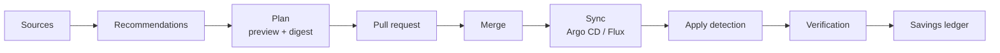

# Concepts

GreenKube is an optimization control loop for Kubernetes clusters managed with GitOps:

1. It **aggregates** recommendations from several sources.
2. It **decides** which ones are worth doing.
3. It **delivers** them as pull requests.
4. It **proves** that the change reached the cluster and what it saved.
5. It keeps a **ledger** of the outcome.

This page defines the vocabulary used across the documentation, the API and the UI. Items marked *(planned)* describe the direction of the project and are not available yet.

## The loop at a glance

| Stage | Question it answers | Where to read more |
|---|---|---|
| Aggregate | What do my tools recommend, for which workloads? | [Recommendation lifecycle](recommendation.md#sources-evidence-and-ranking) |
| Decide | Which changes are worth it, and how risky are they? | [Recommendation lifecycle](recommendation.md#sources-evidence-and-ranking) |
| Deliver | Where does this workload live in Git, and what exactly changes? | [GitOps automation](automation.md) |
| Prove | Did the merge reach the cluster? Is the new configuration live? What did it save? | [Recommendation lifecycle](recommendation.md#lifecycle-states) |
| Ledger | What have we saved so far, measured versus projected? | [Recommendation lifecycle](recommendation.md#realized-savings) |

## Sources

A **source** produces optimization advice as **signals** (one proposal for one target and capability), all in one schema ([Recommendation sources](sources.md)). GreenKube ships these, and third-party packages can add more through the Source SDK; `GET /api/v1/sources` lists them with their health and last run:

| Source | What it contributes | How it is enabled |
|---|---|---|
| `greenkube.*` (v1 `source: greenkube`) | Native analyzers, one source each: CPU and memory rightsizing, zombie pods, autoscaling candidates, off-peak scaling, idle namespaces, carbon-aware scheduling, node utilization, orphaned PersistentVolumes and LoadBalancers | On by default; each can be disabled in `sources.settings` |
| `vpa` | Container targets from VerticalPodAutoscalers in recommendation mode (`updateMode: Off`). This includes the VPAs that Goldilocks creates. | Enabled automatically when the VPA CRD exists |
| `greenkube.nodepool` (v1 `source: karpenter`) | NodePool consolidation opportunities, computed by GreenKube from live NodePool and NodeClaim state | Enabled automatically when the Karpenter CRDs exist |

Each recommendation records its `source`, a source-specific reference (`source_ref`, for example `namespace/vpa-name`), and the list of every source that reported the same issue (`sources`).

When several sources recommend the same change type for the same target, GreenKube combines their values by **consensus** (`RECOMMENDATION_CONSENSUS_POLICY`, default `safest`: the least aggressive value) and shows how much they agree, with the value of each source. Sources that run the same engine (Goldilocks and VPA) count once. See [Consensus across sources](recommendation.md#consensus-across-sources).

Signals of third-party sources become recommendations through the same consensus.

*(Planned)*
- KRR, Kubecost, Polaris and cloud recommenders as additional sources.
- A public API so that any tool can push signals.

## Recommendation

A **recommendation** is one proposed change on one target. It contains:

- **Target**: namespace, workload owner (kind and name), and container when the change is container-specific. Node-level and cluster-level recommendations target a node, a PersistentVolume or a Service instead.
- **Type and capability**: for example `RIGHTSIZING_CPU` in the `cpu_rightsizing` capability.
- **Proposal**: the current and proposed values (for example CPU request 500m → 200m), or a schedule for off-peak scaling.
- **Evidence**:
  - observation window, sample count and coverage;
  - usage distribution (average, p50, p90, p95, p99, max);
  - restarts;
  - the method used to estimate savings;
  - rollback conditions.
- **Projected impact**: estimated annual cost and CO₂e savings.
- **Risk** (`low`, `medium` or `high`), with the factors that explain it.
- **Confidence** (0–1), with the factors that explain it.
- **Effort** (`low`, `medium` or `high`).
- **Ranking score**: a weighted combination of carbon impact, cost impact, confidence, risk, effort and actionability. Profiles change the weights: `balanced`, `cost_first`, `carbon_first`, `quick_wins`, `low_risk`.
- **Expiry**: a recommendation that is not acted upon expires after `RECOMMENDATION_TTL_DAYS` (14 by default).

### Recommendation statuses

| Status | Meaning |
|---|---|
| `active` | Current and actionable |
| `ignored` | Hidden by a user (can be restored) |
| `stale` | No longer produced by the latest scan |
| `expired` | Not acted on before its expiry |
| `pr_open` | A pull request implementing it is open |
| `applied` | The change is live in the cluster (also the state of a measured change whose saving was not realized or inconclusive) |
| `verifying` | The post-change observation window is running |
| `verified` | The measured saving was realized and no health check failed |
| `regressed` | Reserved for drift detection: a realized saving that no longer holds (nothing sets it yet) |
| `rollback_review` | A health check failed after the change |
| `reverted` | A rollback reached the cluster |
| `failed` | The pull request was closed without merge, or the change could not be completed |

Every transition is written to an audit trail: `GET /api/v1/recommendations/{id}/events`.

## Delivering a change

### Binding

GreenKube finds where a workload is defined in Git by reading Argo CD Applications and Flux Kustomizations/HelmReleases. It does not require workload annotations. The result is a **binding**, which records:

- the repository, ref and path;
- the controller (`argocd`, `flux_kustomization`, `flux_helm_release`);
- the renderer (`raw`, `kustomize`, `helm_values`, `helm_release`).

A binding is `resolved`, `ambiguous` (several candidates; an operator can pick one), `unresolved`, `blocked` or `stale`.

### Plan

A **plan** is a validated set of file edits that implements one or more recommendations on one binding:

1. GreenKube takes a snapshot of the repository at an exact commit.
2. It renders the change in an isolated sandbox for Kustomize and Helm.
3. It checks that only the intended fields change.
4. It returns a diff identified by a **digest**.

Approval binds to that digest, so the reviewed change is exactly the committed change.

Policy gates run before a plan is created and again before it is approved:
- risk and confidence thresholds;
- evidence coverage;
- open pull request budget;
- cooldown;
- change freeze;
- rollout state;
- HPA and PDB interactions.

Plan statuses:

| Phase | Statuses |
|---|---|
| Normal flow | `draft` → `validated` → `approved` → `applying` → `pr_open` → `merged` → `synced` → `applied` |
| Alternatives | `needs_mapping`, `ambiguous`, `rejected`, `stale`, `superseded`, `closed`, `sync_failed`, `failed` |

### Pull request

A durable, idempotent worker:
- creates a deterministic branch;
- makes one atomic commit;
- opens a pull request (GitHub, GitLab or Gitea) that carries the evidence, impact, risk, rendered diff and verification expectations.

Merge and close events arrive by signed webhook or by polling.

What can become a pull request today: decreases of container CPU and memory requests on Deployments, StatefulSets and DaemonSets. Other recommendation types are advisory for now.

*(Planned)* Increases, limits, replicas and HPAs, KEDA cron schedules, deletions of orphaned resources, remote Helm charts, Karpenter NodePools; patch-file and CI-driven delivery; a GitHub App.

## Proving the change

### Sync

After the merge, GreenKube watches the Argo CD or Flux object that owns the workload. It waits until the controller reports the merged revision and a healthy state. A plan that does not sync within the configured timeout becomes `sync_failed`.

### Apply detection

Before the pull request is opened, GreenKube freezes a **pre-apply baseline**: workload UID, generation and per-container requests.

A change counts as applied only when two conditions hold:
- the live workload moved past that baseline (new generation, or a recreated object observed at its current generation);
- its per-container requests match the proposed values, within `RECOMMENDATION_APPLY_TOLERANCE`.

### Change measurement

Apply detection records each applied change: the workload revision it rolled out (generation and pod-template digests before and after), the pull request, merge commit and synced revision when it came through GitOps, the rollout start and completion, and a frozen **baseline snapshot** of the workload over the 7 days before the merge.

The change is then measured once, after a 7-day post-window, against a **counterfactual**: the same hour of the week before the change, adjusted by the workload's load (mesh or ingress requests, a `greenkube.io/load-metric` annotation, or CPU usage). The saving gets a 90% confidence interval and confounders are checked (another change on the workload, a spec or HPA edit, replica, price or instance-type shifts). The outcome is `realized`, `not_realized`, `inconclusive` or `contaminated`, and the saving is split across the change's recommendations by cost component. Changes and measurements are served at `GET /api/v2/changes`. The method is described in [Savings measurement](methodology/savings-measurement.md).

### Verification

Changes recorded before change measurement shipped, or all changes when `CHANGE_MEASUREMENT_ENABLED=false`, get the interim **fixed-horizon measurement**. The health gates below also apply to change measurement (once after `VERIFICATION_WINDOW_HOURS`, then over the whole post-window):

- **Windows:** the after-window starts when the rollout completes (every replica updated and available) and lasts `VERIFICATION_WINDOW_HOURS` (72 by default). The baseline window has the same length and ends when the pull request was merged (or the plan approved), so it never overlaps the change.
- **Health (per replica):** per-pod p95 usage stays below the applied per-pod request plus headroom; per-pod restart deltas stay within the limit; no OOM kill, readiness above the minimum and CPU throttling below the maximum (read from kube-state-metrics and cAdvisor through Prometheus). A signal that cannot be read is reported `not_available`, never counted as a pass.
- **Savings:** only rows with trusted cost provenance count. A change is realized when the measured saving clears a small noise floor. The projection is not a gate; how close the measurement came to it is reported.

The outcome is `verified` (realized), `rollback_review` (a health check failed), or `applied` with the saving `not_realized` or `inconclusive`. In this interim measurement, the CO2e difference of a request rightsizing is reported but never claimed. Change measurement claims the operational CO2e the Impact Model allocates by reservation, compared with the projected operational components only (see [Savings measurement](methodology/savings-measurement.md)).

Every decision is stored as an immutable measurement. A `not_realized` or `inconclusive` change is never re-tested automatically; `POST /api/v1/recommendations/{id}/remeasure` starts a new measurement that supersedes the previous one. An operator can dismiss a false-positive `rollback_review` with a reason, which returns the change to `applied` and measures it again. The CPU and memory records of one change stay one attribution group through both actions, so together they never claim the workload's saving twice.

> Verification is in **beta**. Change measurement adds counterfactual baselines, confidence intervals and per-change provenance; the append-only, hash-chained ledger (C6) is not implemented yet.

### Rollback

A rollback is a pull request too. GreenKube previews it from the original plan, restores only the files that still match its output, and runs it through the same approval and worker path. The recommendation becomes `reverted` once the rollback is synced and the original requests are observed again.

## Savings and the ledger

GreenKube distinguishes several kinds of savings figures. They are never added together.

| Kind | Meaning | Status |
|---|---|---|
| **Projected** | Expected annual impact of a recommendation, computed by the versioned [Impact Model](methodology/impact-model.md) | Available |
| **Projected accrual** | The projection accrued hour by hour for a change that is applied but not yet verified (labelled `prorated` before 0.4) | Available |
| **Measured** | The saving observed after the change: counterfactual minus actual with a 90% interval for changes measured by [change measurement](methodology/savings-measurement.md), a before/after difference for the interim verifier | Available (beta) |
| **Allocated vs billed** *(planned)* | A request cut lowers what a workload is *allocated* immediately. The cloud bill only drops when nodes are removed, so this will be measured at node-pool level and reported separately. | Planned |

The ledger accrues savings once per UTC hour slot and recommendation, with their method (`projected`, `measured` or `user_declared`). Accrual is idempotent and backfills downtime; ledger rows are never compressed or deleted. Changes that were not realized, are inconclusive, failed, are in rollback review or were reverted accrue nothing, and a recommendation that enters `rollback_review` has its earlier rows flagged `superseded`. The API reports `projected_annual`, `run_rate_annual` and `realized_to_date` as separate blocks.

*(Planned)* An append-only ledger linking each entry to its pull request, merge commit, synced revision and measurement method, with CSV export and export aligned with the FinOps FOCUS format.

## Where things run

| Process | Responsibilities |
|---|---|
| **Controller** (`greenkube start`) | Every periodic loop: collection; carbon intensity; compression; recommendation scans; GitOps discovery; sync observation; apply detection; verification; savings attribution; plan execution; the automation controller loop (webhook outbox, PR polling, branch cleanup, plan expiry, retention). Uses leader election in production. |
| **API** (`greenkube-api`) | Stateless: REST API and dashboard; plan preview and approval; webhook ingress. Runs no background loop, so it scales horizontally. |
| **Automation worker** (optional) | Executes approved plan operations only, as extra capacity next to the controller |
| **Renderer sandbox** | Renders Kustomize and Helm snapshots with no access to the database, provider tokens or service-account token |

See [Architecture](architecture.md) for the detailed data flow.
