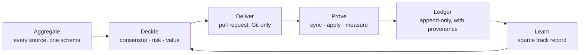
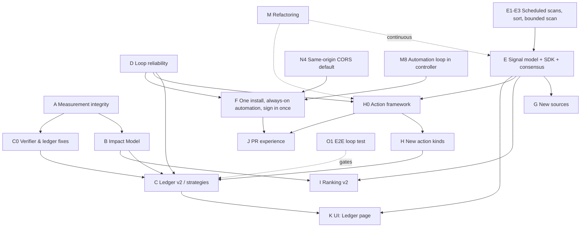
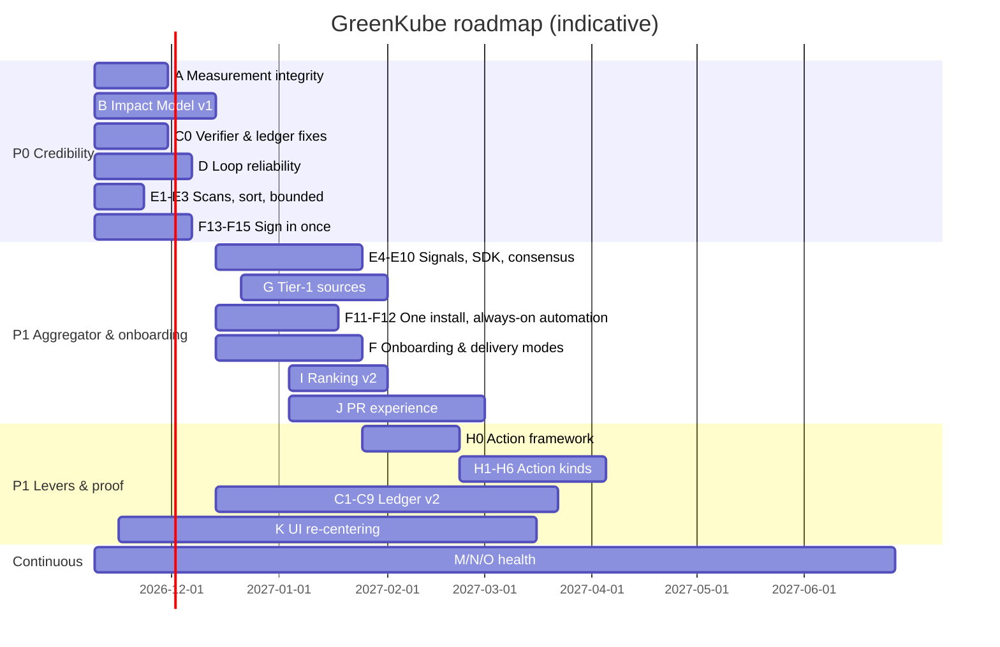

# GreenKube — Strategic Roadmap & Implementation Specifications

> **Status:** working document · **Date:** 2026-11-07 · **Baseline:** `dev` @ `ac48c09` (v0.3.1 + unreleased)
> **Audience:** the maintainer, contributors and coding agents. Every work item is written so that a developer or an agent can pick it up without further context.
> **Location:** `docs/roadmap.md`, versioned with the code.
> **Revision 2** (2026-11-07) adds three changes:
> - a single install topology with no profiles;
> - GitOps automation that is always on and activates itself;
> - persistent sign-in.
>
> See pivot P8 (§4) and category F.

---

## Table of contents

0. [How to use this document](#0-how-to-use-this-document)
1. [Executive summary](#1-executive-summary)
2. [Positioning](#2-positioning)
3. [Where GreenKube stands today](#3-where-greenkube-stands-today)
4. [Strategic pivots](#4-strategic-pivots)
5. [Synthesis — prioritized categories](#5-synthesis--prioritized-categories)
6. [Detailed specifications by category](#6-detailed-specifications-by-category)
7. [Release plan & milestones](#7-release-plan--milestones)
8. [Success metrics](#8-success-metrics)
9. [Risks & open decisions](#9-risks--open-decisions)
- [Appendix A — Defect register](#appendix-a--defect-register)
- [Appendix B — Recommendation source catalogue](#appendix-b--recommendation-source-catalogue)
- [Appendix C — Competitive landscape](#appendix-c--competitive-landscape)
- [Appendix D — Glossary](#appendix-d--glossary)
- [Appendix E — Execution conventions for agents](#appendix-e--execution-conventions-for-agents)

---

## 0. How to use this document

**Identifiers.** Categories are lettered `A`…`Q` and ranked by priority in §5. Work items are numbered within their category (`A1`, `C0.4`, `H3`…). Defects have global IDs `BUG-nn` (Appendix A) and point back to the work item that fixes them.

**Item types.** `BUG` (incorrect behavior), `FEAT` (new capability), `REFACTOR` (no behavior change), `OPS` (deployment/CI/security), `DOC` (documentation), `DESIGN` (decision or spec to produce before code).

**Priority.**
- `P0`: blocks the core promise; do now.
- `P1`: required for the positioning; next 1–3 months.
- `P2`: important health work; continuous budget.
- `P3`: opportunistic or later.

**Effort** (one engineer working with coding agents):
- `S`: ≤ 1 day.
- `M`: 2–4 days.
- `L`: 1–2 weeks.
- `XL`: more than 2 weeks; split it before starting.

**Evidence levels for defects.**
- *Confirmed (sim)*: reproduced by running the real code with fakes. The scripts are in the audit scratchpad and should be turned into regression tests.
- *Confirmed (code)*: established by reading the code.
- *Likely* / *Plausible*: needs a check against a live system before fixing.

**Rule of thumb.** Read the target design of a category before implementing any of its items. Several categories (B, C, E, H) introduce abstractions that later items build on.

---

## 1. Executive summary

**What GreenKube already is.** A carefully engineered open-source system (≈70k lines of Python, a SvelteKit UI, a Helm chart, 2,526 tests, ≈83% coverage) that:
- collects Kubernetes usage, cost (OpenCost) and carbon data (Electricity Maps/Wattnet, Boavizta);
- generates recommendations from 10 native analyzers plus VPA and Karpenter-backed sources;
- ranks them;
- ships CPU/memory request decreases as GitOps pull requests through an unusually defensive pipeline: discovery-based bindings, digest-approved plans, an isolated renderer, leases, idempotent workers;
- tracks Argo CD/Flux sync, detects the applied change and attempts to verify realized savings.

**The opportunity.**
- No open-source project, and almost no commercial one, does *recommendation → GitOps PR → sync verification → measured savings ledger*.
- Commercial optimizers mutate pods in-cluster and ask users to configure Argo CD `ignoreDifferences`. IBM's own Kubecost guidance concedes that "committed manifests will diverge" and that teams who need manifest purity should drive automated PRs.
- Free recommenders (VPA, Goldilocks, KRR) stop at advice.
- GreenKube can own the neutral, Git-native, *proven-savings* layer on top of all of them.

**The problem.** GreenKube has built a bank-vault door in front of a ledger that cannot yet count:

1. **The numbers are not trustworthy yet.** The audit found that:
   - projections multiply request cuts by the pod's *total* cost and claim CO₂e savings that the carbon model cannot produce;
   - the data pipeline double-counts pod CPU and loses compressed data;
   - the verifier inflates measured savings about 4× through a traffic-normalization bug, sends every multi-replica change to `rollback_review`, can never measure container-scoped (GitOps) changes, and keeps accruing projected savings for changes that failed verification.
2. **The loop breaks in real repositories.**
   - Sync verification requires the *exact* merge SHA, so any later commit makes the plan `SYNC_FAILED`.
   - Retention deletes the audit trail and permanently blocks workloads after 90 days.
   - Closed GitHub PRs probably never reconcile.
   - PR creation cost grows with repository size.
3. **The pipe is narrow.** Only one action kind can become a PR: decreasing container CPU/memory requests, on Deployments, StatefulSets and DaemonSets, in raw, Kustomize or local-chart Helm layouts.
4. **The funnel is narrow.** There are three sources (native, VPA, Karpenter); the "Karpenter source" is in fact GreenKube's own heuristic over Karpenter objects. KRR, Goldilocks provenance, Kubecost and cloud recommenders are absent, and there is no scheduled scan.
5. **The activation energy is high, and daily use has friction.**
   - About 13 steps and about 3.5 days of data are needed before the first eligible PR.
   - Two deployment profiles × automation on/off make four install variants, with a 9-row upgrade matrix.
   - Users paste the API key again after every page reload.

**The plan, in order.**

| # | Phase | What it covers | Categories |
|---|---|---|---|
| 1 | Make the numbers right | Fix the measurement pipeline, introduce one Impact Model used by both projections and measurements, rebuild verification and the ledger | A, B, C |
| 2 | Make the loop reliable | Fix the GitOps pipeline defects | D |
| 3 | Widen the funnel | A neutral signal model, a Source SDK, consensus, scheduled scans and new connectors | E, G |
| 4 | Lower the activation energy | One install topology, automation that activates itself, sign in once, lighter delivery modes, guided setup | F |
| 5 | Widen the pipe | An action framework, then new action kinds | H |
| 6 | Re-center the product surface | Ranking v2, PR experience, UI (Inbox → Changes → Ledger), docs | I, J, K, L |

**Continuous budget (about 20%):** architecture simplification, Helm/security and quality engineering (M, N, O). Ecosystem items (P, Q) come after v0.6.

**Milestones.**

| Version | Target date | Focus |
|---|---|---|
| v0.3.2 patch | 2026-11-13 | API key kept across reloads (stopgap), same-origin CORS default |
| v0.4 "Trustworthy" | mid-Dec 2026 | Phases 1–2, plus sign in once |
| v0.5 "Open aggregator" | end Jan 2027 | Phases 3–4, including one install topology and always-on automation |
| v0.6 "More levers" | end Mar 2027 | Phase 5 |
| v1.0 | Q2 2027 | API freeze, end-to-end CI, complete docs |

---

## 2. Positioning

### 2.1 One-liner

> **GreenKube turns the Kubernetes optimization advice you already have into reviewed pull requests — and proves what each merged change actually saved, in money and CO₂e.**

Tagline (primary): **"Every recommendation. One pull request. Proven savings."**
Alternatives: "From advice to verified savings — through Git." / "The savings ledger for GitOps Kubernetes."

### 2.2 The problem GreenKube solves

1. **Advice is abundant, fragmented and contradictory.**
   - VPA, Goldilocks, KRR, Kubecost, cloud consoles, Karpenter and in-house scripts each produce their own lists, with different algorithms (p95 vs max+15%), windows (3 to 14 days) and units.
   - They disagree, and nobody knows which one to trust.
2. **Acting is risky and manual.**
   - In a GitOps shop the cluster is a projection of Git. Changing requests means editing Helm values or Kustomize overlays across many repositories, owned by many teams.
   - In-cluster optimizers mutate pods behind Git's back and ask you to ignore the drift.
3. **Savings are asserted, not proven.**
   - Tools report *potential* savings.
   - Almost none measure what happened after the change, and none ties a realized saving to the commit that produced it.

### 2.3 Positioning statement

**Who it's for.** Platform and SRE teams who run Kubernetes through Argo CD or Flux.

**What it is.** GreenKube is the open-source optimization control loop:
- it aggregates recommendations from every source;
- it ranks them by risk-adjusted value;
- it ships them as reviewable pull requests;
- it measures the savings each change actually realized.

**How it differs.**
- Unlike in-cluster optimizers, it never changes the cluster behind Git's back.
- Unlike recommendation dashboards, it does not stop at advice: it closes the loop with a verified, auditable savings ledger.

### 2.4 Core philosophy: the loop



| Stage | What GreenKube does | Today | Target |
|---|---|---|---|
| **Aggregate** | Pulls *signals* from native analyzers, VPA/Goldilocks, KRR, Kubecost, Polaris, cloud recommenders and any tool that speaks the public signal schema. | Native + VPA + a Karpenter heuristic; scans only on API start or when requested | ≥ 6 connectors, scheduled scans, push API |
| **Decide** | Builds one recommendation per target and capability from all signals. It computes consensus, an impact estimate (same model as measurement), risk and confidence, and ranks by risk-adjusted value in one currency (cost + carbon price × CO₂e). | Fixed-priority arbitration; batch-relative ranking; inflated projections | Consensus, Impact Model, expected-value ranking |
| **Deliver** | Opens a reviewable PR with evidence, impact, risk and rollback, in the right repository and file, for the right owners. | One action kind, ~13 setup steps | Action framework, 8+ action kinds, patch/CI/GitHub App modes |
| **Prove** | Confirms the merge reached the cluster (Argo CD/Flux), detects the rollout, then measures savings against a counterfactual with a confidence interval. | Exact-SHA sync; verifier defects | Ancestry-aware sync, measurement strategies, CIs |
| **Ledger** | Appends immutable entries (projected / allocated / realized), linked to PR, commit, sync revision and method version. | Mutable rows, compression loss, no provenance | Append-only, hash-chained, exportable (CSV/FOCUS-aligned) |
| **Learn** | Feeds realized-vs-projected outcomes back into confidence per source and capability. | — | Track-record-weighted ranking |

### 2.5 Product principles (invariants)

1. **Git is the only write path.** GreenKube never mutates workloads directly. Every change is a commit that a human (or an explicit policy) approved.
2. **Neutral by design.** GreenKube's own analyzers are one source among others, judged by the same track record. No vendor lock-in; every connector is a plugin.
3. **Projected ≠ allocated ≠ realized.** These three kinds of saving are never summed together, never shown as one number, and always labeled.
4. **One model for estimating and measuring.** A projection and its later measurement are computed by the same versioned Impact Model, or the comparison is meaningless.
5. **Evidence travels with the change.** The PR body is the evidence; the ledger entry links back to the PR, the commit and the measurement.
6. **Fail closed, explain why.** Every recommendation that cannot become a PR says why, and what would make it eligible.
7. **Cost and carbon, measured the same way.** Every number has both dimensions. Ranking unifies them through a configurable carbon price.
8. **One install, zero-config first.**
   - A single production-grade topology works with Prometheus alone.
   - Every capability activates itself when its prerequisites are detected: OpenCost, Electricity Maps, connectors, GitOps discovery, PR delivery.
   - No feature flag is needed to turn the core loop on; users sign in once.

### 2.6 What GreenKube is not

- **Not an autoscaler or actuator.** It does not replace VPA, HPA, KEDA or Karpenter; it proposes and verifies changes to their configuration.
- **Not a cost-allocation engine.** It consumes OpenCost or Kubecost and falls back to its own pricing catalog only when they are absent.
- **Not a carbon-accounting suite.** It produces workload-level, SCI-aligned estimates with documented methodology. Corporate reporting is an export, not the product.
- **Not a dashboard-first tool.** Footprint views exist to explain recommendations and savings, not as the headline.

### 2.7 Users and jobs-to-be-done

| Persona | Job to be done | What GreenKube must give them |
|---|---|---|
| **Platform engineer** (buyer and operator) | "Cut waste across N teams without causing incidents or fighting app owners." | Ranked inbox, safe PRs to the right repo/owners, rollback, policy gates |
| **App team reviewer** (PR recipient) | "Decide in 30 seconds whether to merge this." | Plain-language PR title, impact, risk, evidence, what to watch |
| **FinOps practitioner** | "Prove what we actually saved and where." | Ledger with realized vs projected, provenance, export |
| **Sustainability lead** | "Report defensible workload emissions and reductions." | SCI-aligned methodology, CO₂e on every entry, export |

**Ideal customer profile:**
- 20–500 services, 1–20 clusters.
- Argo CD or Flux in place.
- AWS-heavy (EKS has no native pod-level recommender, so GreenKube fills a real gap) or EU-based (carbon is a co-benefit).

### 2.8 Competitive frame (summary — details in Appendix C)

| | Opens PRs to GitOps repo | Keeps Git as source of truth | Multi-source neutral | Verifies sync | Measures realized savings | Carbon | Open source |
|---|---|---|---|---|---|---|---|
| VPA / Goldilocks / KRR | – | n/a (advice only) | – | – | – | – | ✔ |
| IBM Kubecost | – (controller) | ✘ (`ignoreDifferences`) | – | – | partial (3.0 audits) | estimates | ✘ |
| PerfectScale, CAST AI, ScaleOps, Spot Ocean | – | ✘ | – | – | partial / undocumented | PerfectScale only | ✘ |
| StormForge | exports patches | partial | – | – | – | – | ✘ |
| Harness CCM | – (tickets) | n/a | – | – | ✔ (billing inference) | – | ✘ |
| **GreenKube (target)** | **✔** | **✔** | **✔** | **✔** | **✔ (with CI and provenance)** | **✔** | **✔ Apache-2.0** |

### 2.9 Messaging changes

- **Lead with:** verified savings, Git-native, multi-source neutrality.
- **Carbon:**
  - Keep it a first-class *dimension* of every number ("cost and carbon, measured the same way"), not the headline.
  - The EU Omnibus I directive (2026) removed roughly 80% of companies from CSRD scope, and the 2026 State of FinOps survey ranks sustainability low while workload waste reduction is #1.
  - The GreenKube name stays: "green" reads as efficient *and* low-carbon.
- **Retire as headline claims:**
  - "FinGreenOps platform";
  - "full visibility" / "visibility first";
  - "CSRD/ESRS E1 reporting";
  - the 0–100 sustainability score.
- **Adopt a precise vocabulary** (Appendix D):
  - *signal*, *recommendation*, *change*, *measurement*, *ledger entry*;
  - *projected*, *allocated*, *realized*.
- **Honesty as a feature:** "We only count what we measured, and we show you how."

### 2.10 North-star metric

**Verified realized savings run-rate per installation.** This is the annualized cost (and CO₂e) savings from changes whose measurement concluded `realized`. Supporting metrics are in §8.

---

## 3. Where GreenKube stands today

### 3.1 Facts

| Dimension | Value |
|---|---|
| Version | 0.3.1 (2026-10-25) + unreleased GitOps readiness work |
| Python source | ≈70k lines; GitOps + automation alone ≈28k lines |
| Tests | 2,526 collected · 2,484 passed · 42 skipped (live-Postgres tests) · ≈83% statement coverage |
| Frontend | SvelteKit (Svelte 5 installed, Svelte 4 syntax), 6 routes; `recommendations/+page.svelte` is 2,124 lines |
| Helm | 296 leaf values, 32 templates; 2 profiles (standalone, production) × automation on/off = 4 install variants, with a 9-row upgrade matrix (`docs/installation.md:494-536`) |
| UI access | API key kept in memory only (`frontend/src/lib/api.js:10-18`): asked again after every reload or new tab. `API_AUTH_MODE` reserves `session` and `oidc`, but both return 503 (`api/dependencies.py:103`). |
| Settings | ≈112 `Config` fields (5 unused) |
| Migrations | 38 per dialect (SQLite and Postgres maintained in parallel) |
| Recommendation types | 11 (`ZOMBIE_POD`, `RIGHTSIZING_CPU/MEMORY`, `AUTOSCALING_CANDIDATE`, `OFF_PEAK_SCALING`, `IDLE_NAMESPACE`, `CARBON_AWARE_SCHEDULING`, `OVERPROVISIONED/UNDERUTILIZED_NODE`, `ORPHANED_PERSISTENT_VOLUME`, `ORPHANED_LOAD_BALANCER`) |
| Sources | `greenkube` (10 analyzers), `vpa` (Off-mode VPAs, which include Goldilocks-created ones without provenance), `karpenter` (GreenKube heuristic over NodePools) |
| PR-able | `RIGHTSIZING_CPU/MEMORY` decreases of container requests on Deployment/StatefulSet/DaemonSet; raw, Kustomize, local-chart Argo Helm, Flux Git-chart HelmRelease |
| Git providers | GitHub, GitLab, Gitea (personal access tokens) |

### 3.2 Strengths to preserve

- **A safety-first GitOps pipeline**: discovery-based bindings, generation compare-and-set, digest-bound approvals, an isolated renderer sandbox, idempotent operations with fenced leases, and fail-closed defaults. Competitors do not have this.
- **A rich recommendation record**: evidence block, risk/confidence/effort, lifecycle with events, and a ranking breakdown.
- **Security hardening** already done: SSRF guards, rate limiting, CSP, secret handling, Trivy, gitleaks.
- **Breadth of carbon inputs**: Electricity Maps, Wattnet, Boavizta, PUE.
- **A large, fast test suite** (about 9 s for the 799 GitOps and automation tests).
- **The demo experience**: `docker run … demo` and demo.greenkube.cloud.

### 3.3 Critical gaps (summary of the five audits)

| Gap | Evidence | Fixed by |
|---|---|---|
| Projections are inflated and physically inconsistent | BUG-15, BUG-16, BUG-17 | B |
| Measurement pipeline corrupts data | BUG-01..03, BUG-32 | A, C0 |
| Verification is wrong in both directions | BUG-27..38 | C0, C |
| The loop breaks in real repositories | BUG-43..53 | D |
| No scheduled scans; ranking unstable; Active list sorted alphabetically | BUG-20..23 | E, I |
| Only one action kind; most real Helm layouts unsupported | §6.H | H |
| Four install variants; automation opt-in with about 13 setup steps; ≈3.5 days before the first eligible PR; API key re-entered on every reload | §6.F, BUG-63 | F |
| UI still visibility-first; no ledger view; duplicated PR lists | §6.K | K |
| Complexity outpaces scope: 6 overlapping state machines, ~3.3k mirrored storage lines, ~900 lines of dead collection code | §6.M | M |
| Helm chart unsafe under Argo CD (secret regeneration) | BUG-58 | N |

---

## 4. Strategic pivots

| # | From | To | Consequence |
|---|---|---|---|
| **P1** | "Pod-level footprint visibility" is the product | Measurement exists to *price and verify changes* | Visibility pages move under "Footprint". The data model is keyed by **workload identity**, not pod name. |
| **P2** | GreenKube analyzers plus adapters | **Neutral signal aggregator** with a public signal schema | Every source, native included, emits `SourceSignal`s. Consensus replaces fixed priority. Third parties can push signals. |
| **P3** | Savings = projection × status | Savings = **measurement** with method, confidence interval and provenance | New measurement strategies and an append-only ledger. "Prorated" stops being presented as realized. |
| **P4** | One hardened path for one action kind | An **action framework** | Generalize before adding kinds; every kind brings its own baseline, apply check, inverse and measurement strategy. |
| **P5** | Automation is an advanced opt-in feature | **Automation is the product: always on, self-activating, a PR in 15 minutes** | <ul><li>No `automation.enabled` flag: discovery, previews and PR delivery activate as soon as their prerequisites (GitOps controller, Git credentials) are detected, and stay dormant otherwise.</li><li>Patch and CI delivery modes.</li><li>GitHub App.</li><li>Auto-proposed allowlists.</li><li>A warm-up ETA instead of silent ineligibility.</li></ul> |
| **P6** | Two first-class SQL backends | **Postgres-first**, one SQL dialect layer; SQLite for demo/dev | Removes about 3.3k mirrored lines and 38 duplicated migrations. |
| **P7** | CO₂e-led messaging | **Cost leads; carbon is co-equal in data** | A configurable carbon price unifies ranking; SCI-aligned methodology docs. |
| **P8** | Two profiles × automation on/off; API key pasted on every reload | **One install, sign in once** | <ul><li>A single production-grade topology sized for small clusters: scale by replica count, not by profile.</li><li>Postgres-only in Helm.</li><li>Persistent browser sessions: username/password that a password manager can save, HttpOnly cookie.</li><li>Scoped API keys for machines.</li><li>SSO later.</li></ul> |

---

## 5. Synthesis — prioritized categories

Ranked by priority. Within a tier, lower rank means start earlier. Horizon weeks count from Monday 2026-11-09 (week 1).

| Rank | ID | Category | Priority | Horizon | Effort | Why it matters |
|---|---|---|---|---|---|---|
| 1 | **A** | Measurement integrity — fix the data pipeline | P0 | Weeks 1–3 | L | Every projection and every measurement rests on these numbers; several are currently corrupted. |
| 2 | **B** | Impact Model v1 — one model for estimates and measurements | P0 | Weeks 1–5 | L | Projections are inflated (total cost × ratio) and claim CO₂e the model cannot produce. Without B, verification can never agree with projection. |
| 3 | **C** | Verified Savings Ledger v2 — the moat | P0 (C0) / P1 | Weeks 1–3 (C0), 4–14 | XL | "Proven savings" is the differentiator; today it is wrong in both directions and not auditable. |
| 4 | **D** | Close-the-loop reliability — GitOps pipeline fixes | P0 | Weeks 1–4 | L | Real repositories break sync verification, retention and PR creation; savings never reach the ledger. |
| 5 | **F** | One install, always-on automation, sign in once (time-to-first-PR) | P0 (F10, F13, F14) / P1 | Weeks 1–10 | L | Adoption and daily-use bottleneck: four install variants, automation opt-in (≈13 steps, ≈3.5 days), API key re-entered on every reload. |
| 6 | **E** | Recommendation Core v2 — signal model, Source SDK, consensus, scheduled runs | P0 (E1–E3) / P1 | Weeks 1–2, 5–10 | XL | Foundation of the multi-source promise; also fixes "no scheduled scan" and the alphabetical sort. |
| 7 | **G** | New recommendation sources | P1 | Weeks 6–16 | L | Widens the funnel: Goldilocks, KRR, Kubecost, Polaris, push API, then cloud and commercial sources. |
| 8 | **H** | New action kinds — what can become a PR | P1 | Weeks 8–20 | XL | Widens the pipe beyond request decreases: increases, limits, replicas/HPA, off-peak schedules, deletions, remote Helm charts, NodePools. |
| 9 | **I** | Ranking & decisioning v2 | P1 | Weeks 6–10 | M | Risk-adjusted expected value in one currency; stable scores; learning from outcomes. |
| 10 | **J** | Pull-request experience & collaboration | P1 | Weeks 6–14 | L | The PR is the product's main surface for most users. |
| 11 | **K** | Product UI re-centering | P1 | Weeks 2–16 | L | Inbox → Changes → Ledger replaces the CO₂-dashboard-first UI. |
| 12 | **L** | Positioning, documentation & community | P1 | Weeks 1–4, then continuous | M | Communicate the loop; fix stale and contradictory docs; consolidate three doc surfaces. |
| 13 | **M** | Architecture simplification & refactoring | P2 (continuous, ~15%) | Ongoing | XL | Complexity outpaces scope; it slows every other category. |
| 14 | **N** | Helm, security & operations | P2 (N1 is P0) | Weeks 1–12 | M | Argo CD-safe install, schema, secure defaults, controller observability. |
| 15 | **O** | Quality engineering — tests & CI | P2 (O1 is P1) | Ongoing | L | An end-to-end loop test is the only real proof the product works. |
| 16 | **P** | Ecosystem integrations & reporting | P3 | Months 4–7 | L | Notifications, exports (FOCUS/SCI), MCP, Backstage, multi-cluster. |
| 17 | **Q** | Beyond CPU/memory — GPU, node shape, storage | P3 | Months 5+ | L | FinOps-for-AI is the top forward priority; VPA and in-place resize don't cover GPUs. |

### 5.1 Dependency graph



### 5.2 Capacity rule

Each two-week sprint is split as follows:

| Share | Work |
|---|---|
| ≈ 60% | The current milestone's P0/P1 items |
| ≈ 20% | M/N/O health work, chosen preferably on files touched by the milestone |
| ≈ 10% | Docs, which ship with features |
| ≈ 10% | Bugs and community support |

---

## 6. Detailed specifications by category

Each category follows the same structure:
- **Goal**
- **Current state**
- **Target design**: abstractions and classes
- **Work items**: type, priority, effort, problem, spec, acceptance, files
- **Definition of done**

File paths are relative to `src/greenkube/` unless stated otherwise.

---

### Category A — Measurement integrity (fix the data pipeline)

**Priority** P0 · **Horizon** weeks 1–3 · **Effort** L

**Goal.** Make the stored usage, cost and carbon series correct, gap-aware and provenance-tagged. Categories B and C depend on these series.

**Current state.**
- The production path is `HistoricalRangeProcessor.run_range`, triggered every `PROMETHEUS_QUERY_RANGE_STEP` (`cli/start.py:536`, `cli/utils.py:34-57`).
- The "instant" path (`DataProcessor.run()`, `CollectionOrchestrator`, `CostNormalizer`, `PrometheusResourceMapper`, `PrometheusCollector.collect`, `BasicEstimator.estimate`) has no production caller. It is about 900 lines; see M4.
- Defects are confirmed by simulation: double-counted CPU, compression loss, skipped windows.

**Target design.**

1. **`PromQLCatalog`** (`collectors/promql.py`): the single definition of every PromQL expression, parameterized by `step`, `rate_window` and label filters. Both CPU and memory queries carry `container!="", container!="POD"`. `rate_window = max(step, 4 × scrape_interval)` (configurable `PROMETHEUS_SCRAPE_INTERVAL`, default 30s).

2. **`CollectionWindow`** with half-open semantics:

   ```python
   @dataclass(frozen=True)
   class CollectionWindow:
       start: datetime  # inclusive, aligned to step
       end: datetime    # exclusive
       step: timedelta
   ```

3. **`CollectionWatermark`** repository: table `collection_watermarks(cluster_uid, source, last_complete_end, updated_at)`. A collector advances the watermark only after a successful write of the whole window. The scheduler computes `windows_to_collect = [watermark, now - safety_lag)` in step-aligned chunks, with a backfill horizon of `COLLECTION_MAX_BACKFILL` (default 24h).

4. **Per-dimension provenance**, replacing `is_estimated: bool` + `estimation_reasons: list[str]`:

   ```python
   class CostSource(StrEnum):  OPENCOST="opencost"; KUBECOST="kubecost"; PRICING_CATALOG="pricing_catalog"; CUSTOM_RATE="custom_rate"; NONE="none"
   class UsageSource(StrEnum): PROMETHEUS="prometheus"; METRICS_SERVER="metrics_server"; NONE="none"
   class PowerSource(StrEnum): INSTANCE_PROFILE="instance_profile"; NODE_CAPACITY_DERIVED="node_capacity_derived"; DEFAULT_PROFILE="default_profile"; KEPLER="kepler"
   class IntensitySource(StrEnum): REALTIME="realtime"; CONSOLIDATED="consolidated"; STALE="stale"; ZONE_DEFAULT="zone_default"; GLOBAL_DEFAULT="global_default"
   ```

   These are stored as columns on metric rows. Consumers (verifier, ranking) declare which dimensions they need to trust. For example, the cost gate requires `cost_source in {opencost, kubecost}`.

5. **`LeaderFence`**: every leader-gated job receives a fencing token (lease generation). Writes include it, and a job checks it before committing.

**Work items.**

#### A1 · BUG · Pod CPU and memory double-counted in range queries — P0 · S
- **Problem.** The range queries in `core/historical_range_processor.py:280,294,308` sum `container_cpu_usage_seconds_total` and `container_memory_working_set_bytes` without `container!=""`. The pod-level cgroup series is added to the container series. In simulation, CPU was 400m instead of 200m and energy 775 J instead of 610 J. This feeds rightsizing directly. The instant query has the filter (`collectors/prometheus_collector.py:61`). (BUG-01)
- **Spec.**
  - Introduce `PromQLCatalog`, used by both the range and instant paths.
  - Add `container!="",container!="POD"` to every container-scoped CPU and memory expression.
  - Network and filesystem series stay pod-level by design; document this in the catalog.
- **Acceptance.**
  - A fixture-based test with a pod-cgroup series plus two container series returns the sum of the containers only.
  - Golden energy values are updated.
  - A changelog entry notes that historic data before the fix is inflated; `calculation_version` is bumped.
- **Files.** `core/historical_range_processor.py`, `collectors/prometheus_collector.py`, new `collectors/promql.py`, `tests/core/test_historical_range_processor*.py`.

#### A2 · BUG · Half-open windows, watermarks and catch-up — P0 · M
- **Problem.**
  - `run_range` returns stored rows when *any* row exists in `[start, end]` (`historical_range_processor.py:98-116`), and SQL uses inclusive `BETWEEN` (`storage/sqlite/repository.py:315`). As a result, every other window is skipped.
  - OpenCost cost for the skipped windows is dropped; for the computed windows it is counted twice and shifted one step.
  - `--last` backfill does nothing if any row exists.
  - Downtime becomes a permanent gap. (BUG-03)
- **Spec.**
  - Implement `CollectionWindow` and `CollectionWatermark`.
  - Remove the read-first shortcut.
  - All range reads use `timestamp >= start AND timestamp < end`.
  - The scheduler job `collect_metrics` loops over the missing windows up to the backfill horizon, oldest first.
  - Expose `greenkube_collection_watermark_lag_seconds{source}` and `greenkube_collection_gap_windows_total`.
- **Acceptance.**
  - A simulation over 2 hours with a 5-minute step produces exactly 24 windows and 24×pods rows.
  - Killing the controller for 30 minutes and restarting it backfills the gap.
  - Re-running the same window is idempotent (upsert, same values).
- **Files.** `core/historical_range_processor.py`, `cli/utils.py`, `cli/start.py`, `storage/*/repository.py`, new migration.

#### A3 · BUG · Lossless hourly compression — P0 · M
- **Problem.** `MetricsCompressor` compresses rows older than a cutoff that is not aligned to the hour, deletes them, and the next run's `ON CONFLICT … = EXCLUDED` overwrites the partial bucket. Every hour older than 7 days keeps only the minutes after the job's start offset; the simulation kept 4 of 12 samples. The same defect exists in the savings-ledger compression (BUG-32), handled by C0.6 and C6. (BUG-02)
- **Spec.**
  - Compress only *closed* hours: `bucket_end <= floor_hour(min(now - 24h, watermark))`.
  - Compress a bucket from its complete raw set in one transaction, then delete exactly those raw rows.
  - Prune cutoffs are aligned to the hour.
  - Keep a `compression_watermark` per table.
  - Add a lower bound so the job never re-reads already compressed periods (today it re-aggregates the whole raw table older than 24h every hour: `metrics_compressor.py:146,284`).
- **Acceptance.**
  - The property test "sum of raw before compression equals sum of hourly after compression" holds for `total_cost`, `joules`, `co2e_grams` and `sample_count`, with random job start offsets.
  - The `sim_compress.py` scenario becomes a regression test.
- **Files.** `core/metrics_compressor.py`, `storage/*/repository.py`.

#### A4 · BUG · Cost keyed by namespace and pod, with component split — P0 · M
- **Problem.**
  - The OpenCost result map is keyed by `pod_name` only (`historical_range_processor.py:258`, `core/collection_orchestrator.py:113`), so same-named pods (`redis-0`) collide across namespaces.
  - `aggregate=pod` may also merge them on the OpenCost side.
  - CPU, RAM, PV, network and LB components are discarded; `CombinedMetric` keeps only `total_cost`.
  - Cost per step is a trailing-window total divided by steps, so new pods are under-costed for 24h after a rollout (BUG-41). (BUG-04)
- **Spec.**
  - Query OpenCost `/allocation/compute` with `aggregate=namespace,pod`, `window=<CollectionWindow>`, `accumulate=true` and `includeIdle=false`, and keep idle separately (see B2). Use the exact window rather than a trailing `1d` divided by steps.
  - Key the cost map by `(namespace, pod)`.
  - Add columns `cost_cpu`, `cost_ram`, `cost_storage`, `cost_network`, `cost_lb` and `cost_source`; keep `total_cost` as their sum.
  - Verify the exact OpenCost parameter names against the deployed OpenCost version; add a recorded-response fixture.
- **Acceptance.**
  - The two-namespace `redis-0` fixture yields distinct costs.
  - A 5-minute window's cost equals the OpenCost allocation for that window (±1%).
  - The component split is persisted.
- **Files.** `collectors/opencost_collector.py`, `core/historical_range_processor.py`, `core/metric_assembler.py`, `models/metrics.py`, migrations.

#### A5 · BUG · Stale loop variable attaches metrics-server usage to every sample — P1 · S
- **Problem.**
  - `ts_f` at `historical_range_processor.py:597` is left over from the loop at line 459, so the condition is always true.
  - Point-in-time metrics-server usage is attached to every sample of the current chunk.
  - The container row timestamp is overwritten with "now" (`metric_assembler.py:426`). (BUG-05)
- **Spec.**
  - Compare against the sample's own timestamp.
  - Never overwrite the sample timestamp.
- **Acceptance.** A unit test with a 3-sample chunk attaches metrics-server data only to the latest sample, and only if it is fresh.

#### A6 · BUG · Filter NaN, Inf and negative values in range parsing — P2 · S
- **Problem.** `historical_range_processor.py:416-426` accepts NaN and negative values; the instant parser filters them. (BUG-09)
- **Spec.**
  - Drop non-finite values.
  - Clamp negative rates to 0, with a counter `greenkube_collection_dropped_samples_total{reason}`.

#### A7 · BUG · Collect limits and native sidecars — P1 · S
- **Problem.** `collectors/pod_collector.py` ignores init containers with `restartPolicy: Always` (native sidecars) and never collects limits. Limits are needed for H1 and for risk assessment. (BUG-10)
- **Spec.**
  - Add `cpu_limit` and `memory_limit` per container.
  - Include native sidecars as containers with `kind="sidecar"`.
  - Keep classic init containers out of the steady-state sums but record them for H1.
- **Acceptance.** A pod with one container and one native sidecar reports two containers with requests and limits.

#### A8 · BUG · Carbon-intensity staleness and provenance — P1 · S
- **Problem.**
  - The intensity lookup takes the latest value with no age limit (`storage/sqlite/repository.py:51-86`).
  - Defaults are written into history as if they were measured (`collectors/electricity_maps_collector.py:72-93`).
  - None of this is flagged. (BUG-07)
- **Spec.**
  - Add `INTENSITY_MAX_AGE` (default 6h).
  - Beyond it, use the zone default and set `intensity_source=zone_default`.
  - Never persist a default into the intensity history table; keep defaults computed at read time.
  - Store `intensity_source` on metric rows.
- **Acceptance.** With no token, rows are tagged `zone_default` and the intensity history table stays empty.

#### A9 · BUG · Intensity recompute must update container rows — P2 · S
- **Problem.** `recompute_carbon_with_latest_intensities` updates `combined_metrics` only (`storage/postgres/repository.py:1377-1425`, `storage/base_repository.py:532`), so container rows drift from the pod aggregate. (BUG-06)
- **Spec.** Apply the same update to `container_metrics`. On SQLite, use a set-based UPDATE instead of loading 24h of rows into Python.

#### A10 · BUG · Unknown node power profile — P1 · S
- **Problem.**
  - When a node's instance type is unknown, the code silently uses `DEFAULT_INSTANCE_PROFILE` (1 vCPU, 1–10 W) (`historical_range_processor.py:188-212,471-477`).
  - If cAdvisor series lack a `node` label, the whole cluster maps to node `""` and is capped at 10 W. (BUG-08)
- **Spec.**
  - Derive a profile from node capacity (`vcores = allocatable.cpu`) × per-core watts from the Boavizta/CCF average, with `power_source=node_capacity_derived`.
  - Resolve the node from `kube_pod_info` when the cAdvisor label is missing.
  - Emit `greenkube_unknown_power_profile_nodes`.

#### A11 · REFACTOR · Per-dimension provenance columns — P0 · M
- **Spec.**
  - Add the four enums from the target design as columns on `combined_metrics`, `container_metrics` and their hourly tables.
  - Backfill legacy rows as `cost_source = opencost if total_cost > 0 else none`, `intensity_source = unknown`.
  - Deprecate `is_estimated` (keep it computed for API v1 compatibility).
  - Container rows must no longer be blanket-flagged as estimated (`metric_assembler.py:433`; root cause of BUG-29).
- **Acceptance.** Container rows produced with OpenCost cost and Prometheus usage carry `cost_source=opencost` and `usage_source=prometheus`.

#### A12 · OPS · Controller metrics endpoint and collection health — P1 · S
- **Problem.** Controller-side telemetry (`record_verification`, `update_cluster_metrics`) lives in a process with no metrics endpoint. (BUG-14)
- **Spec.**
  - Serve `/metrics` on the controller (port `9102`, authenticated or bound to the pod network only).
  - Add a ServiceMonitor and Helm wiring.
  - Collection metrics: watermark lag, window duration, Prometheus/OpenCost errors, provenance mix.

#### A13 · DESIGN+BUG · Runtime configuration consistency — P1 · S
- **Problem.**
  - URLs and tokens edited in the UI only reach the API process; the controller keeps its cached collectors (`api/routers/health.py:63-97`, `core/config.py:724-760`, `core/factory.py:301`).
  - The API also writes into the release Secret, which causes GitOps drift (BUG-60). (BUG-11)
- **Decision (recommended).**
  - Make data-source endpoints and tokens *configuration-as-code only*: Helm values and Secrets.
  - The UI shows them read-only, with health status and copy-paste Helm snippets.
  - Remove the Secret-writing RBAC.
- **Alternative.** A `runtime_settings` table watched by every process. Rejected: it adds a second source of truth.

#### A14 · BUG · Leader fencing for scheduled jobs — P2 · S
- **Problem.** A controller that loses its Lease mid-job keeps writing (`cli/start.py:369-383`). (BUG-13)
- **Spec.** Implement `LeaderFence`: check the lease before every commit and abort the job if it was lost.

**Definition of done (A).**
- All `sim_*.py` audit scenarios exist as regression tests and pass.
- A 24-hour soak on a kind cluster shows a watermark lag below 2 steps, zero gaps and zero NaN.
- The provenance mix is visible in metrics.
- `docs/architecture.md` describes the `run_range` path only.

---

### Category B — Impact Model v1 (one model for estimates and measurements)

**Priority** P0 · **Horizon** weeks 1–5 · **Effort** L

**Goal.** Replace ad-hoc savings arithmetic in analyzers and the verifier with a single, versioned, documented model. The model must:
- compute what a workload *is charged* (allocated cost and allocated CO₂e), what it *draws* (usage energy), and what a change could *release* (capacity, then billable node-hours);
- be used both to project a recommendation's impact and to measure it after the change.

**Current state.**
- Analyzers compute `annual_total_cost × request_reduction_ratio`, including RAM and other costs, for CPU (`core/optimization/analyzers/rightsizing_cpu.py:71-74,110-111`), memory and VPA (`core/optimization/providers/vpa.py`). (BUG-15)
- CO₂e is usage-based (`energy/estimator.py:217-285`), so request cuts do not change it, yet projections claim proportional CO₂e savings (BUG-16). Without OpenCost, cost is 0 (`config.py:137`; BUG-17).
- Energy is CPU-only (BUG-18).
- Cost allocation excludes idle while energy allocates 100% of node power to pods (BUG-19).
- Embodied emissions use `max(request, usage)` (`core/embodied_service.py:191-196`), the only CO₂e component that responds to requests.

**Target design.**

```python
# src/greenkube/impact/model.py
class ImpactModel(Protocol):
    version: str  # semver; persisted on every metric row, projection, and measurement

    def allocate(self, window: CollectionWindow, snapshot: ClusterSnapshot) -> list[WorkloadImpact]:
        """Per-workload, per-container allocation for one window."""

    def project(self, baseline: WorkloadBaseline, change: ProposedChange, pool: NodePoolContext) -> ImpactDelta:
        """Expected effect of a proposed change; used by analyzers and connectors."""

    def realize(self, before: NodePoolObservation, after: NodePoolObservation) -> RealizedCapacity:
        """Cluster/pool-level node-hours and cost actually removed; used by C."""
```

**Core types:**

```python
@dataclass(frozen=True)
class WorkloadRef:          # stable across rollouts, unlike pod names
    cluster_uid: str; namespace: str; kind: str; name: str; container: str | None

@dataclass
class WorkloadImpact:
    ref: WorkloadRef
    window: CollectionWindow
    replica_hours: float
    cpu_core_hours_requested: float;  cpu_core_hours_used: float
    mem_gib_hours_requested: float;   mem_gib_hours_used: float
    cost_allocated: CostBreakdown      # cpu, ram, storage, network, lb, gpu (currency)
    energy_kwh: EnergyBreakdown        # dynamic_cpu, dynamic_mem, idle_share, gpu
    co2e_operational_g: float          # energy_kwh × PUE × intensity(t)
    co2e_embodied_g: float             # Boavizta share by reservation
    provenance: Provenance             # cost/usage/power/intensity sources + model version

@dataclass
class ImpactDelta:
    allocated_cost_annual: float           # what the workload stops being charged
    capacity_released: CapacityDelta       # core-hours/yr, GiB-hours/yr
    expected_billable_cost_annual: float   # allocated × realization_factor
    realization_factor: float              # 0..1 from RealizationContext (autoscaler, headroom, pool type)
    co2e_allocated_annual_g: float         # idle-power + embodied share released
    co2e_expected_annual_g: float          # × realization_factor
    assumptions: dict                      # unit prices, intensity, PUE used (rendered in PR body)
    confidence: float
```

**Building blocks** (each a protocol with implementations):

| Block | Implementations | Notes |
|---|---|---|
| `UsageSource` | Prometheus (`PromQLCatalog`); Kepler (measured power, opt-in); DCGM (GPU) | Kepler's 2026 rewrite attributes active CPU only; use it for dynamic power, never idle |
| `CostSource` | OpenCost; Kubecost; `PricingCatalog` (bundled list prices per provider/region/instance type, with spot flags); `CustomRates` (per core-hour / GiB-hour from config) | Chain: first available wins; record `cost_source` |
| `PowerModel` | `LinearCpuPowerModel` (existing min/max per profile); `MemoryPowerModel` (W/GiB, default 0.392 W/GB per CCF); `GpuPowerModel` (TDP or DCGM) | Sum of components |
| `GridIntensitySource` | Electricity Maps; Wattnet; zone defaults | Staleness limit (A8) |
| `EmbodiedModel` | Boavizta (existing service) | Lifespan configurable (default 4 years) |
| `AllocationPolicy` | `ReservationAwareAllocation` (default) | See below |
| `RealizationContext` | Built from node pools: Cluster Autoscaler / Karpenter present? Consolidation policy? Pool headroom? `do-not-disrupt` / PDB blockers? | Yields `realization_factor` |

**`ReservationAwareAllocation` (the key methodological change).**
- **Dynamic power** (`util × (max−min)`) is allocated by **usage** share.
- **Idle power** (`min_watts`) and **embodied emissions** are allocated by **reservation** share: `max(request, usage) / node_allocatable`. Unreserved capacity goes to an explicit `__idle__` workload per node.
- **Cost:** OpenCost allocated cost (which is `max(request, usage)`-based) plus OpenCost idle mapped to `__idle__`.
- **Result:** cost and carbon use the same boundary, and request cuts lower a workload's allocated CO₂e (idle + embodied) the same way they lower its allocated cost.
- This is consistent with SCI (ISO/IEC 21031): O = E × I, M = embodied share.

**Projection rules** (replacing per-analyzer arithmetic):
- **Container requests:** Δcost = Σ over resources (Δrequest × replica_hours × unit_price[resource]). Unit prices come from the node's OpenCost hourly rates (CPU core-hour, RAM GiB-hour) or the `PricingCatalog`. CPU and memory deltas of the same container are computed *together* in one `ImpactDelta`, so their sum can never exceed the container's allocated cost.
- **Deletion** (PV, LB, zombie): Δcost = the current allocated rate of the asset; realization_factor = 1.
- **Replica or schedule changes:** Δ replica-hours × per-replica allocated rate; realization from the pool context.
- **Node pool changes:** node-hours × price; realization_factor = 1 when the action is the consolidation itself.

**Carbon price (value unification).**
- Setting `CARBON_PRICE_PER_TONNE` (currency per tCO₂e). The default is a decision (see §9 D-2); a suggested default is 100.
- `value_annual = expected_billable_cost_annual + carbon_price × co2e_expected_annual_g / 1e6`. Used by I.

**Work items.**

#### B1 · DESIGN · Impact methodology document — P0 · M
- Write `docs/methodology/impact-model.md` covering:
  - the allocation policy;
  - the formulas;
  - provenance;
  - the realization factor;
  - SCI mapping;
  - limitations (no network or storage energy; embodied lifespan; Kepler scope).
- It is the reference for code review. Version 1.0.0 accompanies `ImpactModel.version`.

#### B2 · FEAT · `impact/` package with `ReservationAwareAllocation` — P0 · L
- **Spec.**
  - Implement the protocols and types above.
  - Plug them into `HistoricalRangeProcessor` so per-window rows are produced by `ImpactModel.allocate`.
  - Persist `model_version`.
  - Add `__idle__` rows per node, flagged `scope="idle"`.
- **Acceptance.**
  - Golden fixture (3 nodes, 10 pods, mixed requests and usage): per-pod values match hand-computed numbers.
  - Σ allocated + idle = node totals for cost, energy and embodied (conservation test).
- **Files.** New `impact/` package; `energy/estimator.py` and `core/calculator.py` become implementations behind the protocols; `core/metric_assembler.py`.

#### B3 · FEAT · Cost fallback chain and `PricingCatalog` — P0 · M
- **Spec.**
  - Bundle `data/pricing/{aws,gcp,azure,ovh,scaleway}.json`: on-demand hourly price per instance type and region, generated by a script from public price lists. Commit the script, not a scraper in the runtime.
  - `CustomRates` from Helm: `impact.pricing.cpuCoreHour`, `ramGiBHour`, `currency`.
  - Node cost = catalog price, apportioned to CPU and RAM with the OpenCost default ratio, then allocated by `max(request, usage)`.
  - `cost_source=pricing_catalog`.
- **Acceptance.**
  - Without OpenCost, a cluster of known instance types has non-zero costs that are within 15% of OpenCost on the same fixture.
  - The UI shows a "cost source: list prices" badge.

#### B4 · BUG · Analyzers and connectors use `ImpactModel.project` — P0 · M
- **Problem.** BUG-15 and BUG-16.
- **Spec.**
  - Remove `annual_total_cost × ratio` everywhere: `rightsizing_cpu.py`, `rightsizing_memory.py`, `providers/vpa.py`, `zombie.py`, `off_peak.py`, `autoscaling.py`, `providers/karpenter.py`, `orphaned_*.py`.
  - Analyzers emit *proposals*; the engine calls `ImpactModel.project` once per target (see E4).
  - Persist `ImpactDelta` as `impact` JSON on the recommendation.
  - Keep `potential_savings_cost` and `potential_savings_co2e_grams` as `expected_billable_cost_annual` and `co2e_expected_annual_g` for API v1 compatibility.
- **Acceptance.**
  - Property test: for any container, the projected cost delta (CPU + memory) ≤ allocated container cost.
  - A CPU-only cut projects zero RAM savings.
  - Projected CO₂e for request cuts equals the idle and embodied share released × realization factor.

#### B5 · FEAT · Memory and GPU power — P1 · M
- **Spec.**
  - Add `MemoryPowerModel` (configurable `POWER_MEMORY_W_PER_GIB`, default 0.392).
  - Add `GpuPowerModel`: DCGM `DCGM_FI_DEV_POWER_USAGE` when present, otherwise the TDP table for common GPU types (bundled `data/gpu_profiles.json`).
  - Fill `gpu_usage` from DCGM or Kepler (today `gpu_usage_millicores` is never populated).
- **Acceptance.**
  - On the m5.large fixture, memory adds ≈3 W at 8 GiB fully reserved.
  - GPU nodes get non-zero power when DCGM is present.

#### B6 · FEAT · `RealizationContext` — P1 · M
- **Spec.** Read the following to compute `realization_factor` per node pool:
  - Cluster Autoscaler status (`kube-system/cluster-autoscaler-status` ConfigMap; parse defensively);
  - Karpenter NodePools (consolidation policy `WhenEmpty | WhenEmptyOrUnderutilized | Balanced`, disruption budgets);
  - node-group headroom;
  - `do-not-disrupt` / `safe-to-evict=false` annotations and blocking PDBs.
- **Default heuristic:**

  | Situation | `realization_factor` |
  |---|---|
  | No autoscaler | 0.0 (fixed nodes: allocated savings only) |
  | Karpenter `WhenEmptyOrUnderutilized` or `Balanced` | 0.8 |
  | Cluster Autoscaler | 0.6 |
  | Any of the above, with blockers | ×0.5 |

  Show the factor and its reasons in the evidence and PR body.

#### B7 · FEAT · Kepler measured-power mode — P3 · M
- **Spec.** Optional `UsageSource` for dynamic CPU power on bare metal (`kepler_container_cpu_joules_total`). Never use it for idle. `power_source=kepler`.

#### B8 · REFACTOR · Recalculation policy — P2 · S
- **Spec.**
  - When `model_version` changes, raw rows within retention can be recomputed by a CLI command (`greenkube recompute --since`).
  - Hourly rows keep their original version.
  - The UI shows the version mix.

**Definition of done (B).**
- No analyzer computes savings itself.
- Projections and allocations come from `ImpactModel` and carry `model_version`.
- Golden and conservation tests pass.
- The methodology doc is published.
- Without OpenCost, costs are non-zero and labeled.

---

### Category C — Verified Savings Ledger v2 (the moat)

**Priority** P0 for C0, P1 for the rest · **Horizon** C0 in weeks 1–3; C1–C9 in weeks 4–14 · **Effort** XL

**Goal.** Every applied change gets an honest, reproducible measurement, with:
- a counterfactual baseline;
- a confidence interval;
- confounder checks;
- an outcome.

Every saving lands in an append-only ledger with full provenance (recommendation → plan → PR → merge commit → synced revision → measurement → method version).

**Current state** (audit, reproduced):
- Traffic normalization inflates savings about 4× (BUG-27).
- The p95 gate false-fails multi-replica changes (BUG-28).
- Container-scoped (GitOps) changes are never measurable (BUG-29).
- Failed or inconclusive changes keep accruing projected savings (BUG-30).
- Retest-until-pass (BUG-31).
- Ledger compression loses about 50% (BUG-32).
- Non-idempotent accrual (BUG-33).
- One bad record breaks all attribution (BUG-34).
- OOM, readiness and throttle gates are inert (BUG-35).
- CPU and memory records double-count (BUG-36).
- State-machine defects (BUG-37, BUG-38).
- No restatement (BUG-39).
- Mixed reporting units (BUG-40, BUG-42).
- No provenance; mutable rows; mislabelled fields (`baseline_value` holds a projected *saving*; `confidence` is the recommendation's, not the measurement's).

#### C0 · Immediate verifier and ledger fixes (P0, weeks 1–3)

Make today's flow *not wrong* before the redesign lands. Each is `S` unless noted.

| ID | Fix | Defect |
|---|---|---|
| C0.1 | Disable traffic normalization until C3 ships. When it returns, compute load as a **rate** (bytes/s averaged per timestamp bucket, weighted by `sample_count`), never as sums of row values across raw and hourly rows (`core/optimization/verifier.py:357-371`). Remove the unused `seasonality_factor` read. | BUG-27 |
| C0.2 | Health gates are **per replica**: compute the p95 over per-pod usage samples (not the replica sum, `verifier.py:395-402,575-580`) and compare it with the per-pod proposed request × headroom. Restarts are computed as per-pod deltas of cumulative counters; new pods start from their first observation. | BUG-28 |
| C0.3 | Use provenance (A11) instead of `is_estimated` to select trusted rows. The cost gate requires `cost_source ∈ {opencost, kubecost, pricing_catalog}`; the usage gate requires `usage_source=prometheus`. Fix the hourly container readers that drop `sample_count` (`storage/sqlite/repository.py:22` and the Postgres equivalent). (M) | BUG-29 |
| C0.4 | The attributor writes **no** rows for `not_realized`, `inconclusive`, `failed`, `rollback_review` or `reverted`. "Prorated" rows are relabeled `projected` and excluded from "realized" totals everywhere (API, gauges, UI). | BUG-30 |
| C0.5 | Fixed-horizon evaluation: `not_realized` is a terminal outcome for that measurement. Re-measurement only happens through an explicit `POST /recommendations/{id}/remeasure` that creates a *new* measurement. Exclude `not_realized` from `verify_due` (`verifier.py:123-126`, `lifecycle.py:338-351`). | BUG-31 |
| C0.6 | Stop compressing and deleting ledger rows. Rollups become read-side aggregates (SQL views or materialized views refreshed hourly). Migration: recompute hourly ledger aggregates from raw where raw still exists; mark older hourly rows `legacy_compressed=true`. (M) | BUG-32 |
| C0.7 | Idempotent accrual on a fixed grid: periods are UTC 5-minute or hour slots, keyed `(recommendation_id or measurement_id, quantity, period_start)` with a unique constraint and an `accrual_watermarks` table advanced under the leader fence. Missing slots are backfilled; duplicates are impossible. (M) | BUG-33 |
| C0.8 | Validate the user-supplied `cost_saved` and `carbon_saved_co2e_grams` on PATCH `/apply` (finite; bounded by 10× the projection; signed allowed but flagged). Mark them `method=user_declared`; never present them as measured. Attribution processes each record in its own try/except with a counter `greenkube_attribution_errors_total`. | BUG-34 |
| C0.9 | Wire `HealthCollector` into the verifier (`cli/start.py:322`): OOMKilled from `kube_pod_container_status_last_terminated_reason{reason="OOMKilled"}`, readiness from `kube_pod_status_ready`, CPU throttling ratio from `container_cpu_cfs_throttled_periods_total / container_cpu_cfs_periods_total`. Missing signals → the gate reports `not_available` (shown, not silently passed). (M) | BUG-35 |
| C0.10 | Attribution groups (interim): when CPU and memory records target the same container and were applied by the same plan, measure once and split the measured cost delta by the OpenCost `cost_cpu`/`cost_ram` components (A4). | BUG-36 |
| C0.11 | State machine fixes: <ul><li>`mark_inconclusive` writes `event_type=inconclusive` (new enum value, `lifecycle.py:322`);</li><li>forbid `ACTIVE→VERIFIED`;</li><li>`PATCH /apply` refuses non-`active`/`pr_open` records (409);</li><li>add `VERIFIED→REGRESSED` (C8) and `ROLLBACK_REVIEW→APPLIED` (operator dismisses a false positive, with reason);</li><li>all transitions compare-and-swap and atomic with their event.</li></ul> | BUG-37 |
| C0.12 | `applied_at` = rollout completion time (`updatedReplicas == replicas == availableReplicas` and `observedGeneration >= generation`), not detection time. The baseline window ends at the PR **merge** time (or at plan approval for manual applies) and must not overlap the after-window. `freeze_baseline` records the evidence window it copies, not "now". | BUG-38 |
| C0.13 | Persist `measured_ledger_input` immutably in a `savings_measurements` row (C1) and never delete it on inconclusive (`lifecycle.py:314-318`). | BUG-37 |
| C0.14 | Reporting: <ul><li>`/recommendations/savings` returns three never-mixed blocks: `projected_annual`, `run_rate_annual` (from realized measurements), `realized_to_date` (sum of ledger accruals);</li><li>if the ledger read fails, return 503 instead of silently falling back (`api/routers/recommendations.py:352`);</li><li>`_total` gauges become monotonic counters; supersessions are reported as separate reversal counters;</li><li>the window filter includes the partial first hour.</li></ul> | BUG-40, BUG-42 |

**Acceptance (C0).**
- The audit scripts `verify_e2e.py`, `verify_container.py` and `ledger_compress.py` become regression tests and assert correct outcomes:
  - a 1-replica CPU cut with no real CO₂e change → cost `realized` (allocated), CO₂e `n/a`;
  - 2 replicas at 200m with 300m proposed → no rollback_review;
  - container-scoped → measurable;
  - compression sums conserved;
  - two attribution runs → one row per slot.

#### C — Target design (C1–C9)

**Domain objects** (new package `verify/`):

```python
@dataclass(frozen=True)
class ChangeEvent:                      # created by the applied detector; immutable
    change_id: str                      # uuid
    recommendation_ids: list[int]
    plan_id: str | None; pr_url: str | None
    merge_sha: str | None; gitops_revision: str | None; synced_at: datetime | None
    target: WorkloadRef; workload_uid: str
    generation_before: int; generation_after: int
    spec_digest_before: str; spec_digest_after: str   # sha256 of the normalized pod template
    rollout_started_at: datetime; rollout_completed_at: datetime
    action_kind: str                    # from H0 registry
    application_method: Literal["gitops_pr","manual","detected"]

@dataclass(frozen=True)
class BaselineSnapshot:
    snapshot_id: str; content_sha256: str
    window: TimeWindow                  # ≥ 7 days, ends at merge/approval
    hourly_series: dict                 # per hour-of-week: replicas, usage, allocated cost, energy, load driver
    price_card: dict; intensity_source: str
    impact_model_version: str; collector_versions: dict

class SavingsMeasurementStrategy(Protocol):
    key: str; version: str
    def required_windows(self, change: ChangeEvent) -> WindowPlan     # pre/post, warm-up exclusion, min coverage
    async def collect(self, change: ChangeEvent, plan: WindowPlan) -> ObservationSet
    def counterfactual(self, obs: ObservationSet) -> CounterfactualModel
    def estimate(self, obs: ObservationSet, cf: CounterfactualModel) -> SavingsEstimate   # per quantity, rate + 90% CI
    def health(self, obs: ObservationSet) -> list[HealthFinding]

@dataclass(frozen=True)
class SavingsEstimate:
    quantity: Literal["allocated_cost","billed_cost","energy_kwh","co2e_g","core_hours","gib_hours"]
    rate_per_hour: float; ci_low: float; ci_high: float
    coverage: float; confounders: list[Confounder]
    outcome: Literal["realized","not_realized","inconclusive","contaminated"]
```

**Strategies** (registered by `action_kind` from H0):

| Strategy | Measures | Notes |
|---|---|---|
| `RequestRightsizingStrategy` | Freed capacity = Σ(Δrequest × replica-hours) in core-hours and GiB-hours; **allocated** cost and allocated CO₂e (idle + embodied share) via ImpactModel; usage-energy delta ≈ 0 (reported, not claimed) | Primary strategy for v0.4–0.5 |
| `CapacityRealizationAllocator` | Pool-level node-hours and node cost vs a counterfactual (demand ÷ pre-period bin-packing efficiency). Splits **realized billed** cost and CO₂e across the period's changes in proportion to capacity freed | Runs daily per node pool; produces `realized_billed` entries |
| `ResourceDeletionStrategy` | Pre-change allocated rate × time since the asset disappeared from OpenCost / Kubernetes | High confidence; PV, LB, zombie |
| `ReplicaScalingStrategy` | Replica-hours per unit of load (HPA, KEDA, off-peak) | Needs a load driver |
| `NodeConsolidationStrategy` | Node-hours × price (Karpenter NodePool edits) | Directly billable |
| `TemporalShiftStrategy` | kWh × Δintensity (carbon-aware, off-peak) | CO₂e-only |

**Baseline and normalization (C3).**
- `LoadDriverResolver` picks the first available load driver with ≥ 0.8 coverage, in this order:
  1. ingress/mesh requests/s (nginx, Istio, Envoy metrics) for the workload;
  2. a configured custom metric (`greenkube.io/load-metric` annotation);
  3. CPU usage (weakest; flagged).
- Counterfactual (IPMVP Option B style):
  - MVP: hour-of-week matched means, scaled by the load-driver ratio.
  - v2: OLS `metric ~ load + hour_of_week` fitted on ≥ 7 days pre-change, predicted onto post-change load.
- Post-window: starts at `rollout_completed_at + warmup` (default 1h); covers ≥ 7 days with aligned hour-of-week coverage ≥ 0.8; minimum samples derive from coverage, not a fixed 36.
- CO₂e is computed per period from that period's actual intensity, never annualized from a snapshot.

**Confounders and statistics (C4).**
- `ConfounderDetector` checks for:
  - other `ChangeEvent`s on the same workload or in the same pool;
  - image or spec changes (spec digest);
  - HPA min/max edits;
  - replica-count shifts beyond the load model's prediction;
  - price-card changes;
  - node-pool instance-type changes.
- Each confounder lowers confidence; severe ones → `contaminated`.
- Moving-block bootstrap by day gives a 90% CI.
- Outcome rule (fixed horizon, no repeated testing):
  - `realized` if the CI lower bound > 0;
  - `not_realized` if the CI upper bound ≤ ε;
  - otherwise `inconclusive`.
- Report signed values; never floor at 0.
- Projection accuracy (estimate ÷ projection) is reported separately and **not used as a gate**; it feeds the track record (I3).

**Ledger (C6)** — append-only:

```sql
CREATE TABLE savings_measurements (            -- immutable
  measurement_id UUID PRIMARY KEY, change_id UUID NOT NULL, group_id UUID NOT NULL,
  strategy_key TEXT NOT NULL, strategy_version TEXT NOT NULL, impact_model_version TEXT NOT NULL,
  baseline_snapshot_id UUID NOT NULL, windows JSONB NOT NULL, load_driver TEXT,
  counterfactual_params JSONB, estimates JSONB NOT NULL,   -- list of SavingsEstimate
  confounders JSONB, outcome TEXT NOT NULL, evidence_sha256 TEXT NOT NULL,
  supersedes_measurement_id UUID, decided_at TIMESTAMPTZ NOT NULL
);

CREATE TABLE savings_ledger_entries (          -- INSERT-only (trigger rejects UPDATE/DELETE)
  entry_id UUID PRIMARY KEY, cluster_uid TEXT NOT NULL,
  measurement_id UUID, change_id UUID NOT NULL, recommendation_ids INT[] NOT NULL,
  entry_kind TEXT NOT NULL CHECK (entry_kind IN ('accrual','reversal','restatement')),
  method TEXT NOT NULL CHECK (method IN ('projected','measured_allocated','realized_billed','user_declared')),
  quantity TEXT NOT NULL, value DOUBLE PRECISION NOT NULL, unit TEXT NOT NULL, currency TEXT,
  price_card_version TEXT, intensity_g_per_kwh DOUBLE PRECISION, intensity_source TEXT,
  method_version TEXT NOT NULL, confidence DOUBLE PRECISION,
  period_start TIMESTAMPTZ NOT NULL, period_end TIMESTAMPTZ NOT NULL,   -- fixed UTC grid
  reverses_entry_id UUID, created_at TIMESTAMPTZ NOT NULL, created_by TEXT NOT NULL,
  prev_hash TEXT, hash TEXT NOT NULL,
  UNIQUE (change_id, measurement_id, quantity, method, period_start, entry_kind)
);
```

- `cluster_uid` is the `kube-system` namespace UID; it replaces `CLUSTER_NAME="default"` collisions.
- The hash chain is per cluster: `hash = sha256(prev_hash || canonical_json(row))`, so tampering is detectable.
- Rollups are views. Nothing is deleted.
- When a measurement concludes, a `restatement` entry replaces the projected accruals of the measurement window with measured ones: a `reversal` of the projected rows plus `accrual` of the measured rows, all linked.

**Lifecycle states (C2):**
`applied → measuring → {realized | not_realized | inconclusive | contaminated}`, then `realized → {regressed | closed}`.

`DriftMonitor` (C8) closes accrual when:
- the spec drifts (spec digest ≠ `spec_digest_after`);
- the workload is deleted;
- a later change supersedes it.

It posts reversal entries when a measurement is superseded.

**Work items (C1–C9).**

| ID | Type | Item | Pri | Effort |
|---|---|---|---|---|
| C1 | FEAT | `ChangeEvent` and `BaselineSnapshot` creation in the applied detector, with rollout-completion detection (C0.12) and spec digests | P1 | M |
| C2 | FEAT | Measurement lifecycle states and `measurements` API (`GET /api/v2/changes/{id}/measurements`) | P1 | M |
| C3 | FEAT | `LoadDriverResolver` + hour-of-week counterfactual (MVP), then OLS (v2) | P1 | L |
| C4 | FEAT | `ConfounderDetector` + bootstrap CI + outcome rule | P1 | M |
| C5 | FEAT | `AttributionGroup`: one measurement per (workload, change); split across recommendations by cost components or projected share | P1 | S |
| C6 | FEAT | Append-only ledger tables, hash chain, accrual watermarks, read-side rollups, restatement | P1 | L |
| C7 | FEAT | Ledger API and export: `GET /api/v2/ledger/entries` (cursor), `/ledger/summary`, CSV and FOCUS-aligned export (`x-greenkube-*` extension columns: method, measurement_id, pr_url, co2e_g) | P1 | M |
| C8 | FEAT | `DriftMonitor` + `regressed` state + reversal entries | P2 | M |
| C9 | DOC | `docs/methodology/savings-measurement.md`: IPMVP-inspired method, strategies, CI, outcome rule, limitations, auditing guide | P1 | M |
| C10 | FEAT | `CapacityRealizationAllocator` (pool-level realized billed savings) | P2 | L |

**Definition of done (C).** For a GitOps rightsizing PR on the kind end-to-end environment (O1), the ledger shows:
- `projected` accruals until the measurement concludes;
- then a `restatement` to `measured_allocated` with a CI;
- every entry linked to PR URL, merge SHA, synced revision, measurement and method version;
- the hash chain verifies;
- the CSV export reconciles with the UI totals.

---

### Category D — Close-the-loop reliability (GitOps pipeline fixes)

**Priority** P0 · **Horizon** weeks 1–4 · **Effort** L

**Goal.** A merged GreenKube PR must reliably reach `SYNCED → APPLIED → measuring` in real repositories, including busy monorepos, GitHub, GitLab and Gitea, multi-replica APIs, and restarts.

**Current state.**
- Defensive design; 799 automation and GitOps tests, all against fakes.
- Real-world breakpoints were found by the audit (BUG-43..57).

**Work items.**

#### D1 · BUG · Ancestry-aware sync confirmation — P0 · M
- **Problem.** `gitops/sync.py:640-646` requires `observed_sha == merge_commit_sha`. If any later commit lands before the controller syncs (another PR, Renovate, image write-back), the result is `REVISION_MISMATCH`, then `SYNC_FAILED`. Apply detection never runs and savings are never recorded. (BUG-43)
- **Spec.**
  - Add `GitProvider.is_ancestor(ancestor_sha, descendant_sha) -> bool | None`:
    - GitHub: `GET /repos/{o}/{r}/compare/{base}...{head}`, with `status in {ahead, identical}`.
    - GitLab: `GET /projects/:id/repository/merge_base` or compare.
    - Gitea: compare API.
  - Sync is `SYNCED` when the observed revision equals the merge SHA, or descends from it **and** the rendered target still contains the planned values (live-state check through the applied detector).
  - Cache ancestry results.
  - New reason `SYNC_CONFIRMED_DESCENDANT`.
- **Acceptance.** A fake provider with merge SHA M and observed revision D (D descends from M) → `SYNCED`. A non-descendant → `MISMATCHED` with a clear reason.

#### D2 · BUG · Retention must never brick workloads or delete audit data — P0 · S
- **Problem.**
  - `prune_automation_history` deletes `automation_plan_files` for `APPLIED`/`SYNC_FAILED` plans (`storage/base_gitops_sql_repository.py:1586-1595`).
  - The mapper then builds a `Plan` with `file_plan=None`, which the validator rejects (`gitops/contracts.py:545-556`).
  - Policy history reads fail, so every future plan for that workload gets `POLICY_EVIDENCE_MISSING` permanently, and `GET` on the plan returns 500.
  - Retention also deletes `recommendation_events` (`:1613-1616`), which is the audit trail. (BUG-44)
- **Spec.**
  - Never delete `recommendation_events`. Archive them to a cold table if needed, or allow an explicit opt-in retention with export first.
  - Plan-file pruning keeps a compact `file_plan_summary` (paths, digests, diff stats) so the `Plan` remains valid. The validator accepts `file_plan=None` when `file_plan_summary` exists.
  - Policy history reads are tolerant of pruned plans.
- **Acceptance.** The `prune_check.py` scenario becomes a regression test: after pruning, `GET /plans/{id}` returns 200 and new plans for the workload pass policy.

#### D3 · BUG · GitHub PRs closed without merge — P0 · S
- **Problem.**
  - GitHub keeps a test-merge `merge_commit_sha` on PRs closed without merging.
  - The webhook (`automation/webhooks.py:336`) and the poll path (`automation/pr_lifecycle.py:281-291`) copy it.
  - `_verify_provider_state` rejects unmerged states that have a merge SHA, so the plan stays `PR_OPEN` forever and blocks the workload. (BUG-45, *Likely*)
- **Spec.** When `merged == false`, ignore `merge_commit_sha`.
- **Acceptance.** Add a fixture from a real GitHub payload of a closed-unmerged PR, then a regression test.

#### D4 · BUG · GitLab fast-forward and squash merges — P1 · S
- **Problem.** A null `merge_commit_sha` on fast-forward merges leads to `SYNC_FAILED` (BUG-46, *Plausible*).
- **Spec.** Fall back to `squash_commit_sha`, then to the MR `sha` (head) when the merge method is fast-forward. Record which one was used.

#### D5 · BUG · PR creation cost independent of repository size — P0 · M
- **Problem.**
  - `_branch_state` lists the whole tree and fetches every file at base and branch (`automation/plan_worker.py:1084-1121`).
  - On GitHub that is one Contents-API call per file (`automation/git/github.py:70`).
  - It is called 3 times on the happy path, about 6×(N+1) requests. A 1,000-file repo exceeds the 5,000 requests/hour limit. (BUG-47)
- **Spec.**
  - Compare tree blob SHAs (`GET /git/trees/{sha}?recursive=1` on GitHub, `repository/tree` on GitLab) and fetch content only for planned paths.
  - Create commits with the Git Data API (blobs → tree → commit → ref update): a single atomic commit and O(changed files) calls.
  - Add a provider call budget per operation with a metric.
- **Acceptance.** A fake 5,000-file repo → fewer than 15 provider calls to open a PR.

#### D6 · BUG · Re-opening a preview must not 409 — P0 · S
- **Problem.** A preview persists a `VALIDATED` plan. Closing the modal doesn't cancel it, and `create_plan` evaluates policy without excluding the caller's own existing plan (`automation/plan_runtime.py:403`), so the user gets `WORKLOAD_PLAN_ALREADY_EXISTS` for 30 minutes. (BUG-48)
- **Spec.**
  - A new preview for the same workload and recommendations *supersedes* an existing `DRAFT`/`VALIDATED` plan; the supersede path exists at `automation/plans.py:399-403` but is unreachable.
  - Add `DELETE /automation/plans/{id}` (cancel), called by the UI on modal close.
- **Acceptance.** Preview → close → preview returns a new plan; the old one is `SUPERSEDED`.

#### D7 · BUG · Unrelated commits must not stale approved plans — P0 · M
- **Problem.** Approval and the worker require the branch head to equal the plan's base revision (`plans.py:645-652`, `plan_worker.py:428-433`). In busy monorepos, approvals keep returning 409. (BUG-49)
- **Spec.**
  - Accept a moved head when the touched files' blob SHAs are unchanged between base and head; per-file checks already exist at `plan_worker.py:1445-1466`.
  - Re-render only when a touched file changed.
  - Record `base_revision` and `committed_on_revision` separately.

#### D8 · BUG · SQLite connection poisoning — P0 · S
- **Problem.** `storage/sqlite/pull_request_repository.py:107-117` raises on a compare-and-set conflict without rolling back. The shared connection stays in a transaction, and every later write fails. A webhook racing the poller is enough to trigger it. (BUG-50)
- **Spec.**
  - All SQLite writes go through a `transaction()` context manager that always rolls back on exception.
  - Add a lint test that greps for bare `BEGIN`.

#### D9 · BUG · Supervised worker loops — P0 · S
- **Problem.** `_run_worker_loop` has no exception handling (`cli/automation_worker.py:208-226`), and the inline task has no done-callback (`api/app.py:233`). The worker dies silently while the API stays ready. (BUG-51)
- **Spec.**
  - Wrap each iteration with try/except, add jittered backoff, and log with error codes.
  - Add a done-callback that restarts the task with backoff.
  - Readiness reflects the heartbeat age of in-process execution loops (in the controller after F8).

#### D10 · BUG · Lease loss after a PR is opened — P1 · S
- **Problem.** If the lease is lost between recording the PR and `mark_succeeded`, the reclaiming worker marks the plan `STALE` while the PR stays open (`plan_worker.py:1150-1156,1289-1317`). (BUG-52)
- **Spec.** On reclaim, search for an open PR on the deterministic branch and adopt it (`PR_OPEN`) before considering staleness.

#### D11 · BUG · Unrelated PR webhooks — P1 · S
- **Problem.** Closed PRs that GreenKube doesn't know are marked `retryable`, retried every 5 minutes forever, answered with 503 and never pruned (`api/routers/webhooks.py:~197`, `base_gitops_sql_repository.py:1970-1976`). (BUG-53)
- **Spec.**
  - New terminal status `ignored`; respond 202.
  - Retention prunes `ignored` rows.

#### D12 · BUG · Small correctness items — P2 · S
- **Spec.** (BUG-56)
  - Return the real render warnings instead of the `"render-warning"` placeholder (`api/routers/plans.py:249`).
  - `token_configured` must reflect the presence of a resolvable secret (`api/routers/automation.py:265`).
  - Remove `TEAM_REVIEWERS` from Gitea capabilities (`automation/git/gitea.py:55`).
  - Make `save_plan` a compare-and-set insert (`plans.py:364-403`).

#### D13 · BUG+DESIGN · Policy gates truthfulness — P1 · M
- **Problem.**
  - Missing rollout or HPA evidence is marked `NOT_AVAILABLE` and *passes* (`automation/policy.py:541-545,597`), while the docs say it fails closed.
  - Any HPA blocks even memory-only changes (`gitops/discovery/kubernetes.py:797-811`).
  - VPAs are never checked, despite the gate being named `hpa_vpa_pdb`. (BUG-55)
- **Spec.**
  - Add setting `automation.policy.missingEvidence: fail|warn` (default `fail` in production, `warn` in standalone) and document it.
  - The HPA gate blocks only when the HPA scales on the resource being changed (CPU utilization targets block CPU changes; memory changes pass with a warning).
  - Add a VPA gate: block when a VPA in `Recreate/InPlaceOrRecreate/InPlace/Auto` mode targets the workload (a conflicting writer).
  - Surface the gate result per recommendation in `eligibility` (F10).

#### D14 · FEAT · Wire Kustomize rollback — P1 · S
- **Problem.** `create_plan_runtime` passes `rollback_renderer=None` (`automation/plan_runtime.py:1526,1610`), so every Kustomize rollback returns `ROLLBACK_UNSUPPORTED`. (BUG-54)
- **Spec.** Construct `KustomizeRollbackRenderer` with the sandbox backend; add a test.

#### D15 · REFACTOR · Indexes and query shapes — P2 · S
- **Problem.** (BUG-57)
  - The sync-pending query no longer matches its partial index.
  - Branch cleanup does a full scan.
  - `list_plans*` is N+1 (3 queries per plan, no LIMIT).
  - `expire_due_plans` loads every live plan every 60 s in every API replica.
- **Spec.** Add the indexes, set-based queries and LIMITs, and move expiry to the single automation-controller loop (M8).

**Definition of done (D).**
- The kind end-to-end loop (O1) passes 20 consecutive runs, including:
  - a concurrent unrelated commit before sync;
  - a GitHub closed-unmerged PR fixture;
  - a 1,000-file repo;
  - a worker kill during PR creation;
  - a retention pass at "day 91" via a fake clock.

---

### Category E — Recommendation Core v2 (signal model, Source SDK, consensus, scheduled runs)

**Priority** P0 for E1–E3, P1 for the rest · **Horizon** weeks 1–2 (E1–E3), weeks 5–10 (E4–E10) · **Effort** XL

**Goal.** Make GreenKube a neutral aggregator:
- every source, native analyzers included, emits **signals** in one schema;
- the engine builds one **recommendation** per target and capability from all signals, by consensus;
- scans run on a schedule in the controller;
- third parties can plug in or push signals.

**Current state.**
- `RecommendationSource` (`core/optimization/providers/base.py`) has `is_available()` and `collect(context) -> list[Recommendation]`.
- There are three sources, built by `core/optimization/registry.py`.
- Arbitration (`core/optimization/dedup.py:73-105`) keeps the highest-priority source and **discards the others' proposals**; `superseded_by` is never set.
- The `Recommendation` model is flat and resource-specific (`current_cpu_request_millicores`, `cron_schedule`, …).
- Scans run only at API startup (once per API replica) or on `refresh=true`.
- A single failing source blocks persistence for all sources (`core/optimization/engine.py:107-109`).
- The Active list is sorted `ORDER BY priority DESC` on a text column, which gives medium → low → high (BUG-20).

**Target design.**

```python
# src/greenkube/recommend/model.py
class TargetRef(BaseModel):                    # canonical, cluster-qualified
    cluster_uid: str
    api_version: str; kind: str                # Deployment, StatefulSet, DaemonSet, CronJob, Rollout,
                                               # HorizontalPodAutoscaler, NodePool, PersistentVolume, Service, Namespace
    namespace: str | None; name: str
    container: str | None = None
    def key(self) -> str: ...                  # "cluster/apps.Deployment/ns/name[/container]"

class Capability(StrEnum):
    CONTAINER_REQUESTS = "container_requests"; CONTAINER_LIMITS = "container_limits"
    REPLICAS = "replicas"; HORIZONTAL_AUTOSCALING = "horizontal_autoscaling"
    SCHEDULE = "schedule"                      # off-peak / sleep windows
    CLEANUP = "cleanup"                        # orphaned PV/LB, zombie, idle namespace
    NODE_POOL = "node_pool"; PLACEMENT = "placement"   # carbon-aware placement
    HYGIENE = "hygiene"                        # missing requests/limits, best-practice findings

class ResourceSpec(BaseModel):
    cpu_request_m: int | None = None; memory_request_bytes: int | None = None
    cpu_limit_m: int | None = None;   memory_limit_bytes: int | None = None

class ContainerResourcesProposal(BaseModel):
    kind: Literal["container_resources"] = "container_resources"
    container: str; current: ResourceSpec; proposed: ResourceSpec
    direction: Literal["decrease", "increase", "mixed"]
class ReplicasProposal(BaseModel):     kind: Literal["replicas"] = "replicas"; current: int; proposed: int
class HpaProposal(BaseModel):          kind: Literal["hpa"] = "hpa"; min_replicas: int; max_replicas: int; target_cpu_utilization: int | None
class ScheduleProposal(BaseModel):     kind: Literal["schedule"] = "schedule"; timezone: str; sleep_at: str; wake_at: str; weekdays: str; replicas_while_asleep: int = 0
class DeletionProposal(BaseModel):     kind: Literal["deletion"] = "deletion"; reason: str
class NodePoolProposal(BaseModel):     kind: Literal["node_pool"] = "node_pool"; patch: dict          # JSON merge patch on NodePool spec
class AdvisoryProposal(BaseModel):     kind: Literal["advisory"] = "advisory"; text: str              # not PR-able
Proposal = Annotated[ContainerResourcesProposal | ReplicasProposal | HpaProposal | ScheduleProposal
                     | DeletionProposal | NodePoolProposal | AdvisoryProposal, Field(discriminator="kind")]

class AlgorithmInfo(BaseModel):
    name: str                     # "vpa-recommender", "krr.simple", "greenkube.balanced_p95"
    params: dict = {}             # {"cpu_percentile": 95, "memory_buffer_pct": 15, "history": "336h"}
    window: TimeWindow | None = None

class SourceSignal(BaseModel):
    signal_id: str                # sha256(source_id, target.key(), capability, proposal canonical json)
    source_id: str                # "greenkube.rightsizing", "vpa", "goldilocks", "krr", "kubecost", "polaris", "gke", "push:<client>"
    source_version: str | None
    source_ref: str | None        # "ns/vpa-name", KRR run id, Kubecost query id
    target: TargetRef; capability: Capability; proposal: Proposal
    algorithm: AlgorithmInfo
    source_confidence: float | None = None
    source_estimate: dict | None = None          # savings claimed by the source (kept for comparison only)
    raw: dict = {}                                # trimmed raw payload for audit (≤ 8 KiB)
    fetched_at: datetime

class Recommendation(BaseModel):                  # consolidated & persisted (API v2 shape)
    id: int; fingerprint: str                     # v4 = sha256(cluster_uid, target.key(), capability)
    revision: int                                 # increments when the consolidated proposal changes
    target: TargetRef; capability: Capability; proposal: Proposal
    signals: list[SignalRef]; consensus: Consensus
    impact: ImpactDelta                           # from B
    risk: RiskAssessment; confidence: float
    value: ValueScore                             # from I
    eligibility: DeliveryEligibility              # from F10 / H0
    status: RecommendationStatus; lifecycle: LifecycleInfo
```

**Source SDK.**

```python
# src/greenkube/recommend/sdk.py
class SourceConnector(ABC):
    id: ClassVar[str]
    display_name: ClassVar[str]
    tier: ClassVar[Literal["native", "oss", "commercial", "cloud", "custom"]]
    capabilities: ClassVar[frozenset[Capability]]
    settings_model: ClassVar[type[BaseModel]]      # validated from `sources.<id>` config

    def __init__(self, settings: BaseModel, deps: ConnectorDeps): ...   # http, kube, clock, impact model, inventory

    @abstractmethod
    async def probe(self) -> SourceHealth:          # available | degraded | unavailable, with reason & version
        ...
    @abstractmethod
    async def fetch(self, ctx: FetchContext) -> SourceBatch:
        ...

@dataclass
class FetchContext:
    cluster_uid: str; scope: ScopeFilter            # namespaces include/exclude
    inventory: WorkloadInventory                    # live owners, containers, replicas, HPAs (resolve pods → owners)
    window_hint: TimeWindow; deadline: datetime

@dataclass
class SourceBatch:
    signals: list[SourceSignal]
    complete: bool                                  # False → do not mark this source's previous signals stale
    diagnostics: list[Diagnostic]                   # e.g. "12 VPAs skipped: updateMode=Auto"
```

- **Discovery.**
  - Built-ins are registered in code.
  - Third-party connectors are loaded through Python entry points, group `greenkube.sources`.
  - They are enabled through config:

  ```yaml
  sources:
    greenkube:   { enabled: true }
    vpa:         { enabled: auto }          # auto = enabled when probe() succeeds
    goldilocks:  { enabled: auto }
    krr:         { enabled: false, mode: job, schedule: "0 */6 * * *", strategy: simple, history: 336h }
    kubecost:    { enabled: false, url: "", window: 7d }
    polaris:     { enabled: false, mode: job }
    push:        { enabled: true }          # POST /api/v1/signals
  ```

- **Persistence.**
  - `source_runs(run_id, optimization_run_id, source_id, started_at, finished_at, status, complete, signal_count, error_code, diagnostics jsonb)`
  - `source_signals(signal_id, run_id, source_id, target_key, capability, proposal jsonb, algorithm jsonb, raw jsonb, fetched_at)`, kept 30 days.
  - `recommendation_signals(recommendation_id, revision, signal_id)`.
- **Isolation.**
  - Each connector runs with its own timeout, rate limit and circuit breaker.
  - A failed or incomplete source keeps its previous signals as "last known" with an age and never blocks other sources.

**Consensus.**

```python
class ConsensusPolicy(Protocol):
    name: str
    def combine(self, signals: list[SourceSignal], ctx: ConsensusContext) -> ConsensusResult: ...

@dataclass
class Consensus:
    policy: str                                     # safest | median | weighted | priority
    chosen_from: list[str]                          # source ids that support the chosen proposal
    agreement: float                                # 1 − (max−min)/max over proposed values, per resource
    contested: bool                                 # agreement < 0.5 or directions disagree
    spread: dict                                    # per resource: {source_id: value}
```

| Policy | Rule |
|---|---|
| `safest` (default) | For request decreases, choose the **highest** proposed value among sources (least aggressive). For increases, choose the highest value. |
| `median` | Median per resource. |
| `weighted` | Weighted median, with weights from the source track record (I3). |
| `priority` | Today's behavior; kept for compatibility. |

- Agreement ≥ 0.8 adds a confidence bonus.
- `contested` blocks auto-approval and is shown in the UI ("VPA 300m · KRR 250m · GreenKube 280m → 300m").
- **Deduplication across sources that share an engine:** Goldilocks VPAs *are* VPA recommendations. They are a single signal with `source_id="goldilocks"` and `algorithm.name="vpa-recommender"`, never two votes.

**Work items.**

#### E1 · BUG · Scheduled, leader-gated recommendation scans — P0 · M
- **Problem.** No scheduled scan exists (`cli/start.py:530-565`); scans happen only at API startup in every replica (`api/startup.py:107`) or on GET `refresh=true` (side effects on GET). (BUG-21)
- **Spec.**
  - Add a controller job `recommendation_scan` every `RECOMMENDATION_SCAN_INTERVAL` (default `1h`), behind the leader fence.
  - Remove the API startup scan.
  - `POST /api/v1/optimization/runs` enqueues a run request (`optimization_run_requests` row, deduplicated while one is pending) and returns `202 {run_id}`. `GET /api/v1/optimization/runs/{id}` returns its status.
  - `refresh=true` on GET is deprecated; it enqueues and returns current data with a `X-GreenKube-Run-Id` header.
  - The UI polls the run and reloads on completion (K9).
- **Acceptance.**
  - Two API replicas plus a controller produce exactly one scan per interval.
  - GET endpoints perform no writes.

#### E2 · BUG · Correct default ordering — P0 · S
- **Problem.** BUG-20 (`storage/postgres/recommendation_repository.py:356`, `storage/sqlite/recommendation_repository.py:408`).
- **Spec.**
  - Sort by `ranking_score DESC NULLS LAST, potential_savings_cost DESC, id`.
  - Priority, where still needed, uses `CASE priority WHEN 'high' THEN 3 WHEN 'medium' THEN 2 ELSE 1 END`.
  - Add a contract test on both backends.

#### E3 · BUG · Memory-bounded scans — P0 · L
- **Problem.**
  - `ContextBuilder` materializes up to `RECOMMENDATION_MAX_METRIC_ROWS=750k` `CombinedMetric` objects of about 3.5 KB each (≈2.6 GB), against a 512 MiB API limit. (BUG-12)
  - Namespace filtering happens in Python (`storage/base_repository.py:245-261`).
- **Spec.**
  - Add a `workload_usage_hourly` rollup (written by compression), keyed by `WorkloadRef`, holding:
    - avg, p50, p90, p95, p99 and max of CPU and memory;
    - requests and limits;
    - replicas;
    - sample count;
    - allocated cost and CO₂e.
  - Analyzers read `WorkloadUsageSummary` objects (one per target, about 1 KB) computed in SQL over the lookback window.
  - Percentiles come from the stored per-hour percentiles plus max, which is conservative. Document the approximation, or use Prometheus `quantile_over_time` at collection time per step.
- **Acceptance.** A scan on 500 pods × 14 days peaks below 300 MB RSS and finishes in under 60 s on SQLite and Postgres.

#### E4 · REFACTOR · Signal and Recommendation v2 data model — P1 · L
- **Spec.**
  - Implement the models above.
  - Migration:
    - add `target jsonb`, `proposal jsonb`, `consensus jsonb`, `impact jsonb`, `revision int`, `fingerprint_v4`;
    - backfill from the flat columns.
  - API v1 keeps the flat fields, computed from the proposal.
  - Add an API v2 under `/api/v2/recommendations`.
  - Analyzers return signals (`source_id="greenkube.<analyzer>"`).
- **Acceptance.**
  - Round-trip tests from v1 to v2 to v1.
  - Existing frontend works unchanged on v1.

#### E5 · FEAT · Source SDK, registry, health and persistence — P1 · L
- **Spec.**
  - Implement the SDK, entry-point loading, config schema per source, the `source_runs`/`source_signals` tables and the health API (`GET /api/v1/sources`).
  - Port VPA and native to the SDK.
  - Rename the current `KarpenterSource` to the native analyzer `greenkube.nodepool` that reads Karpenter objects (it is a GreenKube heuristic, not Karpenter advice); see G5.
- **Acceptance.**
  - A sample third-party connector package (`examples/greenkube-source-example`) installs via `pip` and appears in `/sources`.

#### E6 · FEAT · Consensus engine — P1 · M
- **Spec.**
  - Implement the policies, `Consensus`, agreement and contested flags.
  - Replace `arbitrate()`.
  - Show the per-source spread in the evidence.
  - Config: `RECOMMENDATION_CONSENSUS_POLICY` (default `safest`).
- **Acceptance.**
  - Fixture: VPA 300m, KRR 250m, native 280m → `safest` = 300m, agreement 0.83.
  - Goldilocks + VPA on the same VPA object → one signal.

#### E7 · FEAT · Identity and revisions — P1 · M
- **Spec.**
  - `fingerprint_v4 = sha256(cluster_uid, target.key(), capability)`.
  - When the consolidated proposal changes, `revision += 1` and a `recommendation_revisions` row stores the previous proposal.
  - Plans pin `(recommendation_id, revision)`.
  - A record never mutates under an open plan: new revisions are queued and shown as "newer advice available" on the PR (J5).

#### E8 · BUG · Per-source reconciliation — P1 · S
- **Problem.** BUG-22.
- **Spec.** A recommendation becomes `stale` only when **all** sources that previously supported it completed successfully and none re-emitted it. Failed or incomplete sources never cause staleness.

#### E9 · FEAT · Native analyzer upgrades — P1 · L
- **Spec.**
  - **Two-way rightsizing.** Emit `increase` proposals when p99 usage > request × 0.9, there are OOMs or throttling > 5%, or memory working set > 90% of the limit. These are reliability recommendations: their value is negative cost but positive risk reduction (I1 handles them).
  - **Limits.**
    - `cpu_limit`: recommend removing it or setting it to ≥ p99 × 1.5 when throttling.
    - `memory_limit`: recommend `memory_limit ≥ request` and ≥ max × 1.1.
    - Make the policy configurable (`limits.policy: keep|remove_cpu|memory_equals_request`).
  - **Windows.**
    - Default lookback 14 days (it covers weekly cycles).
    - Require ≥ 1 full week of coverage for decreases; JVM detection (`JAVA_TOOL_OPTIONS`, image name heuristics) adds a risk factor.
  - **Percentiles.** Use per-step maxima (from Prometheus `max_over_time` per step) for p95/p99, not the average of averages (`core/optimization/statistics.py:usage_stats`).
  - **Cleanup.** Drop `UNDERUTILIZED_NODE` (fewer than 3 pods and under 15% CPU), which duplicates the node analyzer with weaker logic. Fold it into `greenkube.nodepool`.
  - **Identity.** Workload-level analyzers emit `TargetRef` with `container`.

#### E10 · FEAT · Optimization run snapshots and diff — P2 · S
- **Spec.**
  - Persist each run with per-source health, counts, and the diff against the previous run (new, changed, resolved).
  - `GET /api/v1/optimization/runs?limit=`.
  - The UI shows "since last scan: +4 new, 2 resolved".

**Definition of done (E).**
- Scans are scheduled and leader-gated.
- Three or more sources run through the SDK; consensus is visible in the UI.
- A third-party example connector works.
- Scans are memory-bounded.
- Sort order is correct.

---

### Category F — One install, always-on automation, sign in once (time-to-first-PR)

**Priority** P0 (F10, F13, F14) / P1 · **Horizon** weeks 1–10 · **Effort** L

**Goal.** Three outcomes:

1. **One install.**
   - A single `helm install` with no profile to choose and no feature flag to flip.
   - It deploys the full loop in a production-grade topology that is small enough for an evaluation cluster.
2. **Automation is the product.**
   - GitOps discovery, previews and PR delivery are always present.
   - Each capability activates itself when its prerequisites appear (Argo CD/Flux, Git credentials) and stays dormant, with an explanation, when they are missing.
   - A platform engineer goes from `helm install` to an opened PR in **under 30 minutes**, or under 15 with the GitHub App, and always knows what is missing.
3. **Sign in once.**
   - Users authenticate with credentials their browser or password manager can save, and stay signed in across reloads and tabs.
   - Machines use scoped API keys.

**Current state.**
- **Four install variants:**
  - `profile: standalone | production` (`helm-chart/values.yaml:14`) × `automation.enabled` (`values.yaml:17`, default `false`) × `automation.mode` (inline / worker / disabled).
  - `docs/installation.md` needs a "Deployment profiles" section, a dev-vs-prod comparison and a 9-row transition matrix (`docs/installation.md:23-40,494-536`).
  - Two templates maintain the same containers twice: the standalone `deployment.yaml` (collector + API in one pod) and `production-deployments.yaml`.
  - `automation.enabled` is tested in more than 15 template conditions (`configmap.yaml:54-63`, `production-deployments.yaml:3-116`, `networkpolicy.yaml`, `automation-worker*.yaml`).
  - Production uses a Helm-hook migration Job.
  - Both profiles already default to bundled Postgres (`config.db.type: postgres`); SQLite is an option.
- **Automation is opt-in.**
  - About 13 setup steps (audit §3): `automation.enabled`; token Secret; `providers[]`; mandatory non-empty allowlist (the chart fails otherwise); NetworkPolicy-enforcing CNI for Kustomize/Helm; a worker; discovery wait; manual binding resolution; Helm values mapping; policy gates requiring ≥ 36 samples and ≥ 50% coverage of a 7-day lookback (≈3.5 days); pre-created labels; preview; digest approval.
  - Enabling it requires a `helm upgrade` with complete provider values.
  - The production profile enables automation with no providers, so it shows a permanent "not ready" (BUG-61).
- **Authentication.**
  - The UI keeps the API key in a module variable (`frontend/src/lib/api.js:10-18`), so every reload or new tab asks for it again (BUG-63).
  - `API_AUTH_MODE` already reserves `session` and `oidc`, and the settings `SESSION_COOKIE_NAME`, `SESSION_COOKIE_SECURE`, `OIDC_ISSUER` and `OIDC_AUDIENCE` exist (`core/config.py:227-231,434-439`). Both modes return 503 (`api/dependencies.py:103`).
  - The audit actor is `api-key:<digest>`, so no human identity reaches audit events or plan approvals.
- **Eligibility.** The UI hides "Preview plan" unless about 60 lines of client-side checks pass (`frontend/src/routes/recommendations/+page.svelte:240-312`). The server has an eligibility endpoint that the UI doesn't use.

**Target design.**

**1. One install topology** (replaces both profiles):

| Component | Default | Scales by | Responsibilities |
|---|---|---|---|
| `api` Deployment | 1 replica · 100m / 128Mi | `api.replicas` (optional HPA) | Stateless: REST, UI, webhooks ingress, authentication. **No background jobs.** |
| `controller` Deployment | 1 replica · 100m / 256Mi | `controller.replicas` (leader election always on; extra replicas are hot standbys) | Every leader-gated loop: collection, scans (E1), lifecycle and measurement (C), discovery, sync, the automation controller loop and plan execution (M8). Runs database migrations at startup under an advisory lock; the API reports not-ready until `schema_version` matches. |
| `renderer` Deployment | 1 replica · 25m / 96Mi | `renderer.replicas` | Isolated Helm/Kustomize rendering: no Secrets, no service-account token, egress-deny NetworkPolicy (F6) |
| `postgres` StatefulSet | bundled | — | `postgres.enabled: false` + `database.existingSecret` for an external Postgres |
| `worker` Deployment | 0 replicas | `worker.replicas` | Optional extra plan executors for very large installations |

- **Removed:**
  - `profile`, `replicaCount`, the `production.*` block, `automation.enabled`, `automation.mode`, `values-production.yaml`;
  - SQLite in Helm (`config.db.type`, `config.db.path`, `config.persistence`);
  - the migration hook Job;
  - the two-container standalone pod.
- **Footprint.** Default requests total ≈ 325m CPU / ≈ 600 MiB including Postgres.
- **HA.** High availability is two numbers (`api.replicas: 2`, `controller.replicas: 2`), not a different install.
- **SQLite** remains for `greenkube demo` and local development only. This resolves decision D-1.

**2. Capability activation (automation always on):**

| Capability | Activates when | Otherwise |
|---|---|---|
| Observe (collection, footprint) | Always | — |
| Recommend | Always; each source activates when its probe succeeds (E5) | — |
| Measure & ledger | Always (manually applied changes are detected and measured too) | — |
| Discover | Argo CD or Flux CRDs are present (re-probed every discovery interval) | Dormant; the checklist explains how to connect a GitOps controller |
| Preview | Discover + a resolved binding + the repository is readable (public, or read credentials) | The recommendation shows the blocker and its fix (F10) |
| Deliver (open PRs) | Preview + write credentials for that repository + delivery not paused | Patch download only (F4) |
| Webhooks | A provider webhook Secret is configured | Polling only |

- An `AutomationReadiness` reconciler runs in the controller, every 60 s and on watched Secret or ConfigMap changes. It:
  - computes the active capabilities per repository and persists them (`automation_capabilities` table);
  - starts and stops the delivery loops (a loop runs only when at least one repository is deliverable);
  - exposes the result in `/api/v1/setup/status` (F1) and as `greenkube_capability_active{capability}`.
- **Credentials without values files.**
  - A default provider entry is inferred for each discovered repository host: `github.com` → GitHub, `gitlab.com` → GitLab; self-hosted hosts are probed via `/api/v4/version` (GitLab) or `/api/v1/version` (Gitea) (F2).
  - It reads the Secret `greenkube-git-credentials` in the release namespace: key `token`, or `appId` + `privateKey` for a GitHub App.
  - Creating that Secret activates delivery within a minute, with no `helm upgrade` and no restart.
  - Explicit `automation.providers[]` entries still override the inference (self-hosted URLs, several credentials).
- **Safety without a feature flag:**
  - A PR is never opened without an explicit approval of a plan digest by a signed-in user. `autoApprove` (F5) is opt-in and off by default.
  - The repository allowlist defaults to `["@discovered"]`: repositories referenced by discovered Argo CD/Flux sources and reachable with the configured credentials. An explicit list narrows it. With a GitHub App, the installation's repository selection *is* the allowlist.
  - A global policy switch `automation.policy.pauseDelivery: true` blocks PR creation for change freezes or incident response while discovery, previews and measurement keep running. It is a policy, not a feature flag.

**3. Authentication: sign in once.**

```text
Browser ──(login form: username + password, password-manager friendly)──► POST /api/v1/auth/login
        ◄── Set-Cookie: greenkube_session=<opaque>; HttpOnly; SameSite=Strict; Secure(auto); Path=/
        ──(cookie + X-CSRF-Token on unsafe methods)──► API
Machines (CI, Prometheus, push API, MCP) ──Authorization: Bearer gk_<id>_<secret>──► API (scoped keys)
Auth proxy / OIDC (F16) ──► same session machinery
```

A single dependency `authenticate(request) -> Principal` replaces `verify_api_key`. It resolves, in order:
1. a Bearer API key → `apikey:<name>` with scopes;
2. a session cookie → `user:<username>` with a role;
3. trusted proxy headers when `auth.mode=proxy` (F16).

`Principal` flows into audit events, plan approvals and ledger `created_by`.

**Work items — install and access (revision 2).**

#### F11 · OPS · One install topology (remove profiles) — P1 · L
- **Problem.** Four documented install variants and a 9-row upgrade matrix. Duplicated Deployment templates. A Helm-hook migration Job. Automation running inside the API in standalone mode.
- **Spec.**
  - Implement target design 1.
  - Helm: one `components.yaml` template rendering `api`, `controller`, `renderer` and `worker` from a shared container spec.
  - Delete the standalone branch of `deployment.yaml`, `production-deployments.yaml` and `migration-job.yaml`.
  - Migrations move to controller startup (the existing runner already takes an advisory lock).
  - The API readiness probe checks `schema_version`.
  - The Lease is always rendered.
  - Remove the SQLite values.
  - Default resources sized for kind/minikube.
  - The `wait-for-postgres` init container stays.
- **Acceptance.**
  - `helm template` with empty values renders exactly api, controller, renderer and postgres, plus Services, RBAC and NetworkPolicies.
  - A kind smoke install reaches Ready in under 3 minutes.
  - With `api.replicas=2` and `controller.replicas=2`, killing the leader hands over within the lease duration.
  - helm-unittest suites are updated; no Helm hooks remain except the chart test pod.
- **Depends on.** F8 / M8 (automation loops in the controller), N1 (secrets).

#### F12 · FEAT · Always-on automation with capability activation — P1 · L
- **Problem.**
  - Automation is off by default and gated in more than 15 template conditions.
  - Turning it on needs a `helm upgrade` with complete provider values.
  - The production profile shows "not ready" out of the box (BUG-61).
- **Spec.**
  - Implement target design 2: the `AutomationReadiness` reconciler, the `automation_capabilities` table, provider inference, the default credentials Secret, hot activation and deactivation, the `@discovered` allowlist and `pauseDelivery`.
  - Remove `automation.enabled` and `automation.mode`; compatibility is handled by F17.
  - RBAC for Argo CD/Flux discovery is always rendered (read-only).
  - The UI shows capability state in the setup checklist (F1) and per-recommendation blockers (F10).
- **Acceptance.** On a kind cluster with Argo CD:
  - install with no automation values;
  - discovery is active within 5 minutes and delivery is dormant with a clear reason;
  - `kubectl -n greenkube create secret generic greenkube-git-credentials --from-literal=token=…` activates delivery within 60 s, without restart;
  - deleting the Secret makes delivery dormant again, and open PRs remain tracked through webhooks or live-state apply detection;
  - with `pauseDelivery: true`, plan approval returns a policy error and nothing else stops.
- **Depends on.** D9 (supervised loops), F2, F8, M8.

#### F13 · BUG · Stopgap: keep the API key across reloads — P0 · S (0.3.x patch)
- **Problem.** The UI keeps the API key in memory only, so it is asked again after every reload or new tab. (BUG-63)
- **Spec.**
  - Store the key in `sessionStorage`, wrapped in try/catch. It is per tab and cleared when the tab closes.
  - Clear it on 401 and on "Sign out".
  - Put the dialog inside a real `<form>` with a read-only `username` field (value `api-key`, `autocomplete="username"`) and the key field `type="password" autocomplete="current-password"`, so browsers and password managers offer to save and autofill it.
  - Do not use `localStorage`: it keeps a long-lived admin credential beyond the session.
  - F14 replaces this.
- **Acceptance.**
  - A reload keeps the user signed in; closing the tab forgets the key.
  - Chrome and Firefox offer to save the credential.

#### F14 · FEAT · Sign in once: local accounts and server-side sessions — P0 · M
- **Spec.**
  - **Mode.** Implement the reserved `API_AUTH_MODE=session` contract and make it the default for the UI. API keys keep working for machines (F15).
  - **Bootstrap, without Helm `lookup`** (follows Argo CD's `argocd-initial-admin-secret` pattern):
    - On first start with no users, the controller creates the user `admin` with a random password.
    - It stores the password's scrypt hash (stdlib `hashlib.scrypt`, per-user salt; no new dependency).
    - It writes the plaintext to the Secret `<release>-initial-admin`, using a namespaced Role limited to that resource name (`create`, `get`, `delete`).
    - Alternatively, `auth.admin.existingSecret` provides the password.
    - The UI forces a password change at first sign-in, then offers to delete the initial Secret.
    - NOTES.txt prints the command that reads it (N11).
  - **Endpoints:**
    - `POST /api/v1/auth/login` `{username, password, remember}`
    - `POST /api/v1/auth/logout`
    - `GET /api/v1/auth/me` (user, role, CSRF token)
    - `POST /api/v1/auth/password`
    - `GET /api/v1/auth/sessions`, `DELETE /api/v1/auth/sessions/{id}`
  - **Sessions.**
    - An opaque 256-bit token in the cookie named by `SESSION_COOKIE_NAME` (default `greenkube_session`).
    - Server-side table `auth_sessions(token_sha256 PK, user_id, created_at, last_seen_at, idle_expires_at, absolute_expires_at, remember, user_agent, ip, revoked_at)`, shared by all API replicas through Postgres.
    - Defaults: 12 h sliding idle timeout, 7-day absolute lifetime. "Keep me signed in" extends the absolute lifetime to 30 days.
    - A password change revokes all of the user's sessions.
    - Expired sessions are purged daily.
  - **Cookie attributes.**
    - `HttpOnly`, `SameSite=Strict`, `Path=/`.
    - `Secure` when the request is HTTPS, either directly or via `X-Forwarded-Proto` from `TRUSTED_PROXY_IPS`, or always when `auth.session.secureCookie: always`.
    - Plain-HTTP access from anything other than `localhost` shows a banner recommending TLS (N6 provides the Ingress).
  - **CSRF.**
    - Unsafe methods require a same-origin `Origin`/`Referer` and an `X-CSRF-Token` header matching the session.
    - The API stays same-origin by default. **N4 (no wildcard credentialed CORS) is a hard prerequisite.**
  - **Brute force.**
    - Per-IP and per-username limits through the existing `limits` dependency (for example 5 per minute with exponential backoff).
    - Generic error messages.
    - Metric `greenkube_auth_failures_total`.
  - **Login UI.**
    - A real `<form>` with `autocomplete="username"` and `autocomplete="current-password"` and a native submit event, so browsers and password managers save and autofill.
    - The app calls `/auth/me` at load and shows the form only on 401.
  - **Identity.** `Principal` replaces `authenticated_actor` strings. Audit events, plan approvals, ignore reasons and ledger entries record `user:<name>`.
- **Acceptance.**
  - After one sign-in, the user stays signed in across reloads, new tabs, and (with "keep me signed in") a browser restart.
  - Sign-out revokes the session server-side.
  - A cross-origin form POST is rejected.
  - Two API replicas share sessions.
  - Chrome, Firefox and Safari save and autofill the credentials (manual check, recorded in the PR).
  - Security review checklist completed: cookie flags, CSRF, rate limits, hashing parameters, session fixation (new token at login).

#### F15 · FEAT · Scoped API keys for machines — P1 · M
- **Spec.**
  - Table `api_keys(id, name, prefix, secret_sha256, scopes[], created_by, created_at, last_used_at, expires_at, revoked_at)`.
  - Key format `gk_<8-char id>_<32-byte secret>`, shown once.
  - Scopes: `read`, `write`, `approve`, `signals:write` (G6), `metrics:read` (Prometheus scrape), `admin`.
  - Created and revoked in the UI (K11) or the API.
  - The Helm-provided `GREENKUBE_API_KEY` remains accepted as a deprecated bootstrap admin key for one minor release (flagged in the setup checklist), then becomes optional. With it gone, the chart no longer needs to generate an API key (N1).
  - The ServiceMonitor uses a `metrics:read` key.
- **Acceptance.** A Prometheus scrape works with a `metrics:read` key, and that key is rejected on `/api/v1/recommendations`.

#### F16 · FEAT · SSO and roles — P2 · L
- **Spec.**
  - **`auth.mode: proxy`.** Trust `X-Auth-Request-User`, `X-Forwarded-User` and `X-Forwarded-Groups` only from `TRUSTED_PROXY_IPS`, and create the same session. Works with oauth2-proxy, Authentik and Pomerium.
  - **Native OIDC.** Authorization code + PKCE, using the reserved `OIDC_ISSUER` and `OIDC_AUDIENCE` settings.
  - Group → role mapping.
  - **Roles:**
    - `viewer`: read.
    - `operator`: approve plans, ignore/restore, mark applied.
    - `admin`: settings, users, API keys.
  - Plan approval requires `operator`.

#### F17 · OPS · Upgrade path from 0.3.x installs — P1 · M
- **Spec.**
  - **Values compatibility for one minor release.** `profile`, `replicaCount`, `production.components.*`, `automation.enabled` and `automation.mode` are accepted, mapped and reported as deprecated in NOTES:
    - `production.components.api.replicas` → `api.replicas`;
    - `automation.enabled: false` → `automation.policy.pauseDelivery: true`.
    - In the next minor release, the values schema (N2) rejects them with a pointer to the upgrade guide.
  - **Standalone → single topology.** The old `<release>` Deployment is replaced by `<release>-api` and `<release>-controller`. The bundled Postgres StatefulSet, PVC and Secret names are unchanged, so data is preserved.
  - **SQLite installs** (`config.db.type=sqlite`):
    - A pre-upgrade validation fails with the exact migration command.
    - `greenkube db copy --from sqlite:///data/greenkube_data.db --to "$DB_CONNECTION_STRING"`, documented as a one-shot Job manifest, copies recommendations, events, savings ledger and GitOps state. Metrics are optional.
  - **Authentication.** Existing users go through the initial-admin flow on their first visit; existing API keys keep working.
- **Acceptance.** CI upgrade tests lose no recommendations, events, ledger rows or bindings when upgrading from:
  - 0.3.1 `standalone` with Postgres;
  - 0.3.1 `production` with automation;
  - 0.3.1 with SQLite, via the copy Job.

#### F18 · DOC · One installation guide — P1 · M
- **Spec.**
  - Rewrite `docs/installation.md` as one path:
    1. `helm install`;
    2. sign in;
    3. optionally connect Git (one Secret);
    4. done.
  - Optional additive sections: external Postgres, Ingress/TLS (needed for `Secure` cookies on remote access), HA, SSO.
  - Delete "Deployment profiles", "Development vs production at a glance" and the transition matrix (`docs/installation.md:23-40,494-536`).
  - Update the README quick start accordingly.
- **Acceptance.** The default path fits on one screen; every option is an additive section.

**Work items — onboarding and delivery.**

#### F1 · FEAT · Guided setup checklist — P1 · M
- **Spec.**
  - Add `GET /api/v1/setup/status` that aggregates:
    - data sources (Prometheus, OpenCost, intensity);
    - recommendation sources;
    - GitOps controllers discovered;
    - repositories discovered with their allowlist state;
    - provider credentials;
    - renderer availability;
    - worker heartbeat;
    - evidence warm-up.
  - Each check has `status`, `reason`, `fix` (a copy-paste Helm/kubectl snippet or a UI action) and `docs_url`.
  - The UI shows a checklist page (K6) and a banner until it is complete.

#### F2 · FEAT · Allowlist and provider inference — P1 · S
- **Spec.**
  - Propose allowlist entries from repo URLs found by discovery: "Allow these 3 repositories". Persist to config through a values snippet in GitOps mode, or to the DB-backed allowlist (`add_provider_allowlist`, `automation/plan_runtime.py:160`) in standalone mode.
  - Infer provider `type` and `apiBaseUrl` from the host (github.com, gitlab.com, self-hosted via API probe).

#### F3 · FEAT · GitHub App authentication — P1 · L
- **Spec.**
  - Support GitHub App credentials (app id, private key Secret, installation id auto-discovered per repo): installation tokens, verified commits, bot identity, higher rate limits.
  - Provide an app manifest (`docs/examples/github-app-manifest.json`) for one-click app creation in the user's org, so there is no GreenKube-hosted SaaS dependency.
  - GitLab: document project and group access tokens with minimal scopes.

#### F4 · FEAT · Delivery modes — P1 · L
- **Spec.** Setting `automation.delivery.mode`:

  | Mode | What happens |
  |---|---|
  | `direct` | Today's behavior: GreenKube opens the PR. |
  | `patch` | No Git credentials. The approved plan is downloadable as a `git format-patch` (`GET /automation/plans/{id}/patch`) plus a CLI (`greenkube plan apply-patch <id>`). Tracking relies on live-state apply detection plus an optional "I opened PR <url>" link-back. |
  | `ci` | A GitHub Action (`greenkube/open-pr-action`) or GitLab CI component polls `GET /automation/plans?status=approved&delivery=ci`, applies the plan with the CI's own token, opens the PR and reports back (`POST /automation/plans/{id}/delivery` with the PR URL and head SHA). No write token lives in the cluster. |

- **Acceptance.** All three modes reach `PR_OPEN` → `MERGED` → `SYNCED` in the end-to-end test (O1). For `patch`, linkage happens by branch name or PR body trailer.

#### F5 · FEAT · One-click "Open PR" with policy-based auto-approval — P1 · M
- **Spec.**
  - The UI flow is "Open PR". It previews the diff inline; one more click submits the digest. The PR review on the Git provider *is* the human approval.
  - Add setting `automation.autoApprove: {maxRisk: low, minConfidence: 0.8, contested: false}` so eligible plans skip the extra click (still a PR, still reviewed in Git).
  - Remove the legacy `/apply-pr`, `/apply-pr/eligibility` and `/automation/operations/{id}` routes (`api/routers/automation.py`) after one release of deprecation headers.

#### F6 · OPS · Renderer sandbox: always present, small, verified — P1 · S
- **Spec.**
  - The renderer is part of the single topology (F11): always deployed, with lower requests (25m CPU, 96Mi) and the existing limits. Scale-to-zero when idle is a later optimization.
  - Probe NetworkPolicy enforcement with a canary pod, at startup and daily.
  - If egress is not enforced, Kustomize/Helm previews still work but carry a `renderer_egress_unenforced` warning, and the setup checklist offers the init-container firewall. Rationale: the renderer holds no Secrets and no service-account token, Helm runs in template mode without `lookup`, and remote Kustomize bases already fail closed.
  - Raw-manifest repos never call the renderer.

#### F7 · FEAT · Warm-up state with ETA — P1 · S
- **Spec.**
  - Evidence gates are computed relative to the available history: `eligible_at = first_sample + required_coverage`.
  - Recommendations show "Collecting evidence — eligible in ~31h".
  - `minCoverage` is evaluated against the data available since install, capped at the lookback.

#### F8 · OPS · Automation runs in the controller — P1 · M
- **Spec.**
  - Plan operations, PR polling, the webhook outbox, branch cleanup, plan expiry and retention all run in the controller process, leader-gated in one "automation controller" loop (M8).
  - The API never runs workers.
  - `automation.mode` disappears.
  - An optional `worker.replicas` (default 0) adds dedicated executors for large installations. The queue leases are safe across processes once D9 lands.
  - Remove the `production.components.automation` block and the inline/worker/disabled matrix from Helm and the docs.

#### F9 · DOC+OPS · "First PR in 15 minutes" sandbox — P1 · M
- **Spec.**
  - Add `docs/examples/quickstart/`: a kind config, an Argo CD install, an in-cluster Gitea, and a sample app repo with deliberately oversized requests.
  - Add `make quickstart` (or a script) that installs GreenKube with demo-accelerated evidence (`RECOMMENDATION_MIN_SAMPLES=6`, 30-second step), so a PR opens within minutes.
  - Reused by O1.

#### F10 · FEAT · Server-side eligibility on every recommendation — P0 · M
- **Spec.**
  - `eligibility = {can_open_pr, delivery_modes[], blockers[{code, message, fix}], warnings[]}` is computed in the engine:
    - action kind supported (H0);
    - binding resolved;
    - policy gates;
    - warm-up.
  - Replace the frontend `safeActionFor` (K2).
  - Blocker codes are documented in `docs/reference/eligibility-codes.md`.

**Definition of done (F).** On a fresh kind quickstart with Argo CD:

1. One `helm install` with no profile and no automation values.
2. The user signs in once; the browser offers to save the credentials, and the user stays signed in across reloads.
3. The setup checklist shows discovery active and delivery waiting for credentials.
4. Creating one credentials Secret activates delivery without `helm upgrade`.
5. A PR is open within 15 minutes of install with the GitHub App, or 30 minutes with a personal access token, following only the in-app checklist.
6. Upgrades from 0.3.1 standalone and production releases preserve all data (F17).

---

### Category G — New recommendation sources

**Priority** P1 (Tier 1), P2 (Tier 2), P3 (Tier 3) · **Horizon** weeks 6–16 · **Effort** L

**Goal.** Widen the funnel with connectors built on the Source SDK (E5). Prefer sources that are free, have no vendor login and are widely deployed. Each connector ships with:
- a recorded-payload fixture;
- mapping tests;
- a health probe;
- docs: `docs/sources/<id>.md` with what it reads, permissions, configuration and limitations.

**Common rules.**
- Map every source to `SourceSignal` with `algorithm` filled in (percentile, buffer, window).
- Resolve owners through `WorkloadInventory`.
- Keep the source's own savings estimate in `source_estimate` for comparison; GreenKube always recomputes impact with B.

#### G1 · FEAT · Goldilocks provenance — P1 · S
- **Spec.**
  - In the VPA connector, VPAs with labels `creator=Fairwinds` and `source=goldilocks` become signals with `source_id="goldilocks"`, `algorithm.name="vpa-recommender"`, `source_ref=<ns>/<vpa>`.
  - Read namespace opt-in labels (`goldilocks.fairwinds.com/enabled`) for diagnostics.
  - A Goldilocks VPA and a user VPA on the same target are two signals from the *same* engine. Consensus counts them once (`engine_family="vpa"`).
  - Also read `lowerBound`, `upperBound` and `uncappedTarget` into `raw` and risk: target close to `upperBound` means a volatile workload.
- **Acceptance.** A fixture with one Goldilocks VPA and one user VPA → a UI badge "Goldilocks" and one consensus vote.

#### G2 · FEAT · Robusta KRR connector — P1 · M
- **Spec.**
  - Two modes:
    1. **`job`**: GreenKube runs KRR as a Kubernetes CronJob (`robustadev/krr` image pinned by digest; Prometheus URL injected) with `krr simple -f json --logtostderr`. The output goes to stdout and is collected from pod logs, or via `--fileoutput` to a shared emptyDir uploaded by a sidecar to `POST /api/v1/sources/krr/reports`.
    2. **`push`**: users run KRR in CI and `POST` the JSON report (API key with `signals:write` scope).
  - **Mapping:**
    - each scan entry's object (cluster, namespace, kind, name, container) → `TargetRef`;
    - recommended requests and limits for CPU and memory → `ContainerResourcesProposal`, *including increases*;
    - strategy settings (CPU percentile, memory buffer, history duration) → `algorithm.params`;
    - KRR severity → `source_confidence` hint.
  - Pin the parser against KRR's current JSON schema with a recorded fixture from the version in use. KRR is in maintenance mode, so fail soft on unknown fields.
  - RBAC: KRR needs cluster read plus Prometheus access. Document it.
- **Acceptance.** The fixture report yields signals for all containers. Consensus with VPA works.

#### G3 · FEAT · Kubecost connector — P1 · M
- **Spec.**
  - Request sizing: `GET /model/savings/requestSizingV2` with `window`, `algorithmCPU`, `algorithmRAM`, `qCPU`, `qRAM`, `targetCPUUtilization`, `targetRAMUtilization` and `filter` → `ContainerResourcesProposal`.
  - Abandoned workloads → `DeletionProposal` with `capability=cleanup`.
  - Cluster or node-group sizing → `NodePoolProposal` or `AdvisoryProposal`.
  - Probe the version. Kubecost 3.x moved to the `finops-agent` with ClickHouse and renamed cluster sizing "Node Group Sizing"; validate paths against the deployed version and keep the path map versioned.
  - Note the licensing: the free tier is gated at $100K spend per 30 days.
- **Acceptance.** Recorded fixtures for 2.x and 3.x.

#### G4 · FEAT · Polaris and Popeye hygiene findings — P2 · M
- **Spec.**
  - Run `polaris audit --format=json` as a Job, or ingest it via push.
  - `cpuRequestsMissing` / `memoryRequestsMissing` → `capability=hygiene`, plus a native follow-up proposal computed from usage (set requests at p95 × headroom).
  - Other findings → `AdvisoryProposal`, not PR-able, shown in an "Hygiene" tab.
  - Popeye (`-o json`) is optional and mapped the same way.

#### G5 · FEAT · Autoscaler realization signals and the NodePool analyzer — P1 · M
- **Spec.**
  - Cluster Autoscaler status ConfigMap and Karpenter NodePools/NodeClaims, events (`Unconsolidatable`, `DisruptionBlocked`) and metrics (`karpenter_nodepools_cost_total`, `karpenter_voluntary_disruption_decisions_total`) feed `RealizationContext` (B6), not recommendations.
  - The native `greenkube.nodepool` analyzer emits NodePool proposals:
    - `consolidationPolicy: WhenEmpty` → `WhenEmptyOrUnderutilized` or `Balanced`;
    - excessive `consolidateAfter`;
    - no `capacity-type` diversity → allow spot for stateless pools;
    - single architecture → allow arm64 where the images are multi-arch.
  - These are high-risk and PR-able via H7.

#### G6 · FEAT · Push API and public signal schema — P1 · M
- **Spec.**
  - Publish `schemas/signal.v1alpha1.json` (JSON Schema for `SourceSignal`, minus server-computed fields).
  - Add `POST /api/v1/signals` (batch, idempotent on `signal_id`, API key scope `signals:write`).
  - A batch declares `source_id="push:<client>"` and `complete: bool`.
  - Optional later (P3): a `RecommendationSignal` CRD so in-cluster tools can write signals without HTTP.
  - This is the "neutral aggregator protocol": any tool, script or vendor can contribute.
- **Acceptance.** A curl example in the docs. Schema validation errors return 422 with JSON pointers.

#### G7 · FEAT · GKE recommender insights — P2 · M
- **Spec.**
  - Google Recommender API insights for workload over- and under-provisioning (subtypes `WORKLOAD_OVERPROVISIONED` and `WORKLOAD_UNDERPROVISIONED`).
  - Discover the insight type at runtime (`insightTypes.list`) because the ID is not stable in public docs.
  - Auth via Workload Identity.
  - Alternative input: the Cloud Monitoring VPA metrics `kubernetes.io/autoscaler/container/{cpu,memory}/per_replica_recommended_request_*`.
  - GKE gives no recommendations when VPA is enabled or for HPA target metrics; record this in diagnostics.

#### G8 · FEAT · Commercial connectors via SDK (community or partners) — P3 · M each
- **Spec.**
  - **PerfectScale:** public API at `api.app.perfectscale.io/public/v1`, Expert package only, 10 requests/minute; workloads, node groups, carbon.
  - **StormForge:** CLI `stormforge get recommendations … -o json`.
  - **CAST AI:** API, after path verification.
  - **Densify/Kubex:** API.
  - Each must respect rate limits and paid gating. Ship as separate packages (`greenkube-source-<vendor>`) to keep the core neutral and Apache-2.0.

#### G9 · FEAT · Azure Advisor (AKS) — P3 · S
- **Spec.** Configuration-level advisories only (enable VPA, cost analysis, autoscaler profile) → `AdvisoryProposal`.

**Explicitly not sources:**
- HPA (a conflict and risk input).
- Kepler (a measurement input to B).
- OpenCost (a cost input to B; it has no recommendation API).
- AWS Compute Optimizer (no EKS pod coverage).

**Definition of done (G, Tier 1).** Native, VPA, Goldilocks, KRR, Kubecost and Push are live. Consensus spans at least two sources on the demo dataset. `docs/sources/*.md` is published.

---

### Category H — New action kinds (what can become a PR)

**Priority** P1 (H0–H4, H6), P2 (H5, H7, H8) · **Horizon** weeks 8–20 · **Effort** XL

**Goal.** Generalize the GitOps pipeline from "decrease container requests" to a registry of action kinds. Each kind has:
- its own operations;
- target resolution;
- policy gates;
- baseline capture;
- apply detection;
- inverse (rollback);
- PR section;
- measurement strategy.

**Current state.**
- `ActionPlanV3` contains `SetContainerResources`. `DeleteResource` and `AddHorizontalPodAutoscaler` exist in `gitops/contracts.py:361-381`, but nothing produces or plans them.
- About 20 call sites hard-code `isinstance(op, SetContainerResources)`, including:
  - `automation/plan_worker.py:658,707,783,1550`
  - `automation/plan_runtime.py:877,1687,1761`
  - `gitops/planning/raw_manifest.py:265`
  - `gitops/planning/kustomize.py:301`
  - `automation/rollback.py:511,573,880`
  - `core/optimization/applied_detector.py:492,550`
- Validation forbids "unrelated changes", which also forbids creating resources.
- Bindings are workload-only (Deployment, DaemonSet, StatefulSet).

**Target design.**

```python
# src/greenkube/deliver/actions/base.py
class ActionKindSpec(Protocol):
    kind: str                                   # "container_resources", "replicas", "hpa", "keda_cron", "sleepinfo",
                                                # "vpa_mode", "delete_resource", "nodepool_patch"
    capability: Capability
    risk_class: Literal["low", "medium", "high"]
    def ops_for(self, rec: Recommendation, live: LiveState) -> list[TypedOp]
    def targets(self, ops: list[TypedOp]) -> list[ResourceRef]             # what bindings are needed
    def gates(self) -> list[PolicyGate]
    def capture_baseline(self, live: LiveState) -> ActionBaseline           # generalizes PreApplyWorkloadBaseline
    def is_applied(self, live: LiveState, ops: list[TypedOp], baseline: ActionBaseline) -> AppliedVerdict
    def inverse(self, ops: list[TypedOp], baseline: ActionBaseline) -> list[TypedOp]
    def compile(self, ops: list[TypedOp]) -> list[PrimitiveOp]               # typed → primitive
    def pr_section(self, ops: list[TypedOp], rec: Recommendation) -> PrSection
    measurement_strategy: str                   # key in C strategy registry

# primitive layer — the only thing renderers know about
class SetField(BaseModel):       op: Literal["set"]; ref: ResourceRef; path: str; value: Any          # JSON pointer
class RemoveField(BaseModel):    op: Literal["remove"]; ref: ResourceRef; path: str
class CreateResource(BaseModel): op: Literal["create"]; manifest: dict; placement: PlacementHint
class DeleteResource(BaseModel): op: Literal["delete"]; ref: ResourceRef

class PatchStrategy(Protocol):                  # one per renderer: raw, kustomize, helm_values, flux_postrender
    renderer: RendererKind
    def supports(self, op: PrimitiveOp, binding: ResourceBinding) -> Support      # ok | needs_mapping(reason) | unsupported(reason)
    def plan(self, ops: list[PrimitiveOp], snapshot: RepoSnapshot, binding: ResourceBinding) -> list[FileEdit]
```

- **Generic validation.** `render(before)` vs `render(after)` → the resource-set delta must equal the expected delta. That is a set of `(ResourceRef, json_pointer)` changes plus the created and deleted refs. This replaces `ValidationResult.requests_within_limits` with per-kind invariants (for example, request ≤ limit for container resources).
- **Resource bindings.** Generalize `workload_source_bindings` to `resource_bindings(gvk, namespace, name)`. The Argo CD and Flux inventories already list every managed resource.
- **Placement hints** for `CreateResource`:

  | Layout | Where the new resource goes |
  |---|---|
  | Raw | A new file next to the workload's file (`<name>-<kind>.yaml`) |
  | Kustomize | A new file plus an entry in `resources:` |
  | Helm | Unsupported unless a values toggle exists (e.g. `autoscaling.enabled`); otherwise fail closed with an explanation |

**Work items.**

#### H0 · REFACTOR · Action framework — P1 · XL (split into H0a–H0d)
- **H0a** — Introduce `ActionKindSpec` and the registry. Port `container_resources` behind it with no behavior change.
- **H0b** — Primitive op layer; move the raw and Kustomize planners to `PatchStrategy`.
- **H0c** — Generic expected-delta validation; generalized baselines, apply detection and inverse.
- **H0d** — Resource bindings (GVK + name) from the Argo CD and Flux inventories.
- **Acceptance.**
  - No `isinstance(op, SetContainerResources)` left outside the `container_resources` spec.
  - All existing tests are green.
  - Adding a no-op test kind needs no change outside `deliver/actions/`.

#### H1 · FEAT · Container resources v2 — P1 · L
- **Spec.**
  - Increases (reliability).
  - Limits (set, raise, remove CPU limit; memory limit policy).
  - Native sidecars and init containers.
  - CronJob, Job and Argo Rollouts (`argoproj.io/v1alpha1 Rollout`).
  - Lift the "decrease only" check (`core/optimization/actions.py:97`).
  - Increase PRs carry a "reliability" label and show the value as risk reduction.
- **Acceptance.** End-to-end: a memory increase PR for a container with OOM history merges, syncs and is applied, and the OOM rate drops (health measurement).

#### H2 · FEAT · Helm: remote charts and multi-source Argo apps — P1 · L
- **Problem.** Only same-repo charts work (`gitops/planning/helm.py:664-668,828,656`). Remote chart repositories, OCI charts, and Argo multi-source apps with `$values` (the common pattern) fail closed.
- **Spec.**
  - **Argo multi-source:** edit the values file in the `$values` Git source. Render the chart from the Helm repo or OCI registry inside the sandbox; allowlist chart repo egress *only* for the sandbox, via a pull-through cache or pre-fetch by the controller.
  - **Values-path mapping registry:** known charts (bitnami/*, common app charts) map `container → values path` (`resources`, `<component>.resources`). Infer unknown charts by render probe (as today); fall back to a one-time user mapping stored per chart+version.
  - Allow multiple containers per plan (lift `helm.py:656`).
  - **Flux** HelmRepository and OCIRepository charts: values edits in HelmRelease `spec.values`, or `valuesFrom` ConfigMaps in Git. The post-renderer stays the universal fallback.
- **Acceptance.** End-to-end with a bitnami chart from OCI, and with an Argo multi-source app.

#### H3 · FEAT · Replicas and HPA — P1 · M
- **Spec.**
  - `replicas`: `SetField(spec.replicas)` only when no HPA targets the workload. Otherwise propose `hpa` min/max changes.
  - `hpa`: `CreateResource(HorizontalPodAutoscaler)` for `AUTOSCALING_CANDIDATE`, or `SetField` on an existing HPA (minReplicas, maxReplicas, target utilization).
  - Gate: when creating an HPA on CPU, the workload must have CPU requests.
  - Measurement: `ReplicaScalingStrategy`.

#### H4 · FEAT · Off-peak schedules (KEDA cron default, kube-green optional) — P1 · M
- **Spec.**
  - `OFF_PEAK_SCALING` → `ScheduleProposal`.
  - **Default:** `CreateResource(keda.sh/v1alpha1 ScaledObject)` with a `cron` trigger (`timezone`, `start`, `end`, `desiredReplicas`). KEDA is CNCF Graduated.
    - KEDA creates its own HPA. If an HPA already exists, convert it into a ScaledObject with its existing triggers plus cron, or fail closed with an explanation.
  - **Optional:** kube-green `SleepInfo` (`weekdays`, `sleepAt`, `wakeUpAt`, `timeZone`, `excludeRef`). Its release cadence has slowed; warn about it.
  - Probe the CRDs before offering the action.
  - Measurement: `ReplicaScalingStrategy` + `TemporalShiftStrategy`.

#### H5 · FEAT · VPA mode graduation — P2 · M
- **Spec.**
  - `vpa_mode`: `SetField(spec.updatePolicy.updateMode)` `Off → InPlaceOrRecreate`.
  - Requires Kubernetes ≥ 1.33 (in-place resize GA in 1.35) and VPA ≥ 1.6 (where `InPlaceOrRecreate` is GA). Never write `Auto`, which is deprecated.
  - **Caveat:** this hands requests to the VPA, so the requests in Git drift. The PR also adds the Argo `ignoreDifferences` entry for container resources on that workload, and the docs explain the trade-off against principle 1.
  - Policy default: disabled.

#### H6 · FEAT · Delete orphaned resources — P1 · M
- **Spec.**
  - `delete_resource` for PersistentVolume, LoadBalancer Service, zombie Deployment and idle namespace.
  - File deletion, removal of one document from a multi-document file, or removal of a Kustomize `resources:` entry.
  - Gates:
    - Argo CD `prune` enabled or Flux `prune: true`, otherwise warn that the deletion won't propagate;
    - a PV with `reclaimPolicy: Retain` → the PR notes that the cloud disk must be released manually.
  - Apply detection: the resource is absent.
  - Measurement: `ResourceDeletionStrategy`.
  - Resources not managed by GitOps get an `AdvisoryProposal` with a `kubectl delete` snippet.

#### H7 · FEAT · Karpenter NodePool patches — P2 · M
- **Spec.**
  - `nodepool_patch`: `SetField` on `spec.disruption.*` and `spec.template.spec.requirements`. Cluster-scoped, usually in a platform repo, often Terraform-managed. Detect when the NodePool is not GitOps-managed and fall back to advisory.
  - Risk class: high.
  - Requires two approvers via provider settings, documented.
  - Measurement: `NodeConsolidationStrategy`.

#### H8 · FEAT · Change sets (batching) — P2 · L
- **Spec.**
  - Implement `change_set_id`, which is already persisted but never set.
  - One plan covers N bindings in the same repo and ref. Grouping rules come from J4 (namespace, team, CODEOWNERS).
  - Per-batch policy budgets and per-item validation.
  - Partial failure drops the failing items and re-renders.
  - Data model: one PR row per plan, plus a `plan_recommendations` link table (fixes the N-rows-per-PR duplication in `recommendation_pull_requests`).

#### H9 · FEAT · Manual mode for non-GitOps clusters — P1 · S
- **Spec.**
  - "Mark as applied" in the UI, using `applyRecommendation` (already in `frontend/src/lib/api.js:294` but unused).
  - Export a `kubectl patch` snippet or manifest diff.
  - Optional `greenkube.io/source: repo@ref:path` annotation binding (`ControllerKind.ANNOTATION` exists but nothing produces it), with sync confirmed from live state.
  - These changes are still measured (C).

**Definition of done (H, v0.6).**
- H0–H4, H6 and H9 are merged.
- End-to-end tests cover container resources (raw, Kustomize, remote Helm), HPA creation, KEDA cron and PV deletion.
- Each new kind has a measurement strategy and a rollback.

---

### Category I — Ranking & decisioning v2

**Priority** P1 · **Horizon** weeks 6–10 · **Effort** M

**Goal.** Rank by **risk-adjusted expected value in one currency**. Scores must be stable across runs and filters, explainable, and improved by outcomes.

**Current state.**
- `core/optimization/scoring.py`: log1p + min-max normalization **within the batch**. Scores change when the filter or the set changes (BUG-23).
- Fixed source authority (`vpa 1.0, karpenter 0.8, greenkube 0.5`).
- Effort fixed per type.
- Confidence is a hand-tuned sum (`core/optimization/risks.py:_base_confidence`).

**Target design.**

```text
value_annual   = expected_billable_cost_annual + carbon_price × co2e_expected_annual_t      (from ImpactDelta)
p_success      = f(confidence, track_record[source_family, capability], risk_class)        (Beta posterior mean)
incident_cost  = risk_aversion × base_incident_cost[risk_level] × blast_radius(replicas, criticality labels)
effort_cost    = effort_hours[action_kind, delivery_mode] × engineer_hour_cost (default 0 = ignore)
EV             = p_success × value_annual − (1 − p_success) × incident_cost − effort_cost
```

- For **reliability recommendations** (increases): `value_annual` is negative (cost up), and EV includes `incident_cost_avoided = p_incident_now × base_incident_cost`. Show these in a separate "Reliability" lane so they are never hidden by cost-only ranking.
- **Profiles** become presets over `carbon_price`, `risk_aversion` and the effort weight (`balanced`, `cost_first`, `carbon_first`, `low_risk`, `quick_wins`).
- Scores are **absolute** (currency per year), shown as "≈ $412/yr expected · 0.82 success".

**Work items.**

| ID | Type | Item | Pri | Effort |
|---|---|---|---|---|
| I1 | FEAT | `ValueScore` with EV components and absolute scoring; the `ranking_factors` breakdown in currency; deprecate batch min-max | P1 | M |
| I2 | FEAT | Carbon price setting, profiles as presets, per-request override (`?profile=` / `?carbon_price=`) | P1 | S |
| I3 | FEAT | Source track record: Beta(α,β) per (source family, capability), updated from measurement outcomes (`realized` → α+1; `not_realized` or `rollback_review` → β+1); exposed in `/sources` ("VPA: 14/16 realized") and used by `p_success` and `weighted` consensus | P1 | M |
| I4 | FEAT | Risk model v2: per-replica headroom; OOM and throttling history (from C0.9 signals); replicas = 1 (singleton) penalty; HPA/VPA/PDB interplay; JVM flag; in-place-resize constraints (memory decrease best-effort; static CPU manager incompatible); criticality labels (`greenkube.io/criticality`) | P1 | M |
| I5 | FEAT | Unified `PolicySet` (namespaces allow/deny, max risk, change freeze, budgets, contested handling), used by ranking eligibility, plan creation and auto-approve (replaces the scattered checks in `automation/policy.py` and the analyzers) | P2 | M |
| I6 | FEAT | Bundles: suggested groups (per namespace, team, CODEOWNERS owner) with aggregated EV, feeding J4 and H8 | P2 | S |

**Definition of done (I).**
- Ranking is stable across namespace filters (property test).
- The top-N UI shows EV and its components.
- The track record updates after verification outcomes.

---

### Category J — Pull-request experience & collaboration

**Priority** P1 · **Horizon** weeks 6–14 · **Effort** L

**Goal.** For most stakeholders the PR *is* GreenKube. A reviewer must be able to decide in 30 seconds, and the PR must keep reporting until the savings are proven.

**Current state.**
- Title: `Apply GreenKube plan pln-<24 hex>` (`automation/plan_worker.py:1488`).
- The body (`plan_worker.py:1500-1643`) is thorough but machine-oriented:
  - CO₂e in g/yr;
  - CPU and memory both printed even when only one changes;
  - no totals, no links back, no rollback instructions;
  - labels default to none.
- Reviewers are configured globally, with no CODEOWNERS routing.
- There are no post-merge updates and no commit signing.

**Work items.**

#### J1 · FEAT · PR template v2 — P1 · M
- **Title.** `greenkube: rightsize payments/api (cpu 500m→200m, mem 1Gi→512Mi) · −$412/yr · −18 kgCO₂e/yr`
  - Conventional-commit prefix configurable.
  - Truncated at 72 characters, with the full summary in the body.
- **Body.** Rendered from a Jinja2 template; overridable with `automation.pr.template` from a ConfigMap.
  1. **Summary**: one sentence plus a totals table (per month and per year; cost and CO₂e; projected, with the realization factor).
  2. **Changes**: per container, only the resources that change, as current → proposed, with the delta.
  3. **Why**: consensus line (sources and values), evidence (window, coverage, p95, p99, max, restarts), and a link to the Grafana or GreenKube chart.
  4. **Risk & what to watch**: risk level and factors; headroom over p95; HPA/PDB/VPA notes; "watch these metrics for 24h".
  5. **Assumptions**: unit prices, cost source, carbon intensity and source, PUE, Impact Model version.
  6. **Rollback**: "Revert this PR", or the GreenKube rollback link. Say explicitly when a layout doesn't support automated rollback.
  7. **Verification plan**: when measurement starts and ends, which strategy, where the results will be posted.
  8. Collapsible rendered and source diffs (existing).
  9. Machine-readable footer:

     ```text
     <!-- greenkube:v1 {"plan_id":..., "recommendation_ids":[...], "revision":..., "change_set_id":..., "digest":...} -->
     ```

     plus git trailers `GreenKube-Plan:` and `GreenKube-Recommendations:` in the commit message.
- **Setting.** `GREENKUBE_EXTERNAL_URL`, needed for deep links (`/recommendations/{id}`, `/changes/{plan_id}`, `/ledger?change=`).
- **Acceptance.** Snapshot tests of the rendered body for each action kind. Body ≤ 60k characters, with truncation that preserves sections 1–7.

#### J2 · FEAT · Labels and metadata — P1 · S
- **Spec.**
  - Default labels: `greenkube`, `optimization/<capability>`, `risk/<level>`, `reliability` (for increases).
  - Auto-create missing labels where the provider allows it; drop the "labels must pre-exist" requirement from the docs.
  - Draft PRs for `high` risk.

#### J3 · FEAT · CODEOWNERS routing — P1 · M
- **Spec.**
  - Parse `CODEOWNERS` (GitHub and GitLab syntax) from the snapshot.
  - Request reviews from the owners of the touched paths.
  - Owner-to-team mapping is used by bundles (I6) and change sets (H8).
  - Fallback: configured reviewers.

#### J4 · FEAT · Grouping policies — P2 · M
- **Spec.**
  - `automation.grouping: none | workload | namespace | owner | repo_path`, with `maxItemsPerPr` and `maxRiskInGroup`.
  - Produces change sets (H8).
  - The PR title summarizes the group: `greenkube: rightsize 7 workloads in payments · −$2.3k/yr`.

#### J5 · FEAT · Lifecycle feedback on the PR — P1 · M
- **Spec.** Post or update one GreenKube comment with the status timeline:
  - synced (revision, controller);
  - applied (rollout completed);
  - measuring (ETA);
  - outcome (realized savings with CI, or not realized, or rollback review), with a link to the ledger.
- Add a check-run or commit status `greenkube/validation` (render diff valid, policy result) on the PR head.
- When a newer recommendation revision exists (E7), comment "newer advice available".

#### J6 · FEAT · Comment commands — P2 · M
- **Spec.**
  - `/greenkube rebase` re-renders on the current head.
  - `/greenkube refresh` uses the latest revision.
  - `/greenkube explain` posts the evidence detail.
  - `/greenkube snooze 14d` closes the PR and snoozes the recommendation.
  - Commands are authorized by repository write permission (provider API check) and processed via webhooks.

#### J7 · FEAT · Notifications — P2 · S
- **Spec.**
  - Slack and Microsoft Teams incoming webhooks; generic CloudEvents webhook (also P6).
  - Events: PR opened, merged, measurement concluded, rollback_review, weekly digest ("this week: 5 PRs merged, $1.2k/yr realized, 3 high-value items waiting").

#### J8 · OPS · Signed commits — P2 · S
- **Spec.** Verified commits via the GitHub App (F3). For GitLab and Gitea, optional SSH/GPG signing key Secret.

**Definition of done (J).** On the end-to-end loop, the PR has a readable title, labels, CODEOWNERS reviewers, a full template v2 body, a validation check, and a final comment with the measured outcome.

---

### Category K — Product UI re-centering

**Priority** P1 · **Horizon** weeks 2–16 · **Effort** L

**Goal.** The UI tells the loop: **what to do next (Inbox) → what is in flight (Changes) → what it saved (Ledger)**. Footprint charts become supporting context.

**Current state** (`frontend/`, SvelteKit, 6 routes):
- The dashboard leads with CO₂e, cost, energy and pod tiles. Savings sum measured and projected values together.
- Recommendations appear last and unranked ("first 3").
- The recommendations page is 2,124 lines:
  - its default "Projected savings" sort is actually alphabetical by priority (BUG-20);
  - the score is never shown;
  - only the type filter is exposed (the API supports source, risk and capability);
  - there is no bulk PR, no manual apply, and no detail page.
- PR lists are duplicated across Recommendations and Automation, with no sync state on the former.
- There is no ledger view.
- Every page load schedules a full scan and never reloads its result (BUG-25).

**Information architecture (target).**

| Route | Purpose | Key components |
|---|---|---|
| `/` **Overview** | Verified savings to date (realized), pending verification (projected), annual opportunity (EV), changes in flight; top 5 Inbox items with "Open PR" | `SavingsHero`, `PipelineStrip`, `InboxPreview`, `SetupBanner` |
| `/inbox` (replaces `/recommendations`) | Ranked recommendations (EV), filters (source, capability, risk, namespace, owner, eligibility), multi-select into one plan, eligibility reasons inline, "Mark applied", "Ignore", "Hygiene" and "Reliability" lanes | `RecommendationCard`, `ConsensusBadge`, `EligibilityHint`, `BulkBar` |
| `/inbox/[id]` | Evidence, consensus spread per source, impact assumptions, ranking breakdown, diff preview, PR, sync, measurement timeline, ledger rows | `EvidencePanel`, `ImpactAssumptions`, `Timeline`, `PlanPreview` |
| `/changes` | One pipeline board: Plan → PR open → Merged → Synced → Applied → Measuring → Realized / Not realized / Rollback review; replaces both PR lists | `ChangeBoard`, `ChangeRow` |
| `/ledger` | Entries by period, namespace, owner, action kind and method (projected / measured_allocated / realized_billed); CSV and FOCUS export; methodology link; hash-chain verification status | `LedgerTable`, `LedgerTotals`, `ExportMenu` |
| `/integrations` | Recommendation sources (health, last run, track record), data sources, Git providers, GitOps discovery coverage, setup checklist (F1) | `SourceCard`, `SetupChecklist` |
| `/footprint` | Today's dashboard charts, nodes and report builder, moved here | existing |
| `/settings` | Read-only config view (A13), account and API keys (K11), preferences | existing |

**Work items.**

| ID | Type | Item | Pri | Effort |
|---|---|---|---|---|
| K1 | FEAT | Savings-first Overview; never sum projected and realized (show both, labeled) | P1 | M |
| K2 | FEAT | Inbox: server ranking (EV) by default, filters wired to the API, multi-select plans, eligibility from F10 (delete `safeActionFor`), manual apply (H9) | P0/P1 | L |
| K3 | FEAT | Recommendation detail page with deep links (target of PR links, J1) | P1 | M |
| K4 | FEAT | Changes board (merges the two PR lists; shows sync and measurement state) | P1 | M |
| K5 | FEAT | Ledger page and export (needs C7) | P1 | M |
| K6 | FEAT | Integrations page and setup checklist (needs E5, F1) | P1 | M |
| K7 | REFACTOR | Move visibility pages under `/footprint`; keep Grafana as the deep-analysis surface | P2 | S |
| K8 | REFACTOR | Frontend tech debt: <ul><li>Svelte 5 runes migration;</li><li>split the 2,124-line page into components;</li><li>modular ECharts imports (1.15 MB chunk today);</li><li>svelte-check + ESLint + Prettier;</li><li>OpenAPI-generated typed client (M11);</li><li>configurable currency (`utils/format.js:22-27`);</li><li>persisted UI prefs (localStorage, try/catch).</li></ul> | P2 | L |
| K9 | BUG | <ul><li>Stop `refresh=true` on page load; poll the run status and reload on completion (E1);</li><li>pass `AbortController` signals;</li><li>route the 5 mutation helpers through `request()` so 401 opens the auth dialog (`frontend/src/lib/api.js:121-142,294-342,592-602`);</li><li>apply the namespace filter consistently;</li><li>persist dismissal of the connectivity popup;</li><li>optional providers report `inactive`, not `unconfigured` (`core/health.py:198-205`).</li></ul> | P0 | M |
| K10 | FEAT | Accessibility and responsive: <ul><li>labeled nav in collapsed mode;</li><li>`role=tab` / `aria-selected`;</li><li>no colour-only status;</li><li>contrast ≥ WCAG AA;</li><li>keyboard-operable cards (remove `svelte-ignore a11y`);</li><li>mobile layout for Overview, Inbox and Changes.</li></ul> | P2 | M |
| K11 | FEAT | Authentication UI for F13–F16: <ul><li>login page (password-manager friendly);</li><li>first-login password change;</li><li>account menu (change password, active sessions with revoke, sign out);</li><li>API keys page (create with scopes, show once, revoke);</li><li>TLS warning banner on remote plain-HTTP access.</li></ul> | P0/P1 | M |

**Definition of done (K).** A new user lands on the Overview, sees the setup state, opens the top Inbox item, opens a PR, follows it on Changes, and later sees the measured entry on Ledger. Playwright smoke tests cover this path (O5).

---

### Category L — Positioning, documentation & community

**Priority** P1 · **Horizon** weeks 1–4, then continuous · **Effort** M

**Goal.** Communicate the loop clearly and consistently, and make the docs a single source of truth that matches the code.

**Already done in this pass** (2026-11-07, uncommitted):
- `README.md` rewritten around the loop, with an honest "What works today" table (verification labeled beta) and the demo image pinned to the release tag (`sync_version.py` keeps it current).
- New `docs/concepts.md`.
- Positioning refreshed:
  - `pyproject.toml`: description and keywords;
  - `helm-chart/Chart.yaml`: description and keywords only; the Artifact Hub category and changes list are still to do in L11;
  - the intros of `docs/architecture.md` and `docs/recommendation.md`;
  - `CONTRIBUTING.md`: intro and contribution priorities;
  - `.github/instructions/ai_instructions.instructions.md`: vision, stack, structure, doc rules.
- `docs/recommendation.md`: fixed the VPA "enable with …=true" contradiction and the missing Karpenter step.
- `CHANGELOG.md` `[Unreleased]` entry added.
- This roadmap moved from `docs/specs/` (git-ignored) to `docs/roadmap.md` (versioned) in revision 2.

**Work items.**

| ID | Type | Item | Pri | Effort |
|---|---|---|---|---|
| L1 | DOC | Keep the README honest as features land: update the "What works today" table every release | P1 | S |
| L2 | DOC | Restructure the docs (Diátaxis), as a tree under `docs/` (see below) | P1 | M |
| L3 | DOC | `docs/concepts.md` (done) → expand with diagrams as E, C and H land | P1 | S |
| L4 | DOC | `docs/get-started/first-pr.md` built on F9 | P1 | M |
| L5 | DOC | Methodology docs (B1, C9) | P0/P1 | M |
| L6 | DOC | Source connector docs and the "write your own source" SDK guide (E5, G6) | P1 | M |
| L7 | DOC | Fix stale and contradictory statements (list below) | P0 | S |
| L8 | DOC | Websites: <ul><li>align greenkube.cloud's SEO title and the "Visibility first" section with the loop;</li><li>replace the docs.greenkube.cloud hero ("FinGreenOps… full visibility… for tech SMEs");</li><li>make repo `docs/` the single source imported by the Starlight site (sync script);</li><li>stop rsyncing `docs/` to gh-pages;</li><li>rename the two site repos (`greenkube-marketing`, `greenkube-docs`).</li></ul> | P1 | M |
| L9 | DOC | <ul><li>This document is public in `docs/roadmap.md` and linked from the README.</li><li>Add a GitHub Project board mirroring its IDs.</li><li>Until fixed, consider handling security-relevant defects through private security advisories rather than only this public register: BUG-58 (Secret regeneration under Argo CD) and BUG-59 (wildcard credentialed CORS).</li></ul> | P1 | S |
| L10 | DOC | Community files: `SECURITY.md`, `CODE_OF_CONDUCT.md`, issue and PR templates, `GOVERNANCE.md` (when contributors > 3) | P1 | S |
| L11 | DOC | Metadata: <ul><li>Grafana dashboard title ("GreenKube FinGreenOps Dashboard" → "GreenKube — Savings & Footprint");</li><li>`frontend/src/app.html` title and meta;</li><li>Artifact Hub category and changes list (`helm-chart/Chart.yaml` lists 0.2.x items);</li><li>`artifacthub-repo.yml` owner email consistency.</li></ul> | P1 | S |
| L12 | DOC | Generated reference: Helm values doc (helm-docs), OpenAPI page, metrics catalog, eligibility and policy error codes | P2 | M |
| L13 | DOC | Single installation guide (F18) and an authentication guide (sign-in, initial admin password, sessions, API keys and scopes, SSO via proxy/OIDC) | P1 | M |

**L2 — target docs tree:**

```text
docs/
  get-started/   overview.md · demo.md · install.md · first-pr.md
  concepts/      loop.md · sources-and-consensus.md · ranking.md · gitops-plans.md · verification-and-ledger.md
  methodology/   impact-model.md · savings-measurement.md
  guides/        sources/*.md · git-providers.md · argo-flux.md · webhooks.md · production.md · grafana.md · upgrades.md
  reference/     helm-values.md · api.md · cli.md · metrics.md · eligibility-codes.md · configuration.md
  project/       contributing.md · release.md · security.md · roadmap.md
```

**L7 — known stale or contradictory items:**
- ~~`docs/recommendation.md:62` says to enable VPA with `RECOMMENDATION_VPA_ENABLED=true`, though it is on by default; generation step 3 omits Karpenter.~~ Fixed in this pass.
- `docs/recommendation.md:174` says ignoring requires a reason; the UI says "(optional)" (`recommendations/+page.svelte:1070`).
- `docs/architecture.md:149-150` cites `utils/region_mapping.py` and `energy/instance_profiles.py`; both live in `src/greenkube/data/`.
- `docs/architecture.md:262,491` describes the instant `run()` path as the main flow; production uses `run_range`.
- `docs/architecture.md` CO₂e formula divides by 1000; the code produces grams without that division.
- `docs/architecture.md:464` claims "mobile-first"; the UI is not responsive.
- `docs/testing.md` says `postgres:16-alpine`; `docker-compose.test.yml` uses 18.0.
- `docs/installation.md:408` says the key is in `greenkube-secrets`; the README uses Secret `greenkube`.
- `CONTRIBUTING.md:116,127` and the `release.yml` header say `:latest` is pushed on release; `release.yml:121-122` pushes only the version tag. The README demo command therefore pulls a stale `latest` (BUG-62; fix in O6).
- `docs/rollouts.md` documents `RolloutReconciler`, which is used only by tests (delete with M4 or wire it in).
- `docs/automation.md`: the policy gates are described as failing closed on missing evidence; the code passes `NOT_AVAILABLE` (BUG-55; align after D13). The Helm support table overstates remote-chart support (align after H2).
- `docs/automation.md:102` tells users to curl the eligibility endpoint; replace with F10.

---

### Category M — Architecture simplification & refactoring

**Priority** P2 (continuous, about 15% of capacity) · **Effort** XL overall

**Goal.** Cut accidental complexity so that categories E, H and C can move fast:
- one storage dialect layer;
- explicit module boundaries;
- single transition tables;
- less code.

**Target module boundaries** (bounded contexts; enforce with `import-linter`):

```text
src/greenkube/
  measure/     collectors/, promql.py, windows & watermarks, compression        (A)
  impact/      ImpactModel, allocation, pricing, power, intensity, embodied      (B)
  recommend/   model.py, sdk.py, connectors/ (native analyzers, vpa, krr…), consensus, ranking, policy   (E, G, I)
  deliver/     actions/ (registry), gitops/ (discovery, bindings, planning, renderers), providers/, pr/  (D, F, H, J)
  verify/      change events, baselines, strategies, ledger, drift              (C)
  platform/    storage (dialect layer, UoW, migrations), config (settings classes), api, scheduler, leader, observability
  cli/, demo/
```

Rules:
- `recommend` never imports `deliver`.
- `deliver` reads recommendations through a narrow interface.
- `verify` depends on `impact` and `deliver` contracts (`ChangeEvent`), not on internals.

**Work items.**

| ID | Type | Item | Pri | Effort |
|---|---|---|---|---|
| M1 | REFACTOR | Package re-layout per the target tree (mechanical moves with re-export shims for one release) + `import-linter` contracts in CI | P2 | L |
| M2 | DESIGN+REFACTOR | **Storage: Postgres-first.** Decide between (a) extending the existing `BaseSQL*` + `UnitOfWork` pattern with a `Dialect` helper (placeholders, upsert, `hour_bucket`, `bool_or`, `julianday` vs `timestamptz`), or (b) SQLAlchemy Core (async) + Alembic. **Recommendation: (a) now** (lower risk, already proven in the GitOps repos), and (b) only if the migration count keeps growing. Port the measurement, recommendation, savings, summary, node and PR repositories. Removes about 3.3k mirrored lines. SQLite stays for `demo` and dev; production Helm requires Postgres. | P2 | XL |
| M3 | REFACTOR | Squash migrations: create a `0100_baseline` per dialect equal to the current schema; new installs start there; existing installs keep running the old chain up to 0037 then jump. Single migration stream once M2 lands. Enable `PRAGMA foreign_keys=ON` on SQLite (`core/db.py:141-147`). | P2 | M |
| M4 | REFACTOR | **Dead code removal** (see the list below) | P1 | M |
| M5 | REFACTOR | Split large files: <ul><li>`gitops/planning/helm.py` (2,597) → `argo_values.py`, `flux_postrender.py`, `values_mapping.py`;</li><li>`storage/base_gitops_sql_repository.py` (2,274) → bindings, plans, webhooks, heartbeats/leases, retention;</li><li>`automation/plan_runtime.py` (1,878) → facade, provider config, factories, rollback orchestration;</li><li>`automation/plan_worker.py` (1,727) → executor, tree diff, PR rendering (moves to J1 templates);</li><li>`api/metrics_endpoint.py` (1,255) → per-domain collectors;</li><li>`models/metrics.py` (860) → `models/recommendation.py`, `models/metrics.py`, `models/pull_request.py`.</li></ul> | P2 | L |
| M6 | REFACTOR | Deduplicate helpers: 15 local UTC helpers → `utils/time.py`; 7 commit-SHA regexes → `deliver/git/sha.py`; 3 `_plan_digest` implementations; `canonical_repository_identity` = `sanitize_repository_url` (`gitops/contracts.py:210-247`) + copy in `api/routers/plans.py:268`; `_recommendation_records_for_pr` defined twice (`plan_worker.py:716,732`); supported-renderer set ×4 | P2 | S |
| M7 | REFACTOR | **State machines.** One explicit transition table per aggregate (Plan, Operation, Recommendation lifecycle, Measurement) in `*/states.py`, enforced by a single `transition()` that is compare-and-set and atomic with its event. `action_status` and PR `sync_status` become *derived* views of plan status instead of stored copies (today at least five writers update them non-atomically). One PR row per plan + `plan_recommendations` link table (with H8). | P1 | L |
| M8 | REFACTOR | **Process topology.** Controller = every leader-gated loop (collection, scans, lifecycle, measurement, attribution, discovery, sync, *and* one "automation controller" loop for webhook outbox, PR polling, branch cleanup, plan expiry and retention, under one DB lease). API = stateless request handling. Worker (optional) = operation execution only. Removes the expiry sweep running in every API replica (`api/startup.py:40`). | P1 | L |
| M9 | REFACTOR | Configuration: split `Config` (≈112 fields, `core/config.py`, 805 lines) into nested settings classes (`MeasurementSettings`, `ImpactSettings`, `SourceSettings`, `RecommendationSettings`, `VerificationSettings`, `AutomationSettings`, `StorageSettings`, `ApiSecuritySettings`) injected through constructors; ban `get_config()` outside composition roots (39 call sites today); keep env-var names for compatibility. | P2 | L |
| M10 | REFACTOR | Singletons and lifecycle: stop closing cached singletons after each tick (`cli/utils.py:99-100`, `cli/start.py:116`); replace the 14 `@lru_cache` factories with an explicit composition root per process | P2 | M |
| M11 | REFACTOR | API v2 and contracts: versioned `/api/v2` (signals, recommendations v2, changes, measurements, ledger); generated OpenAPI → typed frontend client; deprecation headers on v1 | P2 | M |
| M12 | REFACTOR | Data model: replace the 39-field `CombinedMetric` (about 3.5 KB per object) with `workload_usage`, `workload_impact` and `node_pool_hour` facts keyed by `WorkloadRef` (with B2 and E3) | P2 | L |

**M4 — dead or obsolete code to remove** (verify each with a grep before deleting):
- Instant collection path (≈900 lines): `DataProcessor.run()` (`core/processor.py:119-320`), `CollectionOrchestrator`, `CostNormalizer`, `PrometheusResourceMapper`, `PrometheusCollector.collect()` and its parsers, `BasicEstimator.estimate()`, `LOW_NODE_CPU_THRESHOLD`.
- `ConfigService` persistence and `load()` (`core/config.py:636-787`), the configuration repositories (both dialects) and migration 0020's table (keep the migration file; drop the table in a new migration).
- Unused settings: `PROMETHEUS_QUERY_RANGE_MAX_SAMPLES`, `OIDC_ISSUER`, `OIDC_AUDIENCE`, `SESSION_COOKIE_NAME`, `SESSION_COOKIE_SECURE`.
- `RecommendationStatus.PLAN_CREATED`, `PLAN_STATUS_CHANGED` and `PLAN_ACTION_STATUS_CHANGED` (`models/metrics.py:160-162`; event-like values in a status enum, unused) (BUG-24).
- `automation/rollout/` and `models/rollout`, which are used only by tests (or wire them in), plus `docs/rollouts.md`.
- `ControllerKind.EXPLICIT_REPOSITORY` and `ANNOTATION`, unless H9 implements them.
- `ProviderGitBlobResolver` (`automation/plans.py:120`), the single-file `update_file` path (`automation/git/registry.py:346`), the `queue` parameter (`cli/automation_worker.py:80`), `_legacy_target_selector` (`gitops/planning/helm.py:2111`), and the Helm alias keys `tokenSecret` / `repositories`.
- About 13 storage methods with no callers (e.g. `upsert_worker_heartbeat`, `get_by_idempotency_key`, `list_recommendations_by_action_status`).
- Plan-service alias layers: `AutomationPlanService` vs `RuntimePlanService` facades, `create/read/approve/stale/expire/supersede` aliases (`automation/plans.py:735-773`), `PlanService =` (`:892`), `create_plan_for_recommendations` / `prepare_plan` (`automation/plan_runtime.py:451-475`), `get_plan_service` vs `build_plan_api_service`.
- Legacy routes (after F5 deprecation).
- `core/sustainability_score.py` (487 lines; feeds one gauge): move it to an optional plugin or delete it. It is not part of the positioning.
- `api/routers/report.py` and `core/aggregator.py`: reduce them to a measurement export (CSV / FOCUS-aligned) once the Ledger export exists.
- The demo generator (`demo/data_generator.py`, 1,712 lines, which bypasses the estimator): replace it with recorded Prometheus/OpenCost fixtures replayed through the real pipeline (O7).
- `gpu_usage_millicores` (never populated): repurpose in B5 or drop.
- The runtime dependencies `pyrefly` and `rich` (`pyproject.toml:63,75`): move to the dev group if unused in `src/`.

---

### Category N — Helm, security & operations

**Priority** P2 (N1 is P0) · **Horizon** weeks 1–12 · **Effort** M

| ID | Type | Item | Pri | Effort |
|---|---|---|---|---|
| N1 | OPS+BUG | **Argo CD-safe secrets.** The release Secret is a pre-install/pre-upgrade hook built with `lookup` + `randAlphaNum` (`helm-chart/templates/secret.yaml:2-12,62,103`). Under Argo CD (`helm template`), `lookup` returns nothing, so every sync can regenerate the API key and Postgres password while the PVC keeps the old password; the PVC guard (`postgres-statefulset.yaml:4-7`) also relies on `lookup`. Fix: (a) document `secrets.existingSecret` as the GitOps path; (b) when generating, use a non-hook Secret annotated `helm.sh/resource-policy: keep`, plus Argo `IgnoreExtraneous`/`argocd.argoproj.io/compare-options` guidance; or (c) a tiny init job that creates the Secret only if absent (owned outside the release). Recommended: (a) + (c). Add a test rendering under `helm template` twice → stable output. With F14/F15, the chart no longer needs to generate an API key: bootstrap credentials are created by the application, Argo CD-style, so only the bundled Postgres password remains in scope. (BUG-58) | P0 | M |
| N2 | OPS | `values.schema.json` (generated + hand-tuned) replacing most of the 58 `fail` guards; `.helmignore` (exclude `tests/`) | P1 | M |
| N3 | OPS | Knob reduction: <ul><li>remove `profile`, `replicaCount`, the `production.*` block, `automation.enabled` / `automation.mode`, the SQLite values and `values-production.yaml` (F11, F12, with F17 compatibility);</li><li>collapse the three `minSamples` knobs (`values.yaml:42,430,436`);</li><li>group sources under `sources.*` (E5);</li><li>remove legacy aliases.</li></ul> | P1 | M |
| N4 | OPS+BUG | Secure defaults: `corsOrigins: ""` (today `'*'` with `allow_credentials=True`: `values.yaml:333`, `api/app.py:331-337`) (BUG-59). **Ship before or with F14:** once the UI uses cookie sessions, a wildcard credentialed CORS policy would let any website act as the signed-in user. BUG-61 disappears with F12. | P0 | S |
| N5 | OPS | Pod Security Admission `restricted` compliance: Postgres init container not root (`postgres-statefulset.yaml:45`); renderer firewall init container optional and documented; CI check with `kubectl --dry-run=server` against a restricted namespace | P2 | M |
| N6 | OPS | Ingress and Gateway API `HTTPRoute` templates (optional), with `GREENKUBE_EXTERNAL_URL` wiring for PR deep links (J1) | P1 | S |
| N7 | OPS | Controller `/metrics` + ServiceMonitor (A12); PrometheusRule alerts for watermark lag, scan failures, measurement backlog, ledger hash-chain errors | P1 | S |
| N8 | OPS+BUG | Remove API RBAC that writes runtime config into the release Secret (A13) (BUG-60) | P1 | S |
| N9 | OPS | `cluster_uid` from the `kube-system` namespace UID (RBAC: get namespaces) used everywhere (C6, E4) | P1 | S |
| N10 | OPS | Chart metadata: description, keywords, Artifact Hub category, current `artifacthub.io/changes` generated at release from the CHANGELOG | P1 | S |
| N11 | OPS | NOTES.txt prints the exact command to read the initial admin password (F14) and the setup-checklist URL | P1 | S |

---

### Category O — Quality engineering (tests & CI)

**Priority** P2 (O1 is P1) · **Effort** L

| ID | Type | Item | Pri | Effort |
|---|---|---|---|---|
| O1 | OPS | **End-to-end loop CI** (kind + Argo CD + Flux variant + Gitea + Prometheus + sample app repo; built on F9): recommendation → plan → PR → merge (via Gitea API) → sync → applied → measurement (fake clock / accelerated windows) → ledger entries. Scenarios from D's definition of done. Nightly plus on-demand for PRs touching `deliver/`, `verify/` | P1 | L |
| O2 | OPS | Golden-number tests: ImpactModel (B2), measurement strategies (C), ledger conservation; property tests (Hypothesis) for compression conservation, projection bounds and ranking stability | P0/P1 | M |
| O3 | OPS | Turn the audit scratch scripts into regression tests: `sim_range.py`, `sim_compress.py`, `sim_ledger.py`, `verify_e2e.py`, `verify_container.py`, `ledger_compress.py`, `prune_check.py`, `policy_check.py`, `audit1–3.py` | P0 | M |
| O4 | OPS | Contract tests: repository ordering and pagination on both backends; Git provider contracts against recorded real payloads (GitHub closed-unmerged PR; GitLab fast-forward MR; Gitea) | P1 | M |
| O5 | OPS | Frontend: svelte-check, ESLint, Vitest coverage threshold (60% → 75%), Playwright smoke for the K definition-of-done journey | P1 | M |
| O6 | OPS | CI hygiene: <ul><li>delete the dead README-badge job (`.github/workflows/ci.yml:77-103`) and its `contents: write`;</li><li>raise `fail_under` 70 → 80 (actual ≈83%);</li><li>job timeout 10 → 20 min;</li><li>frontend tests in the release gate;</li><li>Dependabot or Renovate (pip, npm, actions, Docker);</li><li>pin actions by SHA;</li><li>SBOM (syft) + cosign keyless signing + SLSA provenance;</li><li>push `latest` on release, or change the README demo to a pinned tag (BUG-62);</li><li>untrack the stale `coverage.json` (tracked, June, lists deleted modules) and gitignore it.</li></ul> | P1 | M |
| O7 | OPS | Replay harness: record Prometheus `query_range` + OpenCost + Kubernetes list responses from a real cluster (anonymized) → replay through the real pipeline; becomes the demo dataset generator (replaces most of `demo/data_generator.py`) and a regression test of the model | P2 | L |
| O8 | OPS | Live-Postgres tests always run in CI (they are skipped locally without `GREENKUBE_TEST_POSTGRES_DSN`); add a `make test-pg` with docker compose | P2 | S |
| O9 | OPS | Coverage focus: raise the lowest-covered critical files above 80%: <ul><li>`storage/postgres/savings_repository.py` (64%);</li><li>`storage/postgres/recommendation_repository.py` (65%);</li><li>`automation/plan_runtime.py` (66.5%);</li><li>`collectors/karpenter_collector.py` (45%);</li><li>`api/startup.py` (51%);</li><li>`storage/sqlite/optimization_run_repository.py` (31%).</li></ul> | P2 | M |

---

### Category P — Ecosystem integrations & reporting

**Priority** P3 · **Horizon** months 4–7 · **Effort** L

| ID | Item | Notes |
|---|---|---|
| P1 | **Ledger exports**: CSV, JSON, FOCUS-aligned (FOCUS 1.3 added allocation columns for shared resources; 1.4 is current) with `x-greenkube-*` extension columns; scheduled export to S3/GCS | Builds on C7 |
| P2 | **SCI report** per workload and service (ISO/IEC 21031: (O + M) per R, with a configurable functional unit R, e.g. requests from the load driver) | Builds on B, C3 |
| P3 | **MCP server** (tools: `list_recommendations`, `explain_recommendation`, `open_pull_request` [respecting policy], `get_ledger_summary`), so AI agents and IDE assistants can drive the loop; OpenCost already ships an MCP server, so align tool naming | High leverage, low effort |
| P4 | **Backstage plugin**: per-component open recommendations, PRs and realized savings | Owner mapping via CODEOWNERS / catalog |
| P5 | **Grafana dashboard v2**: savings ledger (realized vs projected), pipeline funnel, source health, measurement accuracy; drop the `volkovlabs-echarts-panel` plugin dependency | Replaces `dashboards/greenkube-grafana.json` |
| P6 | **Outbound events**: CloudEvents webhooks for every lifecycle transition (recommendation, plan, PR, measurement, ledger) | Powers J7 and third-party automation |
| P7 | **Multi-cluster hub**: a central GreenKube aggregating ledgers and inboxes across clusters (agent mode per cluster) | Candidate for a commercial edition; see §9 D-5 |

---

### Category Q — Beyond CPU/memory (GPU, node shape, storage)

**Priority** P3 · **Horizon** months 5+ · **Effort** L

| ID | Item | Notes |
|---|---|---|
| Q1 | **GPU idle and underuse analyzer**: DCGM utilization and memory; idle GPU pods; MIG partition advice; GPU power in B5 | VPA and in-place resize don't cover GPUs; FinOps-for-AI is the #1 forward priority in the 2026 State of FinOps |
| Q2 | **Node shape**: arm64/Graviton and spot suitability per workload (multi-arch images, PDB tolerance, statelessness) → NodePool requirement proposals (H7) | Uses `karpenter_cloudprovider_instance_type_offering_price_estimate` |
| Q3 | **PVC rightsizing**: over-provisioned PVCs (usage ≪ request), storage class downgrades (advisory unless the CSI driver supports expansion/migration) | Deletion is already covered by H6 |
| Q4 | **Kubecost GPU-aware node-group sizing** ingestion (G3 extension) | |

---

## 7. Release plan & milestones

Dates assume one core maintainer working with coding agents, and the §5.2 capacity rule. Each milestone ends with: changelog, docs updated, end-to-end loop green (from v0.5), and a demo refresh.

### v0.3.2 — patch · week 1 · target 2026-11-13

**Theme.** Remove the daily friction and the riskiest defaults now.

| Scope | Items |
|---|---|
| Access | F13 (API key kept across reloads, password-manager friendly form) |
| Security | N4 (no wildcard credentialed CORS) |
| Release | O6 subset (push or pin the demo image tag, BUG-62) |

### v0.4.0 — "Trustworthy" · weeks 1–5 · target 2026-12-11

**Theme.** The numbers are right, the loop closes in real repositories, and users sign in once.

| Scope | Items |
|---|---|
| Measurement | A1–A5, A8, A10, A11, A12 |
| Impact | B1, B2, B3, B4 |
| Verification | C0.1–C0.14 |
| Loop | D1, D2, D3, D5, D6, D7, D8, D9, D11 |
| Core | E1, E2, E3 |
| Onboarding & access | F10, F14 (sign in once), F15 (scoped API keys, MVP) |
| UI | K2 (server ranking + eligibility only), K9, K11 (login, account, API keys) |
| Ops/QA | N1, O3, O2 (impact golden), O6 (CI hygiene subset) |
| Docs | L5 (impact methodology), L7, L11 |

**Exit criteria:**
- All P0 defects in Appendix A are closed.
- The audit scenarios run as regression tests.
- A rightsizing PR on the quickstart reaches `measuring`, and its projected and measured allocated values agree within 20%.
- Users stay signed in across reloads and tabs, and the browser saves their credentials.

### v0.5.0 — "Open aggregator" · weeks 6–11 · target 2027-01-29 (holiday buffer included)

**Theme.** Many sources, one consensus, one install, a PR in 15 minutes.

| Scope | Items |
|---|---|
| Core | E4, E5, E6, E7, E8, E9 (two-way rightsizing + windows) |
| Sources | G1 (Goldilocks), G2 (KRR), G3 (Kubecost), G5 (realization signals), G6 (push API) |
| Ranking | I1, I2, I3, I4 |
| Install & onboarding | F11 (one topology), F12 (always-on automation), F17 (upgrade path), F18 (one install guide), F1, F2, F3, F4 (`patch` + `ci`), F5, F6, F7, F8, F9 |
| PR | J1, J2, J3, J5 |
| UI | K1, K3, K6 |
| Loop | D4, D10, D13, D14 |
| Ledger | C1, C2, C5, C9 |
| Ops/QA | O1, O4, O5, N2, N3, N6, N7, N9 |
| Refactor | M4, M7 (Recommendation + Measurement tables), M8 (automation loop in the controller; needed by F8, F11, F12) |
| Docs | L2, L4, L6, L8, L9, L10, L13 |

**Exit criteria:**
- Six sources live, with consensus visible in the UI.
- Time-to-first-PR is under 15 minutes on the quickstart with the GitHub App.
- One install path: no profile and no automation flag. CI upgrade tests from 0.3.1 standalone, production and SQLite installs pass.
- The end-to-end loop CI is green nightly.

### v0.6.0 — "More levers" · weeks 12–20 · target 2027-03-26

**Theme.** More kinds of change, proven with real measurement.

| Scope | Items |
|---|---|
| Actions | H0 (a–d), H1, H2, H3, H4, H6, H9 |
| Ledger | C3, C4, C6, C7, C8 |
| UI | K4, K5, K7 |
| PR | J4, J6, J7 |
| Sources | G4, G7 |
| Refactor | M1, M5, M6 |
| Ops/QA | N5, O7, O9 |

**Exit criteria:**
- Eight action kinds are PR-able, each with a measurement strategy.
- The ledger is append-only with a verified hash chain and exports.
- Two external users run the full loop in production.

### v0.7 → v1.0 — "Production-grade" · April–June 2027

| Scope | Items |
|---|---|
| Actions | H5, H7, H8 |
| Ledger | C10 (pool-level realized billed savings) |
| Sources | G8 (via partners or community), G9 |
| Platform | M2, M3, M9, M10, M11 (API v2 freeze), M12 |
| Access | F16 (SSO via proxy or OIDC, roles) |
| Ecosystem | P1, P2, P3, P5, P6 |
| AI workloads | Q1 |
| UI | K8, K10, K11 |
| Docs | L12 |

**v1.0 criteria:**
- API v2 stable with a deprecation policy.
- Upgrade path tested from 0.3.x.
- Security review done.
- Docs complete per L2.
- Six months of ledger data in a production deployment without integrity errors.

### Gantt (indicative)



---

## 8. Success metrics

| Metric | Definition | Baseline (today) | Target v0.5 | Target v1.0 |
|---|---|---|---|---|
| **Verified realized savings run-rate** (north star) | Σ annualized `measured_allocated` + `realized_billed` from measurements with outcome `realized`, per install | not measurable (verifier defects) | measurable on the quickstart | > 5% of the cluster's allocated cost on reference installs |
| Time to first PR | `helm install` → first PR opened | hours to days (≈13 steps + ≈3.5 days of evidence) | < 15 min (GitHub App, quickstart) | < 30 min on real clusters |
| Install variants | Profiles × automation modes documented and tested | 4, with a 9-row upgrade matrix | 1 | 1 |
| Sign-in prompts | Credential prompts per user in normal use | every page reload or new tab | ≤ 1 per 7 days (≤ 1 per 30 days with "keep me signed in") | 0 with SSO |
| PR-eligible share | Share of the top-20 EV recommendations with `can_open_pr = true` | ≈ rightsizing decreases only | ≥ 50% | ≥ 75% |
| PR merge rate | Merged ÷ opened GreenKube PRs (30-day window) | unknown | ≥ 40% | ≥ 60% |
| Definitive outcome rate | Applied changes reaching `realized` or `not_realized` within 14 days | ≈ 0% for GitOps changes (always inconclusive) | ≥ 60% | ≥ 80% |
| Projection accuracy | Median measured ÷ projected (allocated) for rightsizing | ≈ 4× inflated or 0 | 0.7–1.3 | 0.8–1.2 with 90% CI coverage ≥ 85% |
| Rollback-review rate | Applied changes ending in `rollback_review` | false positives on every multi-replica change | < 5% | < 3% |
| Sources live per install | Median sources with `available` health | 1–2 | ≥ 2 | ≥ 3 |
| Scan resource use | p95 duration / peak RSS at 500 pods × 14 days | up to ≈2.6 GB possible | < 60 s / < 300 MB | same |
| Ledger integrity | Hash-chain verification failures | n/a | 0 | 0 |
| Engineering health | Coverage; mirrored storage lines; open P0 bugs | 83%; ≈3.3k; 20+ | ≥ 85%; ≤ 2k; 0 | ≥ 85%; < 500; 0 |

Instrument these as Prometheus metrics (product analytics stay local; no phone-home without explicit opt-in).

---

## 9. Risks & open decisions

### 9.1 Risks

| Risk | Likelihood | Impact | Mitigation |
|---|---|---|---|
| Methodology credibility challenged by FinOps or sustainability experts | Medium | High | Publish B1/C9 methodology early; label projected, allocated and realized strictly; invite external review (FinOps Foundation community, GSF) |
| Scope explosion across sources × action kinds × layouts | High | High | SDK + action framework first (E5, H0); tiered connectors; community/partner packages for commercial sources |
| Single-maintainer bandwidth | High | High | Agent-executable specs (this doc), §5.2 capacity rule, aggressive dead-code removal (M4), good-first-issue labeling from Appendix A |
| Upstream API churn (Kubecost 3.x paths, KRR maintenance mode, GKE recommender IDs) | Medium | Medium | Versioned connector contracts, recorded fixtures, runtime capability probes, fail-soft parsing |
| Verification needs ≥ 7 days post-change → slow feedback | High | Medium | Show interim "measuring" with partial estimates and CI; demo-accelerated mode for evaluation |
| Requests cuts don't save cash without node scale-down | High | Medium | Separate allocated vs realized-billed (B6, C10); show the realization factor in PRs; NodePool recommendations (G5/H7) |
| GitHub App adoption friction (org admins) | Medium | Medium | Keep PAT and `ci` delivery mode; manifest-based app creation |
| Data migration risk (provenance columns, ledger v2, storage refactor) | Medium | High | Additive migrations first, dual-write periods, backfill scripts with dry-run, upgrade tests from 0.3.x in CI |
| Always-on automation surprises users (unexpected PRs) | Low | High | <ul><li>A PR always needs explicit approval of a plan digest by a signed-in user; auto-approve is opt-in.</li><li>The allowlist defaults to discovered GitOps repositories within the credentials' scope.</li><li>Global `pauseDelivery`.</li><li>The setup checklist shows exactly which capabilities are active.</li></ul> |
| Upgrade from standalone or SQLite installs | Medium | Medium | F17 values compatibility, pre-upgrade validation with actionable messages, `greenkube db copy`, CI upgrade tests |
| Cookie sessions add CSRF and session-theft surface | Medium | High | `SameSite=Strict`, Origin check, CSRF token, HttpOnly cookie, server-side revocation, rate-limited login, strict CORS (N4) before F14, security review checklist |

### 9.2 Open decisions (owner: maintainer)

| ID | Decision | Options | Recommendation |
|---|---|---|---|
| D-1 | SQLite in Helm installs? | keep both / Postgres-only | **Decided (rev. 2): Postgres-only in Helm** (F11); SQLite stays for `greenkube demo` and local development |
| D-2 | Default carbon price | 0 (disabled) / EU ETS-like (~€70–90/t) / internal shadow price (e.g. 100) | **100 (currency-agnostic units) configurable**; profiles override; document rationale |
| D-3 | GitHub App distribution | public GreenKube-hosted app / per-org app via manifest | **Per-org app via manifest** (no SaaS dependency, keeps data in-cluster) |
| D-4 | Tagline | see §2.1 | "Every recommendation. One pull request. Proven savings." |
| D-5 | Open-core boundary | all OSS / hub & SSO commercial | Keep the full single-cluster loop Apache-2.0; consider multi-cluster hub, SSO/RBAC and managed ledger retention as a commercial edition later |
| D-6 | VPA in-place mode graduation (H5) vs "Git is the only write path" | offer / don't | Offer as opt-in, disabled by default, explicit trade-off in the PR |
| D-7 | Sustainability score | keep / plugin / delete | **Plugin or delete** (M4) |
| D-8 | Limits policy default (E9) | keep / remove CPU limits / memory = request | **keep** by default; recommend changes only with throttling/OOM evidence |
| D-9 | Public roadmap granularity | full / themes | **Decided (rev. 2): the full roadmap is public in `docs/roadmap.md`**; see L9 for security-relevant defects |
| D-10 | Default UI authentication | API key in the browser / local accounts + sessions / SSO only | **Decided (rev. 2): local accounts + server-side sessions** (F14); scoped API keys for machines (F15); proxy and OIDC as options (F16) |
| D-11 | Automation on/off switch | `enabled` flag / none / policy pause | **Decided (rev. 2): no feature flag.** Capabilities activate themselves; a global `policy.pauseDelivery` covers freezes and incidents |
| D-12 | Separate automation worker Deployment | always / optional / never | **Optional** (`worker.replicas`, default 0); execution runs in the controller by default |

---

## Appendix A — Defect register

**Severity levels:**
- **Critical**: corrupts numbers or breaks the core loop.
- **High**: wrong results or loop failure in common setups.
- **Medium**: wrong in edge cases, or degrades trust.
- **Low**: minor.

**Confidence**: see §0. **Paths** are relative to `src/greenkube/` unless prefixed.

### A.1 Measurement pipeline

| ID | Sev | Defect | Where | Confidence | Fix |
|---|---|---|---|---|---|
| BUG-01 | Critical | Range CPU/memory queries lack `container!=""`: pod cgroup summed with containers (≈2× CPU, inflated energy) | `core/historical_range_processor.py:280,294,308` | Confirmed (sim + code) | A1 |
| BUG-02 | Critical | Hourly compression with non-hour-aligned cutoff + overwrite upsert loses data in every hour older than 7 days | `core/metrics_compressor.py:146,284,345-375` | Confirmed (sim) | A3 |
| BUG-03 | High | Read-first shortcut + inclusive `BETWEEN` skip every other window; cost dropped, doubled and shifted; backfill no-op | `core/historical_range_processor.py:98-116`; `storage/sqlite/repository.py:315` | Confirmed (sim) | A2 |
| BUG-04 | High | OpenCost cost map keyed by `pod_name` only: cross-namespace collisions; component split discarded | `core/historical_range_processor.py:258`; `core/collection_orchestrator.py:113`; `collectors/opencost_collector.py:55` | Confirmed (code) | A4 |
| BUG-05 | Medium | Stale loop variable `ts_f` attaches metrics-server usage to every sample; container timestamp overwritten | `core/historical_range_processor.py:597`; `core/metric_assembler.py:426` | Confirmed (code) | A5 |
| BUG-06 | Medium | Intensity recompute updates `combined_metrics` only; container rows drift | `storage/postgres/repository.py:1377-1425`; `storage/base_repository.py:532` | Confirmed (code) | A9 |
| BUG-07 | Medium | Stale or default intensity used silently; defaults written into history as real values | `storage/sqlite/repository.py:51-86`; `collectors/electricity_maps_collector.py:72-93` | Confirmed (code) | A8 |
| BUG-08 | Medium | Unknown node → default 1 vCPU / 10 W profile without flag; missing `node` label caps the whole cluster at 10 W | `core/historical_range_processor.py:188-212,471-477` | Confirmed (code) | A10 |
| BUG-09 | Low | NaN and negative values not filtered in range parsing | `core/historical_range_processor.py:416-426` | Plausible | A6 |
| BUG-10 | Medium | Native sidecars ignored; limits not collected | `collectors/pod_collector.py` | Confirmed (code) | A7 |
| BUG-11 | Medium | Runtime URL and token changes reach only the API process; controller keeps cached collectors | `api/routers/health.py:63-97`; `core/config.py:724-760`; `core/factory.py:301` | Confirmed (code) | A13 |
| BUG-12 | High | Scans materialize up to 750k `CombinedMetric` (≈2.6 GB) per API replica vs 512 MiB limit | `api/app.py:237`; `api/startup.py:107`; `core/optimization/context_builder.py` | Plausible (memory measured) | E3 |
| BUG-13 | Low | Controller keeps writing after losing its Lease mid-job | `cli/start.py:369-383` | Plausible | A14 |
| BUG-14 | Medium | Controller-side telemetry never exported (no metrics endpoint) | `core/optimization/verifier.py:186-188` | Confirmed (code) | A12 |

### A.2 Estimation

| ID | Sev | Defect | Where | Confidence | Fix |
|---|---|---|---|---|---|
| BUG-15 | Critical | Rightsizing projections apply the request-cut ratio to *total* pod cost (CPU + RAM + other); CPU + memory projections on one container can exceed 100% | `core/optimization/analyzers/rightsizing_cpu.py:71-74,110-111`; `rightsizing_memory.py`; `providers/vpa.py` | Confirmed (code) | B4 |
| BUG-16 | Critical | Rightsizing projects CO₂e savings ∝ request cut, but the carbon model is usage-based (no effect) | `core/optimization/analyzers/rightsizing_cpu.py:111`; `energy/estimator.py:217-285` | Confirmed (code + sim) | B2, B4 |
| BUG-17 | High | No cost at all without OpenCost (`DEFAULT_COST = 0`) | `core/config.py:137`; `core/metric_assembler.py:173-177` | Confirmed (code) | B3 |
| BUG-18 | Medium | Energy model is CPU-only (no memory or GPU) | `energy/estimator.py:217-285` | Confirmed (code) | B5 |
| BUG-19 | Medium | Cost (idle excluded) and energy (100% of node power on pods) use different allocation boundaries | `collectors/opencost_collector.py`; `energy/estimator.py` | Confirmed (code) | B2 |

### A.3 Recommendation core and UI

| ID | Sev | Defect | Where | Confidence | Fix |
|---|---|---|---|---|---|
| BUG-20 | High | Active list sorted `ORDER BY priority DESC` on TEXT (medium → low → high); UI labels it "Projected savings" | `storage/postgres/recommendation_repository.py:356`; `storage/sqlite/recommendation_repository.py:408`; `frontend/src/routes/recommendations/+page.svelte:48` | Confirmed (code) | E2, K2 |
| BUG-21 | High | No scheduled recommendation scan; scans only at API startup (per replica) and on GET `refresh=true` | `cli/start.py:530-565`; `api/startup.py:107` | Confirmed (code) | E1 |
| BUG-22 | Medium | Any source failure blocks persistence and reconciliation for all sources | `core/optimization/engine.py:107-109` | Confirmed (code) | E8 |
| BUG-23 | Medium | Batch-relative min-max normalization makes ranking unstable across runs and filters | `core/optimization/scoring.py:79-86,113-114` | Confirmed (code) | I1 |
| BUG-24 | Low | `RecommendationStatus` contains unused event-like values | `models/metrics.py:160-162` | Confirmed (code) | M4 |
| BUG-25 | Medium | Every dashboard/recommendations page load schedules a full scan; results never reloaded; abort no-op; 401 bypass in 5 helpers | `frontend/src/routes/+page.svelte:135`; `recommendations/+page.svelte:97-114`; `frontend/src/lib/api.js:121-142,294-342,592-602` | Confirmed (code) | K9 |
| BUG-26 | Low | Arbitration discards losing sources' proposals; `superseded_by` never set | `core/optimization/dedup.py:73-105` | Confirmed (code) | E6 |

### A.4 Verification and ledger

| ID | Sev | Defect | Where | Confidence | Fix |
|---|---|---|---|---|---|
| BUG-27 | Critical | Traffic normalization sums per-row bytes across raw (5 min) and hourly rows → ratio ≈4.25 → measured savings inflated ≈4× | `core/optimization/verifier.py:357-371` | Confirmed (sim) | C0.1 |
| BUG-28 | Critical | p95 health gate compares replica-summed usage with per-replica request → every multi-replica change goes to `rollback_review`; restart gate mixes per-pod and summed counters | `core/optimization/verifier.py:395-402,575-580`; `core/optimization/evidence.py:285` | Confirmed (sim) | C0.2 |
| BUG-29 | Critical | Container rows always `is_estimated` → container-scoped (all GitOps) changes always `inconclusive`; hourly container readers drop `sample_count` | `core/metric_assembler.py:433`; `core/optimization/verifier.py:592-604`; `storage/sqlite/repository.py:22` | Confirmed (sim) | A11, C0.3 |
| BUG-30 | High | `not_realized` / `inconclusive` keep accruing projected savings as "prorated" | `core/savings_attributor.py:86-99` | Confirmed (sim) | C0.4 |
| BUG-31 | High | Retest-until-pass: `not_realized` re-evaluated every ≈7.2 h forever with a growing window | `core/optimization/verifier.py:123-126`; `core/optimization/lifecycle.py:338-351` | Confirmed (sim) | C0.5 |
| BUG-32 | Critical | Ledger hourly compression overwrites partial buckets (≈50% loss); `_total` gauges decrease | `storage/sqlite/savings_repository.py:220-274`; `storage/postgres/savings_repository.py:232-250` | Confirmed (sim) | C0.6, C6 |
| BUG-33 | High | Accrual not idempotent (wall-clock `period_end`); restarts or failover double count; downtime never backfilled | `core/savings_attributor.py:73-75`; `cli/start.py:209-221,570-590` | Confirmed (sim) | C0.7 |
| BUG-34 | High | One invalid user-supplied saving (e.g. negative) breaks attribution for all records; arbitrary claims accepted | `models/metrics.py:538-543`; `core/savings_attributor.py:156` | Confirmed (sim) | C0.8 |
| BUG-35 | High | OOM, readiness and throttling gates inert in production (verifier built without health collector) | `cli/start.py:322` | Confirmed (code) | C0.9 |
| BUG-36 | Medium | CPU and memory records on the same container each claim the whole workload cost delta | `core/optimization/verifier.py:635-655` | Confirmed (code) | C0.10, C5 |
| BUG-37 | Medium | State machine: `VERIFIED` terminal; `rollback_review` → `reverted` only; `ACTIVE→VERIFIED` allowed; PATCH `/apply` re-applies any status; `mark_inconclusive` writes event `verified`; `measured_ledger_input` overwritten and deleted | `core/optimization/lifecycle.py:29-54,314-322`; `api/routers/recommendations.py:374-404`; `core/optimization/verifier.py:189-192` | Confirmed (code) | C0.11, C0.13 |
| BUG-38 | Medium | `applied_at` = detection time (after-window includes old pods); baseline `captured_at = now` copies days-old evidence | `core/optimization/applied_detector.py`; `core/optimization/lifecycle.py:61-89` | Confirmed (code) | C0.12 |
| BUG-39 | Medium | Measured savings never restate earlier prorated accrual | `storage/sqlite/savings_repository.py:74-99` | Confirmed (code) | C6 |
| BUG-40 | Medium | `/recommendations/savings` mixes annual run-rates with windowed totals; "realized" gauges include projected values and `rollback_review`; window filter drops the partial first hour | `storage/sqlite/recommendation_repository.py:895-915`; `storage/postgres/recommendation_repository.py:485`; `api/metrics_endpoint.py:1039-1063` | Confirmed (code) | C0.14 |
| BUG-41 | Medium | New pods under-costed for 24 h after rollout (trailing 1d cost ÷ 288) → savings inflated early in the after-window | `core/cost_normalizer.py:34-36`; `collectors/opencost_collector.py:55` | Plausible | A4 |
| BUG-42 | Medium | `/recommendations/savings` silently falls back to records when the ledger read fails | `api/routers/recommendations.py:352` | Confirmed (code) | C0.14 |

### A.5 GitOps delivery loop

| ID | Sev | Defect | Where | Confidence | Fix |
|---|---|---|---|---|---|
| BUG-43 | Critical | Sync requires `observed_sha == merge_commit_sha`; any later commit → `SYNC_FAILED`; savings never recorded | `gitops/sync.py:640-646` | Confirmed (code) | D1 |
| BUG-44 | Critical | Retention deletes plan files of `APPLIED`/`SYNC_FAILED` plans → mapper `ValidationError` → permanent `POLICY_EVIDENCE_MISSING`; also deletes `recommendation_events` | `storage/base_gitops_sql_repository.py:1586-1616`; `storage/gitops_mapper.py:206-235`; `gitops/contracts.py:545-556` | Confirmed (sim) | D2 |
| BUG-45 | High | GitHub closed-unmerged PRs carry `merge_commit_sha` → `MISMATCHED`; plan stays `PR_OPEN` forever | `automation/webhooks.py:336`; `automation/pr_lifecycle.py:281-291,~684` | Likely | D3 |
| BUG-46 | Medium | GitLab fast-forward merges (null merge SHA) → `SYNC_FAILED` | `automation/pr_lifecycle.py`; `automation/sync_runtime.py` | Plausible | D4 |
| BUG-47 | High | PR creation costs ≈6×(N+1) provider calls for an N-file repo (GitHub rate limit at ≈1k files) | `automation/plan_worker.py:1084-1121`; `automation/git/github.py:70` | Confirmed (code) | D5 |
| BUG-48 | High | Re-opening a preview → 409 `WORKLOAD_PLAN_ALREADY_EXISTS` for 30 min | `automation/plan_runtime.py:403`; `automation/plans.py:399-403`; `frontend/src/routes/recommendations/+page.svelte:739` | Confirmed (code + repro) | D6 |
| BUG-49 | High | Any unrelated commit makes an approved plan stale (exact base-revision check) | `automation/plans.py:645-652`; `automation/plan_worker.py:428-433` | Confirmed (code) | D7 |
| BUG-50 | High | SQLite connection poisoned after a compare-and-set conflict (no rollback) | `storage/sqlite/pull_request_repository.py:107-117` | Confirmed (sim) | D8 |
| BUG-51 | High | Worker loop unsupervised; API stays ready while the queue is dead | `cli/automation_worker.py:208-226`; `api/app.py:233` | Confirmed (code) | D9 |
| BUG-52 | Medium | Lease loss after the PR is opened → plan `STALE` while the PR stays open (untracked merge) | `automation/plan_worker.py:1150-1156,1289-1317` | Confirmed (sim with fakes) | D10 |
| BUG-53 | Medium | Unlinked closed-PR webhooks retried forever (503), never pruned | `api/routers/webhooks.py:~197`; `storage/base_gitops_sql_repository.py:1970-1976` | Confirmed (code) | D11 |
| BUG-54 | Medium | Kustomize rollback never wired (`rollback_renderer=None`) | `automation/plan_runtime.py:1526,1610` | Confirmed (code) | D14 |
| BUG-55 | Medium | Policy: missing rollout/HPA evidence passes as `NOT_AVAILABLE` (docs say fail closed); HPA blocks memory-only changes; VPA never checked | `automation/policy.py:541-545,597`; `gitops/discovery/kubernetes.py:797-811` | Confirmed (code) | D13 |
| BUG-56 | Low | Render-warning placeholder; `token_configured` semantics; Gitea `TEAM_REVIEWERS`; `save_plan` check-then-act race | `api/routers/plans.py:249`; `api/routers/automation.py:265`; `automation/git/gitea.py:55`; `automation/plans.py:364-403` | Confirmed (code) | D12 |
| BUG-57 | Medium | Sync-pending query misses its partial index; branch cleanup full scan; N+1 `list_plans*`; `expire_due_plans` loads all live plans every 60 s per API replica | `storage/base_gitops_sql_repository.py`; `automation/plans.py:388,708` | Confirmed (EXPLAIN) | D15, M8 |

### A.6 Deployment and operations

| ID | Sev | Defect | Where | Confidence | Fix |
|---|---|---|---|---|---|
| BUG-58 | High | Release Secret built with `lookup` + `randAlphaNum` in a hook → regenerated under Argo CD (API key / Postgres password churn); PVC guard ineffective | `helm-chart/templates/secret.yaml:2-12,62,103`; `helm-chart/templates/postgres-statefulset.yaml:4-7` | Confirmed (code) | N1 |
| BUG-59 | Medium | CORS `'*'` with `allow_credentials=True` by default | `helm-chart/values.yaml:333`; `api/app.py:331-337` | Confirmed (code) | N4 |
| BUG-60 | Medium | API writes runtime config into the release Secret → GitOps drift | `helm-chart/templates/role.yaml`; `helm-chart/templates/configmap.yaml:110,117` | Confirmed (code) | A13, N8 |
| BUG-61 | Low | Production profile enables automation with `providers: []` → "not ready" out of the box | `helm-chart/values-production.yaml` | Confirmed (code) | F12 |
| BUG-62 | Low | `latest` image tag not pushed on release, but the README demo uses it (README now pinned to the release tag) | `.github/workflows/release.yml:121-122`; `README.md` | Confirmed (code) | O6 |
| BUG-63 | Medium | UI keeps the API key in memory only: asked again after every reload or new tab. `API_AUTH_MODE` values `session` and `oidc` are reserved but return 503 | `frontend/src/lib/api.js:10-18`; `api/dependencies.py:103`; `core/config.py:227-231` | Confirmed (code) | F13, F14 |

---

## Appendix B — Recommendation source catalogue

| Source | Tier | Signals | Interface | Notes / gotchas | Item |
|---|---|---|---|---|---|
| GreenKube native analyzers | native | container requests (↓↑), limits, replicas/HPA candidates, schedules, cleanup, node pools, placement | in-process | Judged by the same track record as any other source | E9 |
| VPA recommender | oss | container requests (target, lower/upper bounds, uncapped target) | CRD `status.recommendation.containerRecommendations[]` | `Auto` mode deprecated; `InPlaceOrRecreate` GA in VPA 1.6 (needs K8s ≥ 1.33); conflicts with HPA on the same metric | E5 |
| Goldilocks | oss | same as VPA (it creates `updateMode: Off` VPAs) | VPAs labeled `creator=Fairwinds`, `source=goldilocks`, named `goldilocks-<controller>` | Same engine as VPA: count as one consensus vote | G1 |
| Robusta KRR | oss | container requests and limits (↓↑) | CLI `krr simple -f json` (also yaml/csv/html); Job or CI push | `simple`: CPU p95, memory max + 15%, 14-day history by default; releases mostly CVE fixes (maintenance mode) | G2 |
| IBM Kubecost | commercial (free tier ≤ $100K spend per 30 days) | request sizing; abandoned workloads; node-group sizing | `GET /model/savings/requestSizingV2` (+ others) | 3.0 moved to ClickHouse / `finops-agent`; verify paths per version | G3 |
| Fairwinds Polaris | oss | hygiene (missing requests/limits, best practices) | `polaris audit --format=json` | Findings, not sizes; GreenKube computes values | G4 |
| Popeye | oss | over/under allocation, hygiene | `popeye -o json` | Self-described as brittle on recent K8s | G4 |
| Cluster Autoscaler | oss (actuator) | realization context | `kube-system/cluster-autoscaler-status` ConfigMap, metrics `:8085`, events | Loosely structured status: parse defensively | G5, B6 |
| Karpenter (AWS, Azure NAP) | oss (actuator) | realization context; NodePool policy proposals (native analyzer) | NodePool/NodeClaim CRDs, events, `karpenter_*` metrics | No dry-run; `Balanced` consolidation policy is new | G5, H7 |
| KEDA | oss (actuator) | target for schedule proposals | `ScaledObject` (cron trigger) | CNCF Graduated; creates its own HPA | H4 |
| kube-green | oss (actuator) | target for schedule proposals | `SleepInfo` CRD | Slowed release cadence | H4 |
| GKE recommender | cloud | workload over/under-provisioned insights | Recommender API (discover insight type at runtime) or Cloud Monitoring VPA metrics | No recommendations when VPA enabled or for HPA target metrics | G7 |
| Azure Advisor (AKS) | cloud | config-level advisories only | Advisor API | No per-workload numbers | G9 |
| AWS | cloud | — | — | Compute Optimizer does not cover EKS pods: native analyzers fill the gap | — |
| PerfectScale (DoiT) | commercial | workloads, node groups (incl. Karpenter), carbon | Public API `api.app.perfectscale.io/public/v1` (Expert package, 10 req/min) | Paid gating | G8 |
| StormForge (CloudBolt) | commercial | container requests/limits | CLI `stormforge get recommendations … -o json`; Kustomize export | No public REST reference found | G8 |
| CAST AI / Densify-Kubex | commercial | workload sizing | APIs (paths to verify) | Apply in-cluster by default | G8 |
| Push API (any tool) | custom | any capability | `POST /api/v1/signals` (schema `signal.v1alpha1`) | The neutral protocol | G6 |
| OpenCost | cost input | — | `/allocation`, `/assets` | No recommendation API; cost basis for B | B3 |
| Kepler | measurement input | — | `kepler_container_cpu_joules_total` | 2026 rewrite: active CPU only, VM/GPU immature | B7 |

---

## Appendix C — Competitive landscape

Research as of 2026-11-07. URLs are primary sources where possible. Treat items flagged "unverified" as hypotheses.

| Product | Applies how | Opens GitOps PRs | Realized-savings tracking | Carbon | License | Sources |
|---|---|---|---|---|---|---|
| IBM Kubecost 3.x | Cluster controller ("Kubecost Actions"); recommends Argo `ignoreDifferences` + `RespectIgnoreDifferences=true` | No (sample script pushes to main) | Partial (3.0 audits recommendations vs realized) | Estimates | Proprietary (chart Apache-2.0) | apptio.com/blog/gitops-with-ibm-kubecost-preventing-argo-cd-rollbacks/ · apptio.com/blog/ibm-kubecost-3-0-faster-smarter-and-built-for-scale/ · docs.kubecost.com/apis/savings-apis/api-request-right-sizing-v2 |
| PerfectScale (DoiT) | Mutates pods; Argo ignores its field manager | No | Automation KPIs / audit | Yes (Scope 1/2) | Proprietary | docs.perfectscale.io/enable-automation/automation-with-argocd.md · docs.perfectscale.io/api/public-api.md |
| CAST AI | Eviction or in-place (1.33+); annotations for GitOps users | No | Unverified | Not found | Proprietary | docs.cast.ai/docs/workload-autoscaling-overview |
| ScaleOps | In-place / admission; claims GitOps compatibility | Claimed (unverified) | Not documented | Not found | Proprietary | scaleops.com/product/automated-pod-rightsizing/ |
| Spot Ocean (Flexera) | Automatic + in-place rightsizing | No | Unverified | Not found | Proprietary | flexera.com/blog/finops/in-place-pod-rightsizing-how-to-save-k8s-resources-without-missing-a-beat/ |
| StormForge (CloudBolt) | Applier / webhook / Argo field manager; exports patches and Kustomize components | Exports only | Not documented | Not found | Proprietary | docs.stormforge.io/docs/guides/kustomize-export/ |
| Komodor | Admission controller for rightsizing; Klaudia opens PRs for *config* fixes | Config fixes only | Audit log | Not found | Proprietary | help.komodor.com (snippets only; unverified) |
| Harness CCM | Manual / Jira / ServiceNow | No | **Yes**: "Savings Realized" via billing auto-inference | Not found | Proprietary | developer.harness.io/docs/cloud-cost-management/use-ccm-cost-optimization/ccm-recommendations/ec2-recommendations |
| Kubeadapt Cost Gates | GitHub App opens rightsizing PRs (alpha) | Yes | Not documented | Not found | Commercial | landing-page-2id.pages.dev/docs/v1/how-to-guides/setup-cost-gates |
| rere | KRR JSON → auto-merged Flux PRs | Yes | No | No | Source-available, not OSS | github.com/ca-moes/rere |
| AWS sample K8sResourceResizer | AMP + GitHub Actions + Argo render; Bedrock-written PR text | Yes | No | No | MIT-0 (sample) | github.com/aws-samples/K8sResourceResizer |
| VPA / Goldilocks / KRR | Advice (VPA can actuate in-cluster) | No | No | No | Apache-2.0 / MIT | github.com/kubernetes/autoscaler · github.com/FairwindsOps/goldilocks · github.com/robusta-dev/krr |

**Market and standards facts used in this document:**
- In-place pod resize is GA in Kubernetes 1.35 (kubernetes.io/blog/2025/12/19/kubernetes-v1-35-in-place-pod-resize-ga/). VPA `InPlaceOrRecreate` is GA in VPA 1.6, and `Auto` is deprecated (github.com/kubernetes/autoscaler/blob/master/vertical-pod-autoscaler/docs/features.md).
- FOCUS 1.3 (Dec 2025) added allocation columns for shared resources; 1.4 is current (focus.finops.org).
- SCI is ISO/IEC 21031:2024 (iso.org/standard/86612.html); SCI for AI was ratified in late 2025.
- EU Omnibus I (Directive (EU) 2026/470) narrowed CSRD scope to more than 1,000 employees and more than €450M turnover.
- CNCF TAG Environmental Sustainability was folded into TAG Operational Resilience in 2025.
- State of FinOps 2026: workload optimization and waste reduction is the #1 current priority; FinOps for AI is the #1 forward priority; sustainability is low priority (data.finops.org).
- Kepler was re-architected in 2026, attributes active CPU only, and its VM and GPU support is immature (cncf.io/blog/2026/06/30/kepler-re-architected-…).

**Where GreenKube wins:**
- Git stays authoritative.
- Vendor-neutral aggregation across free and paid sources.
- Verified, provenance-linked savings ledger.
- Carbon as a co-equal dimension.
- Apache-2.0.

**Where it must not compete:**
- Real-time in-cluster autoscaling.
- Billing-grade cost allocation.

---

## Appendix D — Glossary

| Term | Definition |
|---|---|
| **Signal** | One source's opinion about one target and capability (`SourceSignal`), with algorithm and evidence. Many signals can exist for the same target. |
| **Recommendation** | GreenKube's consolidated proposal for one target and capability, built from signals by a consensus policy, enriched with impact, risk, confidence, value and eligibility. Has revisions. |
| **Capability** | The optimization domain (container requests, limits, replicas, schedule, cleanup, node pool, placement, hygiene). Used for consensus and track record. |
| **Consensus** | How signals become one proposal (`safest`, `median`, `weighted`, `priority`), with agreement score and contested flag. |
| **Impact Model** | The versioned model that allocates cost and carbon to workloads and projects the effect of changes. The same model is used to measure. |
| **Projected** | Expected effect of a change before it happens (from the Impact Model). Never counted as savings. |
| **Allocated savings** | Reduction in what a workload is charged (cost and the idle + embodied share of carbon) after a change, measured per workload. Effective immediately; cash only if capacity is reclaimed. |
| **Realized (billed) savings** | Reduction in node-hours and bill at pool level, attributed to the changes that freed the capacity. |
| **Realization factor** | Probability-like factor (0–1) that freed capacity turns into removed nodes, based on autoscaler and pool context. |
| **Value (EV)** | Risk-adjusted expected value per year in one currency: cost + carbon price × CO₂e, weighted by success probability, minus incident and effort costs. |
| **Eligibility** | Whether a recommendation can become a PR now, with blockers and fixes. |
| **Capability activation** | The always-on automation model: each capability (discover, preview, deliver, webhooks) activates itself when its prerequisites are detected and otherwise stays dormant with a stated reason. |
| **Principal** | The authenticated identity behind a request: a signed-in user (session) or a scoped API key. Recorded on audit events, approvals and ledger entries. |
| **Binding** | The resolved link between a live Kubernetes resource and its source in Git (repo, ref, path, renderer, controller). |
| **Plan** | A validated, digest-addressed set of file edits implementing one or more recommendations on one binding (or a change set). |
| **Change set** | A group of plans or bindings delivered as one PR. |
| **Change event** | The immutable record that a change landed in the cluster (merge SHA, synced revision, rollout completion, spec digests). |
| **Measurement** | The immutable result of a savings measurement strategy for a change: estimate, CI, confounders, outcome. |
| **Ledger entry** | Append-only accounting record (accrual, reversal or restatement) for one quantity, period and method, linked to change and measurement. |
| **Track record** | Per-source-family and capability history of realized vs not-realized outcomes, used to weight confidence and consensus. |

---

## Appendix E — Execution conventions for agents

1. **One item, one branch, one PR.** Branch `roadmap/<ID>-<slug>` (e.g. `roadmap/A1-promql-container-filter`). PR title `[<ID>] <title>`. Link the item ID and any `BUG-nn` in the description.
2. **Test first.** For `BUG` items, first add the failing regression test, reusing the audit scenario where one exists (O3). For `FEAT` items, add contract or golden tests for the new abstraction before wiring it in.
3. **Both backends.** Any storage change must pass on SQLite *and* Postgres (`GREENKUBE_TEST_POSTGRES_DSN`) until M2 lands.
4. **Migrations are additive first.** Add columns or tables, dual-write, backfill, then remove in a later release. Every migration has an upgrade test from 0.3.1 data.
5. **Configuration discipline.** A new setting goes into `core/config.py` (or the M9 settings class), `helm-chart/values.yaml` (+ schema after N2), `docs/reference/configuration.md`, and the ConfigMap/Secret template.
6. **Docs ship with code.** Update the relevant concept, guide or reference page and the CHANGELOG `[Unreleased]` section in the same PR.
7. **No silent fallbacks.** Every fallback sets a provenance value or a diagnostic visible in the API and UI (principle 6).
8. **Never mix projected and measured.** Any API field, metric or UI number must state its method (principle 3). Reviewers reject PRs that sum them.
9. **Respect module boundaries** (M1) once `import-linter` contracts exist; until then, follow the target tree for new code.
10. **Definition of done per item:**
    - tests green on both backends;
    - `ruff format` + `ruff check`;
    - pyrefly baseline not increased;
    - docs and changelog updated;
    - for user-visible changes, a screenshot or recorded API sample in the PR.
