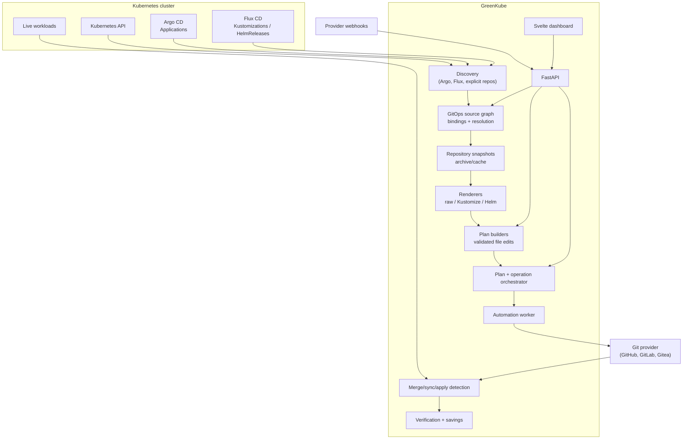

# GreenKube Actionable Optimization and GitOps Automation

| | |
|---|---|
| **Status** | Implemented and locally qualified; live provider/controller end-to-end recovery remains a release gate. |
| **Supersedes** | `docs/specs/optimization-engine.md` and `docs/automation-plan.md` |
| **Baseline** | `dev` at commit `4dbb3f2` |
| **Scope** | Observation → recommendation → action plan → pull request → GitOps sync → verification → measured savings |
| **Primary goal** | A turnkey, GitOps-native apply flow that works with Argo CD, Flux CD, raw manifests, Kustomize and Helm without per-workload GreenKube annotations |
| **Audience** | Maintainers, implementation agents, reviewers, release managers |

---

Sections 3.1–3.3 preserve the original baseline and findings for traceability; they are not a description of the current implementation. The annotation resolver, raw-manifest patcher, and single-provider bot were retired. The `/apply-pr` compatibility route now delegates to the server-resolved plan service.

## 1. Executive summary

GreenKube already has a strong measurement and recommendation foundation: a unified optimization engine, multi-source arbitration, evidence, risk, ranking, a durable automation queue, PR creation for raw YAML, apply detection, post-apply verification and a savings ledger. The weak part is the bridge between a recommendation and the repository that actually owns the workload.

The current bridge is:

- annotation-driven;
- limited to raw Deployment/StatefulSet/DaemonSet YAML;
- single-container-unsafe;
- blind to Argo CD and Flux source ownership;
- unable to edit Kustomize overlays or Helm values;
- unable to make a multi-file commit;
- unable to observe PR merge and GitOps sync reliably;
- deployed without a worker in the default Helm profile;
- coupled to a `pr_open` recommendation status that creates duplicate or disappearing recommendations.

This document defines the replacement: a controller-aware **GitOps source graph**, a **render-validated planning layer**, and a **decoupled action lifecycle**.

The target user experience is:

1. The operator installs GreenKube and configures a Git provider credential and discovery in Helm values.
2. GreenKube discovers Argo CD Applications and Flux Kustomizations/HelmReleases and maps every live workload to its repository, revision, path, renderer and patch strategy.
3. Recommendations show an **Apply** action only when GreenKube knows exactly which source file to change and can prove the rendered result.
4. The user previews one plan. The plan may update one or more files atomically.
5. GreenKube opens one pull request per workload change set, not one per recommendation.
6. Provider webhooks, with polling as fallback, track merge and sync.
7. The recommendation becomes `applied` only when the merged change is observed live, then enters the existing verification and savings loop.
8. A closed, stale or failed PR returns the recommendation to the actionable pool without losing data.
9. If verification needs a rollback, GreenKube can generate the inverse plan and open a revert PR.

No GreenKube annotation is required on any workload. Annotations remain an optional override for unusual layouts, not the primary contract.

---

## 2. Product requirements and non-goals

### 2.1 Requirements

| ID | Requirement |
|---|---|
| R1 | **Zero per-workload configuration.** A workload managed by Argo CD or Flux must become actionable without editing that workload. |
| R2 | **GitOps-native.** The source graph is derived from Argo CD and Flux controller state, not from a parallel manually maintained inventory. |
| R3 | **Raw, Kustomize and Helm.** GreenKube must plan changes for raw manifests, Kustomize overlays and Helm value sources. |
| R4 | **Correct before convenient.** A plan is shown only when GreenKube can locate the owning source and validate the rendered result. Ambiguity is explicit, never silently guessed. |
| R5 | **One click, one plan.** CPU and memory changes for the same workload are grouped into one change set and one PR by default. |
| R6 | **Atomic and idempotent.** A plan produces exactly one commit containing all file edits. Retries never create duplicate branches or PRs. |
| R7 | **PR-only mutation.** GreenKube never mutates the live cluster directly. The Git repository is the source of truth. |
| R8 | **Closed-loop.** PR merge and GitOps sync are observed. "Applied" means the change is live, not that a PR exists. |
| R9 | **Recoverable.** Closed PRs, stale plans, missed webhooks, worker crashes and repository conflicts have deterministic recovery paths. |
| R10 | **Explainable.** Every plan shows the controller, repository, revision, renderer, files, rendered diff, validation result, risk and rollback path. |
| R11 | **Secure by default.** Repository allowlists, least-privilege credentials, webhook signatures, isolated renderers and path confinement are mandatory; renderer execution fails closed until the isolation boundary is available. |
| R12 | **API compatible, source contract modernized.** The `apply-pr` endpoint remains behind a plan adapter; annotation-driven source resolution is retired. |
| R13 | **Production operable.** Discovery coverage, worker health, queue age, plan latency, PR state and webhook lag are observable. |

### 2.2 Non-goals

- Replacing Argo CD, Flux, Kustomize or Helm.
- Direct `kubectl`/API mutation of live workloads.
- Auto-merge enabled by default.
- Editing upstream chart repositories or remote Kustomize bases.
- Supporting every possible Helm chart layout without a one-time chart mapping.
- Multi-tenant SaaS isolation in this iteration. Multi-cluster identity is modeled but not the delivery focus.
- Automating every recommendation type in the first release.

### 2.3 Definition of "turnkey"

A new installation is turnkey when all of the following are true:

- The only required automation configuration is a Git provider credential, an allowlist and discovery toggles in Helm values.
- No workload annotation is required.
- For the supported matrix in §5.9, **at least 95% of workload-scoped rightsizing recommendations** on a representative Argo CD/Flux cluster resolve a source and can produce a validated plan.
- The remaining recommendations show a precise, non-blocking reason and a one-time resolution path; they never show a misleading Apply button.
- The default Helm profile can execute a queued PR operation without requiring the operator to know that a separate worker must be enabled.

---

## 3. Current-state analysis

### 3.1 As-built components

| Area | Current implementation | Assessment |
|---|---|---|
| Recommendation engine | `src/greenkube/core/optimization/` | Good foundation: one orchestration path, sources, evidence, risk, ranking, expiry, lifecycle, verification. |
| Native analyzers | `core/optimization/analyzers/` | Workload-level aggregation; not container-aware. |
| VPA/Karpenter | `core/optimization/providers/`, collectors | Functional but VPA per-container data is aggregated away. |
| Durable queue | `automation/operations.py`, SQLite/Postgres repositories, `cli/automation_worker.py` | Good primitives; worker absent from the default profile. |
| PR bot | `automation/service.py`, `automation/git/`, `automation/manifests/patcher.py` | Raw YAML + annotation discovery only. |
| Partial GitOps discovery | `automation/bindings/`, `automation/discovery/`, `collectors/argocd.py`, `collectors/flux.py`, `repository_bindings` table/API | Present but not wired into the PR path. Collectors are pure mapping functions with no Kubernetes reads. |
| Lifecycle | `core/optimization/lifecycle.py`, `applied_detector.py`, `verifier.py` | `pr_open` is a recommendation status; merge detection is Kubernetes-only and coarse. |
| API | `api/routers/automation.py`, `api/routers/repository_bindings.py` | Preview is ephemeral; no plan resource; status omits worker/discovery readiness. |
| UI | `frontend/src/routes/recommendations/+page.svelte` | No discovery setup; N+1 eligibility calls; retry handler scoping defect. |
| Helm | `helm-chart/` | Worker only in `production` profile; no Argo/Flux RBAC; no renderer tooling. |
| Tests | `tests/automation/`, `tests/integration/test_ga_acceptance.py` | Good provider/patcher coverage; no Kustomize/Helm fixtures; GA acceptance test currently fails. |

### 3.2 Original baseline flow (historical)

```text
RecommendationRecord
  -> AnnotationSourceResolver (K8s annotations)
  -> Git provider read one raw YAML file
  -> RightsizingPatcher (all containers)
  -> branch + single-file commit + PR
  -> recommendation status = pr_open
  -> AppliedDetector observes any live request drop
  -> verifier
```

This flow is linear and cannot represent a repository with multiple sources, rendered outputs, grouped recommendations or a PR that needs several file edits.

### 3.3 Baseline findings (historical)

Severity: **C** = release blocker or correctness risk; **H** = must fix before GA; **M** = important quality issue.

#### Discovery and source binding

| ID | Sev | Finding | Evidence / impact |
|---|---|---|---|
| D1 | C | A workload is actionable only if it carries `greenkube.cloud/git-repo`, `git-path` or `git-branch` annotations. | `automation/source_resolver.py:22-24,94-111`. This is the exact rigid contract the target must remove. |
| D2 | C | A second annotation contract (`greenkube.cloud/repository*`) exists in the partial binding subsystem. | `automation/bindings/annotations.py:9-11`. The two contracts disagree and only the older one is used by the service. |
| D3 | C | The Argo CD collector only reads `spec.source`, never `spec.sources`; the Flux collector emits a `Kustomization` as the "workload" instead of using `status.inventory`. | `collectors/argocd.py:20-27`, `collectors/flux.py:30-45`. The resulting bindings cannot map a Deployment to a repository. |
| D4 | C | There is no Kubernetes discovery client for Argo CD or Flux CRDs, and no RBAC for `argoproj.io` or `*.toolkit.fluxcd.io`. | `automation/discovery/` and `helm-chart/templates/clusterrole.yaml`. The partial subsystem cannot run in a cluster. |
| D5 | C | The PR service never consults `RepositoryBinding` / `RepositoryBindingDiscovery`. | `automation/service.py:77` constructs `AnnotationSourceResolver` directly. The binding table and API are dead weight. |
| D6 | C | There is no source model for renderer type, chart, values files, overlay path, source revision or controller identity. | `models/repository_binding.py` only stores `repo_url/path/branch`. Helm and Kustomize cannot be represented. |
| D7 | H | Source resolution supports only Deployment, StatefulSet and DaemonSet. | `automation/source_resolver.py:26-30`. CronJob and Job are supported by the patcher but not by discovery. |
| D8 | H | When no path is known, the service lists the repository and then fetches up to 300 YAML files one by one. | `automation/service.py:52-53,252-267`. This is slow, rate-limit hostile and does not scale. |
| D9 | H | Repository bindings have no freshness, revision, cluster identity or invalidation semantics. | `repository_bindings` schema, migration `0021`. Stale bindings can silently patch the wrong source. |
| D10 | H | Baseline finding: ambiguity was not resolved end-to-end. | Addressed by the expiring, audited manual candidate-selection flow in §5.4.5 and `POST /gitops/bindings/{namespace}/{workload_kind}/{workload_name}/resolve`. |
| D11 | H | Any annotation can redirect the bot to any repository the global token can write. | `source_resolver.py:102-111`, `git/factory.py`. Confused-deputy risk. |
| D12 | M | `source.path` is not validated for traversal or absolute paths. | `source_resolver.py:109-111`, `git/base.py:57-59`. |

#### Planning and patching

| ID | Sev | Finding | Evidence / impact |
|---|---|---|---|
| P1 | C | Only raw YAML manifests are patched. | `automation/manifests/patcher.py`. Helm templates are invalid YAML; Kustomize overlays are not handled. |
| P2 | C | A patch without a container name is applied to every container. | `patcher.py:186-203`. This changes sidecars and init-like containers incorrectly. |
| P3 | C | Multiple operations for the same resource are collapsed by `setdefault`. | `patcher.py:89-106`. Per-container CPU changes for two containers cannot be represented. |
| P4 | C | The patch model built by the engine has no container field. | `core/optimization/evidence.py:198-232`. `RecommendationPatchV2.container_name` is never populated. |
| P5 | H | A manifest without `metadata.namespace` matches any recommendation namespace. | `patcher.py:172-184`. In a repo with environment overlays, the first match can be the wrong environment. |
| P6 | H | There is no validation that the patched YAML is a valid workload, that requests stay below limits, or that the result is what the recommendation intended. | `patcher.py:112-155`. |
| P7 | H | Legacy `patchesStrategicMerge`-style thinking is not needed for raw files, but no strategy exists for Kustomize's `patches`, `components` or `helmCharts`. | No code. |
| P8 | H | There is no render validation. A source edit can be syntactically valid and render a different resource. | No code. |
| P9 | C | The Git provider contract can update only one file per commit. | `git/base.py:260-268`, `automation/service.py:336-343`. Kustomize needs at least a patch file and `kustomization.yaml`; Helm may need values plus overlay. |
| P10 | H | There is no idempotent managed-patch convention. Re-planning can add duplicate Kustomize patches or values blocks. | No code. |
| P11 | M | Round-trip fidelity is only tested on small YAML samples. Anchors, aliases, block scalars, multi-doc separators and CRLF are not covered. | `tests/automation/test_patcher.py`. |
| P12 | M | JSON manifests and `kind: List` are not supported. | `patcher.py`. |

#### Git providers, PR and merge detection

| ID | Sev | Finding | Evidence / impact |
|---|---|---|---|
| G1 | H | One global provider and one token for the whole cluster. | `core/config.py:274-285`, `automation/git/factory.py:22-53`. Cannot mix GitHub, GitLab and Gitea sources. |
| G2 | H | No multi-file atomic commit. | `git/base.py:260-268`. |
| G3 | H | No provider webhooks and no PR polling. `get_pull_request` exists but is unused. | `git/base.py:281-282`, no webhook route. |
| G4 | H | An existing open attempt is trusted from the local database without asking the provider. A PR closed remotely is still treated as open. | `automation/service.py:299-323`. |
| G5 | H | There is no reconciliation of merged, closed or failed PRs. | `PullRequestRepository.reconcile_open_pull_requests` is unused and bluntly marks all `pending` rows as errors. |
| G6 | H | No rollback PR. `rollback_review` has no action. | `core/optimization/lifecycle.py:240-263`. |
| G7 | H | Provider idempotency is incomplete. If the PR is created but the local DB write fails, a retry can fail with "PR already exists" instead of adopting the existing PR. | `automation/service.py:344-388`. |
| G8 | M | Provider clients are created per call and never closed by the service. | `automation/service.py:121-126`; `git/base.py:237-241`. |
| G9 | M | No draft PR, labels, reviewers, team assignment or auto-merge policy. | No code. |
| G10 | H | No repository allowlist, branch protection check or push-permission preflight. | No code. |

#### Orchestration, lifecycle and correctness

| ID | Sev | Finding | Evidence / impact |
|---|---|---|---|
| O1 | C | Preview is ephemeral. The dry-run diff is returned but not persisted, so approval cannot be bound to the reviewed artifact. | `automation/service.py:195-229`. |
| O2 | C | The default `standalone` Helm profile does not run the automation worker. A queued PR operation stays queued forever. | `helm-chart/values.yaml:7-10`; `helm-chart/templates/deployment.yaml`; `production-deployments.yaml:3`. |
| O3 | C | `pr_open` is a recommendation status. Recommendation refresh only recognizes active rows, so a new active duplicate can be generated while a PR is open, and a closed PR can make the recommendation disappear. | `storage/sqlite/recommendation_repository.py:220-296`, identity helpers around lines 140-180. |
| O4 | H | Apply detection reads summed workload requests and treats any decrease as applied. | `applied_detector.py:54-64,163-180`. It cannot attribute a per-container change and can produce false positives. |
| O5 | H | Merge detection is not correlated with a provider merge commit or a GitOps sync revision. | `applied_detector.py` only lists workloads. |
| O6 | M | There is no worker heartbeat, queue-age alert or automation readiness signal. | `api/routers/automation.py:139-145`. |
| O7 | M | CPU and memory generate separate recommendations and therefore separate PRs for the same workload. | Analyzer split; service handles one record. |
| O8 | M | Retry behavior after a partially completed provider operation is not fully idempotent. | `automation/service.py:329-376`. |
| O9 | M | `RecommendationLifecycle.apply()` bypasses the transition table used by `transition()`. | `lifecycle.py:156-189`. |

#### Recommendation-engine correctness

| ID | Sev | Finding | Evidence / impact |
|---|---|---|---|
| R1 | C | Rightsizing aggregates all containers of a workload and then applies the same target to every container. | `targeting.py`, analyzers, `patcher.py`. Sidecars receive the wrong request. |
| R2 | H | VPA per-container recommendations are summed into a workload target. | `core/optimization/providers/vpa.py:_aggregate_by_target`. The per-container signal is lost. |
| R3 | H | Persisted identity uses `pod_name` and not `owner_kind`/`owner_name`, so same-named Deployment and StatefulSet can collide. | `models/metrics.py:438-454`; repository identity helpers. |
| R4 | M | Deduplication excludes owner kind from its key. | `core/optimization/dedup.py:deduplicate`. |
| R5 | H | Only CPU/memory rightsizing has an action plan. Cleanup, autoscaling, off-peak and scheduling are not actionable. | `build_patch()` returns `None` for all other types. |
| R6 | H | Risk does not account for rollout state, PDB, HPA ownership, recent OOM/restart history, traffic criticality or change freezes. | `core/optimization/risks.py`. |
| R7 | M | No cooldown, budget or concurrent-PR limit per workload. | No code. |

#### API, UI, deployment, security and tests

| ID | Sev | Finding | Evidence / impact |
|---|---|---|---|
| U1 | H | The UI makes one eligibility request per recommendation, each reading the Kubernetes API. | `frontend/src/routes/recommendations/+page.svelte:114-127`. |
| U2 | H | It also makes one recommendation-detail request per open PR. | Same file, around lines 104-110. |
| U3 | C | `retryPr` is declared inside `confirmPr` but referenced by a template handler; the compiled bundle references an undefined global. | Page lines 281-284 and 535. Clicking Retry after an error throws at runtime. |
| U4 | C | There is no setup/discovery UI. Errors still tell users to add annotations. | `source_resolver.py:104-107`; recommendations page. |
| U5 | H | There is no plan resource, file list, renderer identity, rendered diff or validation status in the UI. | Preview modal only shows a raw diff and base branch. |
| U6 | M | No automation health, coverage, unresolved-workload or bulk-apply view. | Settings page has no automation section. |
| S1 | H | `X-Audit-Actor` is trusted as the audit identity. | `api/routers/automation.py:54`. Any caller can spoof the actor. |
| S2 | H | Token scope and repository allowlisting are not enforced. | `git/factory.py`, `source_resolver.py`. |
| S3 | H | Running Helm/Kustomize naively would execute chart templates and may fetch remote resources. | A dedicated renderer Pod receives only a bounded source snapshot, has no Secret mounts or service-account token, uses a default-deny egress NetworkPolicy and applies time/output/process/resource limits. Kustomize `helmCharts` remain unsupported until equivalent Helm validation is available. |
| S4 | H | Archive extraction, path traversal, symlink and decompression-bomb defenses are not implemented. | No snapshot layer exists. |
| S5 | H | No webhook signature verification or replay protection. | No webhook endpoint. |
| S6 | H | Missing Argo CD/Flux RBAC and no egress policy for Git providers. | `helm-chart/templates/clusterrole.yaml`, `networkpolicy.yaml`. |
| S7 | M | Renderer binaries and chart caches are not pinned or checksummed. | No code. |
| T1 | C | The release acceptance test fails on the current `dev` baseline. The fixture omits `scope="workload"` while the resolver now requires it. | `tests/integration/test_ga_acceptance.py:100-132`; reproduced with `uv run pytest tests/integration/test_ga_acceptance.py -q`. |
| T2 | H | No Helm or Kustomize fixture corpus. | `tests/automation/test_patcher.py`. |
| T3 | H | No end-to-end test with real Gitea plus Argo CD/Flux or equivalent controller fixtures. | Existing local Gitea manual runbook only. |
| T4 | H | No webhook, polling, merge, sync, closed-PR or rollback tests. | No code. |
| T5 | M | Docs contradict the code: repository bindings are documented as unused, two annotation contracts exist, and "Phase 4 complete" overstates Helm/Kustomize support. | `docs/api.md`, `docs/ga-qualification.md`, removed phase docs. |
| T6 | M | No performance test for discovery on hundreds of Applications/workloads or planning on large repositories. | No code. |

### 3.4 Root causes

1. **The source model is a file path, not a source graph.** A workload is mapped to one repo/path/branch, which cannot express controller ownership, renderers, overlays or values.
2. **The engine action model is a single HTTP-like patch, not a repository change set.** It cannot represent container-scoped, multi-file or renderer-specific changes.
3. **The lifecycle conflates recommendation state with PR state.** `pr_open` is the symptom; duplicate and disappearing recommendations are the consequence.
4. **Discovery was started but never connected.** The partial binding subsystem is structurally sound but has no Kubernetes feed, no renderer metadata and no service integration.
5. **The Git adapter is a file-editing adapter, not a commit engine.** Multi-file atomicity, PR adoption and provider-side idempotency are missing.
6. **Safety is enforced at the end.** Validation, render checks, allowlists and ambiguity handling must happen before the user sees Apply.
7. **The default deployment cannot complete the flow.** The worker is not present in the profile most users install.

---

## 4. Alternatives considered

| Option | Decision | Why |
|---|---|---|
| Keep annotations as the primary contract | Rejected | Contradicts the turnkey requirement and does not scale to thousands of workloads. |
| Patch only raw manifests | Rejected | Most production GitOps repositories use Helm or Kustomize. |
| Patch the live cluster directly | Rejected | Bypasses GitOps, breaks auditability and drifts from the source of truth. |
| Always patch the Kustomize base | Rejected | Bases are often shared by several environments. |
| Infer Helm values keys by convention only | Rejected as sole strategy | Charts vary widely; convention-only mapping silently produces wrong plans. |
| Use render-probe plus explicit fallback | **Chosen** | It is deterministic, testable and transparent when a chart cannot be mapped. |
| Use Kubernetes API only for merge detection | Rejected as sole strategy | It cannot distinguish a merged PR from an unrelated change and cannot detect a closed PR. |
| Provider webhooks plus polling plus GitOps sync | **Chosen** | Each layer covers the failure mode of the others. |
| Keep `pr_open` as a recommendation status | Rejected | Couples two lifecycles and breaks regeneration. A compatibility view will preserve the API field during migration. |
| Auto-merge low-risk changes by default | Rejected for v1 | PR review remains the safety boundary; auto-merge can be opt-in later. |

---

## 5. Target architecture

### 5.1 Principles

1. **The GitOps controller is the source of ownership.** Argo CD and Flux already know which repository, revision, path and renderer produced a live resource. GreenKube consumes that knowledge instead of asking users to duplicate it.
2. **A workload has a source binding, not a file path.** The binding describes the whole source unit and how to edit it safely.
3. **Plan before apply.** A plan is a durable, reviewable, digest-addressed artifact. Applying means approving a specific plan digest.
4. **Render validation is mandatory.** A source edit is accepted only if the renderer produces the intended resource change and no unrelated change.
5. **PR state and recommendation state are separate.** A recommendation remains active while a PR is open. "Applied" is a live-cluster observation.
6. **One change set per workload.** Group compatible recommendations by target and binding; avoid PR storms.
7. **Provider-agnostic, capability-aware.** Git hosts, renderers and controllers are adapters with explicit capabilities and confidence.
8. **Ambiguity is a first-class outcome.** `needs_binding`, `ambiguous`, `unsupported` and `blocked` are visible states, not hidden failures.
9. **Fail closed on safety, fail open on availability.** Missing discovery or renderer capabilities never crashes the API; it disables only the affected action.
10. **Everything is observable and reversible.** Plans, commits, PRs, syncs, applies and rollbacks have IDs, digests and audit events.

### 5.2 System context



### 5.3 Component map and package layout

The `gitops/` package owns source discovery and planning. The annotation-only `source_resolver.py` and raw-manifest `manifests/patcher.py` were removed; the retained `apply-pr` API delegates to the plan runtime.

```text
src/greenkube/gitops/
├── contracts.py
├── bindings/
│   └── manual.py
├── discovery/
│   ├── argo.py
│   ├── common.py
│   ├── flux.py
│   ├── kubernetes.py
│   ├── runtime.py
│   └── service.py
├── snapshots/
│   ├── archive.py
│   └── models.py
├── renderers/
│   ├── helm.py
│   ├── kustomize.py
│   ├── raw.py
│   └── sandbox.py
├── planning/
│   ├── helm.py
│   ├── kustomize.py
│   └── raw_manifest.py
└── sync.py

src/greenkube/automation/
├── git/
│   ├── base.py
│   ├── github.py
│   ├── gitlab.py
│   ├── gitea.py
│   ├── credentials.py
│   ├── k8s_secret_resolver.py
│   └── registry.py
├── plan_runtime.py
├── plans.py
├── plan_worker.py
├── pr_lifecycle.py
├── pr_lifecycle_runtime.py
├── pr_polling_runtime.py
├── rollback.py
├── sync_runtime.py
├── webhook_runtime.py
└── webhooks.py
```

Shared contracts live in `gitops/contracts.py` and are owned by the integration agent. No other agent edits that file without review.

### 5.4 GitOps source graph

#### 5.4.1 Source descriptor

```python
class RendererKind(StrEnum):
    RAW = "raw"
    KUSTOMIZE = "kustomize"
    HELM_VALUES = "helm_values"
    HELM_RELEASE = "helm_release"

class ControllerKind(StrEnum):
    ARGOCD = "argocd"
    FLUX_KUSTOMIZATION = "flux_kustomization"
    FLUX_HELM_RELEASE = "flux_helm_release"
    EXPLICIT_REPOSITORY = "explicit_repository"
    ANNOTATION = "annotation"

class WorkloadSource(BaseModel):
    id: str
    cluster: str
    namespace: str
    workload_kind: str
    workload_name: str

    provider_id: str
    repo_url: str
    ref: str                      # branch, tag or commit as configured
    revision: str | None          # resolved immutable commit SHA
    path: str                     # source unit path

    controller_kind: ControllerKind
    controller_name: str
    controller_namespace: str
    source_revision: str | None   # sync revision reported by the controller

    renderer: RendererKind
    renderer_config: dict         # values files, chart, overlay, release name/namespace
    confidence: float
    status: BindingStatus         # resolved | ambiguous | unresolved | blocked
    evidence: dict
    observed_at: datetime
    expires_at: datetime | None
```

`renderer_config` examples:

```json
{
  "renderer": "helm_values",
  "values_files": ["apps/payments/values-prod.yaml"],
  "chart": {"name": "payments", "version": "1.4.2", "repo": "in-repo"},
  "release_name": "payments",
  "release_namespace": "prod"
}
```

```json
{
  "renderer": "kustomize",
  "overlay_path": "apps/payments/overlays/prod",
  "kustomization_path": "apps/payments/overlays/prod/kustomization.yaml",
  "base_paths": ["apps/payments/base"]
}
```

#### 5.4.2 Argo CD discovery

- Read `applications.argoproj.io` cluster-wide (or filtered namespaces).
- Support `spec.source` and `spec.sources` (multi-source). For multi-source, identify the source that contains the workload and the source that provides Helm values (`$values/...`).
- Build the live-resource map from `status.resources[]`. Each entry provides group, version, kind, namespace and name.
- Use `status.sync.revision` and `status.operationState.syncResult.revision` as the deployed revision. Never assume `targetRevision` is a branch.
- Determine renderer:
  - `spec.source.kustomize` or a `kustomization.yaml` at `spec.source.path` -> Kustomize.
  - `spec.source.helm` -> Helm values.
  - Otherwise -> raw directory.
- For Helm:
  - Resolve `helm.valueFiles` in order. Files prefixed with `$ref/` belong to the referenced source.
  - `helm.valuesObject` and `helm.parameters` are inline values; if the Application itself is Git-managed, they are a valid plan target. Otherwise mark the binding `blocked` with reason `application-not-in-git`.
  - `helm.releaseName` and `helm.namespace` identify the live Helm release.
- For Kustomize:
  - Resolve `spec.source.path` as the overlay entry point.
  - Capture `spec.source.kustomize.patches`, `components`, `images`, `helmCharts` for planning context.
- Fall back to the Argo tracking annotation/label (`argocd.argoproj.io/tracking-id`) if `status.resources` is empty.
- ApplicationSet-generated Applications are regular Applications by the time they reach the API; no special case is required beyond reading them after generation.
- Canonicalize workload ownership: resolve ReplicaSet pods to their Deployment owner through `ownerReferences`; do not emit a ReplicaSet binding when the Deployment is available. CronJob, Job and Argo Rollout owners are supported in P1.

#### 5.4.3 Flux discovery

- Read `kustomize.toolkit.fluxcd.io/v1` Kustomizations and `helm.toolkit.fluxcd.io/v2` HelmReleases.
- Resolve source URLs from `GitRepository`, `OCIRepository`, `Bucket` or `HelmRepository` referenced by `sourceRef`.
- For Kustomizations:
  - Map live resources from `status.inventory.entries[].id`. Parse the standard inventory ID format into group/version/kind/namespace/name; reject malformed IDs.
  - `spec.path` is the overlay or base entry point.
  - Renderer is Kustomize unless the path is a plain manifest directory.
- For HelmReleases:
  - Match live resource ownership using Flux's release identity: the explicit `spec.releaseName`, or `[targetNamespace-]metadata.name` when omitted. The release namespace is `spec.targetNamespace` or the HelmRelease namespace. GreenKube does not hash or truncate the computed name; it matches the Flux value exactly and blocks plans when that value exceeds Helm's 53-character release-name limit.
  - `spec.chart.spec.valuesFiles` is supported when every selected file is a safe path in the immutable GitRepository snapshot. Paths are relative to the source artifact, files are merged in order, and the selected files replace the chart's default values for rendering. Missing files are skipped only when `ignoreMissingValuesFiles` is true.
  - `spec.chartRef` is supported for a `HelmChart` whose source is a GitRepository in the same immutable snapshot. Direct `OCIRepository` references and charts from remote HelmRepository/OCI sources are blocked because their chart artifact is not in the repository snapshot.
  - `spec.valuesFrom` supports ConfigMaps and Secrets inventoried by exactly one GitRepository-backed Flux Kustomization, in the HelmRelease namespace and same repository/ref/revision snapshot. The default `valuesKey` is `values.yaml`; ConfigMap text and Secret `data`/`stringData` are resolved only for rendering. Runtime-only, ambiguous, cross-repository, or cross-revision references and `targetPath` merging are blocked.
  - Inline `spec.values`, supported `valuesFiles`, and supported `valuesFrom` are applied in Flux precedence order to the render input. The current plan still edits only the Git-owned HelmRelease by adding/updating its managed `spec.postRenderers[]` patch; it does not rewrite values sources.
  - `spec.postRenderers[]` is a supported generic fallback (see §5.9.5).
- Use `status.artifact.revision` for the deployed source revision.

#### 5.4.4 Explicit repositories and optional annotation override

- `gitops.repositories[]` in Helm values can seed bindings for clusters without Argo/Flux or for repositories outside controller management. A repository can be marked `scan: true`.
- The scanner builds a resource index by parsing YAML/JSON at the configured branch and path filters. It never edits a file until a workload resolves to exactly one source unit.
- Explicit repositories are lower priority than a controller inventory match.
- Annotations are supported only when `gitops.allowAnnotationOverride=true`. They are an override for rare layouts, never required, and must match the repository allowlist.

#### 5.4.5 Binding resolution

Priority order (highest first):

1. Manual resolution approved in the UI for this workload and source generation.
2. Argo CD `status.resources` or Flux `status.inventory` exact match.
3. Helm release metadata match (`HelmRelease` / live release labels).
4. Explicit repository scan with a unique resource match.
5. Optional annotation override.

Rules:

- Candidates are grouped by workload identity `(cluster, namespace, kind, name)`.
- Candidates are ranked by priority, then confidence, then freshness.
- If the top candidates resolve to the same `(provider, repo, revision, path, renderer)` tuple, they are merged into one binding with provenance.
- If they resolve to different source units at the same priority, the binding is `ambiguous`. GreenKube never guesses.
- A manual resolution may be created only for an existing `ambiguous` or `unresolved` binding and only by selecting a current candidate returned by the server. The API accepts the candidate ID, an opaque generation token, and explicit confirmation; repository URLs, provider IDs, paths and renderer configuration are never client-authoritative.
- A manual resolution is stored as a binding with `source=manual_resolution`, the selected source's controller UID/generation and source UID/generation/revision, a bounded expiry no later than `GITOPS_BINDING_TTL` (default 30 minutes), and a durable audit event. It has highest resolution priority while valid and is invalidated/re-evaluated when the selected candidate identity or generation changes.
- Create, expiry and invalidation transitions each produce an idempotent durable audit event. The UI exposes safe candidate projections and requires explicit operator confirmation; stale generation tokens return `409`.
- A binding is `stale` when not observed for `GITOPS_BINDING_TTL` (default 30 minutes) or when its controller/source UID changes.
- Every binding carries a confidence score and evidence (controller UID, inventory entry, Application name, Helm release name).

#### 5.4.6 Refresh and watch

- Full discovery refresh on startup, every `GITOPS_DISCOVERY_INTERVAL` (default 5 minutes), after a webhook-triggered reconciliation and on demand from the API.
- Optional Kubernetes watches for Argo CD and Flux CRDs reduce latency. Watches must degrade to periodic listing.
- Refresh is idempotent: upsert bindings, mark vanished bindings stale, never delete audit history.
- Emit coverage metrics after every refresh.

### 5.5 Repository snapshot layer

The source index must be fast and deterministic. Per-file REST calls do not scale.

- `SnapshotProvider.fetch(provider_id, repo_url, revision) -> RepositorySnapshot`.
- Resolve a branch to an immutable commit SHA before planning. Store the SHA in the plan.
- Production GitHub, GitLab and Gitea adapters download archives using that full SHA (`tarball/{sha}`, `repository/archive.tar.gz?sha={sha}`, and `archive/{sha}.tar.gz`, respectively). Downloads are streamed under the compressed-byte limit, then pass through the bounded archive extractor; the provider-generated repository-root directory is stripped only while each entry passes the same-root and path-safety checks.
- There is no production clone or per-file fallback. A provider without bounded immutable-commit archive support fails closed; archive errors never trigger a retry at the mutable source ref.
- Cache by `(provider_id, repo_url, commit_sha)` with an LRU and TTL. Never cache by branch name.
- Limits:
  - `GITOPS_MAX_REPO_BYTES` (default 100 MiB compressed, 500 MiB extracted)
  - `GITOPS_MAX_FILES` (default 20,000)
  - `GITOPS_MAX_FILE_BYTES` (default 2 MiB per file)
  - reject path traversal, absolute paths, device entries, symlinks escaping the workspace and decompression bombs.
- Snapshot workspaces are temporary, isolated and deleted after the plan is created. Only metadata, hashes and diffs are persisted.

### 5.6 Renderers

Renderers answer two questions: "which live resource does this source produce?" and "what does the source produce after the edit?"

| Renderer | Purpose | Input | Output |
|---|---|---|---|
| `raw` | Parse raw YAML/JSON documents | source path(s) | documents with source path and document index |
| `kustomize` | Build the overlay | overlay path | rendered documents + source graph |
| `helm` | Render the chart with the selected values | chart + values files + release name/namespace | rendered documents |

Current rollout state:

- Helm and Kustomize rendering fails closed before repository inputs are inspected or a subprocess is started. The API/worker pods are not an isolation boundary because they may have provider credentials, database access, and Kubernetes service-account credentials.
- The bounded local subprocess helper limits time and output only; it does not isolate filesystem access, networking, CPU, memory, or process count and must not be used with repository-controlled input.
- Kustomize `helmCharts` are currently blocked by the renderer fail-closed policy; they must remain rejected when rendering is re-enabled until Helm's deterministic-template, schema-reference, dependency, and version checks can be applied to the embedded Helm invocation.
- Raw-manifest parsing remains in-process.

Before Helm or Kustomize rendering is re-enabled, a dedicated execution boundary must provide:

- pinned binary versions, a non-root identity, a read-only root filesystem, and `RuntimeDefault` seccomp;
- no provider Secret or database credential mounts and no Kubernetes service-account token;
- denied network egress (enforced by the cluster network layer, not an environment flag);
- read-only repository snapshot input and separate bounded scratch/output storage;
- hard CPU, memory, PID, wall-clock, stdout, and stderr limits.

- When isolated rendering is implemented, normalize output before comparison: stable key order, ignored volatile labels/annotations, and resource identity indexes.
- An enabled renderer result includes:
  - rendered resources;
  - source map (resource -> file or generated template);
  - warnings;
  - renderer version;
  - output digest.
- Helm templates that call `lookup` or other cluster-dependent functions must be rejected; rendering uses `--no-hooks` and a controlled capability set.

### 5.7 Action model

The engine stops emitting a repository-specific patch. It emits a typed action that is independent of Git and renderers.

```python
class ResourceTarget(BaseModel):
    api_version: str
    kind: str
    namespace: str
    name: str

class ContainerResources(BaseModel):
    requests: dict[str, str] = {}   # e.g. {"cpu": "300m", "memory": "256Mi"}
    limits: dict[str, str] = {}

class SetContainerResources(BaseModel):
    op: Literal["set_container_resources"] = "set_container_resources"
    container: str                  # required; no implicit all-container behavior
    resources: ContainerResources

class DeleteResource(BaseModel):
    op: Literal["delete_resource"] = "delete_resource"

class AddHorizontalPodAutoscaler(BaseModel):
    op: Literal["add_hpa"] = "add_hpa"
    min_replicas: int
    max_replicas: int
    target_cpu_utilization: int | None = None

class ActionPlanV3(BaseModel):
    version: Literal[3] = 3
    action_id: str
    recommendation_ids: list[int]
    target: ResourceTarget
    operations: list[SetContainerResources | DeleteResource | AddHorizontalPodAutoscaler]
    constraints: dict
    evidence_ref: str
```

Rules:

- `container` is required for resource changes.
- Quantities are canonical Kubernetes quantity strings, not integers.
- The action model supports future cleanup, HPA and scheduling actions without changing the API shape.
- `Recommendation.patch` becomes a deprecated compatibility view over `ActionPlanV3`; new code reads `action`.
- A recommendation carries `action_status` separate from lifecycle status: `none`, `grouped`, `plan_ready`, `pr_open`, `merged`, `sync_pending`, `applied`, `closed`, `failed`, `reverted`.

### 5.8 Planning layer

A planner converts an action plus a binding plus a snapshot into a **FilePlan**:

```python
class FileEdit(BaseModel):
    path: str
    operation: Literal["create", "update", "delete"]
    original_sha: str | None
    content: str | None

class FilePlan(BaseModel):
    plan_id: str
    files: list[FileEdit]
    diff: str
    rendered_diff: str
    base_revision: str
    source_revision: str | None
    renderer: str
    validation: ValidationResult
    warnings: list[str]
    digest: str
```

Planning is deterministic. The same action, binding and commit SHA must produce the same file edits and digest.

#### 5.8.1 Raw manifest planner

- Use the exact source path from the binding or render map.
- Match documents by `apiVersion`, `kind`, `metadata.namespace` and `metadata.name`; never match a missing namespace against a known namespace when multiple environment overlays exist.
- Apply container operations by container name.
- Preserve comments and formatting with `ruamel.yaml` round-trip.
- Validate:
  - workload kind is supported;
  - container exists;
  - resulting requests are valid quantities;
  - requests do not exceed limits when limits are present;
  - no other resource changes in the same file;
  - re-render/re-parse validation passes.
- Support multi-document YAML, JSON manifests and `kind: List`.
- Refuse unsafe constructs: duplicate resource identities in the same file, ambiguous documents, templated YAML that is not valid after rendering.

#### 5.8.2 Kustomize planner

The planner never edits a base unless it is the actual app entry point and has no other consumers.

Algorithm:

1. Resolve the overlay entry point from the binding (`spec.source.path` for Argo, `spec.path` for Flux).
2. Parse `kustomization.yaml` / `kustomization.yml` / `Kustomization`.
3. Find an existing GreenKube-managed patch:
   - a patch entry with label/annotation `greenkube.cloud/managed: "true"`, or
   - a file matching `greenkube-<workload>-<hash>.yaml` referenced by the overlay.
4. If found, update that patch in place.
5. If not found:
   - create a strategic-merge patch file in the overlay (or a `greenkube-patches/` subdirectory);
   - add a `patches` entry with an explicit `target` selector (group, version, kind, name, namespace);
   - use `patches` (current Kustomize API), not deprecated `patchesStrategicMerge`, unless the repository already standardizes on the legacy form.
6. Detect shared bases:
   - scan the repository for Kustomizations that reference the target path as a base or component;
   - if more than one consumer exists and the target path is a base, refuse and return `needs_binding` with the list of consumers.
7. Render before and after. Verify:
   - only the target container(s) changed;
   - the target resource set is unchanged;
   - no unrelated resource was added, removed or modified.
8. Store the patch file and `kustomization.yaml` edit in the same FilePlan.

Patch file example:

```yaml
apiVersion: apps/v1
kind: Deployment
metadata:
  name: payments-api
  namespace: prod
  annotations:
    greenkube.cloud/managed: "true"
    greenkube.cloud/action-id: "act_01J..."
spec:
  template:
    spec:
      containers:
        - name: api
          resources:
            requests:
              cpu: 300m
              memory: 256Mi
```

Kustomization edit example:

```yaml
patches:
  - path: greenkube-patches/deployment-payments-api.yaml
    target:
      group: apps
      version: v1
      kind: Deployment
      name: payments-api
      namespace: prod
```

#### 5.8.3 Helm values planner

Helm values are the primary Argo CD and Flux action surface.

1. Resolve the values files from the binding in render order. If no values file exists, use `valuesObject`/`values` when the owning object is Git-managed.
2. Determine the value paths that control the target container resources:
   - **Existing override:** if the values file already sets resources for the workload, update those paths.
   - **Schema hint:** use `values.schema.json` and chart defaults to identify valid resource structures.
   - **Template analysis:** parse chart templates that contribute to the target resource and extract candidate `.Values.*` paths affecting `resources`.
   - **Render probe:** render the chart with a sentinel value for each candidate path; accept a candidate only when the target container's requests change and no unrelated rendered resource changes. Use the narrowest unique path.
   - **Cache:** store the resulting chart/workload mapping keyed by chart digest, template digest and workload identity.
3. If no unique mapping exists, return `needs_chart_mapping` (not an error). The UI can offer a one-time chart-level mapping; the mapping is stored globally and reused for all workloads of that chart.
4. Preserve values-file comments and formatting with `ruamel.yaml`.
5. Render before and after and validate that only the intended container resources changed.

Helm values example:

```yaml
payments-api:
  resources:
    requests:
      cpu: 300m
      memory: 256Mi
```

The exact path is discovered, not assumed. Common chart conventions are hints, not rules.

#### 5.8.4 Flux HelmRelease planner

The implemented strategy is a **render-validated post-renderer patch**: GreenKube adds or updates a managed `spec.postRenderers[]` Kustomize patch targeting the workload, even when the chart does not expose resource values. Before creating that edit, it reproduces Flux's supported chart values from the immutable Git snapshot:

- a local chart from the same-revision GitRepository source, or `chartRef` to a Git-backed `HelmChart` in that snapshot;
- ordered `chart.spec.valuesFiles` from safe source-relative paths, honoring `ignoreMissingValuesFiles`;
- inline `spec.values` plus same-snapshot ConfigMap/Secret `valuesFrom` entries in Flux merge order.

The plan does not rewrite `spec.values`, values files, ConfigMaps, or Secrets. Remote HelmRepository/OCI chart artifacts, cross-repository or cross-revision values, runtime-only or ambiguously owned valuesFrom references, and `valuesFrom.targetPath` are blocked with typed reasons because their effective values cannot be reconstructed and validated from the snapshot.

Post-renderer example:

```yaml
spec:
  postRenderers:
    - kustomize:
        patches:
          - target:
              group: apps
              version: v1
              kind: Deployment
              name: payments-api
              namespace: prod
            patch: |-
              apiVersion: apps/v1
              kind: Deployment
              metadata:
                name: payments-api
                namespace: prod
              spec:
                template:
                  spec:
                    containers:
                      - name: api
                        resources:
                          requests:
                            cpu: 300m
                            memory: 256Mi
```

The planner must use strategic-merge-style patches, not brittle JSON6902 indexes, unless the target layout requires JSON patch. Managed patches carry the same `greenkube.cloud/managed` marker for idempotency.

#### 5.8.5 Argo CD Helm without a resolvable mapping

If the Application is Git-managed, the planner may edit `spec.source.helm.valuesObject` / `values` or the referenced values file. If the chart does not parameterize resources or the Application is not Git-managed, the binding is `blocked` with:

- reason `helm-values-not-resolvable`; or
- reason `application-not-in-git`.

The recommendation remains visible with a one-time chart mapping action. GreenKube must never produce a plan that changes values the chart ignores.

#### 5.8.6 Other action planners (P1/P2)

The same interface supports:

- delete a resource (zombie pod, orphaned PV/LB, idle namespace);
- add an HPA (autoscaling candidate);
- add an off-peak schedule or suspend policy;
- node/pool changes in an infrastructure repository.

These are out of the P0 critical path but must not require a new architecture.

### 5.9 Supported source matrix

| Source layout | Discovery | Plan strategy | v1 status |
|---|---|---|---|
| Argo CD, raw YAML | `status.resources` | Raw manifest planner | P0 |
| Argo CD, Kustomize overlay | `status.resources` + `spec.source.path` | Kustomize planner | P0 |
| Argo CD, Helm with values file | `status.resources` + `helm.valueFiles` | Helm values planner | P0 |
| Argo CD, Helm with inline `valuesObject` / `parameters` | `status.resources` | Blocked: inline values are not yet a supported, independently validated Git edit target | Blocked |
| Argo CD, multi-source Helm values | `status.resources` + `spec.sources` | Values source plan | P0 |
| Argo CD, Helm chart with no resource values and non-Git Application | `status.resources` | Blocked with precise reason; one-time mapping | P0 |
| Flux Kustomization, raw/Kustomize | `status.inventory` | Raw or Kustomize planner | P0 |
| Flux HelmRelease with `spec.chart` and a local same-revision GitRepository chart | Flux release identity | Render `valuesFiles` / `valuesFrom` / inline values, then managed post-renderer patch | P0 |
| Flux HelmRelease with `chartRef` to a local Git-backed HelmChart in the same snapshot | Flux release identity | Render the captured HelmChart path and values, then managed post-renderer patch | P0 |
| Flux HelmRelease with a remote HelmRepository/OCI chart or direct OCI `chartRef` | Flux release identity | Blocked: chart artifact is not present in the immutable repository snapshot | Blocked |
| Flux HelmRelease with runtime-only, ambiguous, cross-repository, or cross-revision `valuesFrom` | Flux release identity | Blocked with a precise source reason | Blocked |
| Flux HelmRelease with `valuesFrom.targetPath` | Flux release identity | Blocked: targetPath merge semantics are not implemented | Blocked |
| Explicit repository in Helm values | Resource index | Raw/Kustomize/Helm planner | P0 |
| Optional annotation override | Annotation | Same planners | P0 (disabled by default) |
| Argo CD Application not stored in Git | Controller | No PR target | Blocked |
| Remote Kustomize base / remote chart artifact | Snapshot layer | Blocked unless the exact artifact is present in an immutable validated snapshot | P1 |
| Multi-container workload | Live Pod spec + engine | Per-container planner | P0 after container-aware engine |
| CronJob / Job / Argo Rollout | Controller/inventory | Raw planner | P1 |
| Cleanup / HPA / off-peak / carbon-aware / node actions | Engine | No GitOps action planner yet; keep non-actionable and show a typed reason | Blocked |

Only CPU and memory rightsizing actions currently have GitOps planners. Other recommendation families must not expose an enabled PR action until an action-specific planner and rendered validation are implemented.

### 5.10 Plan, operation and merge lifecycle

#### 5.10.1 Decoupled lifecycles

Recommendation lifecycle remains: `active`, `ignored`, `stale`, `expired`, `applied`, `verifying`, `verified`, `rollback_review`, `reverted`, `failed`.

Action lifecycle is new: `none`, `plan_ready`, `pr_open`, `merged`, `sync_pending`, `applied`, `closed`, `failed`, `reverted`.

The legacy `pr_open` recommendation status is retained only as a compatibility projection. During migration:

- records with status `pr_open` are backfilled to `active` plus an open action;
- API responses expose `status` for compatibility and add `action_status`;
- new writes never create a `pr_open` recommendation status.

This eliminates the duplicate-active-record and disappearing-recommendation defects.

#### 5.10.1.1 Legacy automation-state upgrade

Migration `0034` preserves legacy queue and PR rows while making their disposition explicit:

- Queued/running rows in `automation_operations` are failed rather than replayed because they lack the immutable, plan-bound source snapshot required by the current worker. Their request/result data remains in the legacy table, and the previous status/error plus a durable reason are recorded in `automation_state_migration_audit`. Terminal rows remain historical records and are audited without being requeued.
- A legacy PR is linked only when its recommendation, provider type, exact repository identity, PR host, lifecycle-compatible plan and provider resolve uniquely. Any independently unique provider link is retained, but an unresolved or ambiguous plan/provider association is quarantined with its previous status/error and an explicit reason in the audit table.
- Unlinked pending/open PR rows become `error` so they are excluded from polling. A recommendation previously marked `pr_open` is released to `failed` only when no active PR or busy plan remains, allowing reviewed replanning without overwriting a live association.
- The migration does not delete legacy rows or infer ownership from provider type or recommendation ID alone.

#### 5.10.2 Plan state machine

```text
draft -> validated -> approved -> applying -> pr_open -> merged -> synced -> applied
   |         |            |          |          |          |        |
   |         |            |          |          |          |        +-> sync_failed
   |         |            |          |          |          +-> closed
   |         |            |          |          +-> failed
   |         |            |          +-> failed
   |         |            +-> stale (source changed / expired)
   |         +-> needs_mapping / ambiguous / rejected
   +-> superseded
```

- `draft`: plan is being built.
- `validated`: render and policy validation passed; digest is stable.
- `approved`: the user approved this exact digest.
- `applying`: the worker is committing.
- `pr_open`: the provider PR exists.
- `merged`: the provider reports merge and the merge commit is known.
- `synced`: the GitOps controller reports the merge revision as deployed.
- `applied`: the live workload matches the plan.
- `sync_failed`: merged but not observed within the timeout; requires operator attention.
- `closed`: PR closed without merge; recommendation returns to the actionable pool.
- `stale`: source revision or plan digest changed before approval/apply.
- `failed`: terminal provider or validation failure; retry creates a new plan.

#### 5.10.3 Approval and staleness

- Preview creates and persists a plan. The UI receives `plan_id`, `digest`, `base_revision`, `files`, `diff`, `rendered_diff`, `validation`, `expires_at`.
- Approval includes the plan digest. If the source revision or plan digest changed, approval returns `409 plan_stale`; the user must preview again.
- A plan snapshot targets the current Git branch head. It records the GitOps controller's reported deployed revision separately; when those revisions differ, the preview warns that the render may not match the live workload and recommends refreshing discovery or syncing before approval.
- A plan expires after `GITOPS_PLAN_TTL_MINUTES` (default 30).
- One active plan per workload binding. Creating a new plan supersedes the old one; an open PR is adopted or updated according to provider capability.
- If a plan requires edits in more than one repository (for example, a values source and an Application manifest), GreenKube creates linked plans/PRs with a shared change-set ID. It never patches only one side silently.
- Updating an open PR appends a new commit to the existing branch. GreenKube never force-pushes. If the provider cannot update the PR safely, the operation closes it with an explanation and creates a new plan.

#### 5.10.4 Operation execution

The worker:

1. Claims a durable operation with a database lease (`FOR UPDATE SKIP LOCKED` in PostgreSQL; `BEGIN IMMEDIATE` in SQLite).
2. Loads the plan and verifies the digest.
3. Re-resolves the base revision and fails with a retryable conflict if it moved.
4. Creates one atomic commit with all file edits.
5. Creates or adopts the PR.
6. Persists provider IDs, commit SHAs and plan state.
7. Emits audit events.
8. Releases the lease.

Retries are provider-idempotent:

- deterministic branch per plan;
- before creating a PR, list open PRs by head branch and adopt an existing one;
- if a commit already exists for the same digest, reuse it;
- never force-push;
- transient failures use exponential backoff up to `AUTOMATION_MAX_ATTEMPTS` (default 5);
- permanent failures are terminal and produce an actionable error.

#### 5.10.5 Merge, sync and apply detection

Detection order:

1. **Provider webhook** (primary): `pull_request.closed`/merged events with signature verification, delivery deduplication and merge commit SHA.
2. **Provider polling** (fallback): every `GITOPS_PR_POLL_INTERVAL` (default 2 minutes), poll open PRs and adopt state missed by webhooks.
3. **GitOps sync observation**: Argo CD `status.sync.revision` or Flux Kustomization `status.lastAppliedRevision` reaches the merge commit (or contains it) and the controller is healthy. For a Flux HelmRelease backed by a GitRepository, GreenKube also reads that GitRepository's `status.artifact.revision`; HelmRelease `status.lastAttemptedRevision` is a chart version, not a Git commit.
4. **Live workload observation**: per-container requests match the plan within tolerance and the resource changed after the persisted pre-apply baseline. An advanced generation on the same UID or a replacement UID is accepted only when the current generation is observed.
5. **Kubernetes apply detector** (last resort): manual edits or changes without provider events.

Rules:

- A live request decrease alone never marks a recommendation applied.
- Detection is per container and per target; summed workload requests are not sufficient.
- The worker captures target UID, generation, observed generation and per-container requests before provider mutation. A replacement UID counts as a post-baseline change only when the same namespace/kind/name is still targeted, the current generation is observed, and per-container requests match the synced plan.
- A merged but unsynced PR becomes `sync_pending`, not `applied`.
- A PR closed without merge transitions the action to `closed` and returns the recommendation to `active`.
- A sync timeout produces `sync_failed` and an alert; the recommendation is not silently lost. Only `sync_timeout` failures are re-observed so a later exact source revision and Ready controller can recover the plan to `synced`; other sync failures remain terminal.
- In-cluster collection can supplement Prometheus with per-container CPU/memory from the read-only `metrics.k8s.io` PodMetrics API when Prometheus drops container labels. The chart grants only `get/list` on `pods.metrics.k8s.io`; it never grants `nodes/proxy`. Pod-level cost, energy, and carbon shares copied to container rows are explicitly marked estimated, and pod-level network/disk/restart data is not duplicated across containers.
- Container-scoped post-apply verification reads the container metrics repository and requires an exact `container_name` match; it never falls back to pod aggregates or sibling containers. Savings verification uses only samples explicitly marked `is_estimated=false` in both the before and after windows. Estimated or unknown savings samples never produce a `verified` result; after one extended observation window, insufficient trusted samples leave the recommendation `applied` with verification `inconclusive`. Available exact-container health signals are still evaluated so missing savings quality does not suppress rollback review.
- Negative OpenCost totals are marked untrusted and projected savings are clamped at zero; raw source measurements remain available for diagnosis.
- After digest and source revalidation, the worker captures the target workload UID, nonzero `metadata.generation`,
  reconciled `status.observedGeneration`, and normalized requests for every container immediately before its first Git
  mutation. The baseline is written once to the persisted plan and reused by retries. Missing or invalid workload
  state is a retryable worker failure; no branch, commit or PR is created without a valid baseline.
- Typed forward apply detection requires the same workload UID, a generation greater than the baseline, an
  `observedGeneration` at least as high as the current generation, and the exact target container matching the plan
  within tolerance. Missing baselines, unchanged generations and unreconciled generations remain pending.
- Rollback confirmation uses the rollback plan's own UID/generation baseline and requires the original plan's exact
  pre-apply requests for every affected container; a request match without post-baseline reconciliation remains
  `rollback_review`.

#### 5.10.6 Rollback

- On `rollback_review`, GreenKube builds an inverse plan from the original plan's file edits and the current base revision.
- The inverse plan is rendered and validated like any other plan.
- The user can approve a revert PR in one click. The revert PR is linked to the original plan and recommendation.
- The recommendation remains `rollback_review` until the revert is observed, then moves to `reverted`.
- Attribution stops as soon as rollback review begins, as it does today.

### 5.11 Git provider and credential model

#### 5.11.1 Multiple providers

Configuration moves from one global `GIT_*` set to a provider registry:

```yaml
automation:
  providers:
    - id: github-main
      type: github
      apiBaseUrl: ""
      tokenSecret:
        name: greenkube-git
        key: github-token
      repositories:
        - "acme/gitops"
        - "acme/platform"
    - id: gitea-local
      type: gitea
      apiBaseUrl: "http://gitea-http.gitea.svc.cluster.local:3000"
      tokenSecret:
        name: greenkube-git
        key: gitea-token
      repositories:
        - "greenkube/*"
```

- Each binding records `provider_id`.
- Repository patterns support exact names and globs; an empty allowlist means "deny all".
- Credentials are read from Secret references, never from the ConfigMap.
- Preferred production credential: GitHub App installation token, GitLab project/group access token or Gitea scoped token. Long-lived personal tokens are supported but discouraged.
- A provider preflight verifies token validity, repository read access and PR write capability before an operation starts. The result is surfaced in the API/UI.

#### 5.11.2 Provider capabilities

`GitProvider` advertises capabilities:

- `multi_file_commit`
- `draft_pull_request`
- `labels`
- `reviewers`
- `team_reviewers`
- `webhooks`
- `merge_detection`
- `branch_protection_check`

The typed `GitProviderCapability` contract includes those features and the provider-native tree/ref operations. The worker preflights every configured, non-empty pull-request option before creating a branch or commit. Missing capabilities fail with `provider-capability-missing`; options are never silently dropped.

The `automation.pullRequests` schema defaults are `draft: false`, `labels: [greenkube, sustainability]`, and empty `reviewers` and `teamReviewers` lists. Provider request shapes are:

| Provider | Draft | Labels | Reviewers | Team reviewers |
|---|---|---|---|---|
| GitHub | Native `draft` create field | Added through the issue-label API | Usernames, requested through the PR review API | Team slugs, requested through the PR review API |
| GitLab | `Draft:` title prefix | Comma-separated names on MR creation | Positive numeric user IDs in `reviewer_ids` | Unsupported; preflight fails when configured |
| Gitea | Unsupported; preflight fails when `draft: true` | Configured names are resolved to repository label IDs before PR creation | Usernames in `reviewers` | Team names in `team_reviewers` |

GitHub applies labels/review requests after opening the PR and rechecks missing review requests when adopting an existing PR, so a retry can finish metadata application without duplicating the PR. GitLab and Gitea include their supported options in the create request; Gitea fails before PR creation if any configured label cannot be resolved.

#### 5.11.3 Commit engine

The contract becomes:

```python
class GitCommitRequest(BaseModel):
    repo: GitRepository
    branch: str
    base_revision: str
    message: str
    files: list[GitFileEdit]
    author_name: str
    author_email: str

class GitCommitResult(BaseModel):
    commit_sha: str
    branch: str
    files_changed: list[str]

class GitProvider(ABC):
    async def create_commit(self, request: GitCommitRequest) -> GitCommitResult: ...
    async def find_pull_request(self, repo, head: str, base: str) -> PullRequestInfo | None: ...
    async def create_or_update_pull_request(self, ...) -> PullRequestInfo: ...
    async def list_pull_requests(self, repo, state: str) -> list[PullRequestInfo]: ...
    async def get_pull_request(self, repo, number: int) -> PullRequestInfo: ...
```

Implementation notes:

- GitHub: Git Data API (blobs, tree, commit, ref) or Contents API only for single-file fallback.
- GitLab: Commits API with `actions[]` for multiple files; `last_commit_id` conflict checks.
- Gitea: Contents API only supports one file per call; use Git Data/tree/commit endpoints where available. If multi-file is impossible, the provider reports the capability missing.
- All providers use optimistic concurrency on the base revision and return a typed conflict error.

#### 5.11.4 Webhooks and polling

- Webhook endpoints: `POST /api/v1/webhooks/github`, `/gitlab`, `/gitea`.
- Verify HMAC/signature using a configured secret; reject stale timestamps and unknown delivery IDs.
- Deduplicate deliveries in `webhook_deliveries` by provider + delivery ID.
- Normalize events into `PullRequestEvent` and enqueue a reconciliation operation.
- Polling is always available as a fallback and as the recovery path after downtime.
- Never trust a webhook payload as the sole source of truth; fetch or reconcile the PR state.

### 5.12 Recommendation engine changes

#### 5.12.1 Container-aware targets

The target architecture requires per-container rightsizing.

- Extend the collection model with a stable container dimension, either:
  - `CombinedMetric.container_name` for container-level records; or
  - a separate `container_usage` table keyed by pod/container/timestamp.
- The Prometheus collector already reads container labels; the pod collector already exposes container requests. The missing piece is preserving the dimension through aggregation and storage.
- Analyzers operate on `(namespace, owner_kind, owner_name, container_name)`.
- Evidence includes per-container request/usage and a container-level proposed change.
- VPA provider preserves per-container recommendations instead of summing them.
- Interim safety gate: until container-aware analysis is enabled, the planner refuses multi-container workloads with `requires_container_target`. It never applies the same request to every container.

#### 5.12.2 Recommendation grouping

- Add `change_set_key = (cluster, namespace, owner_kind, owner_name, binding_id)`.
- The planner groups all eligible active recommendations for the same key into one action plan and one PR.
- Compatible operations merge: CPU and memory for the same container, multiple containers in one workload.
- Conflicting operations are rejected or split; the UI explains why.
- A single plan can reference many recommendation IDs. Lifecycle transitions update all of them together.

#### 5.12.3 Actionability and policy

Each recommendation receives an `actionability` assessment:

- `actionable`
- `needs_binding`
- `ambiguous`
- `needs_chart_mapping`
- `blocked`
- `unsupported`
- `stale`

Policy gates before a plan is offered:

- binding resolved and fresh;
- renderer supported;
- source path parsed and target matched;
- sample count and coverage above thresholds;
- no rollout in progress;
- the owning controller is healthy enough to sync (Argo CD Application not suspended; Flux Kustomization/HelmRelease not suspended);
- no change freeze label/window;
- risk within `automation.maxRiskLevel`;
- confidence above `automation.minConfidence`;
- no open plan/PR for the workload (unless grouping);
- per-workload PR budget and cooldown respected;
- HPA/PDB interactions checked.

Policy results are persisted with the plan and returned by the plan API. The persisted result records the policy
snapshot, evaluation time, workload identity, individual check states and typed rejection reasons. Missing risk or
confidence evidence, plan-history evidence, or workload-label evidence required by a configured freeze label fails
closed; callers must not treat unavailable evidence as a passing check.

The documented defaults are `maxRiskLevel: medium`, `minConfidence: 0.6`,
`minSamples: 36`, `minCoverage: 0.5`,
`maxOpenPullRequestsPerWorkload: 1`, `cooldownMinutes: 60`, `changeFreezeLabels: []` and
`changeFreezeWindows: []`. Freeze labels are workload label keys or exact `key=value` selectors. A configured label
cannot be evaluated without current workload-label evidence (`workload_labels` or `workload.labels`) and therefore
rejects the plan. Freeze windows use timezone-aware absolute `start`/`end` timestamps and are configured through
`GITOPS_POLICY_JSON` or the equivalent `automation.policy` Helm values.

Discovery attaches live workload labels, rollout state, GitOps controller suspend/health and HPA/PDB interaction
evidence to each binding. When a discovery source cannot collect one of those inputs (for example, missing HPA/PDB
RBAC), the policy result reports that gate as `not_available` rather than `passed`. Sample-count and coverage evidence
is checked against the configured numeric thresholds; missing or below-threshold evidence rejects the plan.

### 5.13 API

All paths are under `/api/v1`.

#### 5.13.1 GitOps discovery and bindings

| Method | Path | Behavior |
|---|---|---|
| `GET` | `/gitops/status` | Discovery providers, controller versions, last refresh, coverage, renderer availability. |
| `POST` | `/gitops/refresh` | Trigger discovery refresh. |
| `GET` | `/gitops/sources` | List discovered source units (controller, repo, path, renderer, revision). |
| `GET` | `/gitops/bindings` | List a bounded page of workload bindings; status can be filtered. Candidate responses contain an opaque generation token and safe projections. |
| `GET` | `/gitops/bindings/{namespace}/{kind}/{name}` | Read one persisted workload binding, including current candidates and safe evidence projections. |
| `POST` | `/gitops/bindings/{namespace}/{kind}/{name}/resolve` | Resolve only an existing ambiguous/unresolved binding using one current server candidate, its generation token and explicit confirmation. Audited and expiring. |
| `GET` | `/gitops/coverage` | Resolved/ambiguous/blocked counts and actionable coverage. |

#### 5.13.2 Plans and automation

| Method | Path | Behavior |
|---|---|---|
| `POST` | `/automation/plans` | Create a policy-approved plan for one or more recommendation IDs. Returns `201` with plan, policy result, files, diff, rendered diff and validation. |
| `GET` | `/automation/plans/{plan_id}` | Read a plan, including policy result, warnings and source identity. |
| `POST` | `/automation/plans/{plan_id}/approve` | Revalidate policy, approve the exact digest and enqueue an operation. Returns `202`. |
| `POST` | `/automation/plans/{plan_id}/cancel` | Cancel a plan that is not applying. |
| `GET` | `/automation/operations/{operation_id}` | Existing durable operation status, extended with plan and provider IDs. |
| `POST` | `/recommendations/{id}/apply-pr` | Compatibility wrapper: creates a plan and approves it when `dry_run=false`; `dry_run=true` returns the plan preview. |
| `GET` | `/recommendations/{id}/actions` | Action history for a recommendation. |
| `GET` | `/automation/pull-requests` | Open/pending PRs with plan, merge and sync state. |
| `GET` | `/automation/status` | Extends the current response with worker heartbeat, discovery, renderers, provider preflight and queue age. |
| `POST` | `/webhooks/{provider}` | Signed provider webhook. |

Errors are typed and actionable:

- `409 plan_stale`
- `409 source_changed`
- `422 unsupported_source`
- `422 ambiguous_binding`
- `422 needs_chart_mapping`
- `424 provider_not_ready`
- `429 automation_budget_exhausted`
- typed policy rejections including `policy_evidence_missing`, `policy_risk_exceeded`,
  `policy_confidence_too_low`, `change_freeze_active`, `workload_pr_limit_exceeded`,
  `workload_cooldown_active` and `workload_plan_already_exists`

#### 5.13.3 Backward compatibility

- `POST /recommendations/{id}/apply-pr` keeps its current request/response shape. Internally it creates a plan and, for non-dry-run requests, approves it.
- `GET /recommendations/{id}/pull-requests` remains.
- `GET /automation/status` keeps existing keys and adds new ones.
- `GET /repository-bindings` remains, but is deprecated in favor of `/gitops/bindings`. It reads the new binding table through a compatibility view.
- `RecommendationRecord.status` keeps `pr_open` for old clients; new clients read `action_status`.

### 5.14 Persistence

New migrations (SQLite and PostgreSQL together):

| Migration | Contents |
|---|---|
| `0022_gitops_providers.sql` | Provider registry, encrypted/secret references, allowlists, capabilities. |
| `0023_workload_sources.sql` | Source units, bindings, candidates, controller identity, revision, renderer config, confidence, expiry. |
| `0024_automation_plans.sql` | Plans, file edits, diffs, rendered diffs, digests, validation, status, expiry; plan-recommendation join. |
| `0025_pr_webhook_state.sql` | Extend PR rows with plan/provider/commit/merge/sync fields; webhook deliveries. |
| `0026_automation_worker_health.sql` | Worker heartbeat and lease metadata. |
| `0027_action_status.sql` | Recommendation action status, backfill `pr_open` to `active` + open action. |

Data rules:

- JSON columns: `TEXT` in SQLite, `JSONB` in PostgreSQL.
- Every table has `created_at`/`updated_at`; plans and operations are append-only except for state columns.
- No secrets in the database; only secret references and non-sensitive metadata.
- Migrations must be idempotent and covered by both SQLite and PostgreSQL contract tests.
- A backfill script imports existing `repository_bindings` and `recommendation_pull_requests` into the new tables and records a migration event.

### 5.15 UI and UX

#### 5.15.1 First-run setup

- Detect Argo CD and Flux automatically.
- Show discovered controllers, repositories and coverage.
- Ask only for provider credential and repository allowlist if not already configured in Helm.
- Provide a "Test connection" action that checks read and PR-write permissions.
- No workload annotations are mentioned as a requirement.

#### 5.15.2 Recommendations page

- Show actionability badge and reason on every card.
- `Apply` opens a plan preview, not a raw dry-run.
- Preview displays:
  - controller and Application/Kustomization/HelmRelease;
  - repository, base branch, revision, path;
  - renderer and values/overlay;
  - files changed;
  - source diff and rendered diff;
  - validation result;
  - impact, risk, confidence, rollback conditions;
  - expiry;
  - one optional advanced base-branch field.
- Grouped recommendations show "2 changes in one PR".
- Bulk select creates one plan per workload, or one plan with multiple workloads when explicitly chosen.

#### 5.15.3 Pull requests and actions

- A single tab shows plan/PR/merge/sync/apply/verify state.
- Closed/abandoned PRs show "Return to active" and "Re-plan".
- Failed operations show attempts, last error and retry.
- Merged but unsynced PRs show the waiting controller and revision.
- Rollback review offers an inverse-plan preview.

#### 5.15.4 Automation and repositories page

- Provider health and token scopes.
- Worker heartbeat, queue depth, oldest queued operation.
- Discovery freshness and coverage.
- Unresolved workloads with one-time resolution.
- Chart mapping cache and one-time chart mappings.
- Recent operations with digests and audit links.

#### 5.15.5 Performance and correctness fixes

- Replace per-recommendation eligibility calls with one batch actionability response.
- Replace per-PR recommendation detail calls with embedded or batched data.
- Fix the `retryPr` scoping defect (page lines 281-284 and 535) and add a component test that clicks Retry after an error.
- Do not refresh recommendations synchronously on every page load by default.

### 5.16 Configuration and Helm

Example user-facing values:

```yaml
profile: standalone

automation:
  enabled: true
  mode: inline                 # inline | worker | disabled
  worker:
    replicas: 1
    pollSeconds: 5
  discovery:
    argocd:
      enabled: true
      namespaces: []           # empty = cluster-wide
    flux:
      enabled: true
      namespaces: []
    annotations:
      enabled: false           # optional override only
    interval: 5m
    bindingTtl: 30m
  repositories: []              # optional explicit repo allowlist/scan seeds
  renderers:
    raw:
      enabled: true
    kustomize:
      enabled: true
      binary: /usr/local/bin/kustomize
      timeoutSeconds: 30
      allowRemoteBases: false
    helm:
      enabled: true
      binary: /usr/local/bin/helm
      timeoutSeconds: 30
      allowRemoteCharts: false
  planning:
    requireRenderValidation: true
    planTtlMinutes: 30
    maxRepoBytes: 104857600
    maxFiles: 20000
  policy:
    maxRiskLevel: medium
    minConfidence: 0.6
    minSamples: 36
    minCoverage: 0.5
    maxOpenPullRequestsPerWorkload: 1
    cooldownMinutes: 60
    changeFreezeLabels: []
    changeFreezeWindows: []
  pullRequests:
    draft: false
    labels: [greenkube, sustainability]
    reviewers: []
    teamReviewers: []
  webhooks:
    enabled: true
    secretName: greenkube-webhooks
    secretKey: hmac

providers:
  - id: github-main
    type: github
    apiBaseUrl: ""
    tokenSecret:
      name: greenkube-git
      key: token
    repositories:
      - "acme/gitops"
```

Legacy single-provider keys (`config.recommendations.git.*` and `secrets.gitToken`) are retired and are not migrated automatically. Existing releases must move to `automation.providers` with a namespaced Kubernetes Secret reference and repository allowlist before upgrading; see the provider registry upgrade instructions in `docs/configuration.md`.
- Workload repository annotations are not a source-resolution contract; only the documented Argo CD Helm values mapping annotation is supported for sources that need explicit values-file mapping.

Deployment:

- `standalone` profile runs the collector/API and an inline worker loop by default (`mode: inline`), so a queued PR completes without extra configuration.
- `production` profile runs the separate worker Deployment (`mode: worker`).
- Only one mode may execute operations at a time; the durable queue's leases prevent double execution if both accidentally run.
- The image includes pinned `helm` and `kustomize` binaries or a renderer sidecar with those binaries. Versions and checksums are documented and updated through the release process.
- RBAC adds read access to:
  - `applications.argoproj.io`, `applicationsets.argoproj.io`
  - `kustomizations.kustomize.toolkit.fluxcd.io`
  - `helmreleases.helm.toolkit.fluxcd.io`
  - `gitrepositories.source.toolkit.fluxcd.io`
  - `ocirepositories.source.toolkit.fluxcd.io`
  - `helmrepositories.source.toolkit.fluxcd.io`
  - `buckets.source.toolkit.fluxcd.io`
- NetworkPolicy allows egress only to configured Git provider hosts and chart repositories. Renderer subprocesses have no network access by default.

### 5.17 Security model

| Threat | Control |
|---|---|
| Malicious annotation redirects the bot to an unauthorized repository | Repository allowlist per provider; controller bindings outrank annotations; annotations disabled by default; no cross-provider credential reuse. |
| Path traversal / symlink escape | Workspace confinement, reject `..`, absolute paths, symlinks and device entries; validate every plan file path. |
| Archive bombs / oversized repositories | Compressed/extracted/file count/file size limits; stream with cancellation. |
| Arbitrary code execution through Helm/Kustomize | Pinned binaries, argument arrays (no shell), scrubbed env, no cluster credentials, no network, timeout, CPU/memory limits; optional separate sandbox pod. |
| Remote base/chart SSRF or supply chain | Remote bases/charts disabled by default; allowlist + checksum + cache when enabled. |
| Token exfiltration | Secret references only, redaction in logs/errors, short-lived GitHub App tokens, least-privilege scopes, preflight verification. |
| Webhook spoofing/replay | HMAC signature, timestamp window, delivery ID dedupe, provider API re-fetch. |
| Unauthorized approval | API authentication; actor derived from authenticated principal, not a spoofable header. |
| Branch protection bypass | PR-only, never force-push, detect protected branches, surface missing checks. |
| YAML bombs/aliases | Safe loader, document count and nesting/size limits. |
| Confused deputy via explicit repo config | Repository allowlist is the authorization boundary; chart/base allowlists separate. |
| Audit tampering | Append-only events and plans, immutable digests, plan/commit/PR correlation. |

### 5.18 Observability and SLOs

Metrics:

- `greenkube_gitops_bindings_total{status}`
- `greenkube_gitops_coverage_ratio`
- `greenkube_gitops_discovery_refresh_duration_seconds`
- `greenkube_gitops_source_age_seconds`
- `greenkube_automation_plans_total{status,renderer}`
- `greenkube_automation_plan_duration_seconds{renderer}`
- `greenkube_automation_operations_total{status,type}`
- `greenkube_automation_queue_age_seconds`
- `greenkube_automation_worker_up`
- `greenkube_pull_requests_total{state,provider}`
- `greenkube_pull_request_merge_detection_seconds`
- `greenkube_gitops_sync_lag_seconds`
- `greenkube_automation_failures_total{reason}`

SLOs:

- Discovery refresh success >= 99% per day.
- Binding coverage for supported layouts >= 95%.
- Plan p95 latency < 30 seconds for repositories under the configured limits.
- Merge detection p95 < 3 minutes with webhooks; < 5 minutes with polling.
- Queue oldest operation < 5 minutes under normal load.
- No plan is applied without render validation.

Health:

- `/api/v1/automation/status` reports worker heartbeat, discovery age, renderer versions and provider preflight.
- `/api/v1/health` remains liveness-only; automation readiness is separate so provider outages do not fail the API.

### 5.19 Testing strategy

Test pyramid:

1. **Pure unit tests** for action grouping, binding resolution, planners, path validation, policy and state machines.
2. **Fixture tests** for raw YAML, multi-doc, JSON, Kustomize overlays (base/overlay/components/helmCharts), Helm charts (values files, schema, valuesObject, valuesFrom, postRenderers), Argo multi-source and Flux inventory.
3. **Golden diff tests** for every planner; assert exact file edits and no unrelated changes.
4. **Render validation tests** using pinned Kustomize/Helm binaries in CI.
5. **Provider contract tests** with `respx` for GitHub/GitLab/Gitea, multi-file commits, PR adoption, conflicts, 404/429/5xx.
6. **Webhook tests** for signatures, replay, duplicate delivery and normalization.
7. **Lifecycle tests** for approve/stale/merge/closed/sync timeout/rollback/apply/verify.
8. **End-to-end tests** with real SQLite and PostgreSQL, a local Gitea, and controller fixtures; optionally a kind cluster with Argo CD and Flux for nightly runs.
9. **Frontend component tests** for setup, actionability, plan preview, retry and closed/re-plan flows.
10. **Security tests** for traversal, archive bombs, template sandbox escapes, token redaction and allowlist enforcement.
11. **Performance tests** for 1,000 Applications, 5,000 workloads and a 100 MiB repository.

Required fixtures:

- raw Deployment/StatefulSet/DaemonSet/Job/CronJob;
- multi-container workload;
- Kustomize base + prod/staging overlays;
- Kustomize `helmCharts`;
- Helm chart with `values.schema.json`;
- Helm chart without resource values (post-renderer path);
- Argo multi-source with `$values`;
- Flux Kustomization inventory;
- Flux HelmRelease with inline values, valuesFrom and postRenderers;
- ambiguous two-repo binding;
- shared base referenced by two overlays;
- repository with comments, anchors, block scalars and CRLF;
- malicious path, symlink and oversized archive.

CI:

- Add a dedicated renderer job with pinned Helm/Kustomize versions.
- Add a controller-fixture job.
- Keep SQLite and PostgreSQL parity.
- Keep the GA acceptance test green and make it part of the required checks.

---

## 6. Multi-agent delivery plan

### 6.1 Delivery principles

- **Contract-first.** Freeze models, interfaces, API schemas and state machines before parallel implementation.
- **Trunk-based.** Short-lived branches, feature flags, daily integration. No long-lived integration branch.
- **Fakes at the seams.** Every agent codes against an interface and a deterministic fake so parallel work does not block.
- **One owner per path.** File ownership in §6.4 minimizes merge conflicts.
- **Green gates.** A wave does not close with failing lint, type checks, migrations, contract tests or the GA acceptance test.
- **Safety before breadth.** Raw/Kustomize/Helm P0 paths must be validated before cleanup/HPA actions are added.
- **No silent fallback.** Unsupported layouts return typed reasons and are tracked as coverage debt.

### 6.2 Agent roster and ownership

| Agent | Role | Primary ownership | Must not edit |
|---|---|---|---|
| **A0** | Architecture and integration lead | `gitops/contracts.py`, ADRs, integration branches, final acceptance | Feature implementations owned by other agents |
| **A1** | Data and persistence | `core/migrations/**`, `storage/**`, mappers | Planner logic, UI |
| **A2** | GitOps discovery | `gitops/discovery/**` | Provider commits, UI |
| **A3** | Snapshot and renderers | `gitops/snapshots/**`, `gitops/renderers/**`, renderer tooling | Binding resolution, API |
| **A4** | Action model and recommendation engine | `gitops/actions/**`, `models/metrics.py` action fields, `core/optimization/**` | Planning file edits, UI |
| **A5** | Patch planners | `gitops/planning/**` | Discovery, migrations, UI |
| **A6** | Git providers, credentials, webhooks | `automation/git/**`, `automation/webhooks.py`, provider API models | Planner logic, lifecycle |
| **A7** | Orchestrator, plans, worker, lifecycle | `automation/plans.py`, `automation/plan_runtime.py`, `automation/plan_worker.py`, `automation/rollback.py`, `core/optimization/lifecycle.py` | Provider internals, planner internals |
| **A8** | API | `api/routers/gitops.py`, `api/routers/automation.py`, `api/schemas.py`, OpenAPI | Storage internals, UI |
| **A9** | Frontend and UX | `frontend/**` | Backend behavior |
| **A10** | Deployment, security, observability | `helm-chart/**`, `Dockerfile`, `core/observability.py`, network policy | Application logic |
| **A11** | QA, CI, docs, release | `tests/fixtures/**`, `.github/workflows/**`, `docs/**`, `scripts/**` | Production feature code except test fixes |

### 6.3 Wave plan and dependency graph

```text
Wave 0 (contracts)
  A0 + all agents review
      |
      +--> Wave 1 (parallel foundations)
      |      A1  persistence
      |      A2  discovery
      |      A3  snapshots + renderers
      |      A4  action model / engine
      |      A6  providers + credentials
      |      A10 deployment/RBAC scaffolding
      |      A11 fixtures + CI harness
      |
      +--> Wave 2 (parallel integration)
      |      A5  planners (needs A3/A4)
      |      A7  plans/worker/lifecycle (needs A1/A6)
      |      A2  binding resolution finish (needs A1/A2)
      |      A4  container-aware engine finish
      |
      +--> Wave 3 (product surface)
      |      A8  API (needs A1/A3/A5/A7)
      |      A9  frontend (needs A8 contracts)
      |      A6  webhooks/polling finish (needs A7)
      |      A7  merge/sync/rollback finish (needs A6.5)
      |      A10 observability + hardened chart
      |
      +--> Wave 4 (hardening and release)
             A11 E2E/security/performance/docs
             A0 final integration
             all bug fixes
```

Critical path:

```text
Contracts -> persistence + snapshot/renderers -> planners -> orchestrator -> API -> UI -> E2E -> GA
```

Discovery and provider work are parallel and join at the first integration checkpoint. Provider webhooks can be developed in parallel but are integrated after the plan/PR state machine is stable.

Indicative cadence with 8-10 active agents:

| Wave | Duration | Exit focus |
|---|---|---|
| Wave 0 | 3-5 days | Contracts, ADRs, fixtures, migration outline. |
| Wave 1 | 8-10 days | Persistence, discovery, snapshot/renderers, provider commits, chart/RBAC scaffolding. |
| Wave 2 | 8-10 days | Planners, plan/worker lifecycle, grouping, render validation. |
| Wave 3 | 8-10 days | API, UI, webhooks/polling, sync/apply states, observability. |
| Wave 4 | 5-8 days | E2E, security, performance, migration drill, docs, GA sign-off. |

The schedule is dependency-driven, not a promise. The critical path is the planner-to-orchestrator-to-API chain; adding agents outside that chain shortens discovery, provider and test work but cannot make plans ship earlier without stable contracts.

### 6.4 Detailed tasks

#### A0 - Architecture and integration lead

| Task | Deliverable | Depends on | Acceptance |
|---|---|---|---|
| A0.1 | Freeze `gitops/contracts.py`: `WorkloadSource`, `BindingResolution`, `ActionPlanV3`, `FilePlan`, `Plan`, `Operation`, `PullRequestEvent`, state enums, error codes. | None | All agents approve; no contract change after Wave 0 without an ADR. |
| A0.2 | ADRs: source graph, renderer sandbox, plan lifecycle, provider credentials, compatibility. | A0.1 | Reviewed and linked from this spec. |
| A0.3 | Feature flags and rollout matrix: `automation.mode`, discovery toggles, renderer toggles, `plan_v3`. | A0.1 | Incomplete paths cannot be enabled in production. |
| A0.4 | Integration cadence: daily merge queue, cross-agent dependency board, interface drift checks. | A0.1 | Wave gates met on schedule. |
| A0.5 | Final GA integration and release sign-off. | All | §7 acceptance checklist is green. |

#### A1 - Data and persistence

| Task | Deliverable | Depends on | Acceptance |
|---|---|---|---|
| A1.1 | Migrations 0022-0027 for providers, sources/bindings, plans, PR/webhook state, worker health, action status. | A0.1 | SQLite and PostgreSQL apply cleanly from an empty and an existing database. |
| A1.2 | Repositories and mappers for providers, bindings, plans, plan files, plan recommendations, webhook deliveries, worker heartbeats. | A1.1 | Parity contract tests pass on both backends. |
| A1.3 | Backfill from `repository_bindings` and `recommendation_pull_requests`; convert legacy `pr_open` records to `active` + open action. | A1.1 | Migration test covers old and new rows; no data loss. |
| A1.4 | Plan/recommendation many-to-many queries and action-status queries used by API/UI. | A1.2, A0.1 | Query tests cover grouped plans and state transitions. |
| A1.5 | Retention/cleanup for expired plans, webhook deliveries and old worker heartbeats. | A1.2 | Job is idempotent and measurable. |

#### A2 - GitOps discovery

| Task | Deliverable | Depends on | Acceptance |
|---|---|---|---|
| A2.1 | Kubernetes clients for Argo CD and Flux CRDs with capability detection and graceful absence. | A0.1 | No crash when CRDs are absent; metrics report availability. |
| A2.2 | Argo CD discovery: `spec.source`, `spec.sources`, `status.resources`, sync revisions, Helm/Kustomize classification, tracking fallback. | A2.1, A0.1 | Fixtures cover single/multi-source, raw, Kustomize and Helm. |
| A2.3 | Flux discovery: Kustomization inventory, HelmRelease release identity, values/valuesFrom, postRenderers, source revisions. | A2.1, A0.1 | Inventory parsing and Helm identity tests pass. |
| A2.4 | Explicit repository scan and optional annotation override. | A2.1, A0.1 | No annotation required; override is opt-in. |
| A2.5 | Binding resolver with priority, confidence, ambiguity, freshness, manual resolution and coverage. | A1.2, A2.2-A2.4 | Ambiguous fixtures never resolve silently. |
| A2.6 | Refresh scheduler/watches, stale reconciliation, audit events and metrics. | A2.5, A1.2 | Refresh is idempotent; stale bindings expire. |
| A2.7 | Controller fixture/e2e job for Argo/Flux (nightly or envtest). | A2.5, A11.1 | Runs without cloud credentials. |

#### A3 - Snapshot and renderers

| Task | Deliverable | Depends on | Acceptance |
|---|---|---|---|
| A3.1 | Repository snapshot service: archive download/clone, commit resolution, cache, limits, safe extraction. | A0.1 | Traversal, symlink, bomb and size tests pass. |
| A3.2 | Raw renderer: YAML/JSON, multi-doc, `kind: List`, source map, normalize. | A0.1 | Golden fixtures pass. |
| A3.3 | Kustomize renderer with pinned binary, sandbox and deterministic build. | A3.1 | Builds base/overlay/components/helmCharts fixtures. |
| A3.4 | Helm renderer with pinned binary, values order, `--no-hooks`, capabilities and sandbox. | A3.1 | Values/valuesObject/valuesFrom fixtures render deterministically. |
| A3.5 | Render validation: target-only diff, unrelated-change detection, output digest. | A3.2-A3.4 | Rejects a plan that changes an unrelated resource. |
| A3.6 | Renderer version reporting and preflight. | A3.3-A3.4 | API/status shows versions and readiness. |

#### A4 - Action model and recommendation engine

| Task | Deliverable | Depends on | Acceptance |
|---|---|---|---|
| A4.1 | `ActionPlanV3`, typed container operations, canonical quantities, grouping. | A0.1 | Schema/unit tests; no all-container default. |
| A4.2 | Engine emits actions and per-container evidence; compatibility view for `patch`. | A4.1 | Rightsizing fixtures produce container-specific actions. |
| A4.3 | Container-aware metrics/analysis; VPA per-container preservation. | A1.2, A4.2 | Multi-container recommendations target the correct container. |
| A4.4 | Interim single-container gate until A4.3 is enabled. | A4.2 | Multi-container plans are blocked, not misapplied. |
| A4.5 | Actionability and policy assessment: risk, confidence, rollout, freeze, budgets, cooldown. | A4.2 | Policy tests cover every rejection reason. |
| A4.6 | Grouping compatible CPU/memory recommendations into one change set. | A4.1, A4.2 | One plan contains both operations; conflicts are rejected. |
| A4.7 | Prepare P1 action types (delete, HPA, off-peak) behind flags. | A4.1 | Interface is extensible; no P0 regression. |

#### A5 - Patch planners

| Task | Deliverable | Depends on | Acceptance |
|---|---|---|---|
| A5.1 | Planner registry and `FilePlan` contract; policy-aware selection from binding capabilities. | A0.1, A3.5 | Unsupported layouts return typed reasons. |
| A5.2 | Raw manifest planner: exact identity, container operations, limits validation, multi-doc/JSON. | A3.2, A4.1 | Golden tests; no namespace-ambiguous match. |
| A5.3 | Kustomize planner: managed patch, overlay targeting, shared-base detection, idempotency. | A3.3, A4.1 | Re-plan does not duplicate patches; shared base is refused. |
| A5.4 | Helm values planner: values order, schema/template/render-probe mapping, chart mapping cache. | A3.4, A4.1 | Unique mapping only; ambiguous mapping returns `needs_chart_mapping`. |
| A5.5 | Flux HelmRelease planner: values/valuesFrom and postRenderers fallback. | A3.4, A5.4 | Post-renderer plan works for a chart with no resource values. |
| A5.6 | Render validation and plan digest in every planner. | A3.5, A5.2-A5.5 | A plan never reaches `validated` without target-only validation. |
| A5.7 | Multi-file plan assembly and conflict detection. | A5.2-A5.5 | One plan can update patch + kustomization or values + overlay. |

#### A6 - Git providers, credentials and webhooks

| Task | Deliverable | Depends on | Acceptance |
|---|---|---|---|
| A6.1 | Provider registry and credential resolution from Secret refs; repository allowlist and preflight. | A0.1 | Unknown/denied repos are rejected before any Git call. |
| A6.2 | Multi-file atomic commit for GitHub/GitLab/Gitea; typed conflict and capability errors. | A0.1 | One commit per plan; provider contract tests pass. |
| A6.3 | Branch/PR idempotency and safe cleanup of deterministic plan branches after provider-verified PR closure/merge or terminal plans. | A6.2 | Crash-after-create/delete recovery is idempotent; base, open-PR and unrelated branches are never deleted. |
| A6.4 | Webhook endpoints, signature verification, delivery dedupe and normalization. | A7.1 | Replayed/tampered webhooks are rejected. |
| A6.5 | Polling fallback and PR state reconciliation. | A6.3, A7.1 | Missed webhook is recovered within the poll interval. |
| A6.6 | Draft PR, labels, reviewers, team reviewers and branch-protection preflight. | A6.3 | Feature flags/capabilities honored per provider. |
| A6.7 | Close provider clients and reuse HTTP connections safely. | A6.2 | No client leaks in tests/soak. |

#### A7 - Orchestrator, plans, worker and lifecycle

| Task | Deliverable | Depends on | Acceptance |
|---|---|---|---|
| A7.1 | Plan service: create, validate, persist, approve, stale, expire, supersede. | A1.2, A5.1 | Approval of a changed digest returns `409 plan_stale`. |
| A7.2 | Durable operation worker with plan IDs, leases, heartbeat, backoff and terminal failures. | A1.2, A6.2 | Crash/retry tests do not duplicate PRs. |
| A7.3 | Decouple recommendation and action lifecycle; add `action_status`; backfill and compatibility projection. | A1.1, A4.5 | Regeneration never creates duplicate active recommendations; closed PR returns to active. |
| A7.4 | Merge/sync/apply detection order and per-container matching. | A1.2, A2.6, A6.5 | Merged-but-unsynced and closed-PR scenarios pass. |
| A7.5 | Rollback inverse plan and approval flow. | A7.1, A5.1, A7.4 | Revert PR is linked and validated. |
| A7.6 | Worker modes (`inline`, `worker`, `disabled`), health heartbeat and readiness. | A7.2, A10.1 | Default standalone installation executes operations. |
| A7.7 | Grouped plan lifecycle: all recommendations transition together. | A7.1, A4.6 | Plan/recommendation join is consistent. |

#### A8 - API

| Task | Deliverable | Depends on | Acceptance |
|---|---|---|---|
| A8.1 | GitOps discovery/binding/coverage endpoints. | A2.5, A1.2 | OpenAPI and contract tests; typed errors. |
| A8.2 | Plan create/read/approve/cancel endpoints. | A7.1, A5.1 | Digest approval and stale handling covered. |
| A8.3 | Typed error model, pagination, request-size limits and OpenAPI schemas shared with the UI. | A0.1, A8.1-A8.2 | Generated OpenAPI is stable; legacy response fields remain. |
| A8.4 | Extend automation status, operations and PR listings; compatibility wrapper for `apply-pr`. | A7.2, A6.5 | Old clients still work. |
| A8.5 | Authenticated actor identity; remove trust in `X-Audit-Actor`; audit response. | A10.4 | Spoofed header cannot change the actor. |
| A8.6 | Batch actionability endpoint to remove the UI N+1 calls. | A4.5 | One request per recommendation page. |

#### A9 - Frontend and UX

| Task | Deliverable | Depends on | Acceptance |
|---|---|---|---|
| A9.1 | First-run automation setup and discovery coverage view. | A8.1, A8.4 | No annotation instructions; provider test works. |
| A9.2 | Actionability badges and batch actionability loading. | A8.6 | No N+1 eligibility requests. |
| A9.3 | Plan preview modal with source/files/rendered diff/validation. | A8.2 | Approve button uses plan digest. |
| A9.4 | PR/action tracking: merge, sync, closed, failed, rollback. | A8.4 | Closed PR offers re-plan; merged-unsynced is visible. |
| A9.5 | Bulk/grouped plan UX. | A7.7, A8.2 | One plan per workload by default. |
| A9.6 | Fix `retryPr` scoping and add regression test. | A8.4 | Retry works after a failed operation. |
| A9.7 | Automation/repositories settings page with worker and provider health. | A8.4 | Queue depth and last refresh are visible. |

#### A10 - Deployment, security and observability

| Task | Deliverable | Depends on | Acceptance |
|---|---|---|---|
| A10.1 | Helm chart: automation modes, provider registry, renderer values, worker in the default profile. | A0.1 | `helm template` for standalone and production; worker present when enabled. |
| A10.2 | RBAC for Argo CD/Flux CRDs and minimal workload reads; documentation of required rights. | A2.1 | RBAC tests; no secrets access. |
| A10.3 | Dedicated renderer workload with pinned Helm/Kustomize; checksums, versions, and bounded snapshot transport. | A3.3-A3.4 | Reproducible renderer versions; no same-pod sidecar fallback. |
| A10.4 | Isolation and network policy: no credentials or service-account token, read-only input/root FS, denied egress, CPU/memory/PID/time/output limits. | A3.3-A3.4 | Security tests and rendered policy; unsafe paths remain disabled. |
| A10.5 | Metrics, health, heartbeat and alert rules. | A7.2, A8.4 | Dashboard panels and alerts documented. |
| A10.6 | Threat model and security checklist. | A6.4, A10.4 | Reviewed before GA. |

#### A11 - QA, CI, docs and release

| Task | Deliverable | Depends on | Acceptance |
|---|---|---|---|
| A11.1 | Fixture corpus for raw/Kustomize/Helm/Argo/Flux/security. | A0.1 | Fixtures reusable by all agents. |
| A11.2 | Renderer CI job with pinned binaries and golden validation. | A3.3-A3.4 | Job is required and deterministic. |
| A11.3 | Provider webhook and multi-file commit contract tests. | A6.2, A6.4 | All providers covered. |
| A11.4 | E2E: SQLite/PostgreSQL + local Gitea + controller fixtures; optional kind/Argo/Flux nightly. | A7.4, A8.2, A9.3 | Full apply-to-verify flow is green. |
| A11.5 | Security tests: traversal, archive bomb, sandbox, token redaction, allowlist, spoofed actor. | A10.4, A8.5 | No high-severity findings. |
| A11.6 | Performance tests: 1,000 Applications, 5,000 workloads, 100 MiB repo. | A2.6, A3.1, A5.6 | Meets §5.18 SLOs. |
| A11.7 | Docs: install, discovery, support matrix, chart mapping, migration, rollback, troubleshooting. | A8, A9, A10 | No annotation-first instructions. |
| A11.8 | Fix/refresh the GA acceptance test and add it to required checks. | A0.1 | Test is green on `dev` and in CI. |
| A11.9 | Demo/runbook with local Gitea, Argo CD and Flux. | A11.4 | Reproducible local demo. |

### 6.5 Parallelization matrix

| Workstream | Can start | Blocked by | Integrates with |
|---|---|---|---|
| Persistence (A1) | Wave 0 | Contracts | A2, A4, A7, A8 |
| Discovery (A2) | Wave 0 | Contracts | A1, A5, A7 |
| Snapshot/renderers (A3) | Wave 0 | Contracts | A5 |
| Action model/engine (A4) | Wave 0 | Contracts | A5, A7, A8 |
| Providers/credentials (A6) | Wave 0 | Contracts | A7, A8 |
| Deployment/RBAC (A10) | Wave 0 | Contracts | A2, A3, A7 |
| Fixtures/CI (A11) | Wave 0 | Contracts | Everyone |
| Planners (A5) | Wave 1 | A3, A4 | A7, A8, A11 |
| Orchestrator/lifecycle (A7) | Wave 1 | A1, A6, A4 | A5, A8, A9 |
| API (A8) | Wave 2 | A1, A5, A7 | A9, A11 |
| Frontend (A9) | Wave 2 | A8 contracts | A8, A11 |
| Hardening/release (A11, A0) | Wave 3 | All | - |

Rules:

- Agents may merge behind feature flags as soon as their unit and contract tests pass.
- A cross-cutting contract change requires A0 approval and a migration note.
- No agent waits for a full subsystem; fakes and fixtures are mandatory in Wave 0.
- A0 runs a daily integration build and publishes a dependency burn-down.

### 6.6 Integration checkpoints and quality gates

| Gate | When | Required |
|---|---|---|
| G0 - Contracts frozen | End of Wave 0 | Approved contracts, ADRs, API schema, migration outline, fixture list. |
| G1 - Foundations | End of Wave 1 | Migrations apply on SQLite/Postgres; discovery/renderer/snapshot/action unit tests; RBAC and chart render; no regressions. |
| G2 - Plans | End of Wave 2 | Raw/Kustomize/Helm golden plans; render validation; multi-file commit; idempotent retry; plan lifecycle. |
| G3 - Product surface | End of Wave 3 | API/UI plan flow; batch actionability; closed/merged/sync states; inline worker; webhooks/polling. |
| G4 - GA | End of Wave 4 | Full E2E matrix, security, performance, docs, demo, migration, rollback drill, GA acceptance test green. |

Every gate requires:

- `ruff check`, `ruff format --check`, type check;
- unit/integration tests with coverage not below the current threshold;
- SQLite/PostgreSQL contract parity;
- `helm lint` and chart tests;
- frontend tests and production build;
- no broken documentation links;
- a written risk review for any deferred item.

### 6.7 Risks and mitigations

| Risk | Impact | Mitigation |
|---|---|---|
| Helm values mapping is chart-specific | Plans blocked or wrong | Render-probe validation, schema/template analysis, one-time chart mapping, Flux post-renderer fallback; never guess. |
| Kustomize base shared across environments | Wrong environment changed | Consumer scan; refuse shared bases; require one-time overlay resolution. |
| Running Helm/Kustomize is unsafe | RCE/SSRF | Sandbox, no network, pinned binaries, scrubbed env, timeouts, resource limits. |
| Multi-file provider differences | Partial commits | Capability contract; fail closed if atomic commit unsupported. |
| Lifecycle migration | Lost history/duplicate records | Dual-write/compatibility projection; backfill; migration tests; feature flag. |
| Discovery drift/version changes | Stale or wrong bindings | TTL, controller UID, capability detection, refresh, coverage metrics. |
| Token privilege | Blast radius | Allowlist, least-privilege scopes, GitHub App tokens, preflight. |
| Scope creep to all action types | Delays P0 | Freeze P0 to rightsizing; P1/P2 behind flags. |
| Test flakiness from live clusters | Slow CI | Deterministic fixtures by default; nightly kind/Argo/Flux. |
| Performance on large repos | Timeouts/memory | Archive snapshots, commit cache, limits, performance gates. |
| Chart mapping cache stale after chart upgrade | Wrong values path | Key cache by chart/template digest; invalidate on source revision. |

### 6.8 Rollout and backout

1. Ship migrations and models with features disabled.
2. Enable discovery in shadow mode: bindings and coverage are computed and displayed, but Apply is disabled.
3. Enable plan preview for internal users on raw manifests.
4. Enable plan approval and PR creation for raw, then Kustomize, then Helm.
5. Enable webhooks/polling and sync detection.
6. Enable the inline worker in the default profile.
7. Enable grouped plans and rollback PRs.
8. GA when §7 is green.

Backout:

- Disable `automation.enabled`; queued operations stop and plans expire.
- Disable individual renderers or discovery sources without redeploying the application.
- Keep the old `apply-pr` compatibility path available until at least one minor release after GA.
- Migrations are additive; no destructive rollback is required. A down-migration script is provided for emergency use but is not part of normal operations.

---

## 7. Acceptance criteria

### 7.1 Functional

- [ ] Argo CD raw-manifest workload: recommendation → plan → PR → merge → sync → applied → verified, with no GreenKube annotation.
- [ ] Argo CD Kustomize overlay: plan adds a managed patch and `kustomization.yaml` entry in one commit; rendered diff contains only the target container.
- [ ] Argo CD Helm values: plan updates the correct values file; rendered diff contains only the target container.
- [ ] Argo CD multi-source Helm: values source is identified and patched; chart source is never modified.
- [ ] Flux Kustomization: inventory maps the workload; raw/Kustomize plan works.
- [ ] Flux HelmRelease with values: values are patched; with a non-parameterized chart, post-renderer plan works.
- [ ] Explicit repository in Helm values: workload resolves without controller CRDs; unique-match rule prevents wrong edits.
- [ ] Optional annotation override still works when enabled.
- [ ] Multi-container workload is either planned per container or blocked with `requires_container_target`; never all-container.
- [ ] CPU and memory recommendations for one workload produce one grouped plan and one PR.
- [ ] Plan approval of a stale digest returns `409 plan_stale`.
- [ ] Closed PR returns the recommendation to the actionable pool and allows re-plan.
- [ ] Merged-but-unsynced PR is visible as `sync_pending`; it is not marked applied.
- [ ] Retry after a provider failure does not create a duplicate branch or PR.
- [ ] Rollback review can produce a validated revert PR.
- [ ] Default standalone installation executes a queued operation without manual worker setup.
- [ ] Existing `apply-pr` clients continue to work.

### 7.2 Non-functional

- [ ] No workload annotations required for the supported matrix.
- [ ] Binding coverage >= 95% on the reference fixture cluster.
- [ ] Discovery refresh does not exceed the configured CPU/memory budget.
- [ ] Plan p95 < 30 seconds for repositories under the configured limits.
- [ ] Merge detection p95 < 3 minutes with webhooks and < 5 minutes with polling.
- [ ] No renderer subprocess has network or cluster credentials.
- [ ] No token, webhook secret or chart credential is logged.
- [ ] Path traversal, archive bomb, symlink and spoofed actor tests pass.
- [ ] SQLite and PostgreSQL migrations/contract tests pass.
- [ ] Frontend has no N+1 eligibility calls and no undefined retry handler.
- [ ] `helm lint`, chart tests, frontend build and the GA acceptance test are green.
- [ ] Documentation contains no annotation-first workflow.

### 7.3 Release checklist

- [ ] `./scripts/validate_ga.sh` passes.
- [ ] PostgreSQL contract tests pass with `GREENKUBE_TEST_POSTGRES_DSN`.
- [ ] Production Helm profile renders and runs the worker.
- [ ] Standalone profile runs the inline worker.
- [ ] Local Gitea + Argo CD + Flux demo completes the full loop.
- [ ] Migration from the previous release is tested with existing recommendations and PR rows.
- [ ] Rollback and emergency-disable runbooks are tested.
- [ ] Security review signed off.
- [ ] Coverage/observability dashboards are live.

---

## Appendix A - Current versus target

| Concern | Current | Target |
|---|---|---|
| Source discovery | Workload annotations | Argo/Flux controller graph, explicit repos, optional annotations |
| Helm | Not supported | Values planner + Flux post-renderer + chart mapping |
| Kustomize | Not supported | Managed overlay patch planner |
| Container targeting | All containers | Per-container, or blocked until supported |
| Plan | Ephemeral dry run | Durable, digest-addressed plan |
| Commit | One file | Atomic multi-file commit |
| PR state | Local row, no reconciliation | Webhook + polling + sync + live apply |
| Recommendation state | `pr_open` status | Separate action lifecycle |
| Worker | Production profile only | Inline default + separate production worker |
| Grouping | One rec per PR | One change set per workload |
| Rollback | Manual | Validated inverse plan |
| UI | Per-card calls, annotation errors | Batch actionability, setup, coverage, plan preview |
| Security | Global token, annotations | Provider allowlist, least privilege, sandbox, signatures |

---

## Appendix B - Discovery mapping examples

### B.1 Argo CD Helm application

```yaml
apiVersion: argoproj.io/v1alpha1
kind: Application
metadata:
  name: payments-prod
  namespace: argocd
spec:
  project: payments
  destination:
    server: https://kubernetes.default.svc
    namespace: prod
  source:
    repoURL: https://github.com/acme/gitops.git
    targetRevision: main
    path: apps/payments
    helm:
      releaseName: payments
      valueFiles:
        - values-prod.yaml
status:
  sync:
    revision: 4f2c1a9...
  resources:
    - group: apps
      version: v1
      kind: Deployment
      namespace: prod
      name: payments-api
```

Expected binding:

```json
{
  "controller_kind": "argocd",
  "controller_name": "payments-prod",
  "controller_namespace": "argocd",
  "repo_url": "https://github.com/acme/gitops.git",
  "path": "apps/payments",
  "renderer": "helm_values",
  "renderer_config": {
    "values_files": ["apps/payments/values-prod.yaml"],
    "release_name": "payments",
    "release_namespace": "prod"
  },
  "source_revision": "4f2c1a9..."
}
```

### B.2 Flux Kustomization

```yaml
apiVersion: kustomize.toolkit.fluxcd.io/v1
kind: Kustomization
metadata:
  name: payments-prod
  namespace: flux-system
spec:
  path: ./apps/payments/overlays/prod
  sourceRef:
    kind: GitRepository
    name: gitops
status:
  inventory:
    entries:
      - id: apps_v1_Deployment_prod_payments-api
```

Expected binding: `renderer=kustomize`, `path=apps/payments/overlays/prod`, `controller_kind=flux_kustomization`.

### B.3 Flux HelmRelease

```yaml
apiVersion: helm.toolkit.fluxcd.io/v2
kind: HelmRelease
metadata:
  name: payments
  namespace: prod
spec:
  releaseName: payments
  targetNamespace: prod
  chart:
    spec:
      chart: payments
      version: 1.4.2
      sourceRef:
        kind: HelmRepository
        name: acme
        namespace: flux-system
  values:
    resources:
      requests:
        cpu: 500m
```

Expected binding: `renderer=helm_release`, values target in the HelmRelease manifest; post-renderer fallback available.

---

## Appendix C - Plan examples

### C.1 Raw manifest plan

```json
{
  "plan_id": "pln_01J...",
  "recommendation_ids": [42, 43],
  "source": {
    "controller": "argocd/payments-prod",
    "repo": "acme/gitops",
    "base_branch": "main",
    "base_revision": "4f2c1a9...",
    "path": "apps/payments/deployment.yaml",
    "renderer": "raw"
  },
  "files": [
    {
      "path": "apps/payments/deployment.yaml",
      "operation": "update",
      "original_sha": "blob-sha"
    }
  ],
  "diff": "...",
  "rendered_diff": "...",
  "validation": {
    "target_changed": true,
    "unrelated_changes": false,
    "requests_within_limits": true,
    "renderer": "raw"
  },
  "digest": "sha256:...",
  "status": "validated"
}
```

### C.2 Kustomize plan

Files:

```text
apps/payments/overlays/prod/kustomization.yaml       (update)
apps/payments/overlays/prod/greenkube-patches/deployment-payments-api.yaml (create)
```

Rendered validation must show only `Deployment/prod/payments-api` container `api` changing.

### C.3 Helm plan

Files:

```text
apps/payments/values-prod.yaml (update)
```

Rendered validation must show only the target container changing after `helm template`.

---

## Appendix D - API examples

### D.1 Create and approve a plan

```bash
curl -X POST "http://localhost:8000/api/v1/automation/plans" \
  -H "Authorization: Bearer $GREENKUBE_API_KEY" \
  -H "Content-Type: application/json" \
  -d '{"recommendation_ids":[42,43]}'
```

```json
{
  "plan_id": "pln_01J...",
  "status": "validated",
  "digest": "sha256:...",
  "files": ["apps/payments/values-prod.yaml"],
  "diff": "...",
  "rendered_diff": "...",
  "expires_at": "2026-10-21T12:30:00Z"
}
```

```bash
curl -X POST "http://localhost:8000/api/v1/automation/plans/pln_01J.../approve" \
  -H "Authorization: Bearer $GREENKUBE_API_KEY" \
  -H "Content-Type: application/json" \
  -d '{"digest":"sha256:..."}'
```

### D.2 Binding resolution

```bash
curl "http://localhost:8000/api/v1/gitops/bindings/prod/Deployment/payments-api" \
  -H "Authorization: Bearer $GREENKUBE_API_KEY"
```

```json
{
  "status": "resolved",
  "binding": {
    "controller": "argocd/payments-prod",
    "repo_url": "https://github.com/acme/gitops.git",
    "path": "apps/payments",
    "renderer": "helm_values",
    "confidence": 0.98
  },
  "candidates": []
}
```

### D.3 Status

```json
{
  "enabled": true,
  "provider": "github-main",
  "workers": {"inline": {"up": true, "last_seen": "..."}},
  "discovery": {"argocd": {"available": true}, "flux": {"available": true}, "last_refresh": "..."},
  "renderers": {"kustomize": "5.6.0", "helm": "3.17.3"},
  "queue": {"queued": 0, "oldest_age_seconds": 0}
}
```

---

## Appendix E - File ownership map

| Path | Owner |
|---|---|
| `gitops/contracts.py` | A0 |
| `core/migrations/**`, `storage/**` | A1 |
| `gitops/discovery/**` | A2 |
| `gitops/snapshots/**`, `gitops/renderers/**` | A3 |
| `gitops/actions/**`, `core/optimization/**`, `models/metrics.py` action fields | A4 |
| `gitops/planning/**` | A5 |
| `automation/git/**`, `automation/webhooks.py` | A6 |
| `automation/plans.py`, `automation/plan_runtime.py`, `automation/plan_worker.py`, `automation/rollback.py`, `core/optimization/lifecycle.py` | A7 |
| `api/routers/gitops.py`, `api/routers/automation.py`, `api/schemas.py` | A8 |
| `frontend/**` | A9 |
| `helm-chart/**`, `Dockerfile`, `core/observability.py` | A10 |
| `tests/fixtures/**`, `.github/workflows/**`, `docs/**`, `scripts/**` | A11 |

---

## Appendix F - Glossary

| Term | Definition |
|---|---|
| **Action** | A typed intent produced by the engine, such as setting per-container requests. |
| **Binding** | The resolved relationship between a live workload and its GitOps source unit. |
| **Change set** | A group of compatible recommendations applied in one plan and PR. |
| **Controller** | Argo CD or Flux object that owns the source-to-cluster relationship. |
| **FilePlan** | The validated set of file edits, diff and rendered diff for one action. |
| **GitOps source graph** | The persisted map of controllers, source units and workload bindings. |
| **Plan** | A durable, digest-addressed proposal that can be approved and executed. |
| **Renderer** | Component that turns source files into Kubernetes resources. |
| **Source unit** | A repository, revision and path plus renderer metadata that produces a set of resources. |
| **Sync revision** | The commit revision reported by the GitOps controller as deployed. |
| **Turnkey** | Installation requires only global credentials/config; no per-workload annotations. |
